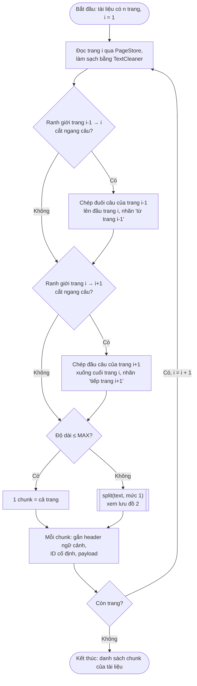
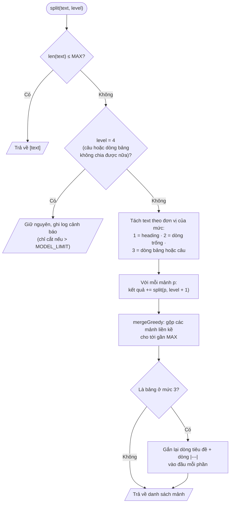

# Indexing pipeline (lập chỉ mục) — v1.10

> Ngày: 10/10/2026. Phạm vi: 6.690 trang `trang_NNN.md` của 278 tài liệu CTR.
> Luồng: `PageStore.read()` → `TextCleaner.clean()` → **chunk** → **embed** → upsert vào Qdrant → cập nhật `documents.ngay_embed`, `so_chunk`.
> Bản này chốt: **model embedding** (đổi sang `Qwen/Qwen3-Embedding-8B` qua DeepInfra, mục 1.6), **thuật toán chunk** (đã cài đặt, mục 2.11) và **lưu trữ trong Qdrant** (nguyên tắc ở mục 3, `QdrantIndexWriter` đã cài đặt và chạy test ở mục 3.9, nội dung một point ở mục 3.10). Các phần còn lại ở mục 5 mới là đề xuất.

## Thay đổi so với bản trước (v1.9)

- **Test `QdrantIndexWriter` đã chạy trên Qdrant thật** (Docker bật lại): 5/5 đạt. Sửa một lỗi trong bước dọn dẹp của test (mục 3.9.4).
- **Thêm enum cho giá trị payload** (`QdrantEnums`: `ElementType`, `Ky`, `PhamVi`, `LoaiTaiLieu`); tên trường payload gom vào `QdrantConstants`; `DocumentMetadata` dùng enum thay cho `String` (mục 3.9.1, 3.9.5).
- **Bốn mức cắt của `Chunking` đổi từ hằng số `int` sang enum `SplitLevel`** (mục 2.11.1). Thuật toán không đổi, 11 test vẫn đạt.
- **Thêm mục 3.10 — Một point chứa gì**: văn bản đem embed khác `noi_dung` ở chỗ nào, vector "chứa" tên tài liệu theo nghĩa nào, vì sao lưu nguyên chữ của chunk trong payload, dung lượng ước tính.
- Mục 3.8: thêm vị trí dự kiến của `DocumentIndexingService` và entity `Document`.
- `EmbeddingTrialRunner` dùng chung hàm `QdrantIndexWriter.elementType()` thay cho bản sao riêng.

(Thay đổi của v1.9 so với v1.8: đổi model embedding sang `Qwen/Qwen3-Embedding-8B` qua DeepInfra (mục 1.6); đổi tên collection thành `finq_pages_qwen3e8b`; thêm mục 3.9 cài đặt `QdrantIndexWriter`; cập nhật mục 3.8 và mục 5.)
(Thay đổi của v1.8 so với v1.7: thêm mục 1.5 (cài đặt embedding qua gateway Viettel AI, base64, lô 32, kết quả thử); mục 3.2 hạ tầng Qdrant đã làm (named volume); đánh dấu đã thử base64. Thay đổi của v1.7 so với v1.6: thêm mục 3 về Qdrant; chốt nguyên tắc payload (toạ độ và trường lọc nằm trong payload, không đem embed); contextual header chỉ gồm tên tài liệu; đánh số lại mục 4–6; cập nhật tên file sau khi tách `TextStitcher`/`TableStitcher`. Thay đổi của v1.6 so với v1.5: chốt và cài đặt gối tiêu đề bảng qua trang (mục 2.10, sửa 32 chỗ); thêm hai điều kiện loại trừ khi phát hiện câu bị cắt (202 → 194 chỗ); phân loại lại bảng vắt qua trang (304 chỗ); thêm mục 2.11 về cài đặt. Thay đổi của v1.5 so với v1.4: sửa mục 2.2.6, cả 33 đơn vị dài hơn trần đều là rác do OCR lặp; thêm số đo phạm vi lỗi OCR lặp. Thay đổi của v1.4 so với v1.3: đổi mức 4 thành "giữ nguyên câu hoặc dòng, ghi log cảnh báo"; thêm mục 2.2.6; làm rõ mức 2 và mức 3; hình minh hoạ mới `images/chunking-thuat-toan_v1.4.svg`.)

---

## 1. Model embedding — CHỐT: `Qwen/Qwen3-Embedding-8B` qua DeepInfra (từ 10/10/2026; trước đó `Qwen3-Embedding-4B` qua Viettel AI)

### 1.1. Các ứng viên trên gateway Viettel AI

Gateway là LiteLLM, tương thích OpenAI, endpoint `POST /v1/embeddings`. Mỗi model gọi 3 lần, lúc 16:19 ngày 06/10/2026.

| Model | Kết quả | Số chiều | Thời gian một input ngắn |
|---|---|---|---|
| `vai/VT-Embed-8B-v1` | 404 cả 3 lần | — | — |
| `vai/VT-Embed-4B-v1` | 404 cả 3 lần | — | — |
| `vai/VT-Embed-1B-v2` | Chạy | 2048 | 0,5–0,9 giây |
| **`Qwen3-Embedding-4B`** | **Chạy** | **2560** | 0,5–1,9 giây |

- Hai model VT-Embed 8B và 4B có tên trong `/v1/models` nhưng trả `default backend - 404`. Đây là lỗi của nginx ingress khi không có dịch vụ phía sau: gateway còn giữ tên model nhưng server chạy model đã tắt hoặc chưa triển khai. Lỗi ở phía nhà cung cấp, không phải do key hay request.
- Tên model phải viết **đúng** là `Qwen3-Embedding-4B`. Viết `Qwen/Qwen3-Embedding-4B` thì gateway báo `no healthy deployments`.
- `.env` đã đổi từ `EMBEDDING_MODEL=vai/VT-Embed-8B-v1` (hỏng) sang `EMBEDDING_MODEL=Qwen3-Embedding-4B`.

### 1.2. Lý do chọn

- **Đồng bộ họ model:** OCR dùng Qwen3-VL-32B, reranker tầng 2 dùng Qwen3-Reranker-4B. Embedding và reranker cùng họ Qwen3, được huấn luyện để dùng cặp với nhau.
- **Mạnh về đa ngôn ngữ,** gồm cả tiếng Việt.
- Là một trong hai model embedding đang chạy được. Ứng viên còn lại `VT-Embed-1B-v2` nhỏ hơn 4 lần.

**Giới hạn của quyết định:** chưa so sánh hai model trên dữ liệu thật. Nếu cần bằng chứng cho báo cáo thì làm thêm phép đo: khoảng 30 câu hỏi đã biết trang đáp án, khoảng 300 trang, so Recall@5 và MRR. Mỗi model mất chưa tới 1 phút.

### 1.3. Đặc tính đo được

| Đặc tính | Số đo | Hệ quả |
|---|---|---|
| Số chiều | 2560, vector đã chuẩn hoá (norm = 1,0000) | Collection Qdrant dùng `Cosine`. Với vector đã chuẩn hoá, cosine bằng tích vô hướng |
| Ký tự trên mỗi token | khoảng 1,94 (tiếng Việt có bảng số), đo trên 64 trang | 4.000 ký tự ≈ 2.060 token |
| Cửa sổ ngữ cảnh | 40.000 ký tự (20.214 token) vẫn chạy; 120.000 ký tự lỗi `ContextWindowExceeded` | Khoảng 32k token. Model không buộc phải cắt nhỏ |
| Bất đối xứng | Tài liệu embed nguyên văn. Câu hỏi thêm tiền tố `Instruct: <nhiệm vụ>\nQuery: <câu hỏi>` | Phía truy hồi phải thêm tiền tố, nếu không sẽ giảm độ chính xác |

**Kích thước batch** (input là các trang dài 2.000–2.600 ký tự):

| Batch | Tổng thời gian | Giây mỗi chunk |
|---|---|---|
| 1 | 0,67 | 0,674 |
| 8 | 1,40 | 0,175 |
| 16 | 2,62 | 0,164 |
| **32** | **3,15** | **0,098** |
| 64 | 15,14 | 0,237 |

→ **Batch 32.** Lên 64 thì chậm hẳn, có lẽ phía server phải xếp hàng. Ước tính 7.245 chunk, tức 226 request, chạy tuần tự **khoảng 12 phút** (OCR mất khoảng 4,6 giờ). Vì vậy không cần thread pool như OCR.

### 1.4. Quy tắc khi đổi model

Số chiều gắn chặt với collection. Đổi model thì phải tạo collection mới và embed lại toàn bộ. Vì thế:
- Tên model nằm trong `.env`, không viết cứng trong code.
- Tên collection ghi kèm tên model, ví dụ `finq_pages_qwen3e4b`.
- Đổi model cũng có thể làm đổi mức trần chunk (mục 2.6, cận trên).

### 1.5. Cài đặt embedding (08/10/2026)

#### 1.5.1. Các file

| File | Vai trò |
|---|---|
| `common/properties/EmbeddingProperties.java` | Khối `embedding:` trong `application.yml`: `api-url` (mặc định `https://viettelai.vn/model-as-a-service/v1/embeddings`, ghi đè được bằng `EMBEDDING_API_URL`), `api-key` (dùng chung `LLM_API_KEY`), `model` (`EMBEDDING_MODEL` trong `.env`), `dimensions: 2560`, `batch-size: 32`, `request-timeout: 120s`, `max-attempts: 3` |
| `indexing/embedder/EmbeddingClient.java` | Gọi `POST /v1/embeddings` cho **một lô**; nhận kết quả base64, giải mã thành `float[]`; thử lại khi lỗi; ghi log thời gian, token, chi phí |
| `indexing/embedder/Embedding.java` | Gắn **tên tài liệu** vào trước mỗi chunk (contextual header, mục 3.5), chia lô 32, gọi client. Có `embedQuery()` cho phía truy hồi |
| `indexing/embedder/EmbeddedChunk.java` | Class bất biến gói `chunk`, văn bản đã đem embed và `vector` |
| `config/testrunner/EmbeddingTrialRunner.java` | Chạy thử, không ghi gì vào Qdrant hay MySQL. Bật bằng `embedding.trial.enabled=true` |
| `src/test/.../embedder/EmbeddingClientTest.java` | 2 test cho hàm giải mã base64 (thứ tự byte little-endian). Đạt 2/2 |

#### 1.5.2. Quyết định thiết kế

| Quyết định | Lý do |
|---|---|
| **Xin kết quả dạng base64** (`encoding_format: "base64"`) | Đo 08/10/2026 trên cùng một vector: JSON số thực 55.016 byte, base64 **13.890 byte** (nhỏ hơn khoảng 4 lần), giải mã ra giống hệt (sai khác 0,0). Cả kho tải khoảng 100 MB thay vì khoảng 395 MB, quan trọng khi mạng chậm như lúc OCR |
| Giải mã base64 thành `float32` **little-endian** | Đúng định dạng chuẩn OpenAI. Đọc nhầm big-endian sẽ ra số rác; có test giữ cho thứ tự byte không bị đổi |
| Kết quả kiểu `List<float[]>` | `List` vì một lần gọi trả một vector cho mỗi văn bản trong lô, đúng thứ tự. `float[]` vì mỗi vector là 2.560 số float32: khoảng 73 MB cho cả kho, so với khoảng 147 MB nếu dùng `double[]` (không thêm độ chính xác vì model chỉ trả float32) và khoảng 300–370 MB nếu dùng `List<Float>` (mỗi số là một object) |
| **Sắp vector theo trường `index`** trong response | Không giả định gateway trả đúng thứ tự |
| **Kiểm tra số chiều** (phải đúng 2.560) và số vector (phải bằng số văn bản gửi đi) | Phát hiện sớm khi đổi model hoặc gateway trả thiếu |
| **Thử lại** tối đa 3 lần, nghỉ 2 giây × số lần thử, chỉ với lỗi mạng, HTTP 429 và 5xx | Lỗi tạm thời đáng thử lại; lỗi 4xx khác (sai key, sai tên model) thì thử lại vô ích nên dừng ngay |
| **Lô 32, không vượt qua ranh giới tài liệu** | 32 là kích thước nhanh nhất đã đo (mục 1.3). Chia lô theo từng tài liệu giúp ghi trạng thái `ngay_embed` gọn: một tài liệu hoặc xong trọn, hoặc làm lại từ đầu. Mỗi văn bản còn phải nằm trong cửa sổ khoảng 32k token của model; chunk dài nhất 12.035 ký tự (khoảng 6.200 token) nên luôn an toàn |
| **Ghi log chi phí** từ header `x-litellm-response-cost` sau mỗi lần gọi | Có số liệu chi phí API cho chương đánh giá |
| `embedQuery()` thêm tiền tố `Instruct: Given a question about a Vietnamese company's financial reports, retrieve the report pages that answer it\nQuery: ` | Qwen3-Embedding là model bất đối xứng: câu hỏi cần tiền tố mô tả nhiệm vụ, tài liệu thì không |

Ghi chú khi thử bằng `curl` trên Git Bash: gửi chữ tiếng Việt thẳng trong tham số `-d` làm gateway trả lỗi 500 ("missing input"). Gửi body bằng file UTF-8 thì chạy bình thường. Java luôn gửi UTF-8 nên không gặp lỗi này.

#### 1.5.3. Kết quả chạy thử

**Hai chunk có gối đầu**, gọi lẻ từng chunk:

| Chunk | Văn bản đem embed | Token | Thời gian |
|---|---|---|---|
| Gối văn bản: BC Ban điều hành ĐHĐCĐ 2021, trang 2 (`...Vốn chủ sở hữu tăng (tiếp trang 3) từ 867 tỷ lên 1.061 tỷ...`) | 2.247 ký tự, dòng đầu `[Báo cáo trình ĐHĐCĐ 2021 — ký ngày 02/04/2021]` | 1.011 | 918 ms |
| Gối tiêu đề bảng: BCTC hợp nhất quý 4/2023, trang 8 (`(tiêu đề bảng từ trang 7)` + tiêu đề `Mã số \| CHỈ TIÊU \| ... \| Quý IV/2023 VND \| ... \| Năm 2023 VND \| ...`) | 1.092 ký tự, dòng đầu `[Báo cáo tài chính hợp nhất quý 4 2023]` | 599 | 713 ms |

Cả hai vector đều 2.560 chiều, độ dài 1,0000. Tên tài liệu lấy từ `documents.ten_hien_thi`.

**Vector có tìm đúng chunk không** (cosine giữa câu hỏi đã gắn tiền tố và chunk):

| Câu hỏi | Chunk văn bản | Chunk bảng |
|---|---|---|
| "Vốn chủ sở hữu năm 2020 tăng từ bao nhiêu lên bao nhiêu?" | **0,5918** | 0,4465 |
| "Chi phí thuế TNDN hiện hành quý 4 năm 2023 là bao nhiêu?" | 0,4500 | **0,7289** |

Mỗi câu hỏi giống chunk "của nó" hơn hẳn chunk kia. Câu hỏi về vốn chủ sở hữu khớp được chunk trang 2 nhờ phần gối "từ 867 tỷ lên 1.061 tỷ".

**Một lô 32 chunk trong một lần gọi** (32 chunk đầu của BCTC hợp nhất quý 4/2023, ghi ra `backend/core-service/trial-embedding-32.txt`, mỗi vector kèm nhãn và metadata):

| Số đo | Giá trị |
|---|---|
| Thời gian | **829 ms** cho 32 chunk (khoảng 0,026 giây mỗi chunk; mạng lúc này nhanh hơn lúc đo ở mục 1.3) |
| Token | 33.943 (khoảng 1.060 token mỗi chunk, đã gồm tên tài liệu) |
| Chi phí | 27,15 theo đơn vị của gateway (khoảng 0,0008 mỗi token; gateway không ghi rõ đơn vị) |
| `element_type` tính thử | 26 `mixed`, 6 `text` |
| Chunk có gối đầu | 1 (trang 8, gối tiêu đề bảng) |

**Ước tính cho cả kho** (7.179 chunk, khoảng 225 lần gọi): khoảng **3–4 phút** nếu mạng như lúc thử, khoảng **7,6 triệu token**, chi phí khoảng **6.100 đơn vị** của gateway. Mạng chậm thì thời gian tăng theo; kết quả base64 giúp giảm phần tải về.

### 1.6. Đổi sang Qwen3-Embedding-8B qua DeepInfra (10/10/2026)

#### 1.6.1. Lý do

| Lý do | Chi tiết |
|---|---|
| Key Viettel AI hết credit | Từ 20:41 ngày 08/10/2026, mọi lượt gọi trả `budget_exceeded`; kiểm tra lại 10:19 ngày 10/10 vẫn vậy. Chi tiết ở `truy-hoi_v1.1.md` |
| Chọn nhà cung cấp | Đã cân nhắc thuê GPU (Vast.ai, ezycloudx), Alibaba Model Studio và DeepInfra. Chọn **DeepInfra**: rẻ nhất ở quy mô đề tài, có đủ embedding, reranker, LLM, model suy luận (xem `truy-hoi_v1.1.md`) |
| Chọn bản 8B | Theo bảng điểm của Qwen, MMTEB đa ngôn ngữ: 4B đạt 69,45 (truy hồi 85,05), 8B đạt **70,58** (truy hồi **86,40**). Trên DeepInfra bản 8B giá **0,010 USD / 1 triệu token**, bản 4B 0,020 |
| Đổi lúc này không tốn gì | Qdrant chưa có dữ liệu thật |

#### 1.6.2. Cấu hình

| Biến (`.env`) | Giá trị |
|---|---|
| `LLM_API_KEY` | Key DeepInfra, dùng chung cho embedding, rerank, LLM, OCR (code không phải sửa) |
| `EMBEDDING_API_URL` | `https://api.deepinfra.com/v1/openai/embeddings` (tương thích OpenAI) |
| `EMBEDDING_MODEL` | `Qwen/Qwen3-Embedding-8B` |
| `EMBEDDING_DIMENSIONS` | `4096` (biến mới; `application.yml` đọc vào `embedding.dimensions`) |
| `QDRANT_COLLECTION` | `finq_pages_qwen3e8b` |

`EmbeddingClient` không phải sửa: DeepInfra nhận cùng định dạng request và hỗ trợ `encoding_format: "base64"`.

#### 1.6.3. Kết quả thử

**Một câu** ("Vốn chủ sở hữu tăng từ 867 tỷ lên 1.061 tỷ", gọi bằng curl):

| Thông tin | Kết quả |
|---|---|
| Trạng thái, số chiều, độ dài | HTTP 200; **4.096 chiều**; độ dài 1,0000 |
| Token, thời gian | 21 token; khoảng 1,2 giây cho một lượt gọi lẻ (gồm đường mạng ra nước ngoài) |
| Base64 so với mảng số | **22.010 byte** so với 92.890 byte, nhỏ hơn khoảng 4 lần |

**Tính ổn định:** gọi dạng mảng số ba lần cho kết quả giống hệt (lệch 0); gọi lẻ hay trong lô hai câu cũng giống hệt; base64 và mảng số ở các lượt sau giống hệt (cosine 1,000000). **Riêng lượt base64 đầu tiên** cho vector hơi lệch (cosine 0,9978 so với các lượt khác), nhiều khả năng do rơi vào một máy chủ khác của DeepInfra lúc vừa khởi động. Độ lệch này rất nhỏ so với khoảng cách giữa câu hỏi và chunk khi tìm kiếm (0,4–0,7) nên không ảnh hưởng thực tế; ghi lại để nhận ra nếu gặp lại.

**Lô 32 chunk qua code Java** (`EmbeddingTrialRunner`, 10/10/2026 10:45): 32 chunk của BCTC hợp nhất quý 4/2023 trong **một lần gọi, 2.640 ms**, vector **4.096 chiều**, nhận dạng base64. Chi phí cả lần chạy (gồm 2 chunk gối đầu và 2 câu hỏi thử) khoảng 36.000 token, tức khoảng **0,00036 USD**.

**Ước tính cả kho:** khoảng 7,6 triệu token, khoảng **0,08 USD**.

## 2. Thuật toán chunk — CHỐT: đệ quy theo cấu trúc, gối đầu có chọn lọc, đơn vị gốc là trang

### 2.1. Các thuật toán đã cân nhắc

| Thuật toán | Đánh giá với kho này |
|---|---|
| Fixed-size | 65% trang có bảng. Cắt theo số ký tự là chắc chắn cắt giữa bảng |
| Semantic | So độ giống nhau giữa các câu liền kề, mà bảng số liệu không có câu. Vector của các dòng số gần như giống nhau nên ngưỡng không phân biệt được. Phải embed thêm từng câu, tức thêm hàng chục nghìn lượt gọi. Qu và cộng sự (NAACL Findings 2025) cũng kết luận chi phí của semantic chunking không đổi lại được cải thiện ổn định |
| LLM-based | 6.690 lượt gọi LLM, tương đương vài giờ như OCR, chỉ để quyết định chỗ cắt mà 94% trang vốn không cần cắt. Caspari và cộng sự (CIKM 2026) thấy các phương pháp tốn kém hiếm khi vượt được phương pháp đơn giản |
| Recursive thuần | Danh sách dấu phân cách `["\n\n", "\n", " ", ""]` không biết gì về bảng. Có thể cắt đôi bảng, nửa sau mất tiêu đề cột |
| Document structure thuần | Cắt theo heading cho chunk quá vụn (mục 2.3) |
| **Recursive + document structure** | **Chọn.** Giữ khung đệ quy, nhưng thay dấu phân cách bằng các đơn vị cấu trúc của markdown |

Cách ghép này tương tự `MarkdownHeaderTextSplitter` nối với `RecursiveCharacterTextSplitter` trong LangChain. Tên chung là *structure-aware recursive chunking*. Hướng này gần với **element-based chunking** của Jimeno Yepes và cộng sự (2024) trên báo cáo tài chính: chunk theo phần tử cấu trúc, mở chunk mới ở tiêu đề, giữ nguyên bảng.

### 2.2. Thuật toán

#### 2.2.0. Hình minh hoạ


| Bước | Trong hình | Làm gì |
|---|---|---|
| ① | Tài liệu → các trang | Chia tài liệu thành các trang t1 … tn. Mỗi trang là một file `trang_NNN.md` đã qua `TextCleaner` |
| ② | Vạch cam giữa các trang | **Gối đầu có chọn lọc:** chỉ ở ranh giới nào câu bị cắt ngang thì chép mẩu câu đó (khoảng 150 ký tự) sang trang kề bên. Trang đầu không gối phía trước, trang cuối không gối phía sau |
| ③ | Chọn một trang | Lần lượt lấy từng trang tᵢ (đã gối) |
| Ô kiểm tra | "độ dài > 4.000 ký tự?" | **KHÔNG** → giữ nguyên trang thành 1 chunk, sang trang tiếp theo. **CÓ** → bước ④ |
| ④ | Hai mảnh nhỏ | **Chia tiếp theo cấu trúc:** heading → khối (dòng trống) → dòng bảng hoặc câu. Câu hoặc dòng bảng nào tự nó vẫn dài hơn 4.000 thì **giữ nguyên**. Bảng bị cắt thì lặp lại dòng tiêu đề |
| Vòng lặp | "kiểm tra lại từng mảnh (đệ quy)" | Mảnh nào vẫn > 4.000 thì quay lại ô kiểm tra, và được chia ở mức mịn hơn |
| ⑤ | Gộp mảnh vụn | Khi mọi mảnh ≤ 4.000, gộp các mảnh nhỏ liền kề lại cho tới gần 4.000 |
| Kết quả | Kho chunk | Mọi chunk trọn câu, trọn dòng bảng, và ≤ 4.000 ký tự, trừ chunk chỉ gồm một câu hoặc một dòng quá dài (mục 2.2.6). Sau đó gắn header ngữ cảnh, ID cố định, payload, rồi đem embed |

#### 2.2.1. Ý tưởng

> **Chia theo cấu trúc từ thô đến mịn, đệ quy khi còn dài, gộp lại khi quá vụn, gối đầu ở đúng chỗ bị cắt, và luôn có điểm dừng.**

Thuật toán kết hợp ba thành phần:

| Thành phần | Vai trò | Nằm ở đâu |
|---|---|---|
| **Cấu trúc tài liệu** | Quyết định **cắt ở đâu**: trang, heading, khối, dòng bảng hoặc câu | Các mức 0–3 |
| **Đệ quy** | Quyết định **cắt tới khi nào**: phần còn > `MAX` thì xuống mức mịn hơn; dừng chắc chắn khi gặp câu hoặc dòng bảng (đơn vị nguyên tử); gộp mảnh vụn bằng `mergeGreedy` | Hàm `split` |
| **Gối đầu có chọn lọc** | Giữ **ngữ cảnh ở chỗ bị cắt**: nối câu qua trang, lặp tiêu đề bảng, (đề xuất) breadcrumb đề mục | Trước `split` (nối câu) và bên trong `split` (tiêu đề bảng) |

Các bước:

1. Chia tài liệu thành **các trang**. Ở ranh giới trang nào câu bị cắt ngang thì **gối mẩu câu đó** sang trang kề bên (mục 2.2.5). Không gối nguyên trang (lý do ở mục 2.8.2).
2. Trang ≤ `MAX` thì giữ nguyên thành **một chunk**.
3. Trang > `MAX` thì chia theo **đề mục** của trang đó, rồi xét từng phần.
4. Phần nào vẫn > `MAX` thì **đệ quy**: chia tiếp bằng đơn vị cấu trúc mịn hơn, cho tới khi mọi phần ≤ `MAX`, hoặc chỉ còn **một câu / một dòng bảng** không chia được nữa thì giữ nguyên.
5. Sau mỗi lần chia, **gộp các phần nhỏ liền kề** lại cho tới gần `MAX`, để không sinh chunk vụn. **Không gộp xuyên ranh giới trang** (lý do ở mục 2.8.1).

`MAX = 4.000` ký tự là **mức trần để quyết định có cắt hay không**, không phải độ dài mục tiêu.
- Trang ≤ MAX (94,3%) giữ nguyên, mỗi trang thành đúng một chunk. Chunk trung vị dài 2.276 ký tự.
- Chỉ trang > MAX (379 trang) mới đi vào đệ quy.
- Độ dài luôn đo **sau khi làm sạch**. Ví dụ ở mục 2.7.2: một trang thô dài 4.242 ký tự, sau khi làm sạch còn 3.388, nên không phải cắt.
- Lý do chọn con số 4.000: xem mục 2.5.

#### 2.2.2. Các mức cắt

| Mức | Đơn vị cắt | Khi nào xuống mức này |
|---|---|---|
| 0 | Trang | Luôn bắt đầu ở đây. Trang ≤ MAX thì là một chunk |
| 1 | Mục theo heading (`#`, `##`, ...) | Trang dài hơn MAX. Trang không có heading thì mức này trả về nguyên trang, và đệ quy xuống thẳng mức 2 |
| 2 | Khối: tách theo dòng trống **và** ở chỗ chuyển giữa dòng bảng (bắt đầu bằng `\|`) và dòng chữ. Ra đoạn văn, bảng, **từng gạch đầu dòng** | Một mục vẫn dài hơn MAX. Trong kho, các gạch đầu dòng thường cách nhau bởi dòng trống nên tách ở mức này. Tách ở chỗ chuyển bảng/chữ để một khối không bao giờ vừa có chữ vừa có bảng |
| 3 | **Bảng:** từng dòng của bảng, lặp lại dòng tiêu đề và dòng `\|---\|` ở đầu mỗi phần. **Văn xuôi:** tách theo **dòng** trước (gạch đầu dòng không có dấu chấm cuối vẫn tách được), rồi mới tách theo **câu** | Một khối vẫn dài hơn MAX |
| 4 | **Giữ nguyên** câu hoặc dòng bảng, ghi log cảnh báo. Chỉ cắt theo số ký tự khi vượt giới hạn của model (`MODEL_LIMIT`, khoảng 50.000 ký tự) | Một câu hoặc một dòng bảng tự nó dài hơn MAX. 33 trường hợp trong kho (mục 2.2.6) |

**Không dùng thụt đầu dòng làm mốc cắt.** Thụt lề do OCR sinh ra không ổn định: cùng một cấp mục, trang này thụt 2 dấu cách, trang kia thụt 4.

#### 2.2.3. Ba chi tiết bắt buộc

| Chi tiết | Vì sao | Thiếu thì sao |
|---|---|---|
| ① **Điều kiện dừng chắc chắn** (mức 4) | Một câu hoặc một dòng bảng > MAX là **đơn vị nguyên tử**: không còn mốc cấu trúc nào để chia mà vẫn giữ trọn câu. Mức 4 trả về nguyên đơn vị đó, nên đệ quy luôn dừng | Đệ quy lặp vô hạn, tràn stack. Nếu thay bằng cắt cứng thì câu bị cắt đôi |
| ② **Gộp tham lam** sau mỗi lần cắt | Cắt theo heading cho rất nhiều mảnh nhỏ (2.297 trang có từ 5 heading trở lên) | Trang 6.969 ký tự ở mục 2.7.1 thành 14 chunk, có chunk chỉ 23 ký tự (`# 36. BÁO CÁO BỘ PHẬN`), vector vô nghĩa. Có gộp thì còn 2 chunk |
| ③ **Nối câu qua trang**, làm trước khi xét độ dài | 202 ranh giới trang cắt ngang câu văn (mục 2.4) | Chủ ngữ nằm ở chunk này, con số nằm ở chunk kia. LLM có thể gán nhầm con số sang chỉ tiêu khác |

Thêm một quy tắc riêng cho bảng: **phải lặp lại tiêu đề bảng** ở đầu mỗi phần. Nếu không, phần sau của bảng chỉ còn con số mà không biết cột nào là "Số cuối kỳ", cột nào là "Số đầu năm".

#### 2.2.4. Lưu đồ

**Lưu đồ 1 — Chunk một tài liệu** (`chunkDocument`)



**Lưu đồ 2 — Hàm đệ quy** `split(text, level)`



Lưu đồ viết bằng Mermaid. GitHub hiển thị trực tiếp; trong VS Code cần extension xem trước Mermaid.

#### 2.2.5. Mã giả

```
// ---------- cả tài liệu ----------
chunkDocument(pages[1..n]):
    chunks = []
    for i in 1..n:
        text = pages[i]                                   // đã qua TextCleaner
        if continues(pages[i-1], pages[i]):
            text = "(từ trang " + (i-1) + ") " + tail(pages[i-1]) + "\n\n" + text
        if continues(pages[i], pages[i+1]):
            text = text + "\n\n(tiếp trang " + (i+1) + ") " + head(pages[i+1])
        for (part, k) in split(text, level = 0):          // trang ≤ MAX thì trả về đúng 1 phần
            chunks.add(Chunk(page = i, part = k, text = part))
    return chunks

// ---------- đệ quy ----------
split(text, level):
    if len(text) <= MAX:   return [text]                  // dừng: đủ nhỏ
    if level == 4:                                        // câu hoặc dòng bảng không chia được nữa
        if len(text) <= MODEL_LIMIT:                      // khoảng 50.000 ký tự
            log.warn("chunk vượt trần", tài liệu, trang, len(text))
            return [text]                                 // giữ nguyên: vượt trần nhưng trọn vẹn
        return cutByChars(text, MODEL_LIMIT)              // lưới an toàn, kho hiện tại không chạm tới
    if level == 3 and isTable(text):
        return splitTable(text)                           // cắt bảng, lặp tiêu đề
    pieces = splitBy(UNIT[level], text)                   // 1: heading, 2: dòng trống, 3: câu
    result = []
    for p in pieces:
        result += split(p, level + 1)
    return mergeGreedy(result, MAX)

// ---------- gộp tham lam ----------
mergeGreedy(pieces, max):
    out = [], cur = ""
    for p in pieces:                                      // giữ nguyên thứ tự, chỉ gộp mảnh liền kề
        if cur == "":                       cur = p
        else if len(cur) + 2 + len(p) <= max:   cur = cur + "\n\n" + p   // tính cả 2 ký tự nối
        else:                               out.add(cur); cur = p
    if cur != "": out.add(cur)
    return out

// ---------- cắt bảng ----------
splitTable(table):
    header = 2 dòng đầu (dòng tiêu đề + dòng |---|)
    rows   = các dòng còn lại
    budget = MAX - len(header) - 1
    parts  = mergeGreedy(rows, budget) (nối bằng "\n" thay vì "\n\n")
    return [header + "\n" + part for part in parts]       // phần nào cũng có tiêu đề cột
                                                          // một dòng > budget thì đứng riêng một phần (giữ nguyên, như mức 4)
```

**Nối câu qua trang** (`continues`, `tail`, `head`):

| Hàm | Quy tắc |
|---|---|
| `continues(N, N+1)` | Đúng khi **cả hai** điều kiện thoả: (a) dòng cuối của trang N (bỏ qua dòng chỉ có số trang) không phải dòng bảng, heading, **dòng kẻ ngang `---`** hay **dòng in nghiêng/đậm `*...*`**, và không kết thúc bằng `. : ; ! ? ) ” "`; (b) dòng đầu của trang N+1 không phải bảng, heading, gạch đầu dòng, và bắt đầu bằng **chữ thường** |
| `tail(N)` | Phần của dòng cuối trang N tính từ dấu kết thúc câu cuối cùng tới hết. Không có dấu kết thúc câu thì lấy cả dòng |
| `head(N+1)` | Phần từ đầu trang N+1 tới dấu kết thúc câu đầu tiên |
| Giới hạn | Mỗi phần nối tối đa **500 ký tự** (giá trị ban đầu), cắt tại khoảng trắng gần nhất, để một đoạn văn rất dài không kéo theo cả trang |

- **Bẫy dấu chấm phân cách nghìn:** dấu kết thúc câu là `.` `!` `?` **đứng ngay trước khoảng trắng hoặc cuối dòng**. Nếu cắt ở dấu `.` đầu tiên thì `"từ 867 tỷ lên 1.061 tỷ"` thành `"từ 867 tỷ lên 1"` (đã chạy thử).
- **Nối câu trước, xét độ dài sau:** phần nối trở thành khối đầu hoặc khối cuối của trang, nên đệ quy và bước gộp vẫn giữ được trần `MAX`.
- **Nhãn `(từ trang N)` / `(tiếp trang N)`** giúp LLM trích dẫn đúng trang chứa con số. Độ chính xác trích dẫn là một tiêu chí đánh giá.
- **Chi phí:** 202 chỗ × khoảng 250 ký tự ≈ 50.000 ký tự, khoảng 0,3% toàn kho.
- **Bỏ sót chấp nhận được:** câu bị cắt mà trang sau mở đầu bằng chữ hoa (tên riêng, ví dụ "Công ty", "Viettel") thì không phát hiện được. Lưới an toàn là lấy kèm trang N±1 ở phía truy hồi.
- **Độ chính xác (đo 07/10/2026):** luật ban đầu phát hiện 202 chỗ, trong đó 8 chỗ báo nhầm vì trang trước kết thúc bằng ghi chú in nghiêng `*Xem thông tin chi tiết tại Thuyết minh số 35*`. Thêm hai điều kiện loại trừ (dòng kẻ ngang, dòng in nghiêng/đậm) thì còn **194 chỗ**. Lấy ngẫu nhiên 8 chỗ để đọc: **cả 8 đều đúng**, kể cả chỗ cắt giữa một từ (`...Phạm` | `vi, nội dung...`) và tài liệu tiếng Anh.
- **Phương án nâng cấp đã thử và loại:** bỏ qua phần đầu trang lặp lại (tên công ty, tên báo cáo) ở trang N+1 rồi mới xét điều kiện (b). Số phát hiện tăng từ 202 lên 350, nhưng hai ví dụ đầu đều **báo nhầm**: dòng tưởng là câu tiếp nối thực ra là dòng thứ 4 của chính đầu trang lặp ("kỳ kế toán từ ngày 01/01/2019..."). Bài học: kiểm tra độ chính xác, không chỉ nhìn số lượng tăng.

#### 2.2.6. Đơn vị nguyên tử dài hơn trần

Đơn vị nguyên tử là đơn vị nhỏ nhất mà cấu trúc còn cho phép chia mà vẫn trọn vẹn: **một câu** (văn xuôi) hoặc **một dòng** (bảng). Đệ quy không chia nhỏ hơn được nữa. Đo trên toàn kho, sau khi làm sạch, với đúng định nghĩa của mức 2 và mức 3:

| Đơn vị | Số lượng | Dài hơn 4.000 ký tự |
|---|---|---|
| Khối (mức 2) | 78.911 | 76 (đệ quy xuống mức 3 xử lý) |
| Dòng bảng | 106.642 | **30** |
| Dòng chữ | 110.898 | 3 |
| Câu | 145.489 | **3** |

→ **33 đơn vị nguyên tử** dài hơn trần, trên khoảng 252.000 đơn vị (0,013%). Đơn vị dài nhất là 12.035 ký tự, khoảng 6.200 token, vẫn nằm xa giới hạn khoảng 32k token của model.

**Kiểm tra từng trường hợp: cả 33 đều là rác do OCR lặp, không có trường hợp nào là nội dung thật.**

| Nhóm | Số lượng | Ví dụ | Thực chất |
|---|---|---|---|
| Dòng bảng gồm hàng nghìn ô rỗng | 28 dòng | `BCTC-hop-nhat-ban-nien-2026_upweb/trang_045.md`: 12.035 ký tự, 5.977 ô, chỉ hai ô đầu có chữ (tên công ty, tên báo cáo) | `\| \| \| \| ...` lặp đi lặp lại |
| Dòng kẻ bảng dài bất thường | 2 dòng (khoảng 6.400 ký tự) | `NQ-DHDCD-2020/trang_006.md`, `CBTT-phat-hanh-CP-kem-TB-NQ/trang_005.md` | `\|----\|------...` với hàng nghìn dấu gạch |
| "Câu" là mã số doanh nghiệp | 3 (khoảng 5.300–5.500 ký tự) | `BCTC_HN_300925_VIEENG/trang_006.md`, `Bien-ban-DHDCD-thuong-nien-2026-kem-tai-lieu/trang_080.md`, `TV_BB-NQ-DHDCD-2026-full/trang_090.md` | `M.S.D.N: 0101000000...` với hàng nghìn chữ số 0 |

Đây là hiện tượng model sinh văn bản **bị kẹt vào vòng lặp**, cứ lặp lại một ký tự hoặc một mẫu cho tới khi hết `max_tokens`.

**Kết luận về mức 4:** trong kho hiện tại **không có câu hay dòng bảng thật nào dài hơn 4.000 ký tự**. Với nội dung thật, đệ quy xuống tới mức câu hoặc dòng thì luôn ≤ 4.000. Mức 4 ("giữ nguyên, ghi log cảnh báo") vẫn giữ làm điều kiện dừng và làm **cảm biến phát hiện lỗi OCR**: mỗi lần mức 4 kích hoạt gần như chắc chắn là một trang cần kiểm tra lại.

**Phạm vi lỗi OCR lặp trên toàn kho** (đo trên file `.md` thô):

| Dấu hiệu | Số trang | Độ tin cậy |
|---|---|---|
| Một ký tự lặp ≥ 100 lần liên tiếp (`000...`, `---...`) | 31 | Gần như chắc chắn là lỗi |
| ≥ 50 ô bảng rỗng liên tiếp | 28 | Gần như chắc chắn là lỗi |
| Một cụm 2–20 ký tự lặp ≥ 30 lần | 133 (thuộc 58 tài liệu, bao gồm cả hai nhóm trên) | **Cần xem mẫu.** Có thể gồm cả dấu chấm dẫn dòng trong mục lục (`. . . .`) hoặc bảng rất nhiều cột |

**Việc cần làm (chưa chốt):**
1. **Luật làm sạch mới:** rút gọn chuỗi lặp (ô rỗng liên tiếp, một ký tự lặp hàng trăm lần). Phải đi theo quy trình thêm luật ở `lam-sach_v1.1.md`, mục 2.6: đo, xem mẫu, kiểm tra không phá bảng. Lưu ý dòng kẻ `|---|` hợp lệ cũng là ký tự lặp, nên luật chỉ được rút gọn chứ không được xoá.
2. **OCR lại các trang lỗi:** trang bị kẹt vòng lặp **có thể đã mất nội dung thật**. Ví dụ mã số doanh nghiệp đúng không còn đọc được, và phần bảng phía sau chỗ kẹt có thể không được OCR. Nên đối chiếu với PDF gốc rồi OCR lại riêng các trang đó (vài chục trang, chi phí nhỏ). Có thể thêm tham số chống lặp khi gọi model (ví dụ `repetition_penalty` hoặc `frequency_penalty`, nếu gateway hỗ trợ).

### 2.3. Số đo làm căn cứ (sau khi làm sạch)

| Số đo | Giá trị |
|---|---|
| Kích thước trang | Trung vị 2.276 ký tự, p75 2.895, p90 3.448, p95 4.290, p97 6.026, p99 8.364, lớn nhất 14.998 |
| Token ước tính | Trung vị khoảng 1.170, p99 khoảng 4.300, lớn nhất khoảng 7.700 |
| Trang dài hơn 4.000 | 379 (5,7%). Chỉ các trang này dùng tới đệ quy |
| Bảng đơn lẻ dài hơn 4.000 | 69 (phải xuống mức 3, cắt theo dòng bảng) |
| Đoạn văn đơn lẻ dài hơn 4.000 | 7 |
| Số chunk ước tính | 7.245 |
| Số heading mỗi trang | 0: 1.948 trang · 1: 294 · 2: 507 · 3: 958 · 4: 686 · 5 trở lên: **2.297** |

**Vì sao đơn vị gốc là trang mà không phải mục theo heading:**
- 2.297 trang có từ 5 heading trở lên. Cắt theo heading thì mỗi chunk trung bình chỉ khoảng 450 ký tự, quá ngắn, mất ngữ cảnh.
- Trích dẫn tính theo trang ("trang 12 của BCTC hợp nhất Q1/2019"). `documents` và `PageStore` cũng tổ chức theo trang.
- Trang là đơn vị tự nhiên của đầu ra OCR: mỗi trang một file, một lần gọi model.

### 2.4. Điểm yếu đã biết

Trang là ranh giới **vật lý**, không phải ranh giới **logic**. Trên **6.412 cặp trang liền kề** của kho:

| Hiện tượng | Số ranh giới | Đã xử lý chưa |
|---|---|---|
| Câu văn bị cắt ngang (trang trước không có dấu kết thúc câu, trang sau mở đầu bằng chữ thường) | **194** (3,0%) | **Có**, bằng nối câu qua trang (mục 2.2.5) |
| Bảng chạy tiếp sang trang sau (dòng cuối trang trước và dòng đầu trang sau đều là dòng bảng) | **304** (4,7%) | **Một phần**: 32 chỗ nguy hiểm đã sửa (mục 2.10), 111 chỗ không cần sửa, 161 chỗ không chắc là cùng bảng nên giữ nguyên |

(Bản v1.5 ghi 202 và 324. Số 194 là sau khi thêm điều kiện loại trừ; số 304 là sau khi bỏ dòng số trang và đếm theo khối bảng cuối trang, chặt hơn cách đếm cũ.)

Cách giảm cho phần chưa xử lý:
1. **Contextual header** gắn trước mỗi chunk khi embed (mục 3.5).
2. Phía truy hồi: lấy trúng trang N thì lấy kèm trang N−1 và N+1 làm ngữ cảnh cho LLM ("truy hồi bằng đơn vị nhỏ, trả về ngữ cảnh rộng"). Wang và cộng sự (EMNLP 2024) gọi kỹ thuật này là *small2big* và ghi nhận nó cải thiện độ trung thực của câu trả lời.

### 2.5. Vì sao chọn 4.000 ký tự

#### 2.5.1. Quy đổi đơn vị

| | Ký tự | Từ (âm tiết) | Token Qwen3 | Trang A4 chữ |
|---|---|---|---|---|
| Trang chữ trung vị (không bảng, 2.328 trang) | 2.437 | 479 | khoảng 1.250 | 1 |
| Trang trung vị (toàn kho) | 2.276 | 356 | khoảng 1.170 | — |
| **Mức trần MAX** | **4.000** | **khoảng 800** (văn xuôi, 5,02 ký tự/từ) đến 650 (có bảng, 6,15 ký tự/từ) | **khoảng 2.060** | **khoảng 1,6** |
| Trang vượt MAX (trung vị) | — | 918 | — | khoảng 2 |

- Tiếng Việt khoảng **1,94 ký tự mỗi token**, tiếng Anh khoảng 4. Cùng một nội dung, tiếng Việt tốn gần gấp đôi token.
- Các nghiên cứu (mục 6) đo chunk bằng **token tiếng Anh**, khoảng 0,75 từ mỗi token. Vì vậy muốn so với nghiên cứu thì phải so theo **lượng nội dung (số từ)**, không so số token:
  - 512 token tiếng Anh ≈ 380 từ.
  - 1.024 token tiếng Anh ≈ 770 từ.
  - Chunk của ta: trung vị 356–479 từ, trần 650–800 từ. Tức là **trong khoảng 512–1.024 token tiếng Anh tương đương**.

#### 2.5.2. Lập luận từ phân bố của tập hiện tại

Tỉ lệ trang bị cắt theo từng mức trần:

| Mức trần | Số trang bị cắt | Tỉ lệ |
|---|---|---|
| 2.000 | 4.280 | 64,0% |
| 3.000 | 1.459 | 21,8% |
| 3.500 | 619 | 9,3% |
| **4.000** | **379** | **5,7%** |
| 5.000 | 267 | 4,0% |
| 6.000 | 206 | 3,1% |
| 8.000 | 85 | 1,3% |

- **Đường gãy ở khoảng 3.000–4.000.** Từ 3.000 lên 4.000, số trang bị cắt giảm 1.080. Từ 4.000 lên 6.000 chỉ giảm thêm 173, trong khi chunk lớn nhất phình từ khoảng 2.060 lên 3.100 token. Vậy 4.000 là điểm mà tăng tiếp gần như không còn lợi.
- **Cận dưới: phải lớn hơn p90 (3.448).** Trang là đơn vị trích dẫn. Nếu trần thấp hơn thì hàng nghìn trang bình thường bị cắt đôi, mỗi nửa mất ngữ cảnh của nửa kia.
- **Cận trên: các trang vượt 4.000 là trang bất thường.** Trung vị 918 từ, khoảng hai trang A4 dồn vào một trang (chữ nhỏ, nhiều bảng), tức nhiều chủ đề trên một trang. Nhồi vào một vector thì vector bị pha loãng: câu hỏi chỉ khớp một bảng sẽ cho điểm thấp vì vector trộn ba, bốn bảng.

#### 2.5.3. Đối chiếu với các nghiên cứu

| Nghiên cứu | Kết quả liên quan | Hệ quả cho FinQuery |
|---|---|---|
| Jimeno Yepes và cộng sự (2024), **báo cáo tài chính** (FinanceBench, 141 câu hỏi, 80 tài liệu) | Chunk cố định 128 / 256 / 512 token cho độ chính xác Q&A 35,46% / 36,88% / 48,23%. Chunk theo phần tử cấu trúc (giữ bảng nguyên, mở chunk mới ở tiêu đề, **tối thiểu 2.048 ký tự**) đạt **53,19%** | Gần nhất với bài toán của ta. Ủng hộ cả hai quyết định: theo cấu trúc, giữ bảng nguyên, chunk khoảng vài nghìn ký tự. Chunk to hơn thì tốt hơn chunk nhỏ trên báo cáo tài chính |
| Wang và cộng sự (EMNLP 2024) | Thử 128–2.048 token. Faithfulness: 512 → 97,59; 1.024 → 94,26; **2.048 → 80,37** | Chunk quá lớn thì giảm rõ. Trần của ta khoảng 1.024 token tiếng Anh tương đương, nằm dưới vùng giảm mạnh |
| Bhat và cộng sự (2025, preprint) | Câu hỏi dữ kiện ngắn hợp với 64–128 token. Câu hỏi cần ngữ cảnh rộng hợp với 512–1.024 token. Tuỳ cả model embedding | Không có kích thước tối ưu chung. Mảng E (giải trình kế hoạch và thực hiện) cần ngữ cảnh rộng. Câu hỏi tra một con số thì có lợi khi chunk nhỏ hơn |
| Chen và cộng sự (EMNLP 2024), Dense X Retrieval | Đơn vị truy hồi mịn (mệnh đề) vượt đơn vị đoạn | Phản biện đáng ghi: với câu hỏi tra một con số, chunk cả trang có thể kém chính xác. Ta bù bằng reranker hai tầng và small2big |
| Liu và cộng sự (TACL 2024), Lost in the Middle | LLM dùng thông tin ở đầu và cuối ngữ cảnh tốt hơn ở giữa | Chunk to nhân top-k thì ngữ cảnh dài. Phải giới hạn top-k và đưa chunk điểm cao lên đầu |
| Caspari và cộng sự (CIKM 2026) | Phương pháp tốn kém hiếm khi vượt phương pháp đơn giản. Gắn tiêu đề tài liệu vào chunk (enriched title) là cải thiện rẻ và ổn định | Ủng hộ việc không dùng semantic hay LLM chunking, và ủng hộ contextual header |
| Shaukat và cộng sự (2026, preprint) | Không có chiến lược chunk tối ưu cho mọi lĩnh vực. Chọn chiến lược chunk ảnh hưởng nhiều hơn số chiều của model | Mức trần phải suy ra từ dữ liệu của mình, không chép con số của người khác |

**Kết luận:** 4.000 là **giá trị ban đầu có căn cứ**, chưa phải giá trị tối ưu đã kiểm chứng trên FinQuery. Khi có bộ câu hỏi đánh giá (`danh-gia`) thì thử 3.000 / 4.000 / 6.000, so Recall@5, MRR và độ chính xác câu trả lời, rồi chọn theo số đo.

### 2.6. Khi tập tài liệu thay đổi

#### 2.6.1. Công thức chọn mức trần

```
MAX = điểm gãy của đường "tỉ lệ trang bị cắt", thường rơi vào p90–p95 độ dài trang sau khi làm sạch
      và phải thoả: CẬN_DƯỚI ≤ MAX ≤ CẬN_TRÊN
```

| Cận | Giá trị | Căn cứ |
|---|---|---|
| Dưới | khoảng 2.000 ký tự (khoảng một trang A4 chữ) | Thấp hơn thì phần lớn trang bị cắt (64% ở mức 2.000). Jimeno Yepes và cộng sự dùng tối thiểu 2.048 ký tự trên báo cáo tài chính |
| Trên, theo nội dung | khoảng 800 từ, tức khoảng 1.024 token tiếng Anh tương đương | Wang và cộng sự: 2.048 token giảm faithfulness rõ rệt |
| Trên, theo model embedding | `0,8 × cửa sổ ngữ cảnh × số ký tự/token` | Không được vượt model. Hiện tại khoảng 32k × 1,94 × 0,8, rất xa, không ràng buộc |
| Trên, theo reranker | `(giới hạn đầu vào của reranker − token câu hỏi) × số ký tự/token` | Chunk dài hơn sẽ bị reranker cắt mất phần cuối. **Chưa đo giới hạn của bge-reranker trên gateway** |

#### 2.6.2. Các tình huống

| Tình huống | Nâng hay hạ | Làm gì |
|---|---|---|
| Thêm tài liệu khiến trang dài hơn (BCTN in chữ nhỏ, phụ lục bảng dày) | Giữ, hoặc nâng nhẹ | Tính lại phân vị. Nếu điểm gãy dịch lên thì nâng, nhưng không vượt cận trên. Trang dày đã được đệ quy cắt theo cấu trúc |
| Thêm tài liệu trang ngắn (nghị quyết, tờ trình, công bố thông tin) | **Không hạ** | Trang ngắn vốn đã là một chunk. Hạ trần không làm thay đổi chúng mà chỉ cắt thêm trang dài |
| DOCX/XLSX (không có trang vật lý) | Giữ cùng giá trị | `DocxDocumentExtractor` đã chia đơn vị theo `MAX_UNIT_CHARS = 4000`. Hai hằng số nên dùng chung một cấu hình. Sheet XLSX lớn sẽ được cắt theo dòng bảng và lặp lại tiêu đề |
| Câu hỏi chủ yếu là tra một con số | Hạ (khoảng 3.000–3.500), hoặc giữ và dùng small2big | Bhat và cộng sự, Chen và cộng sự: câu hỏi dữ kiện hợp với đơn vị nhỏ |
| Câu hỏi chủ yếu là tổng hợp, giải trình (mảng E, BCTN) | Nâng (khoảng 5.000–6.000) | Bhat và cộng sự: câu hỏi cần ngữ cảnh rộng hợp với chunk lớn hơn. Không vượt cận trên |
| Đổi model embedding có cửa sổ ngắn (ví dụ 512 token) | Hạ bắt buộc | 512 × 1,94 × 0,8 ≈ 800 ký tự, nhỏ hơn một trang. Khi đó đơn vị gốc không còn là trang được nữa, phải thiết kế lại (gốc là khối) |
| Reranker cắt đầu vào ngắn (ví dụ 512 token) | Hạ, hoặc đổi cách rerank | Hoặc hạ trần, hoặc chấm điểm reranker trên từng cửa sổ con của chunk rồi lấy điểm cao nhất |
| Thêm tài liệu tiếng Anh | Giữ | Tiếng Anh khoảng 4 ký tự/token, cùng 4.000 ký tự chỉ khoảng 1.000 token. Đo bằng ký tự giữ lượng nội dung gần như không đổi |

#### 2.6.3. Dấu hiệu cần xem lại mức trần

- Truy hồi trúng **đúng tài liệu nhưng sai trang hoặc sai phần** → chunk quá to, xem xét hạ.
- Điểm rerank của các chunk dài thấp bất thường → có thể reranker đang cắt mất phần cuối.
- LLM thường xuyên phải dùng trang N±1 mới trả lời được → chunk quá nhỏ hoặc đang cắt sai chỗ, xem xét nâng.

#### 2.6.4. Quy trình đổi mức trần

1. Đo lại phân bố độ dài trang sau khi làm sạch (phân vị và bảng tỉ lệ trang bị cắt như mục 2.5.2).
2. Chọn ba ứng viên: 0,75 × / 1 × / 1,5 × điểm gãy, đều nằm trong cận.
3. Chạy bộ câu hỏi đánh giá, so Recall@5, MRR và độ chính xác câu trả lời.
4. Mở bản log mới, ghi số đo và lý do.
5. Đặt `documents.ngay_embed = NULL` rồi chạy lại indexing. Point ID cố định nên upsert sẽ ghi đè. Riêng các phần thừa khi số phần của một trang giảm đi thì được dọn bằng bước xoá theo `tai_lieu_id` ở mục 3.7.

### 2.7. Ví dụ chạy tay

#### 2.7.1. Trang dài, nhiều heading: đệ quy mức 1 rồi gộp

`02_bao_cao_thuong_nien/2020/thuong_nien/BaoCaoThuongNien_2020_Final-5/trang_040.md`: thuyết minh BCTC, **6.969 ký tự** sau khi làm sạch.

- **Mức 0:** 6.969 > 4.000, phải cắt.
- **Mức 1:** tách theo heading, được 14 mảnh. Mảnh nào cũng ≤ 4.000, nên không đệ quy sâu hơn.

| Mảnh | Ký tự | Cộng dồn | Gộp vào |
|---|---|---|---|
| `# 34. CÔNG CỤ TÀI CHÍNH (tiếp theo)` | 545 | 545 | Chunk 1 |
| `## Quản lý rủi ro tài chính` | 412 | 957 | Chunk 1 |
| `### Rủi ro thị trường` | 136 | 1.093 | Chunk 1 |
| `#### Rủi ro về tỷ giá hối đoái` | 317 | 1.410 | Chunk 1 |
| `#### Rủi ro về lãi suất` | 464 | 1.874 | Chunk 1 |
| `### Rủi ro tín dụng` (có bảng 10 dòng) | 800 | 2.674 | Chunk 1 |
| `# 34. CÔNG CỤ TÀI CHÍNH (tiếp theo)` | 37 | 2.711 | Chunk 1 |
| `## Rủi ro thanh khoản` (có bảng 11 dòng) | 1.277 | **3.988** | Chunk 1 |
| `# 35. NHỮNG SỰ KIỆN PHÁT SINH SAU NGÀY KẾT THÚC NĂM` | 217 | 3.988 + 217 = 4.205 > 4.000 → chốt chunk 1, bắt đầu chunk 2 | Chunk 2 |
| `# 36. BÁO CÁO BỘ PHẬN` | **23** | | Chunk 2 |
| `## Theo lĩnh vực kinh doanh` | 56 | | Chunk 2 |
| `## Theo khu vực địa lý` (có bảng) | 368 | | Chunk 2 |
| `# 37. NGHIỆP VỤ VÀ SỐ DƯ VỚI CÁC BÊN LIÊN QUAN` | 170 | | Chunk 2 |
| `## Giao dịch phát sinh trong năm` (bảng 23 dòng) | 2.147 | **2.981** | Chunk 2 |

- **Kết quả:** 2 chunk (3.988 và 2.981 ký tự) thay vì 14. Chunk 1 trọn vẹn thuyết minh 34 (rủi ro tài chính), chunk 2 là thuyết minh 35–37. Chỗ cắt trùng với ranh giới ý nghĩa của tài liệu, dù thuật toán không hiểu nội dung, nhờ cắt ở heading.
- **Nếu một mảnh vẫn quá dài**, chẳng hạn bảng "Giao dịch phát sinh trong năm" dài 5.000 ký tự: mức 2 tách thành khối đoạn văn và khối bảng; khối bảng vẫn > 4.000 nên mức 3 cắt theo dòng thành hai phần khoảng 2.500 ký tự, **mỗi phần đều gắn lại tiêu đề cột**.

#### 2.7.2. Câu bị cắt ngang qua hai ranh giới trang: nối câu

`03_dai_hoi_dong_co_dong/2021/bao_cao/04.-BC-BDH/` (Báo cáo Ban điều hành trình ĐHĐCĐ 2021), trang 2 → 3 → 4.

```
...cuối trang 2:
- Các chỉ số tài chính đạt kế hoạch, đảm bảo ở mức an toàn (Dòng tiền cho hoạt động
  SXKD dương 163,5 tỷ (~ 15,4% vốn chủ sở hữu); Vốn chủ sở hữu tăng
════════════════════════ hết trang 2 ════════════════════════
từ 867 tỷ lên 1.061 tỷ; Ngày tồn kho bình quân là 31,5 ngày; ...; Hệ số nợ/tổng tài sản 0,73 lần).
...
- Chuyển đổi số ... Đưa vào sử dụng hệ thống BI & DW ... số hóa hệ thống báo cáo
════════════════════════ hết trang 3 ════════════════════════
đảm bảo trực quan, hỗ trợ cho các đơn vị trong việc kiểm soát, điều hành hoạt động SXKD.
```

**Chạy tay lần 1, chưa nối câu:**

| Trang | Thô | Sau khi làm sạch | So với MAX | Kết quả |
|---|---|---|---|---|
| 2 | 2.402 | 2.035 | ≤ 4.000 | 1 chunk |
| 3 | 4.242 | **3.388** | ≤ 4.000 | 1 chunk (nhờ làm sạch nên không phải cắt) |
| 4 | — | 3.096 | ≤ 4.000 | 1 chunk |

Vấn đề: chunk trang 2 có "Vốn chủ sở hữu tăng" nhưng **không có số**; chunk trang 3 có "từ 867 tỷ lên 1.061 tỷ" nhưng **không có chủ ngữ**. Với câu hỏi *"Vốn chủ sở hữu năm 2020 tăng từ bao nhiêu lên bao nhiêu?"*:
- Vector của chunk trang 3 không chứa "vốn chủ sở hữu" nên khó được truy hồi.
- Nếu truy hồi được, LLM thấy con số mà không biết của chỉ tiêu nào, nên có thể gán nhầm sang doanh thu.

**Chạy tay lần 2, có nối câu:**

| Ranh giới | Điều kiện (a): cuối trang trước | Điều kiện (b): đầu trang sau | Đuôi | Đầu |
|---|---|---|---|---|
| 2 → 3 | "...Vốn chủ sở hữu tăng": không có dấu kết thúc | "từ 867 tỷ...": chữ thường | 149 ký tự | 148 ký tự |
| 3 → 4 | "...số hóa hệ thống báo cáo": không có dấu kết thúc | "đảm bảo trực quan...": chữ thường | 118 ký tự | 88 ký tự |

```
Chunk trang 2 (≈ 2.200 ký tự):
  ... - Các chỉ số tài chính đạt kế hoạch, ... Vốn chủ sở hữu tăng
  (tiếp trang 3) từ 867 tỷ lên 1.061 tỷ; ...; Hệ số nợ/tổng tài sản 0,73 lần).   ← +148

Chunk trang 3 (≈ 3.650 ký tự):
  (từ trang 2) - Các chỉ số tài chính đạt kế hoạch, ... Vốn chủ sở hữu tăng       ← +149
  từ 867 tỷ lên 1.061 tỷ; ... (nội dung trang 3) ... số hóa hệ thống báo cáo
  (tiếp trang 4) đảm bảo trực quan, ... điều hành hoạt động SXKD.               ← +88

Chunk trang 4 (≈ 3.230 ký tự):
  (từ trang 3) Đưa vào sử dụng hệ thống BI & DW ... số hóa hệ thống báo cáo       ← +118
  đảm bảo trực quan, ... (nội dung trang 4)
```

Cả chunk trang 2 lẫn chunk trang 3 đều có trọn câu "Vốn chủ sở hữu tăng từ 867 tỷ lên 1.061 tỷ". Cả ba chunk vẫn ≤ 4.000.

#### 2.7.3. Trang không có heading: đệ quy rơi thẳng xuống mức 2

Lấy trang 3 ở trên (3.388 ký tự, **0 heading**). Với MAX thật thì trang này không phải cắt. Để thấy đệ quy chạy, **giả sử tạm MAX = 1.500**:

```
Mức 0: 3.388 > 1.500                                   → đệ quy
Mức 1: tách theo heading → 0 heading → vẫn 1 mảnh 3.388 > 1.500 → xuống mức 2
Mức 2: tách theo dòng trống → 7 khối (mỗi gạch đầu dòng là một khối):
       B1 148 | B2 496 | B3 814 | B4 512 | B5 501 | B6 456 | B7 449      (đều ≤ 1.500, dừng)
Gộp tham lam:
       148 + 496 + 814 = 1.458   (+512 = 1.970 > 1.500 → chốt)   → chunk A
       512 + 501 + 456 = 1.469   (+449 = 1.918 > 1.500 → chốt)   → chunk B
       449                                                      → chunk C
```

(Khi code thật, mỗi lần nối còn cộng thêm 2 ký tự `\n\n`. Bảng trên bỏ qua cho dễ theo dõi.)

### 2.8. Các biến thể đã thử và loại

Các biến thể dưới đây được **mô phỏng trên toàn kho** (278 tài liệu, 6.690 trang, 16.263.394 ký tự sau khi làm sạch), với cùng bộ luật làm sạch, cùng các mức cắt và cùng bước gộp. Chỉ khác nhau ở cách chọn đơn vị gốc và cách gối.

#### 2.8.1. Gốc là cả tài liệu (nối hết các trang rồi mới chia)

Mức 0 là cả tài liệu; câu bị cắt ngang thì nối liền bằng dấu cách; sau đó xét ≤ 4.000 rồi đệ quy theo heading → khối → dòng.

| | **Gốc là trang** (đã chốt) | **Gốc là tài liệu** |
|---|---|---|
| Số chunk | 7.193 | 4.347 |
| Độ dài chunk trung vị | 2.270 | **3.943** |
| p10 độ dài | 925 | 3.589 |
| Chunk trải ≥ 2 trang | 0% | **80%** (1.806 chunk trải ≥ 3 trang) |
| Tài liệu giữ nguyên thành 1 chunk | — | 70 (công bố thông tin 1–2 trang) |

Lý do loại:
- **Mức trần biến thành độ dài mục tiêu.** `mergeGreedy` không còn gì chặn lại nên gộp xuyên trang tới sát 4.000 ký tự. Kết quả gần như chia cố định 4.000 ký tự, chỉ khác là điểm cắt rơi đúng chỗ. Ở phương án gốc là trang, **ranh giới trang là bức tường chặn bước gộp**, nên trang ngắn vẫn là chunk ngắn và tập trung một chủ đề.
- **80% chunk trải nhiều trang:** trích dẫn phải ghi khoảng trang, và vector trộn nhiều chủ đề.
- **Đầu trang lặp lại lọt vào giữa chunk:** 1.748 cặp trang liền kề (27%) có trang sau mở đầu bằng đúng heading của trang trước (tên công ty, "Báo cáo tài chính hợp nhất", 302 heading kiểu "(tiếp theo)"). Ở phương án này chúng chen vào giữa đoạn văn, và còn thành **mốc cắt giả** ở mức 1. Muốn dùng được phải bỏ đầu trang trước, tức luật làm sạch số 4 đã hoãn vì rủi ro.

**Nhận xét:** nếu đặt trang thành một mức trong đệ quy (tài liệu → **trang** → heading → khối → dòng bảng hoặc câu) và cấm gộp xuyên trang, thì phương án này trở thành đúng thuật toán đã chốt. Hai phương án chỉ khác nhau ở câu hỏi **có cho gộp xuyên trang hay không**.

#### 2.8.2. Cửa sổ k trang, gối nhau một trang

Chia tài liệu thành các cửa sổ t1–tk, tk–t2k−1, ... (trang cuối của cửa sổ này là trang đầu của cửa sổ sau; trang đầu và trang cuối tài liệu không gối), rồi chia theo cấu trúc trong từng cửa sổ.

| Cách chia | Số chunk | Ký tự phải embed | Chunk trải ≥ 2 trang |
|---|---|---|---|
| **Mỗi trang một phần, gối có chọn lọc** (đã chốt) | 7.193 | **1,00× kho** | **0%** |
| Cửa sổ k = 2 (t1–t2, t2–t3, ...) | 11.294 | **1,97× kho** | 56,7% |
| Cửa sổ k = 3 (t1–t3, t3–t5, ...) | 7.741 | 1,50× kho | 68,6% |

Lý do loại:
- **Gối nguyên một trang là quá nhiều:** k = 2 tương đương gối khoảng 50%, lượng embed gần gấp đôi. Nghiên cứu ở mục 2.8.3 cho thấy gối 50% không tốt hơn gối 25%.
- 57–69% chunk trải nhiều trang, cùng hai nhược điểm như mục 2.8.1.
- Trang ở ranh giới nằm trong hai cửa sổ, nên top-k dễ trả về hai chunk cùng nội dung.
- k là con số tuỳ ý, không suy ra được từ dữ liệu.

```
Cửa sổ k = 2:  [t1  t2] [t2  t3] [t3  t4] [t4  t5]        ← gối nguyên trang, ở mọi ranh giới
Đã chốt:       [t1]+  +[t2]  [t3]+  +[t4]  [t5]           ← "+" = mẩu câu bị cắt, chỉ ở ranh giới cần gối
```

Hai cách cùng mục tiêu: không để thông tin rơi mất ở ranh giới trang. Cách đã chốt chỉ trả giá ở **202** ranh giới thật sự bị cắt ngang câu (khoảng 0,3% lượng embed). Cách cửa sổ trả giá ở cả **6.412** ranh giới.

#### 2.8.3. Gối đầu cố định (chunk overlap): nghiên cứu nói gì

| Nghiên cứu | Thiết lập | Kết quả |
|---|---|---|
| El Bachyr và cộng sự (2026), **PDF tài chính** (FinanceBench, TableQuest), đánh giá **truy hồi đúng trang** | Chunk 512 token; gối 0% / 25% / 50% | MRR FinanceBench 0,529 / **0,658** / 0,647; TableQuest 0,735 / **0,833** / 0,832. Gối 25% tốt nhất; 50% làm index to gấp đôi mà không tốt hơn; không gối là kém nhất |
| Amiri và Bocklitz (2025, preprint), tài liệu hoá học | Chunk 100 token; gối 0–80% | Gối càng nhiều càng kém: recall tăng nhưng mất độ đặc hiệu. Khuyến nghị *"overlap should be introduced selectively"* |

Cách hiểu: gối đầu có lợi khi **ranh giới chunk hay cắt ngang thông tin**. Bài tài chính cắt mù theo 512 token, khoảng 2 chunk mỗi trang, nên ranh giới nào cũng có thể rơi giữa câu hoặc giữa bảng. Với FinQuery, ranh giới chunk là ranh giới trang, và chỉ khoảng 8% ranh giới cắt ngang nội dung (202 câu văn và 324 bảng trên 6.412). Vì vậy chọn **gối có chọn lọc**:

| Chỗ gối | Gối cái gì | Khi nào |
|---|---|---|
| Nối câu qua trang | Đuôi câu và đầu câu (khoảng 150 ký tự) | Chỉ ở 202 ranh giới cắt ngang câu |
| Cắt bảng ở mức 3 | Dòng tiêu đề và dòng `\|---\|` | Mỗi phần của bảng bị cắt |
| Gối tiêu đề bảng qua trang (mục 2.10) | Tiêu đề thật của bảng ở trang trước, kể cả tiêu đề phụ | Chỉ ở 32 chỗ OCR coi dòng số liệu là tiêu đề |
| Breadcrumb (đề xuất) | Chuỗi đề mục cha | Mỗi phần của trang bị cắt |
| Small2big khi truy hồi | Trang N±1 | Lúc trả lời, không đụng tới index |

**Gối khi embed khác gối khi đọc:**

| | Gối khi **embed** (lúc lập chỉ mục) | Gối khi **đọc** (lúc trả lời) |
|---|---|---|
| Làm gì | Ghép nội dung trang kề vào text đem đi embed | Embed trang đơn; truy hồi trúng trang N thì đưa thêm trang N±1 cho LLM đọc |
| Ảnh hưởng tới vector | Bị pha loãng | Vẫn sắc nét |
| Kích thước index | Tăng | Không đổi |
| Xử lý bảng vắt qua trang (324 chỗ) | Có | Có |

Nguyên tắc: **embed nhỏ để tìm cho chính xác, đọc lớn để trả lời cho đủ ngữ cảnh.**

#### 2.8.4. Thí nghiệm cần chạy khi có bộ câu hỏi đánh giá

| Cấu hình | Mô tả |
|---|---|
| A0 | Gốc là trang, không gối gì |
| A1 | A0 + nối câu qua trang (**đã chốt**) |
| A2 | A1 + gối 500 ký tự cuối trang trước vào đầu mỗi trang (khoảng 20–25% một trang trung vị) |

So Recall@5 và MRR ở mức trang, như cách đo của El Bachyr và cộng sự. A2 thắng rõ thì bật gối cố định; nếu không thì giữ A1 cho index gọn. A2 chỉ cần tham số `indexing.page-overlap-chars` (mặc định 0), không phải sửa thuật toán.

### 2.9. Liên hệ với quản lý bộ nhớ trong hệ điều hành

Thuật toán tương ứng với kỹ thuật **phân đoạn kết hợp phân trang** (segmentation with paging, như MULTICS, x86): chia theo đơn vị logic trước, đơn vị nào quá lớn mới chia nhỏ tiếp.

| Hệ điều hành | Chunking trong FinQuery |
|---|---|
| Paging: trang cố định, không quan tâm nội dung | Fixed-size chunking |
| Segmentation: chia theo đơn vị logic, kích thước thay đổi | Chia theo trang, heading, bảng, đoạn |
| Segmentation kết hợp paging | Chia theo cấu trúc, phần > 4.000 thì chia nhỏ tiếp |
| Bảng segment (base, limit) | Payload của chunk (`tai_lieu_id`, `trang`, `phan`, đề xuất thêm `char_start`, `char_end`) |
| Phân mảnh trong | Chunk cố định cắt giữa câu, chunk cuối chỉ còn mẩu thừa |
| Phân mảnh ngoài | Nhiều chunk vụn (ví dụ chunk 23 ký tự `# 36. BÁO CÁO BỘ PHẬN`) |
| Compaction | `mergeGreedy` |
| Chọn kích thước trang | Chọn mức trần chunk (mục 2.5) |
| Tính cục bộ không gian, prefetch | Lấy kèm trang N±1 khi truy hồi (small2big) |
| Bảng trang nhiều cấp | Chỉ mục phân cấp tài liệu → mục → chunk |

Chỗ phép so sánh không còn đúng: hệ điều hành tra cứu bằng **địa chỉ chính xác**, còn RAG tìm bằng **độ giống nhau về nghĩa**, nên mỗi chunk phải **tự mang đủ nghĩa**. Đó là lý do phải lặp tiêu đề bảng và nối câu qua trang. Phân mảnh trong hệ điều hành làm tốn bộ nhớ, còn trong RAG thì làm **giảm chất lượng truy hồi**.

Các nghiên cứu đã mượn ý tưởng quản lý bộ nhớ của hệ điều hành cho LLM (không bàn về chunking): MemGPT (bộ nhớ ảo cho ngữ cảnh LLM) và PagedAttention/vLLM (paging cho KV cache, SOSP 2023).

### 2.10. Gối tiêu đề bảng qua trang — CHỐT

#### 2.10.1. Phân loại 304 ranh giới bảng vắt qua trang

| Nhóm | Số chỗ | Có vấn đề không? |
|---|---|---|
| OCR **tự lặp lại đúng tiêu đề thật** ở trang sau | 111 (37%) | Không. Phần bảng ở trang sau tự hiểu được |
| Số cột khác nhau | 88 | Thường **không phải cùng một bảng**. Ví dụ trang sau mở đầu bằng đầu trang lặp, bị OCR dựng thành bảng `\| Tổng Công ty Cổ phần Công trình Viettel \| Báo cáo tài chính hợp nhất \|` |
| Tiêu đề trang sau là chữ, khác trang trước | 68 | Phần lớn là bảng mới hoặc đầu trang lặp (`\| TẬP ĐOÀN CÔNG NGHIỆP - VIỄN THÔNG QUÂN ĐỘI \|`) |
| **"Tiêu đề" trang sau thực ra là một dòng số liệu** | 35 (12%) | **Có, nguy hiểm** |
| Trang sau không có dòng `\|---\|` | 2 | Có, nhưng ít |

Ví dụ nguy hiểm, BCTC hợp nhất quý 4/2023, trang 7 → 8:

```
trang 7:  | Mã số | CHỈ TIÊU | Thuyết minh | Quý IV/2023 VND | Quý IV/2022 VND | Năm 2023 VND | Năm 2022 VND |
          |---|---|---|---|---|---|---|
          | ... các dòng số liệu ...
═══════════════════════ hết trang 7 ═══════════════════════
trang 8:  | 51 | 15. Chi phí thuế TNDN hiện hành | 30 | 36.240.869.667 | 34.379.096.201 | 129.639.757.405 | ... |
          |---|---|---|---|---|---|---|
```

Chunk của trang 8 không còn biết cột nào là quý, cột nào là cả năm. Hỏi "Chi phí thuế TNDN cả năm 2023?" thì LLM có thể lấy nhầm số quý 4 (36,2 tỷ) thay vì số cả năm (129,6 tỷ).

#### 2.10.2. Quy tắc

Chỉ sửa khi chắc chắn là cùng một bảng, phải thoả **cả bốn** điều kiện:
1. Trang N kết thúc bằng một bảng **có tiêu đề chuẩn** (dòng tiêu đề + `|---|`).
2. Trang N+1 mở đầu bằng một bảng.
3. Hai bảng **cùng số cột**.
4. Dòng đầu bảng ở trang N+1 **chủ yếu là số** (ít nhất 50% số ô có nội dung là số), **hoặc** không có dòng `|---|`.

Cách sửa: dựng lại bảng ở đầu trang N+1.
```
(tiêu đề bảng từ trang N)

| tiêu đề thật, chép từ trang N |
|---|...|
| tiêu đề phụ của trang N (nếu có, tối đa 2 dòng) |
| dòng số liệu đầu tiên của trang N+1, trả về đúng vai |
| ... các dòng còn lại ...
```
Dòng `|---|` giả sau dòng số liệu bị bỏ đi.

**Tiêu đề nhiều tầng.** Kiểm tra bằng mắt một trường hợp (BCTC hợp nhất 2024, trang 17 → 18) cho thấy tiêu đề có hai tầng: tầng 1 là `31/12/2024 | 01/01/2024`, tầng 2 `Giá trị | Dự phòng` nằm ngay dưới `|---|`. Nếu chỉ chép tầng 1, LLM biết cột nào là ngày nào nhưng không biết cột nào là giá trị, cột nào là dự phòng. Vì vậy chép thêm tối đa 2 dòng **tiêu đề phụ** ngay dưới `|---|`. Một dòng là tiêu đề phụ khi **không có ô nào là số** và **ít nhất một nửa số ô có chữ**. Điều kiện thứ hai để không nhầm với dòng nhóm như `| Phải thu khách hàng | | | | |` (chỉ một ô có chữ).

**Không động tới** các nhóm còn lại: 111 chỗ OCR đã lặp lại tiêu đề, và 156 chỗ khác số cột hoặc tiêu đề là chữ (không chắc là cùng bảng, gối vào có thể sai). Lưới an toàn vẫn là lấy kèm trang N±1 lúc trả lời.

#### 2.10.3. Kết quả

- Code Java sửa **32 chỗ** trên toàn kho. Ước tính bằng Python trước đó là 35 + 2; code chặt hơn vì đòi hỏi trang trước phải có tiêu đề chuẩn và so số cột theo dòng tiêu đề.
- Ba trường hợp đầu do code tìm ra: BCTC HN quý 4/2023 trang 8; BCTC HN 2024 trang 18 và trang 53.
- **Bảng trải từ 3 trang trở lên:** bản cài đặt đầu tiên so mỗi trang với bản **gốc** của trang trước. Với bảng trải 3 trang, trang 3 sẽ bị chép **một dòng số liệu làm tiêu đề**, vì ở bản gốc của trang 2, dòng số liệu đầu bảng đang đóng vai tiêu đề. Đã sửa: `repairTableHeaders` chạy **một lượt cho cả tài liệu**, mỗi trang so với bản **đã sửa** của trang trước, nên tiêu đề thật được truyền tiếp qua nhiều trang. Có test riêng (`repairPropagatesAcrossThreePages`). Trên kho hiện tại số chỗ sửa vẫn là 32, tức chưa có bảng nào rơi vào trường hợp này, nhưng tài liệu mới có thể gặp.

### 2.11. Cài đặt (07/10/2026)

#### 2.11.1. Các file

| File | Vai trò |
|---|---|
| `preprocessing/indexing/chunker/Chunking.java` | Thuật toán chính: `chunk(documentId, cleanedPages)` → sửa tiêu đề bảng cho cả tài liệu → với mỗi trang: gối câu → `split` đệ quy (heading → khối → dòng bảng/câu → giữ nguyên) → `mergeGreedy` |
| `preprocessing/indexing/chunker/stitcher/TextStitcher.java` | Gối văn bản: phát hiện câu bị cắt (`isCut` = điều kiện A `isOpen` và điều kiện B `isContinuation`), cắt mẩu (`tail`, `head`), ghép (`stitch`) |
| `preprocessing/indexing/chunker/stitcher/TableStitcher.java` | Gối tiêu đề bảng qua trang: `repairTableHeaders` (cả tài liệu một lượt), `repairTableHeader` (một cặp trang). Không cần `IndexingProperties` |
| `preprocessing/indexing/chunker/SplitLevel.java` | Enum bốn mức cắt `HEADING`, `BLOCK`, `LINE`, `ATOM` (thêm ở v1.10, trước đó là hằng số `int` 1–4). `next()` trả mức mịn hơn kế tiếp; dùng enum thì không truyền nhầm được một số không phải mức cắt. Chỉ dùng trong gói `chunker` nên để phạm vi package-private |
| `preprocessing/indexing/chunker/Chunk.java` | Class bất biến (Lombok `@Getter @ToString @AllArgsConstructor`, trường `final`): `documentId, page, part, text`. Dự án không dùng `record` |
| `common/properties/IndexingProperties.java` | `indexing.max-chunk-chars: 4000`, `indexing.stitch-max-chars: 500`, `indexing.model-limit-chars: 50000` trong `application.yml` |
| `src/test/.../chunker/ChunkingTest.java` | 11 test, chạy không cần Spring: `mvn test -Dtest=ChunkingTest` |

#### 2.11.2. Hai điểm khác so với mã giả ở mục 2.2.5

1. **Phần gối nối bằng dấu cách, không nối bằng dòng trống**, để câu đọc liền mạch khi embed: `...Vốn chủ sở hữu tăng (tiếp trang 3) từ 867 tỷ lên 1.061 tỷ...`.
2. **`head` chỉ lấy trong dòng đầu** của trang sau, không lấy sang các dòng tiếp theo. Đơn giản hơn và không bao giờ vô tình kéo theo một bảng.

Ngoài ra, `splitBy` được viết sao cho **ghép các mảnh lại ra đúng văn bản ban đầu** (giữ nguyên ký tự xuống dòng ở cuối mỗi mảnh). Nhờ vậy `mergeGreedy` chỉ cần nối chuỗi, không phải đoán ký tự phân cách.

#### 2.11.3. Kết quả chạy toàn kho

| Số đo | Mô phỏng Python (log) | Java |
|---|---|---|
| Số chunk | khoảng 7.193 | **7.179** |
| Ranh giới được gối câu | 194 | **194** |
| Bảng được sửa tiêu đề | — | **32** |
| Trang sinh ra từ 2 chunk trở lên | — | 353 |
| Chunk vượt trần (OCR lặp, có cảnh báo trong log) | 33 | **33** |
| Độ dài chunk | trung vị khoảng 2.270 | trung vị 2.301, p90 3.385, lớn nhất 12.035 |
| `trang_040` của BCTN 2020 | 3.988 + 2.981 | 3.986 + 2.981 |

#### 2.11.4. Lỗi do test phát hiện

Lần chạy đầu, phần thứ hai của một bảng dài **không có tiêu đề cột**. Nguyên nhân: dòng `|---|` còn kèm ký tự `\n` ở cuối, mà dấu `.` trong regex không khớp `\n`, nên `matches()` trả về sai và thuật toán tưởng bảng không có tiêu đề. Sửa bằng cách `strip()` dòng trước khi so khớp. Đây là kiểu lỗi chỉ lộ ra khi có test.

## 3. Qdrant — lưu trữ vector

### 3.1. Khái niệm

| Qdrant | Tương đương trong MySQL | Trong FinQuery |
|---|---|---|
| **Collection** | Bảng | Một collection chứa toàn bộ chunk |
| **Point** | Một dòng | Một chunk |
| **id** | Khoá chính | UUID cố định (mục 3.6) |
| **vector** | (không có) | 2.560 số thực do embedder tạo ra, dùng để **tìm theo nghĩa** |
| **payload** | Các cột còn lại (dạng JSON) | Dùng để **lọc**, **định vị**, **trích dẫn**, và chứa nội dung chữ |
| **Payload index** | Index trên một cột | Phải **tự tạo** cho từng trường dùng để lọc (mục 3.4) |
| **HNSW** | (không có) | Index vector mặc định, Qdrant tự xây (mục 3.6) |

Luồng tổng quát: chunk (trong bộ nhớ) → **embedder** biến chữ thành vector → **upsert** point (id + vector + payload) vào Qdrant. Embedder không lưu gì. **Chunk không được lưu riêng** ra file hay bảng MySQL: nội dung chữ nằm trong payload của point, còn file `.md` trên đĩa là dữ liệu gốc. Đổi thuật toán chunk thì chạy lại luồng và upsert đè.

### 3.2. Hạ tầng — ĐÃ LÀM (08/10/2026)

File: `infra/qdrant/docker-compose.qdrant.yml`. Chạy từ thư mục `infra/qdrant`: `docker compose -f docker-compose.qdrant.yml up -d`. Dashboard: `http://localhost:6333/dashboard`.

| Mục | Giá trị | Lý do |
|---|---|---|
| Image | `qdrant/qdrant:v1.13.6` | Bản mới nhất của dòng 1.13 trên Docker Hub (các tag có: v1.13.0 → v1.13.6). Khớp `io.qdrant:client` **1.13.0** đi kèm `spring-ai-qdrant-store` 1.1.8. Không dùng `latest` để tránh tự nâng phiên bản làm lệch giao thức |
| Tên project | `finq` (container `finq-qdrant`, mạng `finq_default`) | Nếu không đặt, Docker lấy tên thư mục `qdrant` |
| Cổng | `6333` (REST và dashboard), `6334` (gRPC, Java dùng cổng này) | |
| Lưu trữ | **Named volume** `finq_qdrant_storage` gắn vào `/qdrant/storage` | **Đổi so với đề xuất ở v1.7** (thư mục `data/qdrant/`): Qdrant ghi file bằng `mmap`, chạy trên ổ NTFS của Windows qua Docker Desktop dễ chậm và lỗi. Dữ liệu nằm trong máy ảo của Docker, không nằm trong thư mục dự án nên không cần `.gitignore`; sao lưu bằng snapshot của Qdrant |
| `QDRANT__TELEMETRY_DISABLED` | `true` | Không gửi số liệu sử dụng ra ngoài |
| `mem_limit` | `1g` | Vector cả kho chỉ khoảng 74 MB (7.179 × 2.560 × 4 byte); giới hạn để không chiếm RAM của máy 7,6 GiB |
| `restart` | `unless-stopped` | Bật lại Docker thì Qdrant tự chạy, trừ khi đã chủ động tắt |

Trạng thái 08/10/2026: Qdrant **1.13.6** đã chạy, `GET /collections` trả danh sách rỗng (chưa tạo collection).

### 3.3. Payload — CHỐT nguyên tắc

Mỗi trường phải trả lời được câu *"bỏ nó đi thì mất gì"*:

| Nhóm | Trường | Kiểu | Bỏ đi thì mất gì |
|---|---|---|---|
| **Nội dung** | `noi_dung` (hoặc `page_content`, xem mục 3.8) | text | Tìm trúng nhưng không có chữ để đưa cho LLM. Vector không đổi ngược lại thành chữ được. **Bắt buộc** |
| **Toạ độ** | `tai_lieu_id` | keyword | Không trích dẫn được, không xoá được point cũ khi nạp lại tài liệu. **Bắt buộc** |
| | `trang` | integer | Không trích dẫn được, không tìm được trang N±1. **Bắt buộc** |
| | `phan` | integer | Thứ tự chunk trong trang (đếm từ 0); trang không bị cắt chỉ có `phan = 0`. Đây chính là *chunk index*, không cần trường thứ ba. **Bắt buộc** |
| **Lọc** | `nam` | integer | Không lọc được "năm 2023" ngay trong lúc tìm |
| | `ky` | keyword | Không lọc được "quý 1", "bán niên", "năm" |
| | `pham_vi` | keyword | Không lọc được "hợp nhất" / "riêng" |
| | `loai` | keyword | Không lọc được "bctc", "bctn", "nghi_quyet"... |
| | `la_ban_chinh` | bool | Không loại được bản trùng kỳ khi trả lời |
| **Tuỳ chọn** | `element_type` | keyword | `text` / `table` / `mixed`, tính lúc chunk bằng cách đếm dòng `\|`. Mất khả năng ưu tiên chunk có bảng cho câu hỏi về con số, và khả năng đánh giá tách riêng câu hỏi bảng/văn bản. **Đề xuất có** |

- Các trường lọc lấy từ bảng `documents` (đã có cho 278 tài liệu). Chúng **phải nằm trong Qdrant** dù đã có trong MySQL, vì lúc tìm kiếm Qdrant **không join được với MySQL**: muốn lọc ngay trong lúc tìm thì giá trị phải có sẵn trong payload của từng point.
- **Không lưu trong payload:** `ten_hien_thi`, `duong_dan` (khi trích dẫn thì lấy từ MySQL theo `tai_lieu_id`, giữ một nguồn sự thật: sửa tên tài liệu không phải cập nhật lại mọi point); toạ độ x, y trên trang (model OCR thị giác không trả về, và trích dẫn theo trang là đủ).
- `noi_dung` lưu **nội dung gốc của chunk**, đã gồm các mẩu gối và nhãn `(tiếp trang ...)`, nhưng **không** gồm contextual header (mục 3.5).

### 3.4. Payload index

Qdrant **không tự tạo index** cho trường payload nào. Phải gọi `createPayloadIndex` riêng cho **từng trường dùng để lọc**, một lần khi tạo collection (trong `QdrantIndexWriter.ensureCollection()`):

| Trường | Kiểu index |
|---|---|
| `tai_lieu_id`, `ky`, `pham_vi`, `loai`, `element_type` | keyword |
| `nam` | integer |
| `la_ban_chinh` | bool |

- Không có index thì lọc **vẫn chạy**, nhưng Qdrant phải đọc payload từng point để so. Với 7.179 point chưa thấy chậm, nhưng kho sẽ lớn dần khi thêm tài liệu và thêm công ty.
- Khi tìm có điều kiện lọc, Qdrant dùng payload index để lọc **ngay trong lúc** đi trên đồ thị HNSW, thay vì tìm xong mới lọc.
- **Không index** `trang`, `phan` (chỉ dùng để trích dẫn và tìm hàng xóm) và `noi_dung` (chỉ để đọc).

### 3.5. Embed gì, lưu gì — CHỐT

> **Chữ có nghĩa thì đem embed; toạ độ thì để trong payload.** Vector dùng để tìm theo nghĩa; payload dùng để lọc, định vị và trích dẫn.

| Thông tin | Đem embed? | Lý do |
|---|---|---|
| `tai_lieu_id` (ví dụ `CTR-BCTC-HN-20190331-Q1-a02c8c`), `trang`, `phan` | **Không** | Chuỗi mã và số thứ tự vô nghĩa với model, chỉ làm nhiễu vector |
| `nam`, `ky`, `pham_vi` dưới dạng trường dữ liệu | **Không** | Đã lọc chính xác bằng payload filter; lọc bằng điều kiện luôn chính xác hơn để vector tự đoán |
| **Tên tài liệu**, ví dụ "Báo cáo tài chính hợp nhất quý 1 2019" | **Có** (contextual header) | Ngữ cảnh có nghĩa. Nhiều trang không tự ghi mình thuộc kỳ nào; có tên tài liệu thì câu hỏi "lợi nhuận quý 1/2019" mới khớp được với trang đó |

```
Text đem embed:   [Báo cáo tài chính hợp nhất quý 1 2019]
                  <nội dung chunk>

payload.noi_dung: <nội dung chunk>      ← không có header, để trích dẫn cho sạch
payload.trang:    5                     ← toạ độ nằm ở đây
```

**Sửa so với đề xuất cũ (v1.6, mục 4):** header trước đây là `[tên tài liệu — trang N]`. Số trang là toạ độ, không mang nghĩa, nên **bỏ khỏi header**. Header lấy từ `documents.ten_hien_thi` và tạo lại được bất cứ lúc nào, nên không cần lưu.

Căn cứ cho việc gắn tên tài liệu: Caspari và cộng sự (CIKM 2026) thấy gắn tiêu đề tài liệu vào chunk (*enriched title*) là cải thiện rẻ và ổn định; bài blog Contextual Retrieval của Anthropic (09/2024, không qua bình duyệt) báo cáo giảm 35% số lần truy hồi trượt top-20 khi gắn ngữ cảnh vào chunk.

### 3.6. Collection, HNSW, point ID

| Mục | Quyết định | Ghi chú |
|---|---|---|
| Tên collection | **`finq_pages_qwen3e8b`** (từ v1.9; trước đó đề xuất `finq_pages_qwen3e4b`) | Ghi kèm tên model: đổi model thì tạo collection mới, không lẫn vector của hai model. Đặt trong `.env` (`QDRANT_COLLECTION`) |
| Kích thước vector | **4.096** (Qwen3-Embedding-8B; trước đó 2.560 cho bản 4B) | Đọc từ `embedding.dimensions`; `QdrantIndexWriter` từ chối ghi nếu collection có số chiều khác |
| Khoảng cách | **Cosine** | Vector của model đã chuẩn hoá (độ dài 1) |
| HNSW | **Giữ mặc định** (`m = 16`, `ef_construct = 100`), code không cấu hình | Qdrant tự xây khi dữ liệu đủ nhiều. Tham số chỉ đáng chỉnh khi có hàng triệu vector |
| Point ID | `UUID.nameUUIDFromBytes("<tai_lieu_id>\|<trang>\|<phan>")` (**đề xuất**) | Qdrant chỉ nhận UUID hoặc số nguyên. Cùng tài liệu, trang, phần thì luôn ra cùng UUID, nên upsert lại thì ghi đè, không trùng |

Về HNSW (để viết báo cáo): HNSW (*Hierarchical Navigable Small World*) là đồ thị nhiều tầng, tầng trên thưa để "nhảy xa", tầng dưới dày để "tìm kỹ"; thời gian tìm tăng rất chậm khi số vector tăng. Đây là tìm kiếm **gần đúng** (*approximate nearest neighbor*): rất hiếm khi bỏ sót kết quả gần nhất thật. Khi **đánh giá**, có thể bật `exact = true` lúc tìm để so toàn bộ, loại hẳn yếu tố này; với 7 nghìn vector vẫn nhanh.

### 3.7. Luồng ghi và luồng đọc

**Ghi, cho mỗi tài liệu có `documents.ngay_embed = NULL`:**
```
1. xoá mọi point có tai_lieu_id = X        ← dọn phần cũ, lỡ số phần của một trang đã thay đổi
2. đọc trang → làm sạch → chunk (trong bộ nhớ)
   → embed theo lô 32 → upsert theo lô, chờ Qdrant xác nhận ghi xong
3. UPDATE documents SET ngay_embed = now(), so_chunk = n   ← làm SAU CÙNG
```
Chương trình chết giữa bước 2 thì `ngay_embed` vẫn là NULL, lần sau tài liệu đó được làm lại từ bước 1. Không bao giờ có chuyện tài liệu được đánh dấu đã embed mà Qdrant lại thiếu point.

**Đọc (phía truy hồi, để thấy vì sao payload thiết kế như trên):**
```
câu hỏi → chuẩn hoá NFC → thêm tiền tố "Instruct: ...\nQuery: " → embed
→ Qdrant: tìm 100 point gần nhất, lọc nam / ky / pham_vi / la_ban_chinh
→ reranker tầng 1 → tầng 2 → lấy noi_dung (cộng trang N±1 theo tai_lieu_id, trang) → LLM
```

### 3.8. Còn mở

| Việc | Đề xuất |
|---|---|
| Tên trường nội dung | Code dùng `noi_dung` (mục 3.9.2); đổi được bằng một hằng số trong `QdrantConstants` |
| `element_type` | **Đã làm** (mục 3.9.2) |
| Embed các bản trùng kỳ (`la_ban_chinh = 0`)? | **Có** embed, lọc lúc tìm kiếm, để giữ lựa chọn |
| Tên collection | **Đã chốt:** `finq_pages_qwen3e8b` (mục 1.6) |
| Kích thước kết quả embedding | **Đã xong** (mục 1.5.2): gateway hỗ trợ `encoding_format: "base64"`, kết quả nhỏ hơn khoảng 4 lần |
| Đọc bảng `documents` | Hiện chưa có entity JPA; cần thêm để `DocumentIndexingService` đọc metadata và cập nhật `ngay_embed`, `so_chunk`. Dự kiến đặt entity, repository và ba enum `Ky`, `PhamVi`, `LoaiTaiLieu` vào gói dùng chung `modules/document/` (bảng này còn phục vụ trích dẫn và agent); JPA đọc ghi enum qua `AttributeConverter` dùng `fromValue()` / `getValue()` |
| Vị trí `DocumentIndexingService` | Ở gốc gói `indexing/`, ngang hàng `chunker/`, `embedder/`, `vectordb/` (giống `DocumentOcrService` ở gốc `ocr/`). Hai hàm: `indexDocument(taiLieuId)` và `indexPending()` (mọi tài liệu đã OCR, chưa embed). Controller tải tài liệu lên làm sau, gọi qua một tầng `DocumentIngestionService` (OCR → làm sạch → lập chỉ mục), xử lý bất đồng bộ (trả `202 Accepted`) |

### 3.9. Cài đặt `QdrantIndexWriter` (10/10/2026)

#### 3.9.1. Các file

| File | Vai trò |
|---|---|
| `common/properties/QdrantProperties.java` | Khối `qdrant:` trong `application.yml`: `host` (mặc định `localhost`), `grpc-port` (6334), `collection` (`QDRANT_COLLECTION`), `upsert-batch-size` (64), `timeout` (30s), `api-key` (để trống khi chạy ở máy) |
| `config/QdrantConfig.java` | Một `QdrantClient` (gRPC) dùng chung, tự đóng khi tắt ứng dụng |
| `indexing/vectordb/DocumentMetadata.java` | Thông tin một tài liệu từ bảng `documents`: `taiLieuId`, `loai` (`LoaiTaiLieu`), `nam`, `ky` (`Ky`, có thể null), `phamVi` (`PhamVi`, có thể null), `laBanChinh`. Từ v1.10 dùng enum thay cho `String` |
| `indexing/vectordb/QdrantConstants.java` | Tên các trường payload (`tai_lieu_id`, `trang`, ..., `noi_dung`). Class `final`, constructor `private` |
| `indexing/vectordb/QdrantEnums.java` | Giá trị cố định của payload: `ElementType`, `Ky`, `PhamVi`, `LoaiTaiLieu` (mục 3.9.5) |
| `indexing/vectordb/QdrantIndexWriter.java` | `ensureCollection()`, `deleteDocument()`, `upsert()`, `countDocument()`, kèm hai hàm tiện ích `pointId()` và `elementType()` |
| `src/test/.../vectordb/QdrantIndexWriterTest.java` | 5 test chạy trên Qdrant thật, dùng collection tạm và vector giả 8 chiều (không gọi API embedding); tự bỏ qua khi Qdrant không chạy |

#### 3.9.2. Cách hoạt động

| Hàm | Làm gì |
|---|---|
| `ensureCollection()` | Tạo collection nếu chưa có (Cosine, số chiều lấy từ cấu hình embedding). **Kiểm tra số chiều** của collection có khớp model không, lệch thì báo lỗi (dấu hiệu đổi model mà quên đổi collection). Tạo các payload index còn thiếu. Gọi lại nhiều lần vô hại |
| `deleteDocument(taiLieuId)` | Xoá mọi point có `tai_lieu_id` đó, **chờ xoá xong** mới trả về |
| `upsert(document, chunks)` | Mỗi chunk thành một point; gửi theo lô 64 point; **chờ Qdrant ghi xong** (`wait = true`) để bước ghi `ngay_embed` vào MySQL chỉ chạy khi dữ liệu đã có trong Qdrant. Từ chối vector sai số chiều trước khi gửi |
| `countDocument(taiLieuId)` | Đếm chính xác số point của tài liệu, để đối chiếu với `documents.so_chunk` |

**Payload thực tế của mỗi point:** `tai_lieu_id`, `trang`, `phan`, `nam`, `loai`, `la_ban_chinh`, `element_type`, `noi_dung`, cộng `ky` và `pham_vi` khi có giá trị (thiếu thì bỏ hẳn trường, không ghi null).
- Trường nội dung đặt tên **`noi_dung`** (thống nhất với tên cột tiếng Việt của bảng `documents`). Đây là lựa chọn của sư phụ vì mục 3.8 chưa chốt; muốn đổi thành `page_content` chỉ cần sửa một hằng số.
- `tai_lieu_id` trong payload lấy từ `DocumentMetadata`, **không** lấy từ `Chunk.documentId` (trong các runner thử, `documentId` đang là đường dẫn thư mục).
- `element_type` tính bằng cách xét các dòng bắt đầu bằng `|`: `elementType()` trả enum `ElementType.TEXT` / `TABLE` / `MIXED`, ghi vào payload bằng `getValue()` thành `text` / `table` / `mixed`.
- `ma_cong_ty` (hỗ trợ nhiều công ty) **chưa có**, vì bảng `documents` chưa có cột này.

**Payload index:** `tai_lieu_id`, `ky`, `pham_vi`, `loai`, `element_type` (keyword); `nam` (integer); `la_ban_chinh` (bool).

**Point ID:** `UUID.nameUUIDFromBytes("<tai_lieu_id>|<trang>|<phan>")`.

#### 3.9.3. Lỗi gặp khi biên dịch

`io.qdrant:client` 1.13.0 khai báo các thư viện gRPC ở phạm vi **runtime**, nên lúc biên dịch Java không thấy `io.grpc.ManagedChannel` (lớp xuất hiện trong chữ ký của `QdrantGrpcClient.Builder`). Sửa bằng cách khai báo thêm `io.grpc:grpc-api` **1.65.1** (đúng phiên bản client Qdrant dùng) trong `pom.xml`.

#### 3.9.4. Test

| Test | Kiểm tra |
|---|---|
| `ensureCollectionCreatesIndexes` | Collection đúng số chiều, đủ 7 payload index, gọi lại không lỗi |
| `upsertIsIdempotentAndDeleteIsPerDocument` | Nạp lại cùng tài liệu vẫn đúng số point (không nhân đôi); xoá tài liệu A không đụng tài liệu B |
| `rejectsVectorOfWrongSize` | Vector sai số chiều bị chặn trước khi gửi |
| `elementTypeAndPointId` | Phân loại `text` / `table` / `mixed`; ID cố định theo toạ độ |
| `enumsParseDatabaseValues` | `fromValue()`: chuỗi trong DB ra đúng enum, `null` giữ `null`, chuỗi lạ (ví dụ `Q5`) báo lỗi |

Trạng thái 10/10/2026, sau khi bật lại Docker (`finq-qdrant`, Qdrant 1.13.6): **`QdrantIndexWriterTest` 5/5 đạt**, `ChunkingTest` 11/11, `EmbeddingClientTest` 2/2, `VisionOcrClientTest` 3/3.

Lỗi test phát hiện ở lần chạy đầu: `elementTypeAndPointId` không tạo collection, nhưng bước dọn dẹp (`tearDown`) vẫn xoá collection, nên Qdrant báo `Collection ... could not be deleted`. Đây là lỗi của test, không phải của `QdrantIndexWriter`. Sửa: chỉ xoá khi `collectionExistsAsync()` trả `true`.

Lưu ý khi chạy toàn bộ test: `FinqApplicationTests` khởi động cả ứng dụng, nên mọi trial runner đang bật (`ocr.trial`, `embedding.trial`, ...) đều chạy và **gọi API thật**. Ở lần chạy này `embedding.trial` đã gọi API (khoảng 0,0004 USD); khối này đã được comment lại trong `application.yml`.

#### 3.9.5. Enum cho giá trị payload (v1.10)

| Enum | Hằng → giá trị lưu |
|---|---|
| `ElementType` | `TEXT` → `text`, `TABLE` → `table`, `MIXED` → `mixed` |
| `Ky` | `NAM` → `nam`, `BAN_NIEN` → `ban_nien`, `Q1`…`Q4` → `Q1`…`Q4` |
| `PhamVi` | `HOP_NHAT` → `hop_nhat`, `RIENG` → `rieng` |
| `LoaiTaiLieu` | 13 loại, khớp dữ liệu seed và `devtools/quet_tai_lieu.py`: `bctc` (90 tài liệu), `giai_trinh` (36), `nghi_quyet` (32), `to_trinh` (31), `cbtt_co_tuc` (26), `cbtt_phat_hanh` (19), `bao_cao_dhdcd` (15), `cbtt_khac` (8), `bctn` (7), `dinh_chinh` (4), `ke_hoach` (4), `bao_cao_pt` (3), `tai_lieu_hop` (3) |

Mỗi hằng mang một `value` là **đúng chuỗi lưu trong payload và bảng `documents`**, nên dữ liệu đã có không phải đổi. `fromValue(String)` đổi chuỗi trong DB thành enum: `null` giữ `null` (cột cho phép trống), chuỗi lạ báo lỗi ngay.

**Hằng số và enum dùng vào việc khác nhau:**
- `QdrantConstants` giữ **tên trường** (`"ky"`, `"loai"`, ...): chỉ là nhãn cố định để đọc ghi, hằng số `String` là đủ.
- `QdrantEnums` giữ **giá trị** của trường khi trường chỉ nhận một tập đóng. Hằng số chỉ tránh gõ lại chuỗi; enum còn **chặn giá trị sai ngay lúc biên dịch**. Ví dụ: một tài liệu bị ghi `ky = "q4"` (chữ thường) thì Qdrant vẫn nhận, không báo lỗi, nhưng mọi câu hỏi lọc theo quý 4 sẽ **lặng lẽ bỏ sót** tài liệu đó. Với enum, giá trị như vậy không viết ra được.
- Enum chỉ tồn tại phía Java. Lúc dựng payload mới đổi thành chuỗi (`getValue()`), vì Qdrant chỉ lưu chuỗi, số, boolean. Các giá trị này nằm trong payload để lọc, **không** đi vào văn bản đem embed.

### 3.10. Một point chứa gì (v1.10)

Ví dụ: trang 12, phần 0 của BCTC hợp nhất Q4/2023.

```
point
├── id       UUID băm từ "CTR-BCTC-HN-20231231-Q4-xxx|12|0"
├── vector   float[4096]           ← tính từ: "[Báo cáo tài chính hợp nhất Q4/2023]\n" + chữ của chunk
└── payload
    ├── tai_lieu_id, trang, phan   ← định vị
    ├── nam, ky, pham_vi, loai, la_ban_chinh, element_type   ← lọc
    └── noi_dung                   ← chữ của chunk, KHÔNG có dòng tên tài liệu
```

**Luồng sau khi API embedding trả kết quả:**
1. `EmbeddingClient`: giải mã base64 thành `float[4096]`, **xếp theo `index`** (API không cam kết đúng thứ tự gửi), kiểm tra đủ số vector, ghi log token và chi phí.
2. `Embedding`: ghép thành `EmbeddedChunk` (`chunk`, `embedText`, `vector`).
3. `QdrantIndexWriter.toPoint`: dựng id, vector, payload (enum → chuỗi; `ky`, `pham_vi` trống thì bỏ hẳn trường).
4. Ghi theo thứ tự: `ensureCollection` → `deleteDocument` → `upsert` (lô 64, chờ ghi xong) → `countDocument` để đối chiếu → cuối cùng mới ghi `ngay_embed`, `so_chunk` vào MySQL (`DocumentIndexingService`, chưa viết).

**Văn bản đem embed và `noi_dung` khác nhau đúng một dòng:**

| | Có tên tài liệu? | Dùng để |
|---|---|---|
| Văn bản gửi đi embed (`embedText`) | **Có**, dạng chữ, ở dòng đầu | Tạo vector. Chạy cả khi nạp thật, không chỉ trong trial |
| `vector` | **Có**, nhưng chỉ dưới dạng **ý nghĩa** đã hoà vào 4.096 con số; không đọc ngược ra chữ được | **Tìm** theo nghĩa |
| `payload.noi_dung` | Không | **Đọc**: rerank, LLM, trích dẫn |
| Bảng `documents.ten_hien_thi` | Có, dạng chữ | Nơi **duy nhất** lưu tên tài liệu |

Trường `embedText` trong `EmbeddedChunk` chỉ được giữ lại để kiểm tra (trial runner in ra đúng chuỗi đã gửi); `QdrantIndexWriter` không đọc nó. Cần đúng chuỗi đã embed thì ghép lại được: `"[" + ten_hien_thi + "]\n" + noi_dung` (`Embedding.embedText()`).

**Vì sao không lưu dòng tên vào `noi_dung`:** tên đã có trong `documents`; chép vào từng point thì một thông tin nằm ở hai nơi (sửa tên phải sửa 7.179 point); giao diện trích dẫn hiện tên tài liệu và trang ở chỗ riêng, để trong `noi_dung` thì tên hiện hai lần.

**Vì sao vẫn lưu nguyên chữ của chunk trong payload:**
- Embedding là phép biến đổi **một chiều**: vector không đổi ngược lại thành chữ được. Mà sau khi tìm xong, reranker (chấm cặp câu hỏi và chữ), LLM (đọc con số) và giao diện trích dẫn đều cần **chữ**.
- Phương án khác: chỉ lưu toạ độ, khi cần chữ thì đọc lại file OCR rồi chunk lại. Loại vì **chậm** (khoảng 100 ứng viên mỗi câu hỏi) và **dễ lệch**: sửa luật làm sạch hay thuật toán chunk mà chưa nạp lại thì chữ cắt lại không còn khớp với vector đã tìm ra.
- Spring AI và LangChain cũng mặc định lưu nội dung chunk trong payload.
- `noi_dung` là chữ **sau khi gối đầu**, có cả phần ghép từ trang trước hoặc sau kèm nhãn `(từ trang N)` / `(tiếp trang N)`. LLM nhờ đó đọc được câu hoặc bảng vắt qua hai trang và trích đúng trang.

**Dung lượng ước tính cho 7.179 chunk:** vector 7.179 × 4.096 × 4 byte ≈ **118 MB**; chữ khoảng **25–30 MB** (chunk trung vị khoảng 3.000 ký tự, chữ Việt UTF-8 khoảng 1,3 byte mỗi ký tự). Phần chữ chỉ thêm khoảng 25%. Payload mặc định lưu trên đĩa, nên vừa với giới hạn 1 GB RAM của container Qdrant.

## 4. Hạn mức API

Kiểm tra qua endpoint quản lý của LiteLLM (`GET /key/info`, `GET /user/info`, gửi kèm `Authorization: Bearer <key>`):

| Trường | Giá trị |
|---|---|
| `max_budget`, `soft_budget` | `null`: không giới hạn ngân sách |
| `tpm_limit`, `rpm_limit`, `max_parallel_requests` | `null`: không giới hạn token/phút, request/phút, số request song song |
| `expires` | `null`: key không hết hạn |
| `models` | `[]`: được gọi mọi model |
| `spend` | Chỉ là con số cộng dồn chi phí, không phải số dư |

- Key này **không có khái niệm "còn bao nhiêu token"**. Quản trị viên có thể đặt giới hạn bất cứ lúc nào.
- `/global/spend` và `/spend/logs` trả 403 vì key có vai trò `internal_user`, chỉ admin mới xem được.
- Mỗi response có header `x-litellm-response-cost` (chi phí của lần gọi đó) và `x-litellm-key-spend` (tổng đã dùng). **Nên ghi log `x-litellm-response-cost` sau mỗi batch** để có số liệu chi phí API cho chương đánh giá.
- Key gắn với tài khoản của người khác cấp: không commit `.env`, không đưa key vào log.

## 5. Đề xuất, CHƯA chốt

| Hạng mục | Đề xuất |
|---|---|
| Contextual header | **Đã chốt, xem mục 3.5** (bỏ số trang khỏi header). Đề xuất cũ: text đưa đi embed = `[<documents.ten_hien_thi> — trang N]\n<nội dung>`. Payload giữ nội dung gốc để trích dẫn. Căn cứ: Caspari và cộng sự (CIKM 2026) với enriched title; bài blog Contextual Retrieval của Anthropic (09/2024, không qua bình duyệt) báo cáo giảm 35% số lần truy hồi trượt top-20 khi gắn ngữ cảnh vào chunk |
| Point ID | Xem mục 3.6. `UUID.nameUUIDFromBytes("<tai_lieu_id>\|<trang>\|<phan>")`: cố định, upsert lại thì ghi đè, không trùng |
| Payload | **Đã chốt nguyên tắc, xem mục 3.3 và 3.4** (thêm `element_type`, đổi `text` thành `noi_dung`, thêm index cho `la_ban_chinh`, `element_type`) |
| Thư viện | `EmbeddingClient` tự viết bằng `HttpClient` (cùng khuôn với `VisionOcrClient`, không stream) và `QdrantClient` gRPC cổng 6334 (đã có sẵn qua `spring-ai-qdrant-store`). Không dùng `QdrantVectorStore.add()`, vì nó tự chia batch theo tokenizer cl100k (đếm sai tiếng Việt) và không cho tự đặt ID |
| Luỹ đẳng | Xem mục 3.7. Bỏ qua tài liệu có `ngay_embed` khác NULL. Mỗi tài liệu: xoá point cũ theo `tai_lieu_id` → upsert → ghi `ngay_embed` và `so_chunk` **sau cùng** |
| Hạ tầng | Xem mục 3.2 |
| Gộp chunk nhỏ | Có nên gộp các phần ngắn (dưới khoảng 500 ký tự) vào phần liền kề không: chưa quyết |
| Mức trần dùng chung | Gộp `MAX_UNIT_CHARS` của `DocxDocumentExtractor` và `MAX` của chunker vào một cấu hình `indexing.max-chunk-chars` |
| Thử giới hạn reranker | Đặt cùng một câu trả lời ở đầu trang và ở cuối một trang dài, so điểm rerank, để biết gateway có cắt đầu vào không |
| Lớp | Đã có: `IndexingProperties`, `EmbeddingProperties`, `QdrantProperties`, `QdrantConfig`, `Chunk`, `Chunking`, `TextStitcher`, `TableStitcher`, `EmbeddingClient`, `Embedding`, `EmbeddedChunk`, `DocumentMetadata`, `QdrantIndexWriter`. Còn lại: `DocumentIndexingService`, entity hoặc truy vấn cho bảng `documents`, `RerankClient` (phía truy hồi) |
| Chữ ký của chunker | **Đã làm** (mục 2.11): `List<Chunk> chunk(String documentId, List<String> pages)`, nhận **cả tài liệu** |
| Cấu hình | **Đã làm một phần** (mục 2.11): `max-chunk-chars`, `stitch-max-chars`, `model-limit-chars`. Chưa có `indexing.page-overlap-chars` (để dành cho thí nghiệm A2, mục 2.8.4) |
| Breadcrumb đề mục | Khi một trang bị cắt ở mức 2 hoặc 3, gắn chuỗi đề mục cha vào đầu mỗi phần, ví dụ `[37. Nghiệp vụ và số dư với các bên liên quan > Giao dịch phát sinh trong năm]`, để phần sau của bảng vẫn biết mình thuộc mục nào. Chỉ áp dụng cho 379 trang bị cắt, mỗi phần tốn thêm vài chục ký tự |
| Vị trí ký tự | Lưu `char_start`, `char_end` trong payload (giống base và limit của bảng segment) để mở rộng ngữ cảnh chính xác khi truy hồi |

## 6. Tài liệu tham khảo

Đã qua bình duyệt:
- Wang, X. và cộng sự (2024). *Searching for Best Practices in Retrieval-Augmented Generation.* EMNLP 2024, tr. 17716–17736. https://aclanthology.org/2024.emnlp-main.981/
- Chen, T. và cộng sự (2024). *Dense X Retrieval: What Retrieval Granularity Should We Use?* EMNLP 2024, tr. 15159–15177. https://aclanthology.org/2024.emnlp-main.845/
- Qu, R., Tu, R., Bao, F. S. (2025). *Is Semantic Chunking Worth the Computational Cost?* Findings of NAACL 2025, tr. 2155–2177. https://aclanthology.org/2025.findings-naacl.114/
- Liu, N. F. và cộng sự (2024). *Lost in the Middle: How Language Models Use Long Contexts.* Transactions of the ACL (TACL). https://arxiv.org/abs/2307.03172
- Caspari, L. và cộng sự (2026). *When Is Complex Chunking Worth It? A Multi-Objective Evaluation of Chunking Methods at Scale.* ACM CIKM 2026. https://arxiv.org/abs/2608.16586
- Kwon, W. và cộng sự (2023). *Efficient Memory Management for Large Language Model Serving with PagedAttention.* SOSP 2023. https://arxiv.org/abs/2309.06180

Preprint, chưa qua bình duyệt (dùng làm tham khảo phụ):
- El Bachyr, O. và cộng sự (2026). *Empirical Evaluation of PDF Parsing and Chunking for Financial Question Answering with RAG.* arXiv:2604.12047. https://arxiv.org/abs/2604.12047 (bản PDF trình bày theo định dạng ACM nhưng chưa xác minh được hội nghị/tạp chí)
- Amiri, M., Bocklitz, T. (2025). *Chunk Twice, Embed Once: A Systematic Study of Segmentation and Representation Trade-offs in Chemistry-Aware Retrieval-Augmented Generation.* arXiv:2506.17277. https://arxiv.org/abs/2506.17277
- Packer, C. và cộng sự (2023). *MemGPT: Towards LLMs as Operating Systems.* arXiv:2310.08560. https://arxiv.org/abs/2310.08560
- Jimeno Yepes, A. và cộng sự (2024). *Financial Report Chunking for Effective Retrieval Augmented Generation.* arXiv:2402.05131. https://arxiv.org/abs/2402.05131
- Bhat, S. R. và cộng sự (2025). *Rethinking Chunk Size For Long-Document Retrieval: A Multi-Dataset Analysis.* arXiv:2505.21700. https://arxiv.org/abs/2505.21700
- Shaukat, M. A., Adnan, M., Kuhn, C. C. N. (2026). *A Systematic Investigation of Document Chunking Strategies and Embedding Sensitivity.* arXiv:2603.06976. https://arxiv.org/abs/2603.06976

Không phải bài khoa học (blog kỹ thuật):
- Anthropic (2024). *Introducing Contextual Retrieval.* https://www.anthropic.com/news/contextual-retrieval
