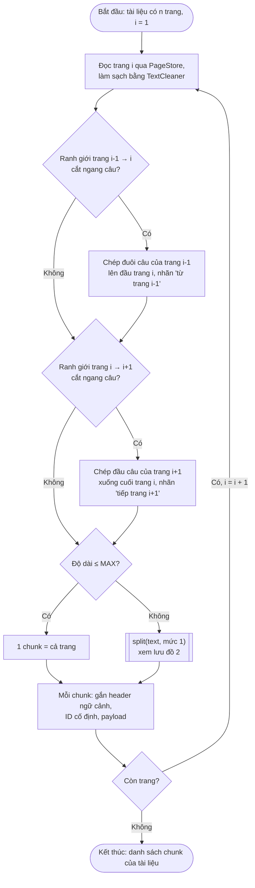
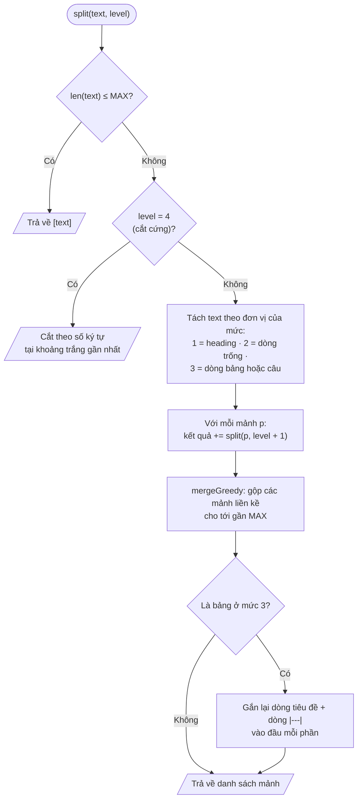

# Indexing pipeline (lập chỉ mục) — v1.2

> Ngày: 06/10/2026. Phạm vi: 6.690 trang `trang_NNN.md` của 278 tài liệu CTR.
> Luồng: `PageStore.read()` → `TextCleaner.clean()` → **chunk** → **embed** → upsert vào Qdrant → cập nhật `documents.ngay_embed`, `so_chunk`.
> Bản này chốt hai việc: **model embedding** và **thuật toán chunk**. Các phần khác ở mục 4 mới là đề xuất.

## Thay đổi so với bản trước (v1.1)

- Viết lại **mục 2.2 — Thuật toán** cho đủ chi tiết để code:
  - Ý tưởng một câu.
  - Thứ tự các mức cắt đã chỉnh: mức 2 là dòng trống (tách cả gạch đầu dòng); không dùng thụt lề làm mốc cắt.
  - Ba chi tiết bắt buộc: điều kiện dừng chắc chắn, gộp tham lam, nối câu qua trang.
  - **Hai lưu đồ** (Mermaid): luồng cho cả tài liệu và hàm đệ quy `split`.
  - Mã giả đầy đủ cho `split`, `mergeGreedy`, cắt bảng và nối câu.
- Thêm **bước nối câu qua trang** (sentence stitching) vào thuật toán, kèm số đo: 202 ranh giới trang cắt ngang câu văn, 324 ranh giới bảng chạy tiếp.
- Cập nhật **mục 2.4** theo số đo mới.
- Thêm **mục 2.7 — Ví dụ chạy tay** trên ba trường hợp thật.
- Hệ quả cho code: chunker nhận **cả tài liệu** chứ không nhận từng trang (mục 4).

---

## 1. Model embedding — CHỐT: `Qwen3-Embedding-4B`

### 1.1. Các ứng viên trên gateway Viettel AI

Gateway là LiteLLM, tương thích OpenAI, endpoint `POST /v1/embeddings`. Mỗi model gọi 3 lần, lúc 16:19 ngày 06/10/2026.

| Model | Kết quả | Số chiều | Thời gian một input ngắn |
|---|---|---|---|
| `vai/VT-Embed-8B-v1` | 404 cả 3 lần | — | — |
| `vai/VT-Embed-4B-v1` | 404 cả 3 lần | — | — |
| `vai/VT-Embed-1B-v2` | Chạy | 2048 | 0,5–0,9 giây |
| **`Qwen3-Embedding-4B`** | **Chạy** | **2560** | 0,5–1,9 giây |

- Hai model VT-Embed 8B và 4B có tên trong `/v1/models` nhưng trả `default backend - 404`. Đây là lỗi của nginx ingress khi không có dịch vụ phía sau: gateway còn giữ tên model nhưng server chạy model đã tắt hoặc chưa triển khai. Lỗi ở phía nhà cung cấp, không phải do key hay request.
- Tên model phải viết **đúng** là `Qwen3-Embedding-4B`. Viết `Qwen/Qwen3-Embedding-4B` thì gateway báo `no healthy deployments`.
- `.env` đã đổi từ `EMBEDDING_MODEL=vai/VT-Embed-8B-v1` (hỏng) sang `EMBEDDING_MODEL=Qwen3-Embedding-4B`.

### 1.2. Lý do chọn

- **Đồng bộ họ model:** OCR dùng Qwen3-VL-32B, reranker tầng 2 dùng Qwen3-Reranker-4B. Embedding và reranker cùng họ Qwen3, được huấn luyện để dùng cặp với nhau.
- **Mạnh về đa ngôn ngữ,** gồm cả tiếng Việt.
- Là một trong hai model embedding đang chạy được. Ứng viên còn lại `VT-Embed-1B-v2` nhỏ hơn 4 lần.

**Giới hạn của quyết định:** chưa so sánh hai model trên dữ liệu thật. Nếu cần bằng chứng cho báo cáo thì làm thêm phép đo: khoảng 30 câu hỏi đã biết trang đáp án, khoảng 300 trang, so Recall@5 và MRR. Mỗi model mất chưa tới 1 phút.

### 1.3. Đặc tính đo được

| Đặc tính | Số đo | Hệ quả |
|---|---|---|
| Số chiều | 2560, vector đã chuẩn hoá (norm = 1,0000) | Collection Qdrant dùng `Cosine`. Với vector đã chuẩn hoá, cosine bằng tích vô hướng |
| Ký tự trên mỗi token | khoảng 1,94 (tiếng Việt có bảng số), đo trên 64 trang | 4.000 ký tự ≈ 2.060 token |
| Cửa sổ ngữ cảnh | 40.000 ký tự (20.214 token) vẫn chạy; 120.000 ký tự lỗi `ContextWindowExceeded` | Khoảng 32k token. Model không buộc phải cắt nhỏ |
| Bất đối xứng | Tài liệu embed nguyên văn. Câu hỏi thêm tiền tố `Instruct: <nhiệm vụ>\nQuery: <câu hỏi>` | Phía truy hồi phải thêm tiền tố, nếu không sẽ giảm độ chính xác |

**Kích thước batch** (input là các trang dài 2.000–2.600 ký tự):

| Batch | Tổng thời gian | Giây mỗi chunk |
|---|---|---|
| 1 | 0,67 | 0,674 |
| 8 | 1,40 | 0,175 |
| 16 | 2,62 | 0,164 |
| **32** | **3,15** | **0,098** |
| 64 | 15,14 | 0,237 |

→ **Batch 32.** Lên 64 thì chậm hẳn, có lẽ phía server phải xếp hàng. Ước tính 7.245 chunk, tức 226 request, chạy tuần tự **khoảng 12 phút** (OCR mất khoảng 4,6 giờ). Vì vậy không cần thread pool như OCR.

### 1.4. Quy tắc khi đổi model

Số chiều gắn chặt với collection. Đổi model thì phải tạo collection mới và embed lại toàn bộ. Vì thế:
- Tên model nằm trong `.env`, không viết cứng trong code.
- Tên collection ghi kèm tên model, ví dụ `finq_pages_qwen3e4b`.
- Đổi model cũng có thể làm đổi mức trần chunk (mục 2.6, cận trên).

## 2. Thuật toán chunk — CHỐT: recursive theo cấu trúc tài liệu, đơn vị gốc là trang

### 2.1. Các thuật toán đã cân nhắc

| Thuật toán | Đánh giá với kho này |
|---|---|
| Fixed-size | 65% trang có bảng. Cắt theo số ký tự là chắc chắn cắt giữa bảng |
| Semantic | So độ giống nhau giữa các câu liền kề, mà bảng số liệu không có câu. Vector của các dòng số gần như giống nhau nên ngưỡng không phân biệt được. Phải embed thêm từng câu, tức thêm hàng chục nghìn lượt gọi. Qu và cộng sự (NAACL Findings 2025) cũng kết luận chi phí của semantic chunking không đổi lại được cải thiện ổn định |
| LLM-based | 6.690 lượt gọi LLM, tương đương vài giờ như OCR, chỉ để quyết định chỗ cắt mà 94% trang vốn không cần cắt. Caspari và cộng sự (CIKM 2026) thấy các phương pháp tốn kém hiếm khi vượt được phương pháp đơn giản |
| Recursive thuần | Danh sách dấu phân cách `["\n\n", "\n", " ", ""]` không biết gì về bảng. Có thể cắt đôi bảng, nửa sau mất tiêu đề cột |
| Document structure thuần | Cắt theo heading cho chunk quá vụn (mục 2.3) |
| **Recursive + document structure** | **Chọn.** Giữ khung đệ quy, nhưng thay dấu phân cách bằng các đơn vị cấu trúc của markdown |

Cách ghép này tương tự `MarkdownHeaderTextSplitter` nối với `RecursiveCharacterTextSplitter` trong LangChain. Tên chung là *structure-aware recursive chunking*. Hướng này gần với **element-based chunking** của Jimeno Yepes và cộng sự (2024) trên báo cáo tài chính: chunk theo phần tử cấu trúc, mở chunk mới ở tiêu đề, giữ nguyên bảng.

### 2.2. Thuật toán

#### 2.2.1. Ý tưởng

> **Chia theo cấu trúc từ thô đến mịn, đệ quy khi còn dài, gộp lại khi quá vụn, và luôn có điểm dừng.**

1. Chia tài liệu thành **các trang**. Trước khi xét độ dài, **nối câu bị cắt ngang ở ranh giới trang** (mục 2.2.5).
2. Trang ≤ `MAX` thì giữ nguyên thành **một chunk**.
3. Trang > `MAX` thì chia theo **đề mục** của trang đó, rồi xét từng phần.
4. Phần nào vẫn > `MAX` thì **đệ quy**: chia tiếp bằng đơn vị cấu trúc mịn hơn, cho tới khi mọi phần ≤ `MAX`.
5. Sau mỗi lần chia, **gộp các phần nhỏ liền kề** lại cho tới gần `MAX`, để không sinh chunk vụn.

`MAX = 4.000` ký tự là **mức trần để quyết định có cắt hay không**, không phải độ dài mục tiêu.
- Trang ≤ MAX (94,3%) giữ nguyên, mỗi trang thành đúng một chunk. Chunk trung vị dài 2.276 ký tự.
- Chỉ trang > MAX (379 trang) mới đi vào đệ quy.
- Độ dài luôn đo **sau khi làm sạch**. Ví dụ ở mục 2.7.2: một trang thô dài 4.242 ký tự, sau khi làm sạch còn 3.388, nên không phải cắt.
- Lý do chọn con số 4.000: xem mục 2.5.

#### 2.2.2. Các mức cắt

| Mức | Đơn vị cắt | Khi nào xuống mức này |
|---|---|---|
| 0 | Trang | Luôn bắt đầu ở đây. Trang ≤ MAX thì là một chunk |
| 1 | Mục theo heading (`#`, `##`, ...) | Trang dài hơn MAX. Trang không có heading thì mức này trả về nguyên trang, và đệ quy xuống thẳng mức 2 |
| 2 | Khối, cách nhau bởi dòng trống: đoạn văn, bảng (các dòng liên tiếp bắt đầu bằng `\|`), **từng gạch đầu dòng** | Một mục vẫn dài hơn MAX. Trong kho, các gạch đầu dòng thường cách nhau bởi dòng trống nên tách ở mức này |
| 3 | **Bảng:** từng dòng của bảng, lặp lại dòng tiêu đề và dòng `\|---\|` ở đầu mỗi phần. **Văn xuôi:** từng câu | Một khối vẫn dài hơn MAX (69 bảng và 7 đoạn văn trong kho) |
| 4 | Cắt cứng theo số ký tự, tại khoảng trắng gần nhất | Phương án cuối: một dòng bảng hoặc một câu dài hơn MAX. Gần như không xảy ra |

**Không dùng thụt đầu dòng làm mốc cắt.** Thụt lề do OCR sinh ra không ổn định: cùng một cấp mục, trang này thụt 2 dấu cách, trang kia thụt 4.

#### 2.2.3. Ba chi tiết bắt buộc

| Chi tiết | Vì sao | Thiếu thì sao |
|---|---|---|
| ① **Điều kiện dừng chắc chắn** (mức 4) | Một mảnh > MAX mà không còn mốc cấu trúc nào để cắt (một dòng bảng siêu dài) thì không thể chia tiếp bằng cấu trúc | Đệ quy lặp vô hạn, tràn stack |
| ② **Gộp tham lam** sau mỗi lần cắt | Cắt theo heading cho rất nhiều mảnh nhỏ (2.297 trang có từ 5 heading trở lên) | Trang 6.969 ký tự ở mục 2.7.1 thành 14 chunk, có chunk chỉ 23 ký tự (`# 36. BÁO CÁO BỘ PHẬN`), vector vô nghĩa. Có gộp thì còn 2 chunk |
| ③ **Nối câu qua trang**, làm trước khi xét độ dài | 202 ranh giới trang cắt ngang câu văn (mục 2.4) | Chủ ngữ nằm ở chunk này, con số nằm ở chunk kia. LLM có thể gán nhầm con số sang chỉ tiêu khác |

Thêm một quy tắc riêng cho bảng: **phải lặp lại tiêu đề bảng** ở đầu mỗi phần. Nếu không, phần sau của bảng chỉ còn con số mà không biết cột nào là "Số cuối kỳ", cột nào là "Số đầu năm".

#### 2.2.4. Lưu đồ

**Lưu đồ 1 — Chunk một tài liệu** (`chunkDocument`)



**Lưu đồ 2 — Hàm đệ quy** `split(text, level)`



Lưu đồ viết bằng Mermaid. GitHub hiển thị trực tiếp; trong VS Code cần extension xem trước Mermaid.

#### 2.2.5. Mã giả

```
// ---------- cả tài liệu ----------
chunkDocument(pages[1..n]):
    chunks = []
    for i in 1..n:
        text = pages[i]                                   // đã qua TextCleaner
        if continues(pages[i-1], pages[i]):
            text = "(từ trang " + (i-1) + ") " + tail(pages[i-1]) + "\n\n" + text
        if continues(pages[i], pages[i+1]):
            text = text + "\n\n(tiếp trang " + (i+1) + ") " + head(pages[i+1])
        for (part, k) in split(text, level = 0):          // trang ≤ MAX thì trả về đúng 1 phần
            chunks.add(Chunk(page = i, part = k, text = part))
    return chunks

// ---------- đệ quy ----------
split(text, level):
    if len(text) <= MAX:   return [text]                  // dừng: đủ nhỏ
    if level == 4:         return cutByChars(text, MAX)   // dừng chắc chắn
    if level == 3 and isTable(text):
        return splitTable(text)                           // cắt bảng, lặp tiêu đề
    pieces = splitBy(UNIT[level], text)                   // 1: heading, 2: dòng trống, 3: câu
    result = []
    for p in pieces:
        result += split(p, level + 1)
    return mergeGreedy(result, MAX)

// ---------- gộp tham lam ----------
mergeGreedy(pieces, max):
    out = [], cur = ""
    for p in pieces:                                      // giữ nguyên thứ tự, chỉ gộp mảnh liền kề
        if cur == "":                       cur = p
        else if len(cur) + 2 + len(p) <= max:   cur = cur + "\n\n" + p   // tính cả 2 ký tự nối
        else:                               out.add(cur); cur = p
    if cur != "": out.add(cur)
    return out

// ---------- cắt bảng ----------
splitTable(table):
    header = 2 dòng đầu (dòng tiêu đề + dòng |---|)
    rows   = các dòng còn lại
    budget = MAX - len(header) - 1
    parts  = mergeGreedy(rows, budget) (nối bằng "\n" thay vì "\n\n")
    return [header + "\n" + part for part in parts]       // phần nào cũng có tiêu đề cột
```

**Nối câu qua trang** (`continues`, `tail`, `head`):

| Hàm | Quy tắc |
|---|---|
| `continues(N, N+1)` | Đúng khi **cả hai** điều kiện thoả: (a) dòng cuối của trang N (bỏ qua dòng chỉ có số trang) không phải dòng bảng hay heading, và không kết thúc bằng `. : ; ! ? ) ”`; (b) dòng đầu của trang N+1 bắt đầu bằng **chữ thường** |
| `tail(N)` | Phần của dòng cuối trang N tính từ dấu kết thúc câu cuối cùng tới hết. Không có dấu kết thúc câu thì lấy cả dòng |
| `head(N+1)` | Phần từ đầu trang N+1 tới dấu kết thúc câu đầu tiên |
| Giới hạn | Mỗi phần nối tối đa **500 ký tự** (giá trị ban đầu), cắt tại khoảng trắng gần nhất, để một đoạn văn rất dài không kéo theo cả trang |

- **Bẫy dấu chấm phân cách nghìn:** dấu kết thúc câu là `.` `!` `?` **đứng ngay trước khoảng trắng hoặc cuối dòng**. Nếu cắt ở dấu `.` đầu tiên thì `"từ 867 tỷ lên 1.061 tỷ"` thành `"từ 867 tỷ lên 1"` (đã chạy thử).
- **Nối câu trước, xét độ dài sau:** phần nối trở thành khối đầu hoặc khối cuối của trang, nên đệ quy và bước gộp vẫn giữ được trần `MAX`.
- **Nhãn `(từ trang N)` / `(tiếp trang N)`** giúp LLM trích dẫn đúng trang chứa con số. Độ chính xác trích dẫn là một tiêu chí đánh giá.
- **Chi phí:** 202 chỗ × khoảng 250 ký tự ≈ 50.000 ký tự, khoảng 0,3% toàn kho.
- **Bỏ sót chấp nhận được:** câu bị cắt mà trang sau mở đầu bằng chữ hoa (tên riêng, ví dụ "Công ty", "Viettel") thì không phát hiện được. Lưới an toàn là lấy kèm trang N±1 ở phía truy hồi.

### 2.3. Số đo làm căn cứ (sau khi làm sạch)

| Số đo | Giá trị |
|---|---|
| Kích thước trang | Trung vị 2.276 ký tự, p75 2.895, p90 3.448, p95 4.290, p97 6.026, p99 8.364, lớn nhất 14.998 |
| Token ước tính | Trung vị khoảng 1.170, p99 khoảng 4.300, lớn nhất khoảng 7.700 |
| Trang dài hơn 4.000 | 379 (5,7%). Chỉ các trang này dùng tới đệ quy |
| Bảng đơn lẻ dài hơn 4.000 | 69 (phải xuống mức 3, cắt theo dòng bảng) |
| Đoạn văn đơn lẻ dài hơn 4.000 | 7 |
| Số chunk ước tính | 7.245 |
| Số heading mỗi trang | 0: 1.948 trang · 1: 294 · 2: 507 · 3: 958 · 4: 686 · 5 trở lên: **2.297** |

**Vì sao đơn vị gốc là trang mà không phải mục theo heading:**
- 2.297 trang có từ 5 heading trở lên. Cắt theo heading thì mỗi chunk trung bình chỉ khoảng 450 ký tự, quá ngắn, mất ngữ cảnh.
- Trích dẫn tính theo trang ("trang 12 của BCTC hợp nhất Q1/2019"). `documents` và `PageStore` cũng tổ chức theo trang.
- Trang là đơn vị tự nhiên của đầu ra OCR: mỗi trang một file, một lần gọi model.

### 2.4. Điểm yếu đã biết

Trang là ranh giới **vật lý**, không phải ranh giới **logic**. Trên **6.412 cặp trang liền kề** của kho:

| Hiện tượng | Số ranh giới | Đã xử lý chưa |
|---|---|---|
| Câu văn bị cắt ngang (trang trước không có dấu kết thúc câu, trang sau mở đầu bằng chữ thường) | **202** (3,2%) | **Có**, bằng nối câu qua trang (mục 2.2.5) |
| Bảng chạy tiếp sang trang sau (dòng cuối và dòng đầu đều là dòng bảng) | **324** (5,1%) | **Chưa** |

Vì sao bảng chưa xử lý được:
- 411 trang mở đầu bằng một dòng bảng. Chỉ 28 trang trong số đó thiếu hẳn dòng `|---|` ở dòng thứ hai.
- Ở các trang còn lại, model OCR tự dựng lại khung bảng, nhưng dòng nó coi là tiêu đề có khi chỉ là một dòng số liệu.
- Câu văn có dấu kết thúc câu để làm mốc phát hiện. Bảng thì không có mốc nào phân biệt được tiêu đề thật với dòng số liệu.

Cách giảm cho phần chưa xử lý:
1. **Contextual header** gắn trước mỗi chunk khi embed (mục 4).
2. Phía truy hồi: lấy trúng trang N thì lấy kèm trang N−1 và N+1 làm ngữ cảnh cho LLM ("truy hồi bằng đơn vị nhỏ, trả về ngữ cảnh rộng"). Wang và cộng sự (EMNLP 2024) gọi kỹ thuật này là *small2big* và ghi nhận nó cải thiện độ trung thực của câu trả lời.

### 2.5. Vì sao chọn 4.000 ký tự

#### 2.5.1. Quy đổi đơn vị

| | Ký tự | Từ (âm tiết) | Token Qwen3 | Trang A4 chữ |
|---|---|---|---|---|
| Trang chữ trung vị (không bảng, 2.328 trang) | 2.437 | 479 | khoảng 1.250 | 1 |
| Trang trung vị (toàn kho) | 2.276 | 356 | khoảng 1.170 | — |
| **Mức trần MAX** | **4.000** | **khoảng 800** (văn xuôi, 5,02 ký tự/từ) đến 650 (có bảng, 6,15 ký tự/từ) | **khoảng 2.060** | **khoảng 1,6** |
| Trang vượt MAX (trung vị) | — | 918 | — | khoảng 2 |

- Tiếng Việt khoảng **1,94 ký tự mỗi token**, tiếng Anh khoảng 4. Cùng một nội dung, tiếng Việt tốn gần gấp đôi token.
- Các nghiên cứu (mục 5) đo chunk bằng **token tiếng Anh**, khoảng 0,75 từ mỗi token. Vì vậy muốn so với nghiên cứu thì phải so theo **lượng nội dung (số từ)**, không so số token:
  - 512 token tiếng Anh ≈ 380 từ.
  - 1.024 token tiếng Anh ≈ 770 từ.
  - Chunk của ta: trung vị 356–479 từ, trần 650–800 từ. Tức là **trong khoảng 512–1.024 token tiếng Anh tương đương**.

#### 2.5.2. Lập luận từ phân bố của tập hiện tại

Tỉ lệ trang bị cắt theo từng mức trần:

| Mức trần | Số trang bị cắt | Tỉ lệ |
|---|---|---|
| 2.000 | 4.280 | 64,0% |
| 3.000 | 1.459 | 21,8% |
| 3.500 | 619 | 9,3% |
| **4.000** | **379** | **5,7%** |
| 5.000 | 267 | 4,0% |
| 6.000 | 206 | 3,1% |
| 8.000 | 85 | 1,3% |

- **Đường gãy ở khoảng 3.000–4.000.** Từ 3.000 lên 4.000, số trang bị cắt giảm 1.080. Từ 4.000 lên 6.000 chỉ giảm thêm 173, trong khi chunk lớn nhất phình từ khoảng 2.060 lên 3.100 token. Vậy 4.000 là điểm mà tăng tiếp gần như không còn lợi.
- **Cận dưới: phải lớn hơn p90 (3.448).** Trang là đơn vị trích dẫn. Nếu trần thấp hơn thì hàng nghìn trang bình thường bị cắt đôi, mỗi nửa mất ngữ cảnh của nửa kia.
- **Cận trên: các trang vượt 4.000 là trang bất thường.** Trung vị 918 từ, khoảng hai trang A4 dồn vào một trang (chữ nhỏ, nhiều bảng), tức nhiều chủ đề trên một trang. Nhồi vào một vector thì vector bị pha loãng: câu hỏi chỉ khớp một bảng sẽ cho điểm thấp vì vector trộn ba, bốn bảng.

#### 2.5.3. Đối chiếu với các nghiên cứu

| Nghiên cứu | Kết quả liên quan | Hệ quả cho FinQuery |
|---|---|---|
| Jimeno Yepes và cộng sự (2024), **báo cáo tài chính** (FinanceBench, 141 câu hỏi, 80 tài liệu) | Chunk cố định 128 / 256 / 512 token cho độ chính xác Q&A 35,46% / 36,88% / 48,23%. Chunk theo phần tử cấu trúc (giữ bảng nguyên, mở chunk mới ở tiêu đề, **tối thiểu 2.048 ký tự**) đạt **53,19%** | Gần nhất với bài toán của ta. Ủng hộ cả hai quyết định: theo cấu trúc, giữ bảng nguyên, chunk khoảng vài nghìn ký tự. Chunk to hơn thì tốt hơn chunk nhỏ trên báo cáo tài chính |
| Wang và cộng sự (EMNLP 2024) | Thử 128–2.048 token. Faithfulness: 512 → 97,59; 1.024 → 94,26; **2.048 → 80,37** | Chunk quá lớn thì giảm rõ. Trần của ta khoảng 1.024 token tiếng Anh tương đương, nằm dưới vùng giảm mạnh |
| Bhat và cộng sự (2025, preprint) | Câu hỏi dữ kiện ngắn hợp với 64–128 token. Câu hỏi cần ngữ cảnh rộng hợp với 512–1.024 token. Tuỳ cả model embedding | Không có kích thước tối ưu chung. Mảng E (giải trình kế hoạch và thực hiện) cần ngữ cảnh rộng. Câu hỏi tra một con số thì có lợi khi chunk nhỏ hơn |
| Chen và cộng sự (EMNLP 2024), Dense X Retrieval | Đơn vị truy hồi mịn (mệnh đề) vượt đơn vị đoạn | Phản biện đáng ghi: với câu hỏi tra một con số, chunk cả trang có thể kém chính xác. Ta bù bằng reranker hai tầng và small2big |
| Liu và cộng sự (TACL 2024), Lost in the Middle | LLM dùng thông tin ở đầu và cuối ngữ cảnh tốt hơn ở giữa | Chunk to nhân top-k thì ngữ cảnh dài. Phải giới hạn top-k và đưa chunk điểm cao lên đầu |
| Caspari và cộng sự (CIKM 2026) | Phương pháp tốn kém hiếm khi vượt phương pháp đơn giản. Gắn tiêu đề tài liệu vào chunk (enriched title) là cải thiện rẻ và ổn định | Ủng hộ việc không dùng semantic hay LLM chunking, và ủng hộ contextual header |
| Shaukat và cộng sự (2026, preprint) | Không có chiến lược chunk tối ưu cho mọi lĩnh vực. Chọn chiến lược chunk ảnh hưởng nhiều hơn số chiều của model | Mức trần phải suy ra từ dữ liệu của mình, không chép con số của người khác |

**Kết luận:** 4.000 là **giá trị ban đầu có căn cứ**, chưa phải giá trị tối ưu đã kiểm chứng trên FinQuery. Khi có bộ câu hỏi đánh giá (`danh-gia`) thì thử 3.000 / 4.000 / 6.000, so Recall@5, MRR và độ chính xác câu trả lời, rồi chọn theo số đo.

### 2.6. Khi tập tài liệu thay đổi

#### 2.6.1. Công thức chọn mức trần

```
MAX = điểm gãy của đường "tỉ lệ trang bị cắt", thường rơi vào p90–p95 độ dài trang sau khi làm sạch
      và phải thoả: CẬN_DƯỚI ≤ MAX ≤ CẬN_TRÊN
```

| Cận | Giá trị | Căn cứ |
|---|---|---|
| Dưới | khoảng 2.000 ký tự (khoảng một trang A4 chữ) | Thấp hơn thì phần lớn trang bị cắt (64% ở mức 2.000). Jimeno Yepes và cộng sự dùng tối thiểu 2.048 ký tự trên báo cáo tài chính |
| Trên, theo nội dung | khoảng 800 từ, tức khoảng 1.024 token tiếng Anh tương đương | Wang và cộng sự: 2.048 token giảm faithfulness rõ rệt |
| Trên, theo model embedding | `0,8 × cửa sổ ngữ cảnh × số ký tự/token` | Không được vượt model. Hiện tại khoảng 32k × 1,94 × 0,8, rất xa, không ràng buộc |
| Trên, theo reranker | `(giới hạn đầu vào của reranker − token câu hỏi) × số ký tự/token` | Chunk dài hơn sẽ bị reranker cắt mất phần cuối. **Chưa đo giới hạn của bge-reranker trên gateway** |

#### 2.6.2. Các tình huống

| Tình huống | Nâng hay hạ | Làm gì |
|---|---|---|
| Thêm tài liệu khiến trang dài hơn (BCTN in chữ nhỏ, phụ lục bảng dày) | Giữ, hoặc nâng nhẹ | Tính lại phân vị. Nếu điểm gãy dịch lên thì nâng, nhưng không vượt cận trên. Trang dày đã được đệ quy cắt theo cấu trúc |
| Thêm tài liệu trang ngắn (nghị quyết, tờ trình, công bố thông tin) | **Không hạ** | Trang ngắn vốn đã là một chunk. Hạ trần không làm thay đổi chúng mà chỉ cắt thêm trang dài |
| DOCX/XLSX (không có trang vật lý) | Giữ cùng giá trị | `DocxDocumentExtractor` đã chia đơn vị theo `MAX_UNIT_CHARS = 4000`. Hai hằng số nên dùng chung một cấu hình. Sheet XLSX lớn sẽ được cắt theo dòng bảng và lặp lại tiêu đề |
| Câu hỏi chủ yếu là tra một con số | Hạ (khoảng 3.000–3.500), hoặc giữ và dùng small2big | Bhat và cộng sự, Chen và cộng sự: câu hỏi dữ kiện hợp với đơn vị nhỏ |
| Câu hỏi chủ yếu là tổng hợp, giải trình (mảng E, BCTN) | Nâng (khoảng 5.000–6.000) | Bhat và cộng sự: câu hỏi cần ngữ cảnh rộng hợp với chunk lớn hơn. Không vượt cận trên |
| Đổi model embedding có cửa sổ ngắn (ví dụ 512 token) | Hạ bắt buộc | 512 × 1,94 × 0,8 ≈ 800 ký tự, nhỏ hơn một trang. Khi đó đơn vị gốc không còn là trang được nữa, phải thiết kế lại (gốc là khối) |
| Reranker cắt đầu vào ngắn (ví dụ 512 token) | Hạ, hoặc đổi cách rerank | Hoặc hạ trần, hoặc chấm điểm reranker trên từng cửa sổ con của chunk rồi lấy điểm cao nhất |
| Thêm tài liệu tiếng Anh | Giữ | Tiếng Anh khoảng 4 ký tự/token, cùng 4.000 ký tự chỉ khoảng 1.000 token. Đo bằng ký tự giữ lượng nội dung gần như không đổi |

#### 2.6.3. Dấu hiệu cần xem lại mức trần

- Truy hồi trúng **đúng tài liệu nhưng sai trang hoặc sai phần** → chunk quá to, xem xét hạ.
- Điểm rerank của các chunk dài thấp bất thường → có thể reranker đang cắt mất phần cuối.
- LLM thường xuyên phải dùng trang N±1 mới trả lời được → chunk quá nhỏ hoặc đang cắt sai chỗ, xem xét nâng.

#### 2.6.4. Quy trình đổi mức trần

1. Đo lại phân bố độ dài trang sau khi làm sạch (phân vị và bảng tỉ lệ trang bị cắt như mục 2.5.2).
2. Chọn ba ứng viên: 0,75 × / 1 × / 1,5 × điểm gãy, đều nằm trong cận.
3. Chạy bộ câu hỏi đánh giá, so Recall@5, MRR và độ chính xác câu trả lời.
4. Mở bản log mới, ghi số đo và lý do.
5. Đặt `documents.ngay_embed = NULL` rồi chạy lại indexing. Point ID cố định nên upsert sẽ ghi đè. Riêng các phần thừa khi số phần của một trang giảm đi thì được dọn bằng bước xoá theo `tai_lieu_id` ở mục 4.

### 2.7. Ví dụ chạy tay

#### 2.7.1. Trang dài, nhiều heading: đệ quy mức 1 rồi gộp

`02_bao_cao_thuong_nien/2020/thuong_nien/BaoCaoThuongNien_2020_Final-5/trang_040.md`: thuyết minh BCTC, **6.969 ký tự** sau khi làm sạch.

- **Mức 0:** 6.969 > 4.000, phải cắt.
- **Mức 1:** tách theo heading, được 14 mảnh. Mảnh nào cũng ≤ 4.000, nên không đệ quy sâu hơn.

| Mảnh | Ký tự | Cộng dồn | Gộp vào |
|---|---|---|---|
| `# 34. CÔNG CỤ TÀI CHÍNH (tiếp theo)` | 545 | 545 | Chunk 1 |
| `## Quản lý rủi ro tài chính` | 412 | 957 | Chunk 1 |
| `### Rủi ro thị trường` | 136 | 1.093 | Chunk 1 |
| `#### Rủi ro về tỷ giá hối đoái` | 317 | 1.410 | Chunk 1 |
| `#### Rủi ro về lãi suất` | 464 | 1.874 | Chunk 1 |
| `### Rủi ro tín dụng` (có bảng 10 dòng) | 800 | 2.674 | Chunk 1 |
| `# 34. CÔNG CỤ TÀI CHÍNH (tiếp theo)` | 37 | 2.711 | Chunk 1 |
| `## Rủi ro thanh khoản` (có bảng 11 dòng) | 1.277 | **3.988** | Chunk 1 |
| `# 35. NHỮNG SỰ KIỆN PHÁT SINH SAU NGÀY KẾT THÚC NĂM` | 217 | 3.988 + 217 = 4.205 > 4.000 → chốt chunk 1, bắt đầu chunk 2 | Chunk 2 |
| `# 36. BÁO CÁO BỘ PHẬN` | **23** | | Chunk 2 |
| `## Theo lĩnh vực kinh doanh` | 56 | | Chunk 2 |
| `## Theo khu vực địa lý` (có bảng) | 368 | | Chunk 2 |
| `# 37. NGHIỆP VỤ VÀ SỐ DƯ VỚI CÁC BÊN LIÊN QUAN` | 170 | | Chunk 2 |
| `## Giao dịch phát sinh trong năm` (bảng 23 dòng) | 2.147 | **2.981** | Chunk 2 |

- **Kết quả:** 2 chunk (3.988 và 2.981 ký tự) thay vì 14. Chunk 1 trọn vẹn thuyết minh 34 (rủi ro tài chính), chunk 2 là thuyết minh 35–37. Chỗ cắt trùng với ranh giới ý nghĩa của tài liệu, dù thuật toán không hiểu nội dung, nhờ cắt ở heading.
- **Nếu một mảnh vẫn quá dài**, chẳng hạn bảng "Giao dịch phát sinh trong năm" dài 5.000 ký tự: mức 2 tách thành khối đoạn văn và khối bảng; khối bảng vẫn > 4.000 nên mức 3 cắt theo dòng thành hai phần khoảng 2.500 ký tự, **mỗi phần đều gắn lại tiêu đề cột**.

#### 2.7.2. Câu bị cắt ngang qua hai ranh giới trang: nối câu

`03_dai_hoi_dong_co_dong/2021/bao_cao/04.-BC-BDH/` (Báo cáo Ban điều hành trình ĐHĐCĐ 2021), trang 2 → 3 → 4.

```
...cuối trang 2:
- Các chỉ số tài chính đạt kế hoạch, đảm bảo ở mức an toàn (Dòng tiền cho hoạt động
  SXKD dương 163,5 tỷ (~ 15,4% vốn chủ sở hữu); Vốn chủ sở hữu tăng
════════════════════════ hết trang 2 ════════════════════════
từ 867 tỷ lên 1.061 tỷ; Ngày tồn kho bình quân là 31,5 ngày; ...; Hệ số nợ/tổng tài sản 0,73 lần).
...
- Chuyển đổi số ... Đưa vào sử dụng hệ thống BI & DW ... số hóa hệ thống báo cáo
════════════════════════ hết trang 3 ════════════════════════
đảm bảo trực quan, hỗ trợ cho các đơn vị trong việc kiểm soát, điều hành hoạt động SXKD.
```

**Chạy tay lần 1, chưa nối câu:**

| Trang | Thô | Sau khi làm sạch | So với MAX | Kết quả |
|---|---|---|---|---|
| 2 | 2.402 | 2.035 | ≤ 4.000 | 1 chunk |
| 3 | 4.242 | **3.388** | ≤ 4.000 | 1 chunk (nhờ làm sạch nên không phải cắt) |
| 4 | — | 3.096 | ≤ 4.000 | 1 chunk |

Vấn đề: chunk trang 2 có "Vốn chủ sở hữu tăng" nhưng **không có số**; chunk trang 3 có "từ 867 tỷ lên 1.061 tỷ" nhưng **không có chủ ngữ**. Với câu hỏi *"Vốn chủ sở hữu năm 2020 tăng từ bao nhiêu lên bao nhiêu?"*:
- Vector của chunk trang 3 không chứa "vốn chủ sở hữu" nên khó được truy hồi.
- Nếu truy hồi được, LLM thấy con số mà không biết của chỉ tiêu nào, nên có thể gán nhầm sang doanh thu.

**Chạy tay lần 2, có nối câu:**

| Ranh giới | Điều kiện (a): cuối trang trước | Điều kiện (b): đầu trang sau | Đuôi | Đầu |
|---|---|---|---|---|
| 2 → 3 | "...Vốn chủ sở hữu tăng": không có dấu kết thúc | "từ 867 tỷ...": chữ thường | 149 ký tự | 148 ký tự |
| 3 → 4 | "...số hóa hệ thống báo cáo": không có dấu kết thúc | "đảm bảo trực quan...": chữ thường | 118 ký tự | 88 ký tự |

```
Chunk trang 2 (≈ 2.200 ký tự):
  ... - Các chỉ số tài chính đạt kế hoạch, ... Vốn chủ sở hữu tăng
  (tiếp trang 3) từ 867 tỷ lên 1.061 tỷ; ...; Hệ số nợ/tổng tài sản 0,73 lần).   ← +148

Chunk trang 3 (≈ 3.650 ký tự):
  (từ trang 2) - Các chỉ số tài chính đạt kế hoạch, ... Vốn chủ sở hữu tăng       ← +149
  từ 867 tỷ lên 1.061 tỷ; ... (nội dung trang 3) ... số hóa hệ thống báo cáo
  (tiếp trang 4) đảm bảo trực quan, ... điều hành hoạt động SXKD.               ← +88

Chunk trang 4 (≈ 3.230 ký tự):
  (từ trang 3) Đưa vào sử dụng hệ thống BI & DW ... số hóa hệ thống báo cáo       ← +118
  đảm bảo trực quan, ... (nội dung trang 4)
```

Cả chunk trang 2 lẫn chunk trang 3 đều có trọn câu "Vốn chủ sở hữu tăng từ 867 tỷ lên 1.061 tỷ". Cả ba chunk vẫn ≤ 4.000.

#### 2.7.3. Trang không có heading: đệ quy rơi thẳng xuống mức 2

Lấy trang 3 ở trên (3.388 ký tự, **0 heading**). Với MAX thật thì trang này không phải cắt. Để thấy đệ quy chạy, **giả sử tạm MAX = 1.500**:

```
Mức 0: 3.388 > 1.500                                   → đệ quy
Mức 1: tách theo heading → 0 heading → vẫn 1 mảnh 3.388 > 1.500 → xuống mức 2
Mức 2: tách theo dòng trống → 7 khối (mỗi gạch đầu dòng là một khối):
       B1 148 | B2 496 | B3 814 | B4 512 | B5 501 | B6 456 | B7 449      (đều ≤ 1.500, dừng)
Gộp tham lam:
       148 + 496 + 814 = 1.458   (+512 = 1.970 > 1.500 → chốt)   → chunk A
       512 + 501 + 456 = 1.469   (+449 = 1.918 > 1.500 → chốt)   → chunk B
       449                                                      → chunk C
```

(Khi code thật, mỗi lần nối còn cộng thêm 2 ký tự `\n\n`. Bảng trên bỏ qua cho dễ theo dõi.)

## 3. Hạn mức API

Kiểm tra qua endpoint quản lý của LiteLLM (`GET /key/info`, `GET /user/info`, gửi kèm `Authorization: Bearer <key>`):

| Trường | Giá trị |
|---|---|
| `max_budget`, `soft_budget` | `null`: không giới hạn ngân sách |
| `tpm_limit`, `rpm_limit`, `max_parallel_requests` | `null`: không giới hạn token/phút, request/phút, số request song song |
| `expires` | `null`: key không hết hạn |
| `models` | `[]`: được gọi mọi model |
| `spend` | Chỉ là con số cộng dồn chi phí, không phải số dư |

- Key này **không có khái niệm "còn bao nhiêu token"**. Quản trị viên có thể đặt giới hạn bất cứ lúc nào.
- `/global/spend` và `/spend/logs` trả 403 vì key có vai trò `internal_user`, chỉ admin mới xem được.
- Mỗi response có header `x-litellm-response-cost` (chi phí của lần gọi đó) và `x-litellm-key-spend` (tổng đã dùng). **Nên ghi log `x-litellm-response-cost` sau mỗi batch** để có số liệu chi phí API cho chương đánh giá.
- Key gắn với tài khoản của người khác cấp: không commit `.env`, không đưa key vào log.

## 4. Đề xuất, CHƯA chốt

| Hạng mục | Đề xuất |
|---|---|
| Contextual header | Text đưa đi embed = `[<documents.ten_hien_thi> — trang N]\n<nội dung>`. Payload giữ nội dung gốc để trích dẫn. Căn cứ: Caspari và cộng sự (CIKM 2026) với enriched title; bài blog Contextual Retrieval của Anthropic (09/2024, không qua bình duyệt) báo cáo giảm 35% số lần truy hồi trượt top-20 khi gắn ngữ cảnh vào chunk |
| Point ID | `UUID.nameUUIDFromBytes("<tai_lieu_id>\|<trang>\|<phan>")`: cố định, upsert lại thì ghi đè, không trùng |
| Payload | `tai_lieu_id, trang, phan, nam, ky, pham_vi, loai, la_ban_chinh, text`. Payload index: `nam` (integer); `loai, ky, pham_vi, tai_lieu_id` (keyword) |
| Thư viện | `EmbeddingClient` tự viết bằng `HttpClient` (cùng khuôn với `VisionOcrClient`, không stream) và `QdrantClient` gRPC cổng 6334 (đã có sẵn qua `spring-ai-qdrant-store`). Không dùng `QdrantVectorStore.add()`, vì nó tự chia batch theo tokenizer cl100k (đếm sai tiếng Việt) và không cho tự đặt ID |
| Luỹ đẳng | Bỏ qua tài liệu có `ngay_embed` khác NULL. Mỗi tài liệu: xoá point cũ theo `tai_lieu_id` → upsert → ghi `ngay_embed` và `so_chunk` **sau cùng** |
| Hạ tầng | `docker-compose.yml` cho Qdrant (cổng 6333/6334, volume). Vector chỉ tốn khoảng 74 MB RAM (7.245 × 2560 × 4 byte) |
| Gộp chunk nhỏ | Có nên gộp các phần ngắn (dưới khoảng 500 ký tự) vào phần liền kề không: chưa quyết |
| Mức trần dùng chung | Gộp `MAX_UNIT_CHARS` của `DocxDocumentExtractor` và `MAX` của chunker vào một cấu hình `indexing.max-chunk-chars` |
| Thử giới hạn reranker | Đặt cùng một câu trả lời ở đầu trang và ở cuối một trang dài, so điểm rerank, để biết gateway có cắt đầu vào không |
| Lớp | `IndexingProperties`, `Chunk` (record), `PageChunker`, `EmbeddingClient` / `HttpEmbeddingClient`, `QdrantIndexWriter`, `DocumentIndexingService` |
| Chữ ký của chunker | `List<Chunk> chunk(String documentId, List<String> cleanedPages)`. Nhận **cả tài liệu**, vì bước nối câu cần trang kề bên |
| Cấu hình | `indexing.max-chunk-chars: 4000`, `indexing.stitch-max-chars: 500`. Thay cho `indexing.chunk-size` đang để trống trong `application.yml`; tên mới nói rõ đơn vị là ký tự và là mức trần |

## 5. Tài liệu tham khảo

Đã qua bình duyệt:
- Wang, X. và cộng sự (2024). *Searching for Best Practices in Retrieval-Augmented Generation.* EMNLP 2024, tr. 17716–17736. https://aclanthology.org/2024.emnlp-main.981/
- Chen, T. và cộng sự (2024). *Dense X Retrieval: What Retrieval Granularity Should We Use?* EMNLP 2024, tr. 15159–15177. https://aclanthology.org/2024.emnlp-main.845/
- Qu, R., Tu, R., Bao, F. S. (2025). *Is Semantic Chunking Worth the Computational Cost?* Findings of NAACL 2025, tr. 2155–2177. https://aclanthology.org/2025.findings-naacl.114/
- Liu, N. F. và cộng sự (2024). *Lost in the Middle: How Language Models Use Long Contexts.* Transactions of the ACL (TACL). https://arxiv.org/abs/2307.03172
- Caspari, L. và cộng sự (2026). *When Is Complex Chunking Worth It? A Multi-Objective Evaluation of Chunking Methods at Scale.* ACM CIKM 2026. https://arxiv.org/abs/2608.16586

Preprint, chưa qua bình duyệt (dùng làm tham khảo phụ):
- Jimeno Yepes, A. và cộng sự (2024). *Financial Report Chunking for Effective Retrieval Augmented Generation.* arXiv:2402.05131. https://arxiv.org/abs/2402.05131
- Bhat, S. R. và cộng sự (2025). *Rethinking Chunk Size For Long-Document Retrieval: A Multi-Dataset Analysis.* arXiv:2505.21700. https://arxiv.org/abs/2505.21700
- Shaukat, M. A., Adnan, M., Kuhn, C. C. N. (2026). *A Systematic Investigation of Document Chunking Strategies and Embedding Sensitivity.* arXiv:2603.06976. https://arxiv.org/abs/2603.06976

Không phải bài khoa học (blog kỹ thuật):
- Anthropic (2024). *Introducing Contextual Retrieval.* https://www.anthropic.com/news/contextual-retrieval
