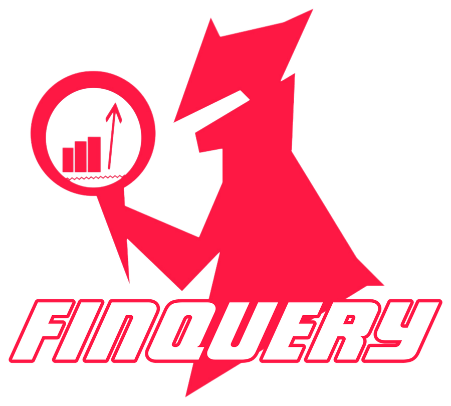
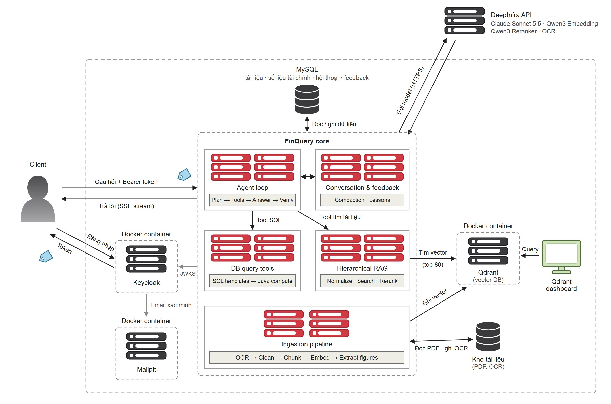
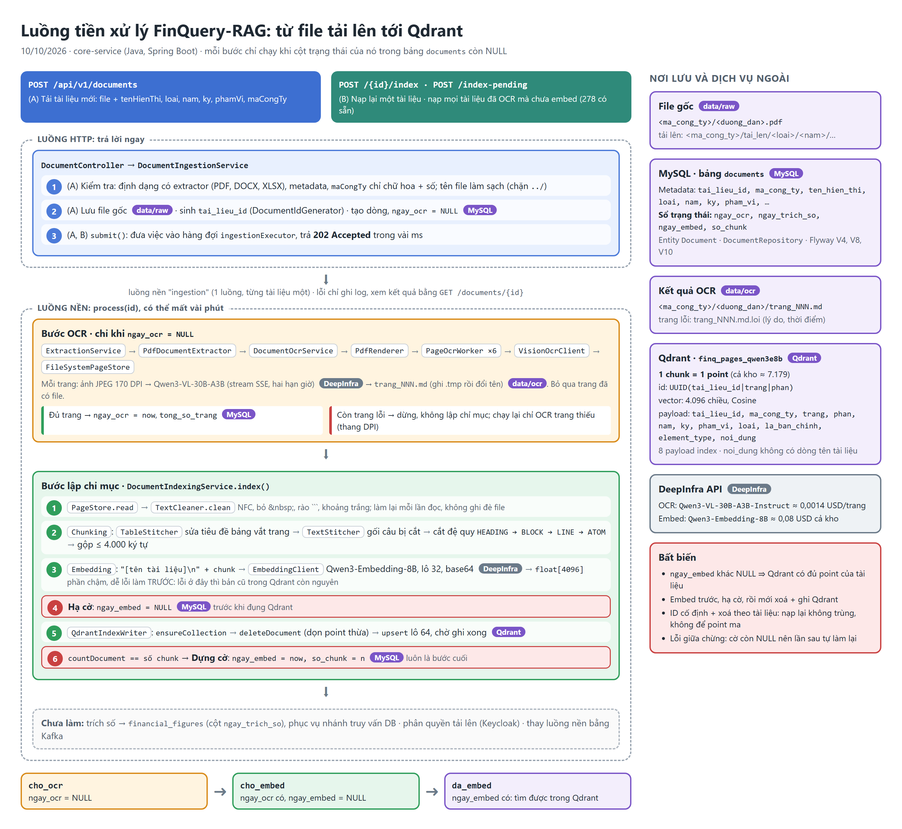
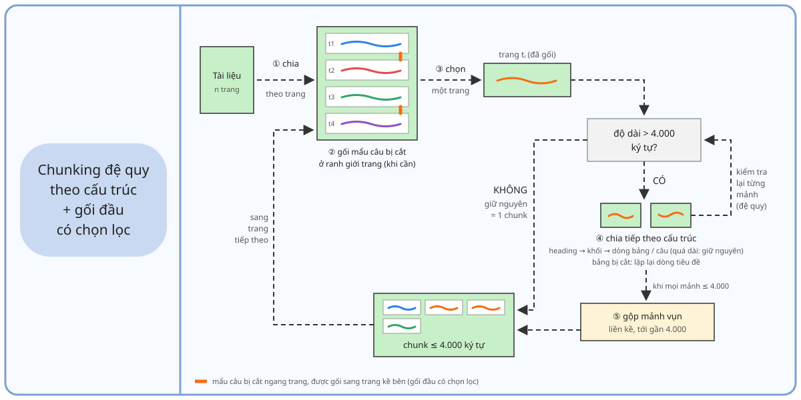

<p align="center">
  
</p>

<h3 align="center">Truy xuất dữ liệu, hỏi đáp tài chính</h3>

FinQuery là trợ lý hỏi đáp cho bộ phận kế toán – tài chính. Người dùng hỏi bằng tiếng Việt. Hệ thống lấy số liệu từ CSDL tài chính và lấy nội dung từ báo cáo tài chính, báo cáo thường niên, nghị quyết, công văn giải trình. Mọi câu trả lời đều kèm trích dẫn tới đúng tài liệu và trang.

## Chức năng chính

- **Hỏi đáp số liệu:** doanh thu, LNST, tổng tài sản, tăng trưởng, tỷ lệ… Model gọi công cụ truy vấn CSDL theo mẫu SQL có sẵn, không tự viết SQL.
- **Hỏi đáp tài liệu:** nguyên nhân biến động, kế hoạch, cổ tức, vốn điều lệ… Câu trả lời lấy từ RAG phân cấp trên kho PDF đã OCR.
- **Kết hợp hai nhánh** trong một câu hỏi. Ví dụ: "Năm 2025 công ty có hoàn thành kế hoạch LNST không?" lấy kế hoạch từ tài liệu và số thực hiện từ CSDL.
- **Trích dẫn kiểm chứng được:** bấm mã `[C#]` / `[D#]` để mở trang gốc (phóng to được).
- **Từ chối** câu hỏi ngoài phạm vi, không đoán số.
- **Hội thoại nhiều lượt:** hiểu câu hỏi nối tiếp ("còn năm trước thì sao?"), tự nén lịch sử khi hội thoại dài.
- **Tài khoản và phân quyền** (Keycloak), gồm 3 vai trò:
  - `analyst`: hỏi đáp;
  - `document_manager`: thêm quyền tải lên và quản lý tài liệu;
  - `admin`: thêm quyền quản lý người dùng.
- **Nạp tài liệu mới:** tải PDF lên, hệ thống tự OCR, cắt chunk, embed rồi ghi vào Qdrant.

## Điểm nổi bật

- **Model không tự tính số.** Khi cần chênh lệch, tỷ lệ hay % thay đổi, model chỉ khai báo phép tính. Java kiểm từng số đầu vào có nguyên văn trong bằng chứng, rồi mới tính bằng `BigDecimal`.
- **Trích dẫn được kiểm bằng code.** Câu trích phải có nguyên văn trong nguồn. Số trong câu trả lời phải có trong bằng chứng được trích.
- **Truy hồi phân cấp:**
  1. chuẩn hoá câu hỏi (viết tắt, không dấu);
  2. lọc theo metadata (năm, kỳ, phạm vi, loại tài liệu);
  3. tìm vector Qdrant (top 80);
  4. rerank lấy top 20.
- **Chunking theo cấu trúc:** chia đệ quy heading → khối → dòng/câu. Bảng bị cắt thì lặp lại dòng tiêu đề, câu bị cắt ngang trang thì gối sang trang kề bên.

Kết quả benchmark trên bộ 50 câu có nhãn vàng (chi tiết: [danh-gia_v1.12.md](.docs/projectdevlogs/danh-gia_v1.12.md)):

| | FinQuery | Đối chứng |
|---|---|---|
| Truy hồi tài liệu: Recall@20 / MRR | **95,6% / 0,719** | RAG cơ bản: 68,9% / 0,357 |
| Câu trả lời nhánh tài liệu | **26/26** (+ 3/3 từ chối đúng) | RAG cơ bản: 20/26 |
| Câu trả lời nhánh số liệu | **21/21** | Text-to-SQL: 19/21 · LLM không công cụ: 3/21 |
| Câu trích có nguyên văn trong nguồn | **138/138** | |
| Thời gian TB: số liệu / tài liệu | 8,2 s / 27,6 s | |
| Chi phí TB: số liệu / tài liệu | 0,051 / 0,116 USD/câu | |

## Kiến trúc



- **Client:** React. Đăng nhập lấy token từ Keycloak, gửi câu hỏi kèm Bearer token, nhận câu trả lời dạng stream (SSE).
- **FinQuery core:** Java Spring Boot, Spring AI.
  - Agent loop: lập kế hoạch → gọi công cụ → trả lời → kiểm chứng.
  - Công cụ truy vấn CSDL.
  - RAG phân cấp.
  - Hội thoại và feedback.
  - Pipeline nạp tài liệu.
- **Lưu trữ:** MySQL (tài liệu, số liệu tài chính, hội thoại), Qdrant (vector), kho file PDF và OCR.
- **Model:** qua DeepInfra.
  - Claude Sonnet 5.5: agent và câu trả lời;
  - Qwen3-Embedding-8B, Qwen3-Reranker;
  - Qwen3-VL: OCR.

## Thuật toán

**Luồng hỏi đáp**

1. Agent đọc câu hỏi (và tóm tắt hội thoại trước, nếu có), rồi chọn công cụ:
   - `get_financial_figures`, `compute_financial_ratio`, `relate_two_figures`: lấy số từ CSDL (bằng chứng `D#`);
   - `search_documents`: tìm trong tài liệu (bằng chứng `C#`). Lần tìm đầu tiên dùng nguyên câu hỏi của người dùng.
2. Agent lặp tới khi đủ bằng chứng, tối đa vài lượt.
3. Bước trả lời viết câu trả lời chỉ từ bằng chứng. Mỗi ý kèm mã trích dẫn và câu trích nguyên văn. Phép tính để chỗ trống `{{K#}}` cho Java điền.
4. Java kiểm câu trích, kiểm số, tính phép tính, rồi gửi kết quả về giao diện.

**Tiền xử lý tài liệu**



**Chunking**



## Công nghệ

| Phần | Công nghệ |
|---|---|
| Core | Java 21, Spring Boot 3.5, Spring AI, Spring Security (OAuth2 Resource Server), Flyway |
| Giao diện | React 19, Vite, TypeScript, nginx |
| Dữ liệu | MySQL 8, Qdrant |
| Tài khoản | Keycloak 26 (OIDC), Mailpit (thư thử) |
| Triển khai | Docker, Docker Compose |

## Chạy thử

Cần có trước:

- **MySQL** chạy trên máy (cổng 3306), có schema `FINQUERY`.
- **Qdrant:**
  ```bash
  docker compose -f infra/qdrant/docker-compose.qdrant.yml up -d
  ```
- **Keycloak + Mailpit.** Cần file `infra/keycloak/.env` có `KC_ADMIN_PASSWORD`.
  ```bash
  docker compose -f infra/keycloak/docker-compose.keycloak.yml up -d
  ```
- **Tài khoản:** tạo bằng `infra/keycloak/tao-nguoi-dung.ps1` (Windows) hoặc `tao-nguoi-dung.sh`.
- **Cấu hình core:** tạo `backend/core-service/.env` từ `.env.example`, điền khoá DeepInfra, mật khẩu MySQL và secret của client `finquery-core`.

Chạy core và giao diện:

```bash
docker compose up -d --build
```

Mở http://localhost:5173.

## Cấu trúc thư mục

```
backend/core-service/   core Java (agent, dbquery, rag, document, account, conversation)
frontend/               giao diện React
infra/                  Keycloak, Qdrant
data/eval/              bộ câu hỏi đánh giá và kết quả benchmark
.docs/projectdevlogs/   nhật ký, quyết định thiết kế, đánh giá
```
