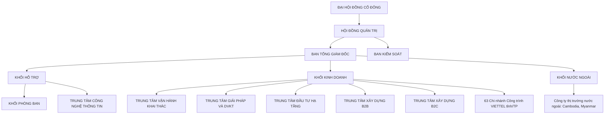

<!-- ===== 001 ===== -->

# TỔNG CÔNG TY CP CÔNG TRÌNH VIETTEL

## viettel  
construction

# BÁO CÁO THƯỜNG NIÊN  
## 2024

### NÂNG CAO TRẢI NGHIỆM  
### BỨT PHÁ TĂNG TRƯỞNG

---

**30**  
**1995 - 2025**  
**viettel**  
**construction**

<!-- ===== 002 ===== -->

# DANH MỤC CÁC TỪ VIẾT TẮT

| TỪ VIẾT TẮT | GIẢI THÍCH |
|-------------|------------|
| Tổng Công ty/VCC | Tổng Công ty Cổ phần Công trình Viettel |
| ĐHĐCĐ | Đại hội đồng cổ đông |
| HĐQT | Hội đồng quản trị |
| BKS | Ban kiểm soát |
| BĐH | Ban điều hành - Ban Tổng Giám đốc |
| TGĐ | Tổng Giám đốc |
| PTGĐ | Phó Tổng Giám đốc |
| CBNV | Cán bộ, công nhân viên |
| CTV | Cộng tác viên |
| SXKD | Sản xuất kinh doanh |
| VHKT | Vận hành khai thác |
| NLMT | Năng lượng mặt trời |
| CNTT | Công nghệ thông tin |
| NSLĐ | Năng suất lao động |
| VTTB | Vật tư thiết bị |
| QTRR | Quản trị rủi ro |
| "Hay" | Cơ chế trả lương do Hay Group – Tập đoàn tư vấn toàn cầu về lĩnh vực nhân sự tư vấn, xây dựng |
| TMForum | Hiệp hội ngành công nghiệp toàn cầu cho các nhà cung cấp dịch vụ và nhà cung cấp của họ trong ngành viễn thông |
| B2B | Business To Business - hình thức buôn bán, kinh doanh, giao dịch trực tiếp giữa doanh nghiệp và doanh nghiệp. |
| B2C | Business-to-consumer: kinh doanh với đối tượng khách hàng là người tiêu dùng cá nhân |
| BI | Business Intelligence - trí tuệ doanh nghiệp - công nghệ giúp doanh nghiệp hiểu biết về quá khứ, qua đó đưa ra quyết định, hành động và dự đoán tương lai |
| EPC | Engineering, Procurement and Construction: Thiết kế, cung cấp thiết bị công nghệ và thi công xây dựng công trình. |
| ROE | Return On Equity: Lợi nhuận trên vốn chủ sở hữu |
| EPS | Earning Per Share: Lợi nhuận sau thuế của 1 cổ phiếu. |
| ESOP | Employee Stock Ownership Plan: Cổ phiếu được phát hành theo chương trình lựa chọn cho Người lao động |

---

# MỤC LỤC

| TRANG | NỘI DUNG |
|-------|----------|
| 04 | THÔNG ĐIỆP CHỦ TỊCH HĐQT |
| 05 | THÔNG ĐIỆP TỔNG GIÁM ĐỐC |
| 06 | NHÌN LẠI NĂM 2024 |
| 06 | I. CON SỐ ẤN TƯỢNG |
| 08 | II. SỰ KIỆN NỔI BẬT NĂM 2024 |
| 10 | III. DANH HIỆU & GIẢI THƯỞNG NĂM 2024 |
| 11 | PHẦN I: THÔNG TIN CHUNG |
| 11 | I. THÔNG TIN CƠ BẢN KHÁI QUÁT |
| 12 | II. LỊCH SỬ HÌNH THÀNH VÀ PHÁT TRIỂN |
| 14 | III. NGÀNH NGHỀ VÀ ĐỊA BÀN KINH DOANH |
| 15 | IV. MÔ HÌNH/ CƠ CẤU TỔ CHỨC |
| 16 | V. CÔNG TY CON/ CÔNG TY LIÊN KẾT |
| 17 | VI. ĐỊNH HƯỚNG PHÁT TRIỂN |
| 18 | VII. QUẢN TRỊ RỦI RO |
| 24 | PHẦN II: TÌNH HÌNH HOẠT ĐỘNG TRONG NĂM |
| 25 | I. TÌNH HÌNH HOẠT ĐỘNG SXKD |
| 26 | II. ĐÁNH GIÁ THỰC HIỆN CÁC CHUYỂN DỊCH THEO CHIẾN LƯỢC GIAI ĐOẠN 2021 – 2025 |
| 26 | 1. CHỈ TIÊU TÀI CHÍNH |
| 26 | 2. CHỈ TIÊU HIỆU QUẢ |
| 26 | 3. CÁC CHUYỂN DỊCH CHIẾN LƯỢC CỦA ĐƠN VỊ THEO CHIẾN LƯỢC GIAI ĐOẠN 2021 – 2025 |
| 28 | III. TỔ CHỨC VÀ NHÂN SỰ |
| 28 | 1. DANH SÁCH BAN ĐIỀU HÀNH (BAN TGĐ VÀ KẾ TOÁN TRƯỞNG) |
| 28 | 2. SỐ LƯỢNG NGƯỜI LAO ĐỘNG |
| 30 | IV. TÌNH HÌNH ĐẦU TƯ, TÌNH HÌNH THỰC HIỆN CÁC DỰ ÁN ĐẦU TƯ |
| 30 | 1. CÁC KHOẢN ĐẦU TƯ LỚN, TÌNH HÌNH THỰC HIỆN CÁC DỰ ÁN ĐẦU TƯ |
| 30 | 2. CÔNG TY CON VÀ TÌNH HÌNH HOẠT ĐỘNG/TÀI CHÍNH |
| 31 | V. TÌNH HÌNH TÀI CHÍNH |
| 31 | 1. TÌNH HÌNH TÀI CHÍNH |
| 31 | 2. CÁC CHỈ TIÊU TÀI CHÍNH CHỦ YẾU |
| 32 | VI. CƠ CẤU CỔ ĐÔNG, THAY ĐỔI VỐN ĐẦU TƯ CỦA CHỦ SỞ HỮU |
| 32 | 1. THÔNG TIN CƠ BẢN CỔ PHIẾU |
| 32 | 2. DIỄN BIẾN GIAO DỊCH CỦA CỔ PHIẾU |
| 37 | VII. BÁO CÁO TÁC ĐỘNG LIÊN QUAN ĐẾN MÔI TRƯỜNG XÃ HỘI |
| 38 | PHẦN III: BÁO CÁO ĐÁNH GIÁ CỦA BAN TỔNG GIÁM ĐỐC |
| 39 | I. ĐÁNH GIÁ KẾT QUẢ HOẠT ĐỘNG SẢN XUẤT KINH DOANH |
| 40 | II. TÌNH HÌNH TÀI CHÍNH |
| 41 | III. NHỮNG CẢI TIẾN VỀ CƠ CẤU TỔ CHỨC, CHÍNH SÁCH, QUẢN LÝ |
| 48 | PHẦN IV: ĐÁNH GIÁ CỦA HĐQT VỀ HOẠT ĐỘNG TỔNG CÔNG TY |
| 49 | I. ĐÁNH GIÁ CÁC MẶT HOẠT ĐỘNG CỦA TỔNG CÔNG TY |
| 53 | II. ĐÁNH GIÁ VIỆC THỰC HIỆN NHIỆM VỤ CỦA BAN ĐIỀU HÀNH |
| 54 | III. KẾ HOẠCH VÀ ĐỊNH HƯỚNG CỦA HĐQT NĂM 2025 |
| 55 | PHẦN V: QUẢN TRỊ TỔNG CÔNG TY |
| 56 | I. HĐQT VÀ CÁC TIỂU BAN |
| 56 | 1. THÀNH VIÊN VÀ CƠ CẤU CỦA HỘI ĐỒNG QUẢN TRỊ |
| 56 | 2. CÁC TIỂU BAN THUỘC HỘI ĐỒNG QUẢN TRỊ |
| 56 | 3. HOẠT ĐỘNG CỦA HỘI ĐỒNG QUẢN TRỊ |
| 56 | 4. HOẠT ĐỘNG CỦA THÀNH VIÊN HỘI ĐỒNG QUẢN TRỊ ĐỘC LẬP |
| 56 | 5. DANH SÁCH CÁC THÀNH VIÊN HỘI ĐỒNG QUẢN TRỊ CÓ CHỨNG CHỈ ĐÀO TẠO VỀ QUẢN TRỊ CÔNG TY |
| 63 | II. BAN KIỂM SOÁT |
| 63 | 1. THÀNH VIÊN VÀ CƠ CẤU CỦA BAN KIỂM SOÁT |
| 63 | 2. HOẠT ĐỘNG CỦA BAN KIỂM SOÁT |
| 63 | 3. GIAO DỊCH VÀ THỦ LAO |
| 71 | PHẦN VI: BÁO CÁO TÀI CHÍNH 2024 - ĐÃ ĐƯỢC KIỂM TOÁN |

<!-- ===== 003 ===== -->

# THÔNG ĐIỆP CHỦ TỊCH HỘI ĐỒNG QUẢN TRỊ

Kính thưa Quý Cổ đông, Khách hàng, Đối tác và toàn thể CBNV,

Khép lại một năm 2024 đầy khó khăn đến từ thiên tai với cơn bão Yagi mạnh nhất trong vòng 70 năm qua, đầy thách thức đến từ KPI và chỉ tiêu từ hợp đồng vận hành khai thác mới và từ những biến động chính trị trên thế giới và khu vực. Vượt qua tất cả, Viettel Construction đã hoàn thành kế hoạch sản xuất kinh doanh đề ra với tốc độ tăng trưởng doanh thu trên 10%. Bên cạnh việc hoàn thành kế hoạch kinh doanh, Viettel Construction đã hoàn thành nhiều nhiệm vụ trọng điểm của quốc gia, Tập đoàn giao: Xây dựng dự án truyền tải điện 500KV mạch 3; triển khai lắp đặt trạm BTS để khai trương mạng 5G Viettel; khôi phục hạ tầng mạng lưới sau bão... Tất cả kết quả đó là minh chứng cho sức mạnh và bản lĩnh của Người Viettel Construction.

Bước sang năm 2025, một năm đánh dấu chặng đường 30 năm hình thành và phát triển, Viettel Construction được ví như một chàng trai trẻ đầy nhiệt huyết, không ngừng nỗ lực vươn lên, trưởng thành và đạt được những thành tựu đáng tự hào. Nhưng có một điều không hề thay đổi, đó là sứ mệnh "Dựng xây cuộc sống mới" luôn cháy bỏng trong tim.

Cuộc sống mới chính là đích đến mà doanh nghiệp luôn hướng tới, không chỉ là những giá trị vật chất, mà còn là những trải nghiệm tích cực, truyền cảm hứng và góp phần xây dựng một xã hội tốt đẹp hơn. Viettel Construction không chỉ kinh doanh vì lợi nhuận, mà còn vì sứ mệnh nâng tầm chất lượng cuộc sống, kiến tạo những giá trị bền vững cho thế hệ hiện tại và tương lai.

Chúng tôi sẽ không ngừng đổi mới tiên phong ứng dụng công nghệ hiện đại, Viettel Construction không chỉ kiến tạo nền tảng hạ tầng vững chắc mà còn đồng hành cùng sự phát triển bứt phá của dân tộc. Với khát vọng vươn xa, chúng tôi tiếp tục mở rộng, chinh phục những mục tiêu chiến lược, đóng góp cho một Việt Nam thịnh vượng, hiện đại và hội nhập toàn cầu.

Năm 2025 cũng là khởi đầu cho một giai đoạn chiến lược mới của Tổng Công ty, một giai đoạn vươn mình, bùng nổ và đầy vinh quang. Chúng tôi hy vọng sẽ được tiếp tục đồng hành cùng quý cổ đông, quý khách hàng, quý đối tác và toàn thể CBNV trên chặng đường sắp tới.

Trân trọng cảm ơn!

**CHỦ TỊCH**

Đỗ Mạnh Hùng

---

# THÔNG ĐIỆP TỔNG GIÁM ĐỐC

Kính thưa Quý Cổ đông, Khách hàng, Đối tác và Quý vị,

Chuyển đổi kép: "Chuyển đổi số và Chuyển đổi xanh trong doanh nghiệp với mục tiêu phát triển bền vững" đã và đang gõ cửa các quốc gia, doanh nghiệp trên thế giới. Đây được xem là bước chuyển lớn của nhân loại, một sứ mệnh toàn cầu, một mệnh lệnh đặt ra cho tất cả các quốc gia, doanh nghiệp vì một thế giới thịnh vượng và xanh hơn, mở ra cơ hội to lớn, tạo động lực mạnh mẽ cho cộng đồng doanh nghiệp Việt tiến hành chuyển đổi sang mô hình kinh doanh mang tính bền vững.

Để triển khai mục tiêu này, Việt Nam đang thực hiện nhiều chiến lược quan trọng như Chiến lược quốc gia về tăng trưởng xanh giai đoạn 2021-2030, tầm nhìn đến năm 2050, Chiến lược quốc gia về biến đổi khí hậu giai đoạn đến năm 2050. Đồng hành cùng Chính phủ, Viettel Construction đã và đang có những chuyển động mạnh mẽ trong chuyển đổi kép, thay đổi căn bản về tư duy và hành động, đưa ra chiến lược đúng đắn và nắm bắt những cơ hội tăng trưởng, tiếp tục phát huy thế mạnh kinh doanh trên nền tảng kỹ thuật kết hợp ứng dụng khoa học công nghệ số nhằm nâng cao chất lượng sống người dân thông qua từng sản phẩm và dịch vụ.

Cụ thể trong năm 2024, Viettel Construction hoàn thành 100% kế hoạch năm với Doanh thu đạt 12.663 tỷ đồng, tăng 1.267,1 tỷ đồng so với năm 2023; Lợi nhuận trước thuế đạt 671,8 tỷ đồng, tăng 35,8 tỷ đồng so với năm 2023. Đặc biệt tại lĩnh vực kinh doanh "xanh" - Năng lượng mặt trời, chúng tôi đã ký kết và triển khai cho 2.877 khách hàng doanh nghiệp, hộ gia đình với tổng công suất 50 MWP ~ 508 tỷ đồng, chứng minh cho những nỗ lực chuyển đổi của Viettel Construction trong công cuộc thúc đẩy doanh nghiệp song hành với phát triển bền vững.

Bên cạnh đó, Viettel Construction luôn nỗ lực trong việc đảm bảo công việc và thu nhập cho hơn 11.000 cán bộ nhân viên. Liên tục tuyển mới các nhân sự có trình độ cao gia nhập ngôi nhà chung Viettel Construction. Chúng tôi coi con người là yếu tố then chốt đồng thời là nguồn vốn quý giá nhất của doanh nghiệp. Việc này không đơn giản chỉ là chuyển từ nền kinh tế "màu nâu" sang "màu xanh", mà còn đòi hỏi sự đầu tư vào đào tạo nguồn nhân lực và nâng cấp vốn con người, bên cạnh việc duy trì nguồn vốn xã hội và tự nhiên.

Trong bối cảnh hiện tại, tư duy kinh doanh chỉ chú trọng đến lợi nhuận đã không còn phù hợp. Chuyển đổi xanh, tăng trưởng xanh và phát triển xanh là những yếu tố không thể tách rời trong quá trình phát triển. Viettel Construction xác định, doanh nghiệp bền vững phải kết hợp thành công về mặt tài chính với những đóng góp tích cực cho xã hội, như tạo ra công ăn việc làm, góp phần ổn định an sinh và bảo vệ môi trường.

Sau cùng, Viettel Construction tâm niệm việc đưa chất lượng sản phẩm, dịch vụ tốt nhất đến gần hơn với người dân trên mọi miền Tổ quốc và các Quốc gia trên thế giới là trách nhiệm cao cả trong giai đoạn mới: Dựng xây một cuộc sống tốt đẹp cho từng hộ gia đình, mang những giải pháp tối ưu đến từng doanh nghiệp từ đó kiến tạo nên những giá trị thịnh vượng cho xã hội. Đây cũng là chiến lược kinh doanh dài hạn mà Viettel Construction theo đuổi nhằm hướng đến mục tiêu đạt 1 tỷ USD vào năm 2030 để tiến đến lộ trình hạnh phúc và vững mạnh trong tương lai.

**TỔNG GIÁM ĐỐC**

Phạm Đình Trường

<!-- ===== 004 ===== -->

# NHÌN LẠI NĂM 2024

## I- CON SỐ ẤN TƯỢNG

### Tổng doanh thu
| Chỉ tiêu | Giá trị |
|----------|---------|
| Tổng doanh thu | 12.663 Tỷ đồng |

### Lợi nhuận sau thuế
| Chỉ tiêu | Giá trị |
|----------|---------|
| Lợi nhuận sau thuế | 538 Tỷ đồng |
| Ghi chú | Tăng 2,6% so với cùng kỳ, hoàn thành 101% kế hoạch |

### ROE
| Chỉ tiêu | Giá trị |
|----------|---------|
| ROE | 27,9% |

### ROA
| Chỉ tiêu | Giá trị |
|----------|---------|
| ROA | 7,6% |

### EPS
| Chỉ tiêu | Giá trị |
|----------|---------|
| EPS | 4.705 đồng |

### Tổng tài sản
| Chỉ tiêu | Giá trị |
|----------|---------|
| Tổng tài sản | 7.106 Tỷ đồng |

### Vốn chủ sở hữu
| Chỉ tiêu | Giá trị |
|----------|---------|
| Vốn chủ sở hữu | 1.865 Tỷ đồng |

### Vốn hóa cổ phiếu CTR
| Chỉ tiêu | Giá trị |
|----------|---------|
| Vốn hóa cổ phiếu CTR tại ngày 31/12/2024 | 14.240 Tỷ đồng |
| Ghi chú | Trong năm 2024 vốn hóa/ thị giá cổ phiếu CTR tăng trưởng 36% so với mức tăng 12% của VNindex. |

### Vị thế TOWERCO
| Chỉ tiêu | Giá trị |
|----------|---------|
| Khẳng định vị thế Towerco số 1 Việt Nam | SỐ 1 |
| Hạ tầng sở hữu | 10.000 trạm BTS; 1,87 triệu m² Das; 2.716 km truyền dẫn; 16,87 mwp điện mặt trời. |
| Ghi chú | Số 1 công ty cung cấp dịch vụ VHKT hạ tầng mạng lưới viễn thông. |
| Ghi chú | Số 1 công ty cung cấp dịch vụ HomeService. |

<!-- ===== 005 ===== -->

# II- SỰ KIỆN NỔI BẬT NĂM 2024

| STT | Nội dung |
|-----|----------|
| 1 | VIETTEL CONSTRUCTION TỔ CHỨC THÀNH CÔNG ĐẠI HỘI THI ĐUA QUYẾT THẮNG GIAI ĐOẠN 2019-2024 |
| 2 | THAM GIA THI CÔNG GÓI THẦU THUỘC DỰ ÁN TRUYỀN TẢI ĐIỆN 500KV - DỰ ÁN TRỌNG ĐIỂM QUỐC GIA |
| 3 | CHUNG SỨC ĐỒNG LÒNG VƯỢT CƠN BÃO LỊCH SỬ - YAGI ĐỂ BẢO VỆ MẠNG LƯỚI |
| 4 | NGƯỜI LÍNH VIETTEL QUÁ CẢM:   ▶ NGUYỄN ĐỨC TÀI - “TRÁI TIM DŨNG CẢM” WECCHOICE AWARDS 2024   ▶ NHÂN VIÊN KỸ THUẬT HOÀNG ĐỨC HIẾU KÍP THỜI CỨU NGƯỜI DÂN LẶT THUYỀN TRONG LŨ |
| 5 | KỸ THUẬT VIETTEL CONSTRUCTION THAM GIA TÌM KIẾM 2 PHI CÔNG GIỮA RỪNG SÂU |
| 6 | TRIỂN KHAI LẮP ĐẶT THIẾT BỊ 5G LÀ NHIỆM VỤ TRỌNG TÂM ĐƯỢC TẬP ĐOÀN GIAO, TRONG ĐÓ VCC LÀ HẠT NHÂN NÒNG CỐT TRONG QUÁ TRÌNH TRIỂN KHAI |
| 7 | VIETTEL CONSTRUCTION ĐẠT 17 GIẢI THƯỞNG UY TÍN TRONG NƯỚC VÀ QUỐC TẾ |
| 8 | MỨC ĐỘ TRƯỞNG THÀNH SỐ ĐỨNG THỨ 3 TẬP ĐOÀN, DẪN ĐẦU VỀ LĨNH VỰC DỮ LIỆU |
| 9 | VIETTEL CONSTRUCTION CÓ ĐỘ PHỦ LỚN NHẤT THỊ TRƯỜNG XÂY DỰNG TẠI VIỆT NAM |
| 10 | KIẾN TOÀN BAN TỔNG GIÁM ĐỐC VIETTEL CONSTRUCTION |

<!-- ===== 006 ===== -->

# III- SỰ KIỆN NỔI BẬT NĂM 2024

## DANH HIỆU

### ANH HÙNG LAO ĐỘNG
**THỜI KỲ ĐỔI MỚI**

## GIẢI THƯỞNG

### GIẢI QUẢN TRỊ & CON NGƯỜI
- TOP 10 DOANH NGHIỆP QUẢN TRỊ CÔNG TY TỐT NHẤT (VLCA 2024)
- TOP 100 DOANH NGHIỆP BỀN VỮNG HOẠT ĐỘNG TRONG LĨNH VỰC THƯƠNG MẠI - DỊCH VỤ (CSI 100)
- Mid Cap có hoạt động IR được nhà đầu tư yêu thích nhất 2024” và “Mid Cap có hoạt động IR được định chế tài chính đánh giá cao nhất 2024”
- Wechoice Awards 2024 – Giải Trái tim dũng cảm
- Đứng thứ 76 trong Top 100 Nơi Làm Việc Tốt Nhất Việt Nam 2024 khối Doanh nghiệp lớn.

### GIẢI CÁC LĨNH VỰC
- Hệ thống IOC – Giải pháp điều hành kinh doanh toàn trình xây dựng dân dụng (Intelligent Operation Center)
- Giải Thương hiệu Quốc gia 2024 - 2026: Thiết kế, cung cấp, lắp đặt hệ thống điện năng lượng mặt trời VIETTEL
- TOP10 Sản phẩm công nghệ số xuất sắc trong lĩnh vực công nghiệp và xây dựng
- Giải thưởng Make in Vietnam 2024
- TOP5 Nhà thầu uy tín, chất lượng hàng đầu Việt Nam 2024 – VietNam Construction Awards 2024
- Đứng thứ 1 trong ngành Xây dựng/ Kiến trúc khối Doanh nghiệp lớn
- Quán quân nhà phát triển hạ tầng và xây lắp điện
- Quán quân Top 10 Nhà thầu xây dựng Việt Nam, hạng mục Hạ tầng – Công nghiệp.
- Construction Company of the year - Bronze

### GIẢI XẾP HẠNG DOANH NGHIỆP
- Viettel Construction được vinh danh trong Top 500 Doanh nghiệp tạo giá trị hàng đầu Việt Nam 2024 (Value500) và Top 10 Doanh nghiệp tạo giá trị hàng đầu Việt Nam 2024 trong các ngành kinh tế trọng điểm.
- Top 500 Công ty lớn nhất khu vực Đông Nam Á (Fortune 500)
- Top 500 Doanh nghiệp tăng trưởng nhanh nhất Việt Nam 2024
- Top 50 Doanh nghiệp tăng trưởng xuất sắc nhất Việt Nam

---

# PHẦN I: THÔNG TIN CHUNG

## I. THÔNG TIN CƠ BẢN KHÁI QUÁT

| **Thông tin** | **Nội dung** |
|----------------|--------------|
| **Tên đầy đủ** | Tổng Công ty Cổ phần Công trình Viettel |
| **Tên viết tắt** | Viettel Construction |
| **Trụ sở chính** | Số 1 Giang Văn Minh, Phường Kim Mã, Quận Ba Đình, Thành phố Hà Nội |
| **Địa chỉ giao dịch** | Số 06 Phạm Văn Bạch, Phường Yên Hòa, Quận Cầu Giấy, Thành phố Hà Nội |
| **Điện thoại** | (024) 6275 1783 |
| **Fax** | (024) 6275 1783 |
| **Website** | https://viettelconstruction.com.vn/ |
| **Logo** |  |
| **Vốn điều lệ đăng ký** | 1.143.858.790.000 đồng (Một nghìn, một trăm bốn mươi ba tỷ, tám trăm năm mươi tám triệu, bảy trăm chín mươi nghìn đồng) |
| **Vốn điều lệ thực góp** | 1.143.858.790.000 đồng (Một nghìn, một trăm bốn mươi ba tỷ, tám trăm năm mươi tám triệu, bảy trăm chín mươi nghìn đồng) |
| **Giấy CNĐKDN** | Giấy CNĐKDN số 0104753865 do Sở Kế hoạch & Đầu tư TP. Hà Nội cấp đăng ký lần đầu ngày 09/06/2010, cấp đăng ký thay đổi lần thứ 18 ngày 24/06/2024 |
| **Mã số thuế** | 0104753865 |
| **Người đại diện theo pháp luật** | Phạm Đình Trường – Thành viên HĐQT kiêm Tổng Giám đốc |

---

**Annual Report 2024**

**BÁO CÁO THƯỜNG NIÊN NĂM 2024**

**10** » TỔNG CÔNG TY CP CÔNG TRÌNH VIETTEL

**11**

<!-- ===== 007 ===== -->

# II. LỊCH SỬ HÌNH THÀNH VÀ PHÁT TRIỂN

Tổng Công ty Cổ phần Công trình Viettel được thành lập ngày 30 tháng 10 năm 1995, là đơn vị hạch toán độc lập, một phần không thể thiếu trong hệ sinh thái Tập đoàn Công nghiệp - Viễn thông Quân đội. Sở hữu nguồn lực lên đến 11.000 người và mạng lưới hoạt động trải dài khắp 63 tỉnh thành trên cả nước, Viettel Construction là đơn vị cung cấp dịch vụ trên nền tảng kỹ thuật hàng đầu Việt Nam thông qua 5 trụ kinh doanh chiến lược chính: Đầu tư Hạ tầng, Xây dựng (bao gồm xây dựng hạ tầng viễn thông, xây dựng dân dụng B2C và B2B), Công nghệ thông tin, Giải pháp và Dịch vụ Kỹ thuật và Vận hành Khai thác.

Đến nay sau gần 30 năm hoạt động, Viettel Construction đã xây dựng hệ thống hạ tầng mạng lưới viễn thông trong nước với hơn 50.000 trạm phát sóng, 320.000 km cáp quang (tương đương 8 vòng trái đất), bao phủ 100% lãnh thổ Việt Nam bao gồm vùng biển hải đảo và vùng sâu vùng xa. Đồng thời còn là đơn vị tham gia xây dựng hạ tầng viễn thông tại 10 quốc gia thuộc châu Á, châu Phi và châu Mỹ.

## 1995 – 2003

- Thành lập Xí nghiệp khảo sát thiết kế và Xí nghiệp Xây lắp Công trình (tiền thân của Tổng Công ty CP Công trình Viettel) trực thuộc Công ty Điện tử Viễn thông Quân đội.
- Xí nghiệp thi công móng cột và lắp dựng các cột anten trong nước, quốc tế có chất lượng cao như: cột anten 120 m Đài truyền hình Tuyên Quang, Cột anten 140 m Đài truyền hình Trung ương Lào, các cột anten cho Công ty Lào Telecom tại Viên Chăn.

## 2004 – 2009

- Xí nghiệp xây lắp Công trình đổi tên thành Công ty Công trình Viettel.
- Năm 2006, Quyết định chuyển đổi hình thức hoạt động từ Công ty hạch toán phụ thuộc sang hạch toán độc lập với tên giao dịch mới: Công ty Trách nhiệm hữu hạn nhà nước một thành viên Công trình Viettel.
- Tháng 12/2007, thực hiện triển khai thi công mạng lưới tại Vương quốc Campuchia.

## 2010 – 2017

- Năm 2010, Viettel Construction tập trung mạnh vào xây dựng hạ tầng mạng lưới 3G. Hạ tầng mạng 2G và 3G của Tập đoàn Viettel là mạng lớn nhất Việt Nam.
- Ngày 15/01/2010, Bộ trưởng Bộ quốc phòng quyết định về việc chuyển đổi Công ty TNHHNNMTV Công trình Viettel thành Công ty cổ phần Công trình Viettel.
- Trong năm 2011, Công trình Viettel tổ chức lực lượng triển khai thi công tại Haiti.
- Năm 2014, Thành lập 03 Công ty tại thị trường nước ngoài là Cameroon, Burundi và Tanzania.
- Năm 2015, Hoàn thiện thủ tục với Bộ Kế hoạch và đầu tư về cấp phép hoạt động tại 2 thị trường Lào và Myanmar.

## 2018 – 2020

- Trở thành nhà cung cấp dịch vụ kỹ thuật trên nền tảng số hàng đầu Việt Nam.
- Chính thức hoạt động trên 5 trụ kinh doanh chính: Đầu tư hạ tầng cho thuê, Xây dựng dân dụng, Công nghệ thông tin, Giải pháp Tích hợp và Vận hành Khai thác.
- Doanh thu năm 2020 đạt mốc 6.381 tỷ ~ 106% kế hoạch; Lợi nhuận đạt 274 tỷ ~ 136% kế hoạch.

## 2021 – 2025

- Trở thành nhà đầu tư, vận hành, cung cấp công trình thông minh, hiệu quả cao nhất.
- Năm 2024: Viettel Construction ghi nhận doanh thu 12.663 tỷ đồng. Giữ vững vị thế TowerCo số 1 Việt Nam.
- Mục tiêu doanh thu đến năm 2025 đạt 13.968 tỷ đồng.
- Trưởng thành số đạt mức 5/5 theo tiêu chuẩn TMForum vào năm 2025.

<!-- ===== 008 ===== -->

# III. NGÀNH NGHỀ VÀ ĐỊA BẢN KINH DOANH

| STT | LĨNH VỰC | NHÓM SPDV | TÊN SPDV |
|-----|----------|-----------|----------|
| 1 | Vận hành khai thác | Vận hành khai thác trong nước và nước ngoài | ▶ Cung cấp dịch vụ vận hành khai thác và ứng cứu thông tin trạm, tuyến cáp và hộp cáp CDBR lớp mạng truy nhập; Quản lý đường dây thuê bao và phát triển mới khách hàng cố định băng rộng |
| 2 | Xây lắp | Xây lắp hạ tầng mạng viễn thông | ▶ Dịch vụ xây dựng, lắp đặt, củng cố, bảo dưỡng hệ thống nhà trạm, cột anten, cột truyền hình, hệ thống tiếp địa thoát sét, hệ thống cáp quang... |
| 3 | Xây lắp | Xây dựng dân dụng B2B | ▶ Xây dựng hạ tầng các dự án xây dựng (Nhà ở, khu nghỉ dưỡng, khu công nghiệp, nhà xưởng...); Hạ tầng công trình Thủy lợi, Giao thông; Cầu Cảng ... |
| 4 | Xây lắp | Xây dựng dân dụng B2C&SME | ▶ Xây dựng các công trình nhà ở cá nhân, nhà xưởng, văn phòng làm việc, trường học.... |
| 5 | Hạ tầng cho thuê | Trạm BTS | ▶ Đầu tư Hạ tầng trạm BTS cho thuê, hệ thống nguồn cho trạm BTS cho thuê |
| 6 | Hạ tầng cho thuê | Hạ tầng IoT khu đô thị, khu công nghiệp, cảng biển | ▶ Đầu tư xây dựng hạ tầng IoT khu đô thị, khu công nghiệp, cảng biển |
| 7 | Hạ tầng cho thuê | Năng lượng tái tạo | ▶ Điện năng lượng mặt trời |
| 8 | Hạ tầng cho thuê | DAS và CDBR | ▶ DAS và CDBR |
| 9 | Hạ tầng cho thuê | Cống bể cho thuê | ▶ Cống bể cho thuê, cáp quang treo |
| 10 | Giải pháp tích hợp | Bán lẻ & Phân phối thiết bị hàng hóa | ▶ Bán lẻ và phân phối các thiết bị hàng hóa (không bao gồm lắp đặt) của các lĩnh vực: Điện gia dụng, thiết bị smarthome, thiết bị công nghệ thông tin, hệ thống năng lượng mặt trời do TCT OEM hoặc phân phối từ các nhãn hàng. |
| 11 | Giải pháp tích hợp | Giải pháp Cơ điện và Năng lượng | ▶ Hệ thống điện nặng, điện nhẹ; Hệ thống chữa cháy; Hệ thống chiếu sáng, chiếu sáng khẩn cấp, đèn năng lượng mặt trời; Máy phát điện; Hệ thống camera; Hệ thống năng lượng mặt trời |
| 12 | Dịch vụ kỹ thuật | Dịch vụ bảo dưỡng, lắp đặt, sửa chữa các thiết bị gia đình (B2C) | ▶ Dịch vụ bảo dưỡng, bảo trì, sửa chữa các thiết bị gia đình bao gồm: Điều hòa/ Máy giặt/ Máy lọc nước/ Bình nóng lạnh/ Năng lượng mặt trời/smarthome. |
| 13 | Dịch vụ kỹ thuật | Dịch vụ thi công lắp đặt hoặc dịch vụ vận hành bảo trì, bảo dưỡng các hệ thống năng lượng tái tạo | ▶ Dịch vụ thi công, lắp đặt mới hệ thống năng lượng mặt trời bao gồm: điện áp mái, điện farm. ▶ Dịch vụ vận hành bảo dưỡng, bảo trì, sửa chữa hệ thống năng lượng mặt trời bao gồm: điện áp mái, điện farm. |

**CÁC SẢN PHẨM DỊCH VỤ TRÊN ĐƯỢC TỔNG CÔNG TY CUNG CẤP TẠI 63 TỈNH/TP TẠI VIỆT NAM.**

---

# IV. MÔ HÌNH/ CƠ CẤU TỔ CHỨC

## 1. BAN TỔNG GIÁM ĐỐC
▶ Tổng Giám đốc và 04 Phó Tổng Giám đốc.

## 2. KHỐI HỖ TRỢ, NGHIỆP VỤ
▶ Khối cơ quan (gồm 11 phòng): Phòng Chính trị; Phòng Tổ chức lao động; Văn phòng; Phòng Tài chính kế toán; Phòng Mua sắm; Phòng Truyền thông đào tạo; Phòng Pháp chế và Kiểm soát nội bộ; Phòng Kỹ thuật công nghệ; Phòng Chiến lược Kinh doanh, Phòng Chăm sóc khách hàng, Phòng Kiểm toán nội bộ ▶ Trung tâm Công nghệ thông tin.

## 3. KHỐI KINH DOANH (05 TRUNG TÂM)
▶ Lĩnh vực VHK T: Trung tâm Vận hành khai thác. ▶ Lĩnh vực giải pháp & dịch vụ kỹ thuật: Trung tâm Giải pháp và Dịch vụ kỹ thuật. ▶ Lĩnh vực xây lắp viễn thông, đầu tư hạ tầng: Trung tâm Đầu tư hạ tầng. ▶ Lĩnh vực xây dựng dân dụng: Trung tâm Xây dựng B2B; Trung tâm Xây dựng B2C.

## 4. KHỐI TRỰC TIẾP SXKD
▶ 63 Chi nhánh Công trình Viettel tỉnh/TP. ▶ Công ty thị trường nước ngoài: 02 Công ty tại thị trường đang hoạt động: Myanmar, Cambodia.

<!-- ===== 009 ===== -->

# V. CÔNG TY CON/ CÔNG TY LIÊN KẾT

## VIETTEL CONSTRUCTION CAMBODIA CO., LTD
- **Địa chỉ**: 22D, ChrokThmay, VeangVong, 7 Makara, Phnom Pênh, Campuchia
- **Lĩnh vực hoạt động**: Thi công, xây lắp hạ tầng viễn thông
- **Vốn điều lệ**: 10.000 USD
- **Tỷ lệ sở hữu**: 100%

## VIETTEL CONSTRUCTION MYANMAR CO.,LTD
- **Địa chỉ**: Số 39, Đường Inya Myaing, Golden Vallay 1, Bahan, Yangon, Myanmar
- **Lĩnh vực hoạt động**: Thi công, xây lắp hạ tầng viễn thông
- **Vốn điều lệ**: 680.000 USD
- **Tỷ lệ sở hữu**: 100%

---

# VI. ĐỊNH HƯỚNG PHÁT TRIỂN

## TẦM NHÌN:
Trở thành nhà đầu tư, vận hành, cung cấp công trình thông minh, hiệu quả cao nhất.

## SỨ MỆNH:
Thúc đẩy cách mạng công nghiệp 4.0 đến các doanh nghiệp, hộ gia đình. Cung cấp hệ sinh thái sản phẩm, dịch vụ trên nền tảng kỹ thuật các lĩnh vực Đầu tư hạ tầng, Xây dựng, Công nghệ thông tin, Giải pháp tích hợp, Dịch vụ kỹ thuật và Vận hành khai thác theo tiêu chí: chuyên nghiệp, chất lượng, chi phí cạnh tranh, đóng góp tích cực vào sự phát triển kinh tế và xã hội.

## MỤC TIÊU ĐẾN NĂM 2030:
Đến năm 2030, Tổng Công ty trở thành doanh nghiệp tỷ đô, quy mô doanh thu từ 25.000 - 30.000 tỷ, tăng trưởng trung bình trên 10-15%; Lợi nhuận lớn hơn 1.000 tỷ, tăng trưởng 5-10%/năm.

- **Mảng Vận hành khai thác**: số 1 về VHKT tại Việt Nam và mở rộng thị trường nước ngoài, ưu tiên thị trường Viettel đầu tư.
- **Đầu tư hạ tầng cho thuê**: Số 1 về TowerCo tại thị trường Việt Nam. Mở rộng đầu tư hạ tầng ngành hóa, IoT, năng lượng tái tạo.
- **Xây dựng**: Top 3 doanh nghiệp xây dựng B2B và số 1 về B2C. Mở rộng hoạt động xây dựng tại nước ngoài.
- **Giải pháp và dịch vụ kỹ thuật**: Top 1 nhà cung cấp hệ thống năng lượng mặt trời cho khách hàng cá nhân. Top 3 nhà thầu triển khai M&E.

---

**Annual Report 2024**

**16** » TỔNG CÔNG TY CP CÔNG TRÌNH VIETTEL  
**BÁO CÁO THƯỜNG NIÊN NĂM 2024** « **17**

<!-- ===== 010 ===== -->

# VII. QUẢN TRỊ RỦI RO

Năm 2024, tình hình kinh tế - xã hội Việt Nam bị ảnh hưởng mạnh mẽ bởi bất ổn chính trị, thiên tai và biến đổi khí hậu trên toàn cầu. Đặc biệt, siêu bão số 3 Yagi, cơn bão mạnh nhất trong 30 năm qua, đã gây thiệt hại lớn về hạ tầng và tài sản, ảnh hưởng đến hoạt động sản xuất và kinh doanh của TCT. Mặc dù đối mặt với nhiều thách thức, TCT đã linh hoạt thực hiện các giải pháp ứng phó rủi ro và duy trì hoạt động, đồng thời nhận diện những cơ hội phát sinh trong các lĩnh vực xây dựng, cải tạo, sửa chữa hạ tầng, và đạt mục tiêu mức độ trưởng thành 5 về Quản trị rủi ro (QTRR) trong năm 2024.

## 1. CƠ CẤU TỔ CHỨC CỦA HỆ THỐNG QUẢN TRỊ RỦI RO

### Sơ đồ tổ chức

| HỘI ĐỒNG QUẢN TRỊ |
|-------------------|
| → BAN TỔNG GIÁM ĐỐC |
| → TUYẾN THỨ NHẤT ← TUYẾN THỨ HAI ← TUYẾN THỨ BA |

#### TUYẾN THỨ NHẤT

| CÁC ĐƠN VỊ |
|------------|
| Phòng, Ban chức năng, CNKT Viettel tỉnh/TP. Các thị trường nước ngoài |
| Trưởng đơn vị |
| Điều phối viên QTRR |

#### TUYẾN THỨ HAI

| PHÒNG PHÁP CHẾ VÀ KIỂM SOÁT NỘI BỘ | PHÒNG KTCN |
|-----------------------------------|------------|
| Pháp lý | Kiểm soát nội bộ | Quản trị rủi ro | ISO, Quy trình |
| Trưởng bộ phận | |
| Chuyên viên | |

#### TUYẾN THỨ BA

| PHÒNG KTNB |
|------------|
| Trưởng bộ phận |
| Kiểm toán viên |

### Mối quan hệ giữa các tuyến

- **Tuyến 1 → Tuyến 2**: Giải trình, báo cáo
- **Tuyến 2 → Tuyến 1**: Ủy quyền, định hướng cung cấp nguồn lực, giám sát
- **Tuyến 2 ↔ Tuyến 3**: Liên kết, điều phối giao tiếp, cộng tác

### Mô tả chi tiết

Hệ thống quản trị rủi ro tại VCC được xây dựng theo mô hình ba tuyến, đảm bảo tính chủ động và hiệu quả trong kiểm soát rủi ro. Trong đó:

- **TUYẾN SỐ 1**: chủ sở hữu rủi ro là các đơn vị trực thuộc VCC, bao gồm bộ phận kinh doanh, vận hành và hỗ trợ kinh doanh. Đây là những đơn vị tiếp nhận rủi ro trực tiếp từ hoạt động sản xuất kinh doanh và chịu trách nhiệm quản lý rủi ro trong phạm vi chức năng của mình. Các đơn vị này có nhiệm vụ nhận diện, đánh giá, kiểm soát rủi ro thông qua việc áp dụng các biện pháp kiểm soát ngay trong các quy trình nghiệp vụ, nhằm đảm bảo hoạt động kinh doanh được vận hành một cách an toàn, hiệu quả.

- **TUYẾN SỐ 2**: hỗ trợ và giám sát rủi ro. Chịu trách nhiệm xây dựng hệ thống văn bản, chính sách, công cụ QTRR, đồng thời hướng dẫn và phối hợp với tuyến số 1 trong công tác kiểm soát rủi ro. Ngoài ra, tuyến số 2 cũng thực hiện chức năng giám sát và phản biện để đảm bảo rằng các rủi ro được nhận diện và kiểm soát kịp thời. Bộ phận QTRR chịu trách nhiệm chính trong việc thực hiện chức năng này tại VCC.

- **TUYẾN SỐ 3**: Kiểm toán nội bộ thực hiện chức năng đánh giá độc lập về mức độ hiệu quả của hệ thống quản trị, quản lý rủi ro và kiểm soát nội bộ. Phòng kiểm toán nội bộ - trực thuộc Hội đồng quản trị, chịu trách nhiệm giám sát, kiểm tra mức độ tuân thủ, đánh giá hiệu quả các biện pháp kiểm soát rủi ro và đề xuất các giải pháp cải thiện nhằm nâng cao năng lực quản trị rủi ro của toàn TCT.

Việc triển khai mô hình 3 tuyến tại VCC giúp nâng cao tính chủ động trong quản trị rủi ro, tăng cường khả năng giám sát, kiểm soát rủi ro ở mọi cấp độ, đồng thời đảm bảo an toàn trong hoạt động sản xuất kinh doanh, hướng tới mục tiêu phát triển bền vững của Tổng Công ty.

## 2. CHÍNH SÁCH QUẢN TRỊ RỦI RO

Chính sách QTRR tại Tổng Công ty quy định các vấn đề cơ bản trong Quản trị rủi ro tại TCT. Chính sách QTRR là cơ sở pháp lý để Tổng Giám đốc và các đơn vị trực thuộc TCT thực hiện QTRR, được áp dụng thống nhất và gắn liền với sứ mệnh, tầm nhìn, giá trị cốt lõi và mục tiêu chiến lược của TCT.

Chính sách QTRR được đánh giá và cập nhật định kỳ hàng năm hoặc đột xuất khi có sự thay đổi về môi trường kinh doanh, pháp lý, chiến lược kinh doanh hoặc các tác động khác có thể ảnh hưởng tới hoạt động kinh doanh của Tổng Công ty.

## 3. BÁO CÁO RỦI RO

Báo cáo QTRR được thực hiện hàng tháng nhằm tổng hợp, theo dõi và đánh giá tình hình quản trị rủi ro tại các đơn vị. Báo cáo này bao gồm việc ghi nhận các sự kiện tổn thất, phân tích các rủi ro trọng yếu hiện hữu cũng như nhận diện các rủi ro mới phát sinh trong toàn TCT. Để từ đó đưa ra những giải pháp ứng phó phù hợp, đồng thời xây dựng kế hoạch và phương án kiểm soát rủi ro hiệu quả cho kỳ tiếp theo. Báo cáo QTRR không chỉ giúp nâng cao năng lực QTRR của TCT mà còn góp phần đảm bảo hoạt động sản xuất kinh doanh diễn ra an toàn, bền vững và phù hợp với mục tiêu, chiến lược của TCT.

<!-- ===== 011 ===== -->

# 4. RỦI RO TRỌNG YẾU

## RỦI RO TÀI CHÍNH
Là một trong những rủi ro mà TCT đối mặt, đặc biệt trong việc quản trị và thu hồi công nợ phải thu. Nguyên nhân là các chủ đầu tư mất cân đối về dòng tiền hoặc gặp khó khăn trong việc tiếp cận các nguồn vốn tín dụng. Để kiểm soát rủi ro này, VCC chủ động áp dụng quy trình đánh giá năng lực tài chính của khách hàng trước khi ký hợp đồng, rà soát kỹ các điều khoản thanh toán, quy định lãi suất phạt chậm trả, yêu cầu bảo lãnh ngân hàng và áp dụng cơ chế tạm ứng hợp lý. Trách nhiệm thu hồi công nợ được giao trực tiếp đến cá nhân trong đơn vị kết hợp với việc sử dụng phần mềm để theo dõi và phân tích công nợ tự động đảm bảo hiệu quả trong quản lý tài chính.

## RỦI RO TUÂN THỦ
Là rủi ro hoạt động phát sinh từ các yếu tố liên quan đến con người, quy trình và hệ thống, có thể dẫn đến tổn thất tài chính cũng như ảnh hưởng tiêu cực đến chất lượng sản phẩm, dịch vụ của TCT. Điều này có thể gây ra sự không hài lòng về phía khách hàng cũng như ảnh hưởng đến uy tín về mặt thương hiệu của TCT. Nhằm kiểm soát rủi ro tuân thủ, VCC đã xây dựng khung tuân thủ toàn diện, liên tục cập nhật theo sự thay đổi của pháp luật và các yêu cầu quản trị hiện đại. TCT cũng đẩy mạnh công tác đào tạo nhân sự về pháp lý và quy trình nội bộ, đồng thời thực hiện việc kiểm tra, giám sát định kỳ và đột xuất nhằm phát hiện sớm các hành vi vi phạm quy định để kịp thời xử lý.

## RỦI RO DANH TIẾNG
Có thể xuất phát từ các phản hồi tiêu cực của khách hàng, báo chí hoặc các thông tin trên các phương tiện truyền thông, mạng xã hội, ảnh hưởng trực tiếp đến hình ảnh và uy tín của VCC trên thị trường. Để chủ động kiểm soát rủi ro này, VCC đã nâng cấp hệ thống chăm sóc khách hàng, chuyển từ mô hình phản ứng bị động sang chủ động bằng cách ứng dụng công nghệ thông tin và trí tuệ nhân tạo (AI). Hệ thống này giúp tự động đo lường, phân tích dữ liệu khách hàng, dự báo xu hướng hành vi và tiếp cận phản hồi nhanh chóng nhằm nâng cao trải nghiệm khách hàng. Bên cạnh đó, VCC tích cực triển khai các hoạt động truyền thông, tổ chức hội thảo và công bố thông tin kịp thời cho khách hàng, đối tác, cổ đông và các cơ quan quản lý, củng cố niềm tin vào thương hiệu của TCT.

## RỦI RO NGUỒN NHÂN LỰC
Một thách thức lớn đối với doanh nghiệp hoạt động trong lĩnh vực vận hành khai thác và xây dựng với quy mô lớn trên toàn quốc. Việc tuyển dụng và giữ chân đội ngũ nhân sự có chuyên môn cao, giàu kinh nghiệm là yếu tố then chốt để đảm bảo sự phát triển bền vững của TCT. Nhằm giảm thiểu rủi ro thiếu hụt nhân sự, TCT đã triển khai kế hoạch “Trải nghiệm nhân viên xuất sắc”, tập trung vào việc xây dựng môi trường chuyên nghiệp, tạo động lực phát triển cho đội ngũ cán bộ công nhân viên. TCT thường xuyên tổ chức các chương trình đào tạo chuyên sâu, nâng cao trình độ và có lộ trình quy hoạch nhân sự kế cận, tạo điều kiện cho đội ngũ trẻ có cơ hội phát triển và đảm nhiệm các vị trí quản lý quan trọng trong tương lai.

## RỦI RO VỀ TIẾN ĐỘ TRIỂN KHAI DỰ ÁN
Là yếu tố quan trọng ảnh hưởng đến kế hoạch và kết quả kinh doanh của TCT, đặc biệt trong các dự án đầu tư hạ tầng trạm viễn thông BTS, hệ thống năng lượng mặt trời, tiến độ thi công các công trình xây dựng B2C và B2B. Các vấn đề liên quan đến mặt bằng thi công, đấu thầu, tổ chức thi công và công tác nghiệm thu có thể phát sinh gây chậm trễ tiến độ. Nhận thức rõ những rủi ro tiềm tàng này, TCT đã thực hiện chuẩn hóa toàn bộ quy trình triển khai, tích hợp công nghệ số vào công tác kiểm soát tiến độ và chất lượng công trình. Ngoài ra, TCT duy trì quy trình sàng lọc, đánh giá và quy hoạch các đối tác tư vấn, thi công, cung cấp thiết bị theo tiêu chuẩn đánh giá nghiêm ngặt, đảm bảo lựa chọn được các nhà thầu và đơn vị cung cấp uy tín, có năng lực đáp ứng yêu cầu về tiến độ và chất lượng dự án.

# 5. CÔNG TÁC QUẢN TRỊ RỦI RO TRONG NĂM 2024

## VỀ CON NGƯỜI
Văn hoá quản trị rủi ro là một trong sáu văn hoá của Tổng Công ty. Hàng quý, các Trung tâm kinh doanh đã lồng ghép nội dung đào tạo QTRR vào các bài giảng nghiệp vụ cho nhân sự trực tiếp SXKD, bảo đảm quản trị rủi ro trở thành trách nhiệm và ý thức tự giác, thường nhật của mọi người, trở thành văn hoá ứng xử của Tổng Công ty. Thông qua các bài thi QTRR hàng tháng cho 100% CBNV, 04 chuyên đề đào tạo pháp lý và 51 bài học rủi ro trên trang thông tin nội bộ Người đồng hành, Tổng Công ty đã nâng cao những hiểu biết, kiến thức và nhận thức chung về những khái niệm về các nguy cơ, rủi ro cũng như cách phòng ngừa và kiểm soát chúng.

Đồng thời, 12 bản tin pháp luật cùng 12 bài viết cập nhật các quy định pháp lý mới được đăng tải trên trang Người đồng hành nhằm trang bị cho CBNV kiến thức thiết yếu, giảm thiểu rủi ro pháp lý và hỗ trợ công tác tuân thủ trong mọi hoạt động kinh doanh của TCT.

Trong năm 2024, Cộng đồng QTRR đã tổ chức sinh hoạt 65 hội thảo sinh hoạt cộng đồng tại 3 cấp, nhận diện được những rủi ro và chia sẻ phương pháp mà đơn vị đang áp dụng để giảm thiểu rủi ro.

## VỀ QUY TRÌNH
Khung tiêu chí đo lường mức độ trưởng thành (MDTT) hệ thống QTRR cấp TCT, TTKD và CNCT được rà soát, hàng năm nhằm tạo hiệu ứng liên kết giữa các cấu phần của tổ chức, ưu tiên ứng dụng công nghệ và hướng tới việc đạt được mục tiêu chung của tổ chức. Kế hoạch tác nghiệp hoàn thiện hệ thống QTRR cấp TCT được triển khai đúng tiến độ nhằm hoàn thiện hệ thống QTRR từ cấp TCT đến cấp đơn vị, đảm bảo mục tiêu đề ra.

QTRR đã tích hợp vào mọi hoạt động SXKD, từ xây dựng chiến lược, kế hoạch kinh doanh, phương án kinh doanh, dự án đầu tư đến các thay đổi mang tính trọng yếu trong tổ chức như thay đổi mô hình tổ chức, mô hình kinh doanh, xây dựng và cải tiến quy trình kinh doanh. TCT đã lan tỏa Văn hóa QTRR đến 202 đối tác tại 63 chi nhánh công trình và TTKD.

<!-- ===== 012 ===== -->

# VỀ CÔNG CỤ

Trong năm 2024, TCT đã ứng dụng các công cụ AI, Machine Learning phục vụ công tác phân tích phục vụ công tác QTRR hiệu quả, xây dựng báo cáo BI biểu diễn và phân tích xu hướng, cảnh báo rủi ro đến từng lĩnh vực kinh doanh cho 63 CNCT, xây dựng thư viện rủi ro cho từng lĩnh vực, phát triển tính năng công cụ cảnh báo sớm và đưa vào ứng dụng thư viện các lỗi thường gặp trên Vsmart để hỗ trợ CBNV tra cứu phục vụ công việc.

# VỀ QUẢN TRỊ

Công tác KSNB theo định hướng rủi ro: KSNB đã kiểm tra, giám sát 34 chuyên đề tập trung vào các rủi ro xếp hạng cao, bám sát hoạt động SXKD của TCT (dự án trọng điểm SPDV chiến lược, Quản trị dữ liệu khách hàng, Tài sản, Kho, Quản lý dòng tiền hợp đồng, Công nợ...), nhận diện vấn đề và đưa ra khắc phục.

Cơ chế khen thưởng gắn với trách nhiệm QTRR giúp nâng cao ý thức trách nhiệm của mỗi CBNV trong quá trình thực hiện nhiệm vụ, duy trì nề nếp, kỷ luật và tăng cường hiệu suất lao động tại TCT. 99 CBNV đã được khen thưởng vì có những sáng kiến QTRR, đóng vai trò tích cực trong lan tỏa văn hóa QTRR.

---

# 6. KẾ HOẠCH CÔNG TÁC QUẢN TRỊ RỦI RO NĂM 2025

- Văn hóa QTRR theo hướng chủ động tích cực và lan tỏa văn hóa QTRR tới đối tác của TCT.
- Triển khai kế hoạch tác nghiệp đảm bảo hệ thống QTRR năm 2025 theo hướng chủ động và tích cực.
- Nâng cấp phần mềm đảm bảo liên kết dữ liệu với các phần mềm nghiệp vụ, phục vụ cho việc lưu trữ thông tin, phục vụ phân tích và cảnh báo rủi ro.
- Xây dựng công cụ SMART trên phần mềm KSNB để kiểm soát các hành động ứng phó rủi ro đang vượt ngưỡng cảnh báo.
- Hậu kiểm 100% đơn vị có mức độ rủi ro cao để nhận diện vấn đề mang tính hệ thống, đưa ra giải pháp phòng ngừa rủi ro hiệu quả hoặc động viên kịp thời các cá nhân/đơn vị làm tốt công tác QTRR.
- Gắn đánh giá hiệu quả QTRR với cơ chế lương thưởng.

---

**22** » TỔNG CÔNG TY CP CÔNG TRÌNH VIETTEL

Annual Report 2024 ▶

BÁO CÁO THƯỜNG NIÊN NĂM 2024 « **23**

<!-- ===== 013 ===== -->

# PHẦN II: TÌNH HÌNH HOẠT ĐỘNG TRONG NĂM

## I. TÌNH HÌNH HOẠT ĐỘNG SXKD

### ▶ Chỉ tiêu hợp nhất

| TT | TÊN CHỈ TIÊU | TH 2023 | TH 2024 | | So với 2023 | |
|----|--------------|---------|---------|---|-------------|---|
|    |              |         | KH      | TH | %KH         | Δ | % Δ |
| I  | Chỉ tiêu tài chính |         |         |   |             |   |     |
| 1  | Tổng doanh thu (tỷ đồng) | 11.470 | 12.653 | 12.663 | 100% | 1.192 | 10,4% |
| 2  | Tổng chi phí (tỷ đồng) | 10.815 | 11.982 | 11.991 | 100% | 1.176 | 10,9% |
| 3  | LN TT (tỷ đồng) | 656 | 671,4 | 672 | 100% | 16 | 2,5% |
| 4  | LNST (tỷ đồng) | 525 | 531,7 | 38 | 101% | 14 | 2,6% |
| II | Chỉ tiêu hiệu quả |         |         |   |             |   |     |
| 5  | ROA (%) | 8,0% | 6,80% | 7,6% | 112% | -0,4% | -5,0% |
| 6  | ROE (%) | 28,9% | 24,70% | 27,9% | 113% | -1,0% | -3,5% |

*(Số liệu trong báo cáo tài chính hợp nhất năm 2024)*

### ▶ Chỉ tiêu Công ty mẹ

| TT | TÊN CHỈ TIÊU | TH 2023 | TH 2024 | | So với 2023 | |
|----|--------------|---------|---------|---|-------------|---|
|    |              |         | KH      | TH | %KH         | Δ | %Δ |
| I  | Chỉ tiêu tài chính |         |         |   |             |   |     |
| 1  | Tổng doanh thu (tỷ đồng) | 9.919 | 11.262 | 10.139 | 90% | 219 | 2% |
| 2  | Tổng chi phí (tỷ đồng) | 9.286 | 10.624 | 9.479 | 89% | 193 | 2,1% |
| 3  | LN TT (tỷ đồng) | 633 | 638 | 660 | 103% | 26 | 4,2% |
| 4  | LNST (tỷ đồng) | 509 | 509,2 | 532 | 104% | 22 | 4,4% |
| II | Chỉ tiêu hiệu quả |         |         |   |             |   |     |
| 5  | ROA (%) | 8,4% | 7,00% | 8,1% | 115% | -0,3% | -4,0% |
| 6  | ROE (%) | 29,1% | 24,70% | 28,8% | 116% | -0,4% | -1,3% |

<!-- ===== 014 ===== -->

# II. ĐÁNH GIÁ THỰC HIỆN CÁC CHUYỂN DỊCH THEO CHIẾN LƯỢC GIAI ĐOẠN 2021 – 2025

## 1. CHỈ TIÊU TÀI CHÍNH

### ▶ DOANH THU
Tổng doanh thu: Đạt 12.663 tỷ hoàn thành 100% kế hoạch năm, tăng trưởng 10,4% so với thực hiện (TH) năm 2023 (Δ = 1.192 tỷ).

### ▶ LỢI NHUẬN
Tổng lợi nhuận trước thuế đạt 672 tỷ hoàn thành 100% KH năm 2024, tăng 2,5% so với thực hiện năm 2023.

## 2. CHỈ TIÊU HIỆU QUẢ

### ▶ ROA
Đạt 7,6% hoàn thành 112%KH, giảm 5% so với thực hiện năm 2023 (ROA TB ngành bán lẻ: 2,7%, ngành xây dựng ~ 1,1%).

### ▶ ROE
Đạt 27,9% hoàn thành 113%KH, giảm 3,5% so với thực hiện năm 2023 (ROE TB ngành bán lẻ: 6,6%, ngành xây dựng ~ 3,8%).

## 3. CÁC CHUYỂN DỊCH CHIẾN LƯỢC CỦA ĐƠN VỊ THEO CHIẾN LƯỢC GIAI ĐOẠN 2021 – 2025

### Chuyển dịch từ nhà thầu dịch vụ, thương mại thành công ty sở hữu tài sản, hạ tầng cho thuê:
Năm 2024, VCC đã triển khai hoàn thành đồng bộ 4.000 trạm ~ 100% kế hoạch năm, giữ vững vị trí số 1 về TowerCo tại Việt Nam. Lũy kế đến hết năm 2024 VCC sở hữu 10.000 trạm BTS (OCK đứng thứ 2 với ~ 3.800 trạm); 2,45 triệu m2 DAS, 2.716 km truyền dẫn, 16,87 Mw năng lượng mặt trời. Tỷ lệ dùng chung đạt 1.034, tương đương với thực hiện năm 2023; Lũy kế đến hết năm 2024 ký được 336 hợp đồng với khách hàng thứ 2, thứ 3.

### Chuyển dịch từ xây dựng, vận hành hạ tầng viễn thông sang hệ sinh thái khép kín từ Thiết kế – Triển khai – Vận hành – Tối ưu hạ tầng kết nối thông minh:

- **Dự án xây dựng**: cung cấp sản phẩm dịch vụ xây dựng dân dụng, thi công các hạng mục cơ điện, cung cấp và lắp đặt các sản phẩm cơ điện cho công trình, cung cấp dịch vụ vận hành hệ thống cơ điện thường xuyên cho khách hàng.
- **Công trình nhà dân**: cung cấp sản phẩm chia khóa trao tay từ tư vấn, thiết kế công trình, thiết kế nội thất, triển khai thi công, hoàn thiện công trình, cung cấp và lắp đặt các sản phẩm cơ điện, giải pháp thông minh cho hộ gia đình và dịch vụ bảo dưỡng, sửa chữa các thiết bị điện gia đình. Trong năm 2024 VCC đã thi công 1.268 căn nhà trọn gói cho khách hàng có hợp đồng turnkey, số lượng nhà ở cá nhân đã phủ 99% số lượng quận/huyện và phủ 31% số lượng xã/phường.
- **Hạ tầng cho thuê**: VCC thiết kế, xây dựng nhà trạm BTS, cột anten, triển khai đầu tư cho thuê hạ tầng viễn thông và cung cấp nguồn cho trạm, cung cấp dịch vụ vận hành nhà trạm, cột BTS cho khách hàng.
- **Công trình năng lượng mặt trời**: VCC cung cấp pin mặt trời, dịch vụ lắp đặt (bao gồm thiết kế, dự toán), bảo dưỡng hệ thống pin năng lượng mặt trời cho khách hàng B2B, B2C. Trong năm 2024 VCC đã triển khai cung cấp và lắp đặt 21Mwp EPC và vận hành 152 Mwp.

---

### Vận hành tổ chức theo định hướng chuyển dịch số:

- **Quản lý chất lượng dữ liệu và ra quyết định dựa trên dữ liệu**: Mức độ trưởng thành quản lý dữ liệu đạt 3/5 top 1 khối độc lập do Tập đoàn đánh giá, mức độ trưởng thành lĩnh vực dữ liệu đạt 3,94, tăng 4,3% so năm 2023 với nhiều tiêu chí thách thức; Hoạt động triển khai các bài toán phân tích dữ liệu hỗ trợ điều hành ra quyết định dựa trên dữ liệu tăng 121% so với thực hiện năm 2023 (tính theo số phiếu yêu cầu). 100% nhân sự phân tích dữ liệu, khoa học dữ liệu sở hữu các chứng chỉ ngành trong nước và quốc tế.
- **Số hóa và tự động hóa quy trình**: Quy trình của VCC luôn được cải tiến để thích ứng linh hoạt với nhu cầu của hệ thống và phù hợp với từng giai đoạn phát triển của TCT, Các bộ KPI quản trị được số hóa lên phần mềm quản trị (BI) để theo dõi và điều hành. Tỷ lệ số hóa quy trình đạt 98%, tăng 7% so với năm 2023 và tự động hóa đạt 52% các quy trình trọng yếu. Ứng dụng công nghệ RPA vào các hoạt động quản trị, SXKD của Tổng Công ty. Xây dựng gần 290 usecase áp dụng cho toàn bộ công tác quản trị, hoạt động sản xuất kinh doanh.
- **Hoạt động sáng tạo của VCC**: có sự mở rộng và tăng trưởng so với năm 2023 với 100% các đơn vị tham gia. Tổng số lượng SKYT ghi nhận trên phần mềm lên đến 2.599 SKYT (tính đến hết tháng 10/2024), đạt 118% kế hoạch và tăng trưởng 15% so với cùng kỳ năm 2023. Các chính sách về SKYT được thay đổi để thúc đẩy CBNV đổi mới sáng tạo và lan tỏa hoạt động.

---

### Mở rộng kinh doanh các lĩnh vực Năng lượng, cơ điện

**Doanh thu năm 2024 từ Năng lượng cơ điện đạt 1.149 tỷ vượt mục tiêu 1.118 tỷ theo chiến lược, tăng trưởng 10% so năm 2023.**

#### NĂNG LƯỢNG:
VCC vừa là nhà thầu cung cấp Pin năng lượng mặt trời và thi công các dự án Pin Năng lượng mặt trời cho các khách hàng doanh nghiệp và khách hàng cá nhân, vừa là nhà đầu tư các hệ thống Năng lượng mặt trời để bán điện cho các đơn vị, cá nhân có nhu cầu sử dụng năng lượng điện tái tạo.

- **Triển khai dự án**: trong năm 2024 nhờ có chính sách của Chính phủ, nhu cầu năng lượng mặt trời tăng cao hơn 3 năm gần đây tuy nhiên chưa đột phá như cao điểm năm 2020. Tổng sản lượng năm 2024 ước đạt 42,84 Mwp (trong đó B2C: 21,35 Mwp, B2B: 21,5 Mwp), doanh thu dự kiến đạt 418 tỷ ~ 190%KH, tăng trưởng 315% (delta 318 tỷ) so với thực hiện năm 2023.

- **Đầu tư dự án**: tháng 10/2024 Chính phủ mới ban hành Nghị định 80 liên quan đến việc đấu nối và giá bán điện (chưa có hướng dẫn cụ thể từ EVN) do đó VCC chưa triển khai dự án nào mới trong năm 2024. VCC đang khởi động lại công tác tiếp xúc khách hàng tiềm năng có nhu cầu mua điện năng lượng mặt trời. Năm 2024 doanh thu từ bán điện của VCC chỉ đến từ các dự án cũ, đạt 42 tỷ ~ 66%KH năm, tăng 8% so thực hiện năm 2023.

#### CƠ ĐIỆN:
Doanh thu về cơ điện đạt 731 tỷ ~ 68%KH, giảm 22,6% (delta -213 tỷ) so với thực hiện năm 2023. Nguyên nhân: chưa đạt các mục tiêu nội bộ về phát triển kênh bán xã hội hóa, kênh bán online; Các hạng mục cơ điện chiếm 30-40% tổng vốn các dự án bất động sản, trong khi đó năm 2024 thị trường bất động sản vẫn ảm đạm, đến cuối năm mới có dấu hiệu phục hồi.

---

**Annual Report 2024**

**26 » TỔNG CÔNG TY CP CÔNG TRÌNH VIETTEL**

**BÁO CÁO THƯỜNG NIÊN NĂM 2024 « 27**

<!-- ===== 015 ===== -->

# III. TỔ CHỨC VÀ NHÂN SỰ

## 1. DANH SÁCH BAN ĐIỀU HÀNH (BAN TGĐ VÀ KẾ TOÁN TRƯỞNG)

| THÀNH VIÊN | CHỨC DANH | TÓM TẮT LÝ LỊCH | SỐ LƯỢNG CỔ PHẦN/ TỶ LỆ SỞ HỮU CỔ PHẦN | NĂM GIỮ CHỨNG KHOÁN KHÁC DO TỔNG CÔNG TY PHÁT HÀNH |
|------------|-----------|------------------|----------------------------------------|--------------------------------------------------|
| PHẠM ĐÌNH TRƯỜNG | Thành viên HĐQT kiêm TGĐ | Trước khi về VCC ông đã trải qua nhiều vị trí lãnh đạo trong các đơn vị của Viettel: Tổng Giám đốc Tổng Công ty Mạng lưới Viettel; Phó Tổng Giám đốc Tổng Công ty Viễn thông Viettel. Ngày 07/04/2017, HĐQT bổ nhiệm Ông giữ chức Phó Giám đốc Công ty. 18/10/2018, ông được HĐQT bầu làm Tổng Giám đốc Công ty. 26/01/2019, ĐHĐCĐ bầu ông vào HĐQT Tổng Công ty | 20.332 cp ~ 0,018%. | Không có. |
| ĐÀO THU HIỀN | Phó Tổng Giám đốc | Trước khi bổ nhiệm PTGĐ bà làm GD trung tâm kinh doanh của VCC. Ngày 22/03/2017, HĐQT bổ nhiệm Bà giữ chức Phó Giám đốc Công ty. | 64.291 cp ~ 0,056%. | Không có. |
| NGUYỄN HUY DŨNG | Phó Tổng Giám đốc | Trước khi bổ nhiệm PTGĐ ông làm. Ngày 27/02/2020, HĐQT bổ nhiệm Ông giữ chức Phó Giám đốc Công ty | 32.216 cp ~ 0,028%. | Không có. |
| TRẦN THÚC LINH | Phó Tổng Giám đốc | Trước khi bổ nhiệm PTGĐ ông làm GD trung tâm VHKT. Ngày 18/12/2024, HĐQT bổ nhiệm Ông giữ chức Phó Giám đốc Công ty | 19.339 cp ~ 0,017% | Không có. |
| ĐẶNG VĂN CHUNG | Phó Tổng Giám đốc | Trước khi bổ nhiệm PTGĐ ông làm GD trung tâm Xây dựng B2B. Ngày 18/12/2024, HĐQT bổ nhiệm Ông giữ chức Phó Giám đốc Công ty | 3.015 cp ~ 0.003% | Không có. |
| PHẠM TUẤN | Kế toán trưởng | Trước khi về VCC ông làm Phó phòng tài chính Tổng Công ty Viễn thông Viettel. Ngày 15/5/2024, HĐQT bổ nhiệm giữ chức KTT | 400 cp ~ 0.00% | Không có. |

### Thay đổi trong Ban điều hành trong năm 2024:
- Ngày 18/12/2024: HĐQT quyết định miễn nhiệm chức danh PTGĐ với Ông Nguyễn Thái Hưng (Chuyển công tác đơn vị mới trong Viettel) và Bổ nhiệm chức danh PTGĐ TCT với ông Trần Thúc Linh (GD trung tâm VHKT) và Đặng Văn Chung (GD trung tâm xây dựng B2B).
- Ngày 15/5/2024: HĐQT quyết định miễn nhiệm chức danh KTT với ông Bùi Duy Bảo (Chuyển công tác đơn vị mới trong Viettel) và bổ nhiệm chức danh KTT với ông Phạm Tuấn.

## 2. SỐ LƯỢNG NGƯỜI LAO ĐỘNG

**Số lượng lao động cuối kỳ ngày 31/12/2024: 10.581 người**

### Chính sách liên quan đến người lao động

Tại VCC, chúng tôi luôn nhận thức con người là nguồn vốn quan trọng của doanh nghiệp ("Human Capital"). VCC đảm bảo cho gần 11.000 người lao động các chính sách:

- Tổng Công ty luôn đảm bảo NLĐ được hưởng đầy đủ các chế độ chính sách của Nhà nước và chế độ phúc lợi như: BHXH bắt buộc, nghỉ hằng năm, nghỉ theo chế độ BHXH, tham gia các loại hình bảo hiểm sức khỏe, khám sức khỏe định kỳ và sinh hoạt văn hóa doanh nghiệp.
- Cùng với các chính sách lương, thưởng, và các chế độ phúc lợi theo quy định Pháp luật (bảo hiểm xã hội/y tế/thất nghiệp...), Tổng Công ty còn xây dựng các chế độ phúc lợi khác biệt với mục đích chăm sóc toàn diện người lao động và người thân: Hằng năm đều có chương trình kiểm tra sức khỏe định kỳ cho toàn thể CBNV đã ký hợp đồng lao động chính thức mỗi năm một lần tại các bệnh viện uy tín với chi phí do Tổng Công ty chi trả. Người thân của SQ, QNCN, CNVQP cũng được Tổng Công ty tham gia BHYT đầy đủ. Đối với CBNV thử việc chưa thuộc đối tượng tham gia BHXH bắt buộc cũng được Tổng Công ty tham gia bảo hiểm tai nạn 24/24.
- Hàng năm vào các dịp Lễ, Tết VCC luôn có những món quà bằng tiền và hiện vật để trao tặng cho người lao động: Quà ngày lễ 30/4 và 1/5; Quà ngày lễ 2/9; Quà ngày lễ 22/12 và tết dương lịch; Quà ngày tết; Quà ngày thành lập Tập đoàn 1/6; Quà ngày thành lập TCT 30/10 ...
- Người lao động cũng được hưởng chế độ nghỉ mát trong 3 ngày/ năm với chi phí được doanh nghiệp chi trả là 6 triệu đồng/người.
- VCC tạo ra môi trường làm việc an toàn, môi trường học tập chủ động và cơ hội thăng tiến với toàn bộ người lao động.
- Ngoài các chế độ phúc lợi nêu trên, Viettel Construction luôn quan tâm, hỗ trợ kịp thời cho CBNV có hoàn cảnh khó khăn, bị ảnh hưởng bởi thiên tai, dịch họa. Cụ thể: Trong năm 2024, Viettel Construction đã gây dựng Quỹ Người Công trình lên đến 2.858.713.000 đồng; Xây dựng 14 ngôi nhà đoàn kết với tổng chi phí 1.260.000.000 đồng; Hỗ trợ 272.000.000 đồng cho CBNV mắc bệnh hiểm nghèo và 3.050.870.918 đồng cho CBNV cùng thân nhân bị thiệt hại bởi bão lũ.

<!-- ===== 016 ===== -->

# IV. TÌNH HÌNH ĐẦU TƯ, TÌNH HÌNH THỰC HIỆN CÁC DỰ ÁN ĐẦU TƯ

## 1. CÁC KHOẢN ĐẦU TƯ LỚN, TÌNH HÌNH THỰC HIỆN CÁC DỰ ÁN ĐẦU TƯ

Trong năm, TCT thực hiện giải ngân các dự án đầu tư, mua sắm TSCĐ đạt 800,8 tỷ đồng. Một số dự án lớn đang triển khai:

| Tên dự án | Địa điểm xây dựng | Mục đích xây dựng | Nguồn vốn đầu tư | Thời gian thực hiện | Tổng mức đầu tư (Tỷ đồng) | Khối lượng đã thực hiện (Tỷ đồng) |
|-----------|-------------------|-------------------|------------------|---------------------|---------------------------|-----------------------------------|
| Đầu tư xây dựng hạ tầng trạm BTS cho thuê năm 2023 (i) | 63 tỉnh/thành phố | Xây dựng hạ tầng BTS cho thuê (2.000 nhà trạm và hệ thống nguồn) | Vốn chủ sở hữu và vốn vay | Từ quý 2/2023 đến hết năm 2025 | 536,3 | 440,3 |
| Đầu tư xây dựng hạ tầng trạm BTS cho thuê năm 2024 (ii) | 63 tỉnh/thành phố | Xây dựng hạ tầng BTS cho thuê (5.000 nhà trạm và hệ thống nguồn) | Vốn chủ sở hữu và vốn vay | Từ quý 1/2024 đến hết năm 2026 | 1.460 | 468,2 |

## 2. CÔNG TY CON VÀ TÌNH HÌNH HOẠT ĐỘNG/TÀI CHÍNH

(Nghìn USD)

| TT | Tên công ty con, công ty liên kết | Lĩnh vực và địa bàn kinh doanh | Vốn góp của doanh nghiệp, giá trị đầu tư | Vốn chủ sở hữu của công ty con | Doanh thu 2024 | LNST 2024 |
|----|----------------------------------|-------------------------------|------------------------------------------|-------------------------------|---------------|-----------|
|    |                                  |                               | Giá trị | Tỷ lệ |               |           |
| I  | Công ty con                      |                               |         |       |               |           |
| 1  | Viettel Construction Cambodia  | Xây lắp viễn thông và vận hành hạ tầng viễn thông tại thị trường Cambodia | 10 | 100% | 986 | 23.140 | 1.226 |
| 2  | Viettel Construction Myanmar   | Xây lắp viễn thông và vận hành hạ tầng viễn thông tại thị trường Myanmar | 150 | 100,0% | 1.572 | 79.506 | 18 |

# V. TÌNH HÌNH TÀI CHÍNH

## 1. TÌNH HÌNH TÀI CHÍNH

| TT | CHỈ TIÊU | ĐƠN VỊ TÍNH | TH NĂM 2023 | TH NĂM 2024 | % TĂNG/GIẢM |
|----|----------|-------------|-------------|-------------|-------------|
| 1  | Tổng tài sản | Tỷ đồng | 6.991 | 7.106 | 2% |
| 2  | Doanh thu thuần | Tỷ đồng | 11.370 | 12.610 | 11% |
| 3  | Lợi nhuận từ hoạt động kinh doanh | Tỷ đồng | 658 | 674 | 3% |
| 4  | Lợi nhuận khác | Tỷ đồng | - 2,1 | - 2,5 | 18% |
| 5  | Lợi nhuận trước thuế | Tỷ đồng | 656 | 672 | 2% |
| 6  | Lợi nhuận sau thuế | Tỷ đồng | 525 | 538 | 3% |
| 7  | Tỷ lệ lợi nhuận trả cổ tức | % | 59,31% | 53,1% | -10% |

*Doanh thu và lợi nhuận tăng trưởng dương.*

## 2. CÁC CHỈ TIÊU TÀI CHÍNH CHỦ YẾU

| TT | CHỈ TIÊU (HỢP NHẤT) | ĐƠN VỊ TÍNH | TH NĂM 2023 | TH NĂM 2024 | TĂNG/GIẢM |
|----|---------------------|-------------|-------------|-------------|-----------|
| 1  | Chỉ tiêu về Khả năng thanh toán | | | | |
|    | - Hệ số thanh toán ngắn hạn | Lần | 1,24 | 1,17 | - 0,07 |
|    | - Hệ số thanh toán nhanh | Lần | 1,06 | 1,03 | - 0,03 |
| 2  | Chỉ tiêu về Cơ cấu vốn | | | | |
|    | - Hệ số nợ/Tổng tài sản | Lần | 0,71 | 0,74 | 0,02 |
|    | - Hệ số nợ/Vốn chủ sở hữu | Lần | 2,50 | 2,81 | 0,31 |
|    | - Hệ số Vốn chủ sở hữu/Tổng tài sản | Lần | 0,29 | 0,26 | - 0,02 |
| 3  | Chỉ tiêu về Năng lực hoạt động | | | | |
|    | - Vòng quay hàng tồn kho | Lần | 13,01 | 16,75 | 3,73 |
|    | - Vòng quay các khoản phải thu | Lần | 6,13 | 6,35 | 0,22 |
|    | - Vòng quay các khoản phải trả | Lần | 2,22 | 2,29 | 0,07 |
|    | - Doanh thu thuần/Tổng tài sản | Lần | 1,63 | 1,77 | 0,15 |
| 4  | Chỉ tiêu về Khả năng sinh lời | | | | |
|    | - Lợi nhuận sau thuế/Doanh thu thuần | % | 4,6% | 4,3% | - 0,00 |
|    | - Lợi nhuận sau thuế/Vốn chủ sở hữu | % | 26,3% | 28,9% | 0,03 |
|    | - Lợi nhuận sau thuế/Tổng tài sản | % | 7,5% | 7,6% | 0,00 |

<!-- ===== 017 ===== -->

# VI. CƠ CẤU CỔ ĐÔNG, THAY ĐỔI VỐN ĐẦU TƯ CỦA CHỦ SỞ HỮU

## 1. THÔNG TIN CƠ BẢN CỔ PHIẾU

- Tổng Công ty Cổ phần Công trình Viettel
- Mã Chứng khoán CTR
- Sàn giao dịch: HOSE
- Ngày giao dịch đầu tiên trên UPCOM: 31/10/2017
- Ngày giao dịch đầu tiên của cổ phiếu niêm yết trên HOSE: 23/02/2022
- Số lượng cổ phiếu lưu hành: 114.385.879 cổ phiếu
- Cổ phiếu tự do chuyển nhượng: 1.143.619.604 cổ phiếu
- Cổ phiếu bị hạn chế chuyển nhượng: 84.056 cổ phiếu trong đó:
  - Hạn chế theo quy chế ESOP phát hành 2020 để chờ thu hồi do CBNV nghỉ việc: 84.056 cổ phiếu.

## 2. DIỄN BIẾN GIAO DỊCH CỦA CỔ PHIẾU

Năm 2024, cổ phiếu CTR đã tăng giá 36% so với đầu năm, tốt hơn nhiều so với mức tăng 12% của VNINDEX (Giá đóng cửa ngày 29/12/2023: 91.800 đồng/Cp; Giá đóng cửa ngày 31/12/2024: 124.500 đồng/Cp). Thanh khoản trung bình khoảng 520.000 cp/phiên tăng 108% so với mức trung bình 250.000 cp/phiên năm 2023.

## 3. CƠ CẤU CỔ ĐÔNG

Theo danh sách cổ đông chốt ngày 30/09/2024:

### ★ CƠ CẤU CỔ ĐÔNG THEO ĐỐI TƯỢNG

| PHÂN LOẠI | SỐ LƯỢNG CỔ ĐÔNG | TỶ LỆ | SỐ CỔ PHIẾU SỞ HỮU | TỶ LỆ |
|-----------|------------------|-------|---------------------|-------|
| 1. TRONG NƯỚC | 7.975 | 97% | 103.308.169 | 90% |
| a. Cá nhân | 7.929 | 96% | 22.213.106 | 19% |
| b. Tổ chức | 46 | 1% | 81.095.063 | 71% |
| 2. NƯỚC NGOÀI | 255 | 3% | 11.077.710 | 10% |
| a. Cá nhân | 186 | 2% | 647.896 | 1% |
| b. Tổ chức | 69 | 1% | 10.429.814 | 9% |
| Tổng Cộng | 8.230 | 100% | 114.385.879 | 100% |

### ★ CƠ CẤU CỔ ĐÔNG LỚN TRÊN 5%; CỔ ĐÔNG NHÀ NƯỚC

| TT | LOẠI CỔ ĐÔNG | SỐ LƯỢNG CỔ PHIẾU SỞ HỮU | TỶ LỆ SỞ HỮU (%) | GHI CHÚ |
|----|--------------|--------------------------|------------------|---------|
| I | Cổ đông nhà nước | 0 | 0% | Không có |
| II | Cổ đông lớn | | | |
| 1 | Tập đoàn Công nghiệp – Viễn thông Quân đội | 75.107.745 | 65,66% | |
| 2 | Nhóm Cổ đông khác nắm trên 5% | 0 | 0 | |

### ★ CƠ CẤU THEO LOẠI CỔ PHIẾU

| TT | LOẠI CỔ PHIẾU | SỐ LƯỢNG CỔ PHIẾU | TỶ LỆ | GHI CHÚ |
|----|---------------|-------------------|-------|---------|
| 1 | Cổ phiếu phổ thông | 114.385.879 | 100% | |
| 2 | Cổ phiếu quỹ | 0 | 0% | Trong năm không có phát sinh giao dịch cổ phiếu quỹ. |
| 3 | Cổ phiếu đang lưu hành | 114.385.879 | 100% | |

<!-- ===== 018 ===== -->

# 4. LỊCH SỬ TĂNG VỐN/ PHÁT HÀNH CỔ PHIẾU

| THỜI ĐIỂM | MỨC VỐN ĐIỀU LỆ PHÁT HÀNH THÊM (TRIỆU ĐỒNG) | VỐN ĐIỀU LỆ SAU KHI PHÁT HÀNH (ĐỒNG) | HÌNH THỨC TĂNG VỐN | CƠ QUAN CHẤP THUẬN |
|-----------|---------------------------------------------|--------------------------------------|---------------------|---------------------|
| Năm 2010 | - | 238.000.000.000 | Vốn điều lệ tại thời điểm thực hiện cổ phần hóa (Theo GCN ĐKKD ngày 09/06/2010) | ▶ Sở Kế hoạch và Đầu tư thành phố Hà Nội cấp lần đầu ngày 09/06/2010. |
| Lần 1 Tháng 04/2015 | 35.695.650.000 | 273.695.650.000 | Phát hành cổ phiếu để trả cổ tức với tỷ lệ 100:15 | ▶ ĐHĐCĐ Tổng Công ty theo Nghị quyết ĐHĐCĐ số 322/NQ-CTR-ĐHCD ngày 26/04/2014;   ▶ UBCKNN theo Công văn số 1235/UBCK-QLPH ngày 20/03/2015;   ▶ Sở Kế hoạch và Đầu tư thành phố Hà Nội theo GCN ĐKKD thay đổi lần thứ 03 ngày 27/07/2015. |
| Lần 2 Tháng 09/2015 | 32.835.250.000 | 306.530.900.000 | Phát hành cổ phiếu để trả cổ tức với tỷ lệ 100:12 | ▶ ĐHĐCĐ Tổng Công ty theo Nghị quyết ĐHĐCĐ số 347/NQ-CTR-ĐHCD ngày 25/04/2015;   ▶ UBCKNN theo Công văn số 5655/UBCK-QLPH tháng 04/2015;   ▶ Sở Kế hoạch và Đầu tư thành phố Hà Nội theo GCN ĐKKD thay đổi lần thứ 04 ngày 04/02/2016. |
| Lần 3 Tháng 04/2016 | 75.979.940.000 | 382.510.840.000 | Chào bán cổ phiếu cho cổ đông hiện hữu với tỷ lệ 112:30 | ▶ ĐHĐCĐ Tổng Công ty theo Nghị quyết ĐHĐCĐ số 347/NQ-CTR-ĐHCD ngày 25/04/2015;   ▶ UBCKNN theo GCN đăng ký chào bán cổ phiếu ra công chúng số 01/GCN-UBCK ngày 13/01/2016;   ▶ Sở Kế hoạch và Đầu tư thành phố Hà Nội theo GCN ĐKKD thay đổi lần thứ 05 ngày 28/07/2016. |
| Lần 4 Tháng 10/2016 | 45.889.500.000 | 428.400.340.000 | Phát hành cổ phiếu để trả cổ tức với tỷ lệ 10:12 | ▶ ĐHĐCĐ Tổng Công ty theo Nghị quyết ĐHĐCĐ số 435/NQ-CTR-ĐHCD ngày 26/04/2016;   ▶ UBCKNN theo Công văn số 6483/UBCK-QLCB ngày 26/09/2016;   ▶ Sở Kế hoạch và Đầu tư thành phố Hà Nội theo GCN ĐKKD thay đổi lần thứ 06 ngày 14/11/2016. |
| Lần 5 Tháng 06/2017 | 42.833.070.000 | 471.233.410.000 | Phát hành cổ phiếu để trả cổ tức với tỷ lệ 10:1 | ▶ ĐHĐCĐ Tổng Công ty theo Nghị quyết ĐHĐCĐ số 13/NQ-CT-ĐHCD ngày 22/04/2017;   ▶ UBCKNN theo Công văn số 2828/UBCK-QLCB ngày 22/05/2017;   ▶ Sở Kế hoạch và Đầu tư thành phố Hà Nội theo GCN ĐKKD thay đổi lần thứ 07 ngày 18/08/2017. |
| Lần 6 Tháng 11/2018 | 47.117.020.000 | 518.350.430.000 | Phát hành cổ phiếu để trả cổ tức với tỷ lệ 10:1 | ▶ ĐHĐCĐ Tổng Công ty theo Nghị quyết ĐHĐCĐ số 1192/NQ-CT-ĐHCD ngày 19/06/2018;   ▶ UBCKNN theo Công văn số 7322/UBCK-QLCB ngày 29/10/2018;   ▶ Sở Kế hoạch và Đầu tư thành phố Hà Nội theo GCN ĐKKD thay đổi lần thứ 11 ngày 17/01/2019. |
| Lần 7 Tháng 09/2019 | 88.624.660.000 | 606.975.090.000 | Phát hành cổ phiếu để trả cổ tức với tỷ lệ 100:17,1 | ▶ ĐHĐCĐ Tổng Công ty theo Nghị quyết ĐHĐCĐ số 03/NQ-CT-ĐHCD ngày 23/04/2019;   ▶ UBCKNN theo Công văn số 4781/UBCK-QLCB ngày 08/08/2019;   ▶ Sở Kế hoạch và Đầu tư thành phố Hà Nội theo GCN ĐKKD thay đổi lần thứ 12 ngày 18/10/2019. |
| Lần 8 Tháng 08/2020 | 97.106.160.000 | 704.081.250.000 | Phát hành cổ phiếu để trả cổ tức với tỷ lệ 100:16 | ▶ ĐHĐCĐ Tổng Công ty theo Nghị quyết ĐHĐCĐ số 060602/NQ-VCC-ĐHĐCĐ ngày 06/06/2020;   ▶ UBCKNN theo Công văn số 4567/UBCK-QLCB ngày 23/07/2020;   ▶ Sở Kế hoạch và Đầu tư thành phố Hà Nội theo GCN ĐKKD thay đổi lần thứ 13 ngày 29/09/2020. |
| Lần 9 Tháng 11/2020 | 13.737.030.000 | 717.818.280.000 | Phát hành cổ phiếu cho cán bộ công nhân viên (ESOP) năm 2020 | ▶ ĐHĐCĐ Tổng Công ty theo Nghị quyết ĐHĐCĐ số 060602/NQ-VCC-ĐHĐCĐ ngày 06/06/2020;   ▶ UBCKNN theo Công văn số 6395/UBCK-QLCB ngày 26/10/2020;   ▶ Sở Kế hoạch và Đầu tư thành phố Hà Nội theo GCN ĐKKD thay đổi lần thứ 14 ngày 15/12/2020. |
| Lần 10 Tháng 06/2021 | 211.420.450.000 | 929.238.730.000 | Phát hành cổ phiếu để trả cổ tức với tỷ lệ 100:22,676   Phát hành cổ phiếu tăng vốn cổ phần từ nguồn vốn chủ sở hữu với tỷ lệ 100:6,782 | ▶ ĐHĐCĐ Tổng Công ty theo Nghị quyết ĐHĐCĐ số 14/NQ-VCC-ĐHĐCĐ ngày 23/04/2021;   ▶ UBCKNN theo Công văn số 2753/UBCK-QLCB ngày 10/06/2021;   ▶ Sở Kế hoạch và Đầu tư thành phố Hà Nội theo GCN ĐKKD thay đổi lần thứ 16 ngày 02/08/2021. |
| Lần 11 Tháng 5/2022 | 214.620.060.000 | 1.143.858.790.000 | Phát hành cổ phiếu để trả cổ tức với tỷ lệ 100:23,1 | ▶ ĐHĐCĐ Tổng Công ty theo Nghị quyết ĐHĐCĐ số 13/NQ-ĐHĐCĐ ngày 22/04/2022;   ▶ UBCKNN theo Công văn số 4265/UBCK-QLCB ngày 06/07/2022;   ▶ Sở Kế hoạch và Đầu tư thành phố Hà Nội theo GCN ĐKKD thay đổi lần thứ 17 ngày 10/08/2022. |

<!-- ===== 019 ===== -->

# 5. LỊCH SỬ CHI TRẢ CỔ TỨC VÀ TĂNG VỐN TỪ NGUỒN VỐN CHỦ SỞ HỮU

## Biểu đồ cột: CỔ TỨC

| Năm | Tăng vốn từ VCSH | Bằng cổ phiếu | Bằng tiền |
|-----|------------------|---------------|-----------|
| 2016 | 10%              | 10%           |           |
| 2017 | 10%              | 10%           |           |
| 2018 | 17.1%            | 10%           |           |
| 2019 | 16%              | 10%           |           |
| 2020 | 6.78%            | 22.68%        | 10%       |
| 2021 | 23.1%            | 10%           |           |
| 2022 |                  |               | 29.19%    |
| 2023 |                  |               | 27.2%     |
| DK 2024 |                |               | 21.5%     |

## Bảng chi tiết

|  | 2016 | 2017 | 2018 | 2019 | 2020 | 2021 | 2022 | 2023 | DK 2024 |
|---|------|------|------|------|------|------|------|------|---------|
| Tăng vốn từ VCSH | 0.00% | 0.00% | 0.00% | 0.00% | 6.78% | 0.00% | 00.00% | 00.00% | 00.00% |
| Bằng cổ phiếu | 10.00% | 10.00% | 17.10% | 16.00% | 22.68% | 23.10% | 00.00% | 00.00% | 00.00% |
| Bằng tiền | 10.00% | 10.00% | 10.00% | 10.00% | 10.00% | 10.00% | 29.19% | 27.2% | 21.5% |

---

# VII. BÁO CÁO TÁC ĐỘNG LIÊN QUAN ĐẾN MÔI TRƯỜNG XÃ HỘI

*Thông tin theo báo cáo phát triển bền vững.*

Annual Report 2024

BÁO CÁO THƯỜNG NIÊN NĂM 2023

<!-- ===== 020 ===== -->

# PHẦN III: BÁO CÁO ĐÁNH GIÁ CỦA BAN TỔNG GIÁM ĐỐC

## I. ĐÁNH GIÁ KẾT QUẢ HOẠT ĐỘNG SẢN XUẤT KINH DOANH

### 1. KẾT QUẢ KINH DOANH

| Chỉ tiêu | Nội dung |
|----------|----------|
| **TỔNG DOANH THU** | Đạt 12.663 tỷ ~ 100% kế hoạch (KH) năm (12.653 tỷ), tăng trưởng 11% so với thực hiện (TH) năm 2023 (∆ = 1.264 tỷ). |
| **CHUYỂN DỊCH DOANH THU TRONG/NGOÀI TẬP ĐOÀN** | Doanh thu với các đối tác ngoài Viettel đạt 7.984 tỷ đồng. Chiếm tỷ lệ 37%/tổng doanh thu Tổng Công ty. |
| **LỢI NHUẬN TRƯỚC THUẾ** | Đạt 671,9 tỷ/671,4 tỷ ~ 100% KH năm 2024, tăng 4,2% so với thực hiện năm 2023. |

### 2. NHỮNG THÀNH TỰU CHỦ YẾU

- Hoàn thành các chỉ tiêu sản xuất kinh doanh mục tiêu năm 2024 và tăng trưởng 2 con số, duy trì thu nhập người lao động đều đặn trong bối cảnh ngành nghề cốt lõi VHKT suy giảm, thị trường không thuận lợi cho việc phát triển các ngành nghề mới (XDDD, GP&DVKT).

- Giữ vị trí số 1 thị trường TowerCo tại Việt Nam với lũy kế đến hết năm 2024 đạt 10k trạm.

- Tham gia triển khai dự án năng lượng trọng điểm quốc gia 500KV mạch 3 kéo dài với tiến độ gấp rút theo yêu cầu của Thủ tướng Chính phủ; Là đơn vị nòng cốt trong quá trình triển khai lắp đặt trạm 5G của Viettel, thi công tại 55 tỉnh, 4.118/6.010 trạm tương đương 70% tổng khối lượng trạm toàn mạng.

- Hoạt động chuyển đổi số sôi động, đến hết năm đạt mức chuyển đổi số 3.85/5 trong đó các lĩnh vực công nghệ, vận hành, khách hàng, chiến lược, văn hóa, dữ liệu đạt từ 3.5-4/5 điểm, tăng từ 2,1%-5,4%.

<!-- ===== 021 ===== -->

# II. TÌNH HÌNH TÀI CHÍNH

## 1. TÌNH HÌNH TÀI SẢN

Tổng Công ty duy trì cơ cấu nguồn vốn, tài sản hợp lý. Tài sản sinh lời tốt ROA ~ 7,6% cao hơn mức ngành.

### CƠ CẤU TÀI SẢN DOANH NGHIỆP:

| Chỉ tiêu | Năm 2023 | | Năm 2024 | | % Tăng/Giảm |
| :--- | :--- | :--- | :--- | :--- | :--- |
| | **Giá trị** | **Tỷ trọng** | **Giá trị** | **Tỷ trọng** | |
| **TÀI SẢN NGẮN HẠN** | 5.689 | 81% | 5.421 | 76% | -5% |
| Tiền mặt & khoản tiền gửi | 1.819 | 26% | 1.740 | 24% | -4% |
| Khoản phải thu | 2.999 | 43% | 2.937 | 41% | -2% |
| Hàng tồn kho | 790 | 11% | 610 | 9% | -23% |
| **TÀI SẢN DÀI HẠN** | 1.302 | 19% | 1.685 | 24% | 29% |
| **TỔNG TÀI SẢN** | 6.991 | 100% | 7.106 | 100% | |

### ĐẾN 31/12/2024 CÔNG TY ĐÁNH GIÁ LẠI CÔNG NỢ VÀ TRÍCH LẬP DỰ PHÒNG CỦA CÁC ĐỐI TƯỢNG SAU:

| Đối tượng | Dự nợ 31/12/2024 | Giá trị trích lập dự phòng |
| :--- | :--- | :--- |
| **1. Phải thu ngắn hạn của khách hàng** | **108.098.515.720** | **90.761.088.734** |
| Công ty Cổ phần Xây dựng FLC Faros | 20.664.108.829 | 20.664.108.829 |
| Công ty Cổ phần Siêu Chung Kỳ | 5.073.917.227 | 5.073.917.227 |
| Công ty TNHH Delta - Valley Bình Thuận | 32.422.041.661 | 22.695.429.163 |
| Công ty TNHH Bất động sản Đà Lạt Valley | 16.858.310.422 | 11.800.817.295 |
| Công ty Cổ phần IDC Đông Dương | 6.235.952.975 | 6.235.952.975 |
| Các khách hàng khác | 16.440.992.078 | 13.887.670.717 |
| **2. Trả trước cho người bán ngắn hạn** | **1.388.288** | **1.388.288** |
| Các nhà cung cấp khác | 1.388.288 | 1.388.288 |
| **3. Tổng Cộng** | **108.099.904.008** | **90.762.477.022** |

So với đầu năm giá trị trích lập dự phòng nợ phải thu đã giảm 11,7 tỷ đồng đến từ kết quả tích cực đôn đốc thu hồi công nợ.

## 2. TÌNH HÌNH NỢ PHẢI TRẢ: TỔNG CÔNG TY KHÔNG CÓ NỢ QUÁ HẠN

---

# III. NHỮNG CẢI TIẾN VỀ CƠ CẤU TỔ CHỨC, CHÍNH SÁCH, QUẢN LÝ

## 1. CON NGƯỜI

- Nâng cao chất lượng nguồn nhân lực: tỷ lệ nhân sự CNTT sở hữu các chứng chỉ ngành đạt 80% ~ 66/82 nhân sự; số lượng nhân sự chất lượng cao có chứng chỉ hành nghề/chứng chỉ quốc tế (682 chứng chỉ tăng 18,6% so với 2023).
- Triển khai xây dựng trải nghiệm nhân viên xuất sắc tại TCT với tầm nhìn "Dựng xây cuộc sống mới"; Triển khai ứng dụng khung năng lực và lộ trình thăng tiến cho 100% vị trí chức danh; đào tạo nâng cao năng lực lãnh đạo quản trị hiện đại cho 100 đ/c GD TTKD, TP Khối CQ, GD CNCT.

## 2. QUY TRÌNH

- Cải tiến liên tục để thích ứng linh hoạt với nhu cầu của hệ thống và từng giai đoạn phát triển của TCT; Tiến đến level 5 - level tự tiến hóa, từng bước trong quy trình tự động điều chỉnh thông qua công cụ AI, BI, Cloud.
- Mức độ trưởng thành hệ thống khung quy trình và quy trình của TCT đạt 4.5/5.
- Tỷ lệ số hóa quy trình năm 2024 đạt 98%, tăng 7% so với năm 2023 (Top 1 Tập đoàn); tỷ lệ tự động hóa đạt 54% các quy trình trọng yếu (Top 2 Tập đoàn); 83% ~140/168 hoạt động đã được xây dựng quy trình theo khung quy trình; bổ sung ma trận rủi ro vào 100% quy trình hiện có.

## 3. CÔNG NGHỆ

- Cải thiện đáng kể hàm lượng công nghệ trong hoạt động SXKD.
- Mức độ trưởng thành chuyển đổi số của VCC đạt 3.92, Top 3 Tập đoàn, tăng trưởng 6.8% so với năm 2023.
- Hoàn thành nghiên cứu 4 sản phẩm công nghệ mới (giải pháp phủ sóng 5G cho các tòa nhà, nhà máy; Đánh giá tình trạng sử dụng và hiệu quả đầu tư ắc quy Lithium-ion 50Ah trên mạng lưới trạm BTS HTCT; giải pháp công nghệ pin nhiên liệu Methanol; Ứng dụng truyền tải điện không dây vào SmartHome); Thực hiện thử nghiệm 2 sản phẩm (hệ thống chuyển đổi NLMT cho trạm BTS HTCT; giải pháp lọc tổng cho vùng nước cứng đặc thù); Đã có sản phẩm công nghệ đưa vào kinh doanh (lõi lọc nước AIO).

## 4. QUẢN TRỊ

- Phát triển bền vững: Mô hình quản trị tiếp cận theo chuẩn quốc tế và theo định hướng thị trường được xuất phát từ Chiến lược TCT, kết hợp các hoạt động quản trị Nhân sự và quản trị Doanh nghiệp.
- Thượng tôn pháp luật: Ban hành Khung tuân thủ các quy định Pháp luật; hệ thống QTRR đã gắn liền với mọi hoạt động SXKD tại tất cả các cấp và được triển khai tích cực, chủ động, mức độ trưởng thành hoạt động QTRR đạt 5/5, Các rủi ro đã được cảnh báo tự động, được tích hợp vào phần mềm kinh doanh IOC, AIO.
- Kế toán quản trị: Triển khai mô hình hạch toán 3 cấp, dữ liệu được tổ chức xuyên suốt từ TCT - TTKD - CNCT.
- Cơ chế lương thưởng gắn liền với kết quả SXKD và năng suất lao động đích danh đến từng vị trí nhằm thúc đẩy và tạo động lực tăng NSLĐ.

<!-- ===== 022 ===== -->

# 5. KẾ HOẠCH PHÁT TRIỂN

## 5.1. DỰ BÁO VỀ MÔI TRƯỜNG KINH DOANH

Năm 2025, Chính phủ đạt mục tiêu tăng trưởng GDP từ 8% phấn đấu để xếp hạng 31-33 thế giới về quy mô GDP.

Các văn bản pháp luật về thúc đẩy năng lượng tái tạo đã được ban hành năm 2024 và nhiều văn bản đang đang xem xét sửa đổi và ban hành với mục tiêu thúc đẩy tăng trưởng kinh tế như: Luật điện lực kỳ vọng sẽ mở ra hướng đi mới cho hạ tầng truyền tải và năng lượng tái tạo, thúc đẩy đầu tư hạ tầng truyền tải điện và đầu tư hệ thống năng lượng tái tạo; Luật Đầu tư công với mục tiêu giảm thủ tục hành chính, loại cơ chế “xin-cho”; Nghị quyết tháo gỡ khó khăn, vướng mắc tại các dự án bất động sản để phát triển dài hạn thị trường.....

Động lực tăng trưởng năm 2025 được dự báo sẽ đến từ đầu tư công do chỉ tiêu của Chính phủ năm 2024 thấp hơn kế hoạch, còn dư địa tăng trưởng cho năm 2025; Các luật Đất đai, luật Nhà ở, Luật kinh doanh bất động sản có hiệu lực từ năm 2024 đi vào cuộc sống, kỳ vọng sẽ tác động tích cực, sàng lọc Chủ đầu tư, khơi thông dòng vốn, gỡ bỏ các rào cản, tạo động lực thúc đẩy sự phục hồi và phát triển của thị trường bất động sản.

Theo viện nghiên cứu quản lý kinh tế TƯ, thu hút FDI tiếp tục khả quan, là trụ cột tăng trưởng trong năm 2025, dòng chảy FDI đổ về Asean vẫn là điểm sáng, kết quả năm 2024, vốn FDI thực hiện đạt 25,35 tỷ USD, tăng 9,4% so năm 2023 là mức giải ngân cao nhất từ trước tới nay.

Tháng 2/2025, Quốc hội đã thông qua kế hoạch cải tổ hành chính quy mô lớn từ cấp Trung Ương đến địa phương với mục tiêu tinh gọn bộ máy, nâng cao hiệu quả hành chính, tạo điều kiện thuận lợi cho hoạt động kinh doanh và đầu tư, thu hút đầu tư nước ngoài. Tuy nhiên trong ngắn hạn, việc thực hiện kế hoạch cải tổ này có thể gây ra gián đoạn trong hoạt động kinh tế và việc giải ngân vốn đầu tư công gây khó khăn đến các doanh nghiệp nói chung và VCC nói riêng trong việc kinh doanh các lĩnh vực xây dựng dân dụng, giải pháp và dịch vụ kỹ thuật.

## 5.2. CHỦ TRƯƠNG, ĐỊNH HƯỚNG KINH DOANH NĂM 2025

Với phương châm hành động năm 2025 “Nâng cao trải nghiệm, bứt phá tăng trưởng” BDH định hướng kinh doanh theo từng lĩnh vực như sau:

### Vận hành khai thác:
- VHKT trong Tập đoàn: Đảm bảo cam kết KPIs với CĐT.
- VHKT ngoài Tập đoàn: Xúc tiến, mở rộng VHKT thành công tối thiểu từ 3 đến 5 doanh nghiệp ngoài Tập đoàn.

### Xây dựng dân dụng:
- B2B: Đẩy mạnh tham gia các dự án nguồn vốn đầu tư công, nguồn vốn FDI bên cạnh các dự án bất động sản truyền thống, đặc biệt tập trung vào 27 tỉnh trọng điểm. Triển khai mô hình góp vốn kinh doanh bất động sản khi đủ điều kiện pháp lý; Mở rộng kinh doanh ra thị trường nước ngoài.
- B2C: Hoàn thành mục tiêu 5 căn nhà/tỉnh/tháng. Phát triển hệ sinh thái xây dựng dân dụng gắn liền với thiết kế “smart”, nội thất và thiết bị gia dụng.
- Giải pháp và dịch vụ kỹ thuật: nâng cao năng lực đấu thầu và triển khai các dự án cơ điện giá trị lớn. Tập trung lực lượng chiếm lĩnh thị trường năng lượng mặt trời trên 63 tỉnh/TP.
- Đầu tư hạ tầng: Đầu tư xây dựng mới 2.000 trạm BTS. Triển khai đầu tư hệ thống cáp quang tuyến đường cao tốc Bắc Nam và các tuyến ngầm hóa kết nối từ đường cao tốc vào tổng trạm. Bám nắm chính sách của Nhà nước để triển khai đầu tư các tuyến ngầm kiên cố tại các tỉnh/TP lớn.

## 5.3. CÁC CHỈ TIÊU SẢN XUẤT KINH DOANH

### Chỉ tiêu hợp nhất

| TT | TÊN CHỈ TIÊU | TH 2024 | KH 2025 | So với 2024 Δ | So với 2024 %Δ |
|----|--------------|---------|---------|----------------|----------------|
| I  | Chỉ tiêu tài chính | | | | |
| 1  | Tổng doanh thu (tỷ đồng) | 12.663 | 13.968 | 1.305 | 10,3% |
| 2  | Tổng chi phí (tỷ đồng) | 11.991 | 13.247 | 1.256 | 10,5% |
| 3  | LNTT (tỷ đồng) | 671,9 | 721,4 | 49 | 7,4% |
| 4  | LNST (tỷ đồng) | 538,1 | 562,7 | 25 | 4,6% |
| II | Chỉ tiêu hiệu quả | | | | |
| 1  | Ebitda (tỷ đồng) | 1051,6 | 1163,9 | 112 | 10,7% |
| 2  | Dòng tiền ròng (tỷ đồng) | 857,0 | 967,3 | 110 | 12,9% |
| 3  | ROA (%) | 7,6% | 7,2% | -0,5% | -5,9% |
| 4  | ROE (%) | 27,9% | 24,7% | -3,2% | -11,5% |

### Chỉ tiêu công ty mẹ

| TT | CHỈ TIÊU CÔNG TY MẸ | TH 2024 | KH 2025 | So với 2024 Δ | So với 2024 %Δ |
|----|---------------------|---------|---------|----------------|----------------|
| I  | Chỉ tiêu tài chính (tỷ đồng) | | | | |
| 1  | Tổng doanh thu | 10.139 | 12.361 | 2.222 | 21,92% |
| 2  | Tổng chi phí (tỷ đồng) | 9.479 | 11.687 | 2.208 | 23,29% |
| 3  | LNTT (tỷ đồng) | 659,8 | 674,0 | 14 | 2,16% |
| 4  | LNST | 531,5 | 526,6 | - | -0,93% |
| II | Chỉ tiêu hiệu quả (%) | | | | |
| 1  | ROA | 8,1% | 7,3% | -0,8% | -10,22% |
| 2  | ROE | 28,8% | 24,8% | -4,0% | -13,83% |

## 5.4. NHIỆM VỤ TRỌNG TÂM NĂM 2025

- Thực hiện chiến lược Go Global: Ký hợp đồng kinh tế với 2-3 đối tác nước ngoài.
- Vận hành khai thác: Đảm bảo chất lượng mạng theo yêu cầu của chủ đầu tư.
- Mở rộng hoạt động kinh doanh ngoài TD, doanh thu đạt 6.359, tăng trưởng 26,6% so năm 2024.
- Giữ vững thị phần Towerco số 1 Việt Nam, tìm kiếm mặt bằng và triển khai thi công ĐBHT 2.000 vị trí mới.
- Nâng cao điểm trưởng thành số theo khung TMForum đạt mức ~ [4.0-4.5]/5.

<!-- ===== 023 ===== -->

# 5.5. CÁC CHỈ TIÊU SẢN XUẤT KINH DOANH

## Vận hành khai thác

- **Nâng cao chất lượng nguồn lực VHKT**: Chuẩn hóa bộ khung kiến thức nền tảng cho lực lượng tuyển đầu; Sát hạch hàng quý các nhân sự yếu/kém để thay thế và thải loại; Xây dựng công cụ cảnh báo tự động về việc thiếu hụt nhân sự.
- **Đảm bảo chất lượng trạm đạt chuẩn**: Kiểm soát nghiệm thu trạm phát sóng mới; Kiểm soát việc tác động vào hạ tầng mạng lưới; Duy trì chất lượng trạm đạt chuẩn.
- **Nâng cao chất lượng mạng truyền dẫn**: Chuẩn hóa cơ sở dữ liệu mạng truyền; Chủ động củng cố hạ tầng tuyến cáp.
- **Nâng cao chất lượng dịch vụ cố định băng rộng**: thực hiện chương trình củng cố chủ động điểm xung yếu truyền dẫn; Đào tạo kỹ năng tiếp xúc khách hàng cho FT để nâng cao trải nghiệm; Đảm bảo hàng hóa vật tư; công cụ dụng cụ; Chủ động đầu tư nguồn lực.
- **Xúc tiến khách hàng Ngoài Tập đoàn**: Tiếp xúc các khách hàng CMC Telecom; Bộ Công An, HBO, Đồn Biên Phòng, các đơn vị sở hữu trạm xã hội hóa... hợp tác triển khai VHKT~ 9.500km cáp quang, 400 trạm đồn biên phòng, 1.500 trạm xã hội hóa; Làm việc với các ngân hàng và các nhà cung cấp trạm ATM, xúc tiến tìm cơ hội hợp tác cung cấp dịch vụ bảo trì, xử lý sự cố máy ATM cho các ngân hàng (mục tiêu tối thiểu 200 máy).

## Đầu tư hạ tầng cho thuê

- **Towerco**: Tìm kiếm mặt bằng và triển khai 2.000 vị trí trạm BTS mới; Xúc tiến ký hợp đồng tối thiểu 300 trạm cho khách hàng ngoài TD, nâng tỷ lệ dùng chung lên 1,045.
- **Cáp quang**: Bám nắm, phối hợp Cục đường bộ, Cục đường cao tốc và các BQLDA, BOT xin chấp thuận thiết kế, cấp phép thi công hoàn thành lũy kế 15 tuyến ~ 910km cáp ngầm dọc cao tốc Bắc Nam; Tìm kiếm khách hàng đưa vào kinh doanh 11 tuyến ~ 580 km trong năm 2025
- **Năng lượng tái tạo**: Tiếp tục bám nắm kế hoạch, chính sách của Nhà nước để xúc tiến đầu tư ngay khi đủ điều kiện đảm bảo hiệu quả dự án; Tìm kiếm khách hàng có nhu cầu NLMT tại các tỉnh KV2, KV3.
- **Nghiên cứu thị trường trạm sạc**: đánh giá hiệu quả phương án đầu tư trạm sạc tại các điểm dừng cao tốc, nếu khả thi sẽ triển khai đầu tư.
- **Đảm bảo các chương trình trọng điểm với Tổng Công ty Mạng lưới Viettel**: Quy hoạch lực lượng triển khai đáp ứng tiến độ, chất lượng các chương trình BTS xây mới, kiện cố, GPON, ngầm hóa và các giải pháp nâng cao chất lượng mạng lưới.

## Giải pháp và dịch vụ kỹ thuật

### Năng lượng:

- **B2B**: Tiếp cận các quỹ đầu tư hệ thống năng lượng mặt trời từ khâu tiếp xúc tìm mái để xúc tiến EPC, vận hành cho quỹ.
- **B2C**: Triển khai chương trình phát triển NLMT mục tiêu mỗi Trung tâm quận huyện (TTQH) phát triển 3 hệ (5kw)/tháng. Tổng Công ty tìm kiếm nguồn hàng đảm bảo cạnh tranh, xây dựng chính sách thúc đẩy bán hàng; Tổ chức đào tạo bán hàng từng nhóm; Khối trung tâm tổ chức làm cùng, hỗ trợ đối với các hệ đầu tiên của TTQH.

### Cơ điện:

- **B2B**: Tập trung tìm kiếm, tiếp xúc 6 nhóm khách hàng: tổng thầu cơ điện, doanh nghiệp bất động sản, đơn vị tư vấn thiết kế, đơn vị hành chính sự nghiệp cung cấp các sản phẩm: hệ thống điều hòa, thông gió; phòng cháy chữa cháy, điện chiếu sáng/ động lực, thang máy, điện nhẹ... Đi cùng Trung tâm Xây dựng B2C, B2B để cung cấp hệ sinh thái sản phẩm cho các dự án bất động sản, dự án nguồn vốn đầu tư công, FDI; Tiếp cận làm thầu phụ hoặc liên doanh để lấy năng lực, triển khai công trình điểm tại địa bàn các tỉnh;
- **B2C**: Triển khai chương trình phát triển thang máy hộ gia đình; Chương trình phát triển thuê bao lọc nước.

## Xây dựng

- **Triển khai chương trình đầu tư công, dự án bất động sản**: Xây dựng tập khách hàng B2B trên địa bàn tỉnh, đặc biệt là các đơn vị có dự án đầu tư công và dự án bất động sản lớn, tạo tên tuổi tại địa phương để lan tỏa uy tín, thương hiệu, nâng cao cơ hội tìm kiếm dự án.
- **Tổ chức bộ máy tham gia tìm kiếm, tiếp xúc, triển khai các dự án FDI**: Nghiên cứu những tiêu chí cần đáp ứng để có thể cạnh tranh với các tổng thầu nước ngoài (kinh nghiệm, tài chính, máy móc thiết bị, nhân sự). Xây dựng quy trình từ tìm kiếm thông tin dự án, đánh giá dự án (mức độ hiệu quả của dự án, khả năng cạnh tranh), tham gia đấu thầu, triển khai dự án đến thanh quyết toán, bảo hành dự án...
- **Triển khai chương trình 5 căn nhà ở cá nhân/tỉnh/tháng**: Thực hiện chiến dịch marketing “Xây nhà muốn nơi” “xây nhà trọn tâm” phát triển thương hiệu AIOHOMES trên đa kênh; Phát triển kênh xã hội hóa đảm bảo tối thiểu 2 cộng tác viên/xã phường tìm kiếm khách hàng có nhu cầu xây nhà ở cá nhân và lan tỏa thương hiệu; Quy hoạch, tuyển dụng, đào tạo, đánh giá, sàng lọc hàng quý đảm bảo số lượng và chất lượng đội thi công, nhà cung cấp tại địa phương; Đảm bảo công cụ dụng cụ thi công, giám sát việc thực hiện quy trình và giám sát chất lượng công trình bằng công nghệ và kiểm tra thực tế, mục tiêu 100% công trình đạt yêu cầu chất lượng theo hợp đồng với khách hàng.
- **Go Global**: Bám nắm các dự án tại đã theo năm 2024 để triển khai theo tiến độ; Tiếp tục tìm kiếm các dự án qua các kênh trung gian (Trang alibaba.com; mua dữ liệu khách hàng...), các tổ chức, hiệp hội trong ngành. Mục tiêu hướng đến ký hợp đồng cung cấp vật liệu xây dựng cho các dự án xây dựng tại thị trường Australia, NewZealand, Đông Nam Á); Xây dựng và triển khai kế hoạch tuyển dụng, đào tạo nhân sự để đảm bảo cho các dự án dự kiến sẽ triển khai trong năm 2025 và các năm tới.

<!-- ===== 024 ===== -->

# 5.6. GIẢI TRÌNH CỦA BAN GIÁM ĐỐC ĐỐI VỚI Ý KIẾN KIỂM TOÁN: KHÔNG CÓ. BCKT CHẤP NHẬN TOÀN BỘ

---

# 5.7. ĐÁNH GIÁ BÁO CÁO ĐÁNH GIÁ LIÊN QUAN ĐẾN TRÁCH NHIỆM VỀ MÔI TRƯỜNG VÀ XÃ HỘI CỦA CÔNG TY

## a. Đánh giá liên quan đến các chỉ tiêu môi trường

VCC nhận thức bảo vệ môi trường là một trong các yếu tố quan trọng giúp doanh nghiệp phát triển bền vững. VCC áp dụng ISO 14001:2015 và ISO 14064-1:2018 vào việc xác định các khía cạnh môi trường có ý nghĩa, giám sát và kiểm kê khí nhà kính. Các hoạt động tại VCC:

- Thu gom rác thải tại nguồn.
- Lựa chọn đối tác vận chuyển rác thải/chất thải có đầy đủ năng lực.
- Xây dựng chỉ thị sử dụng tiết kiệm điện, nước.
- Bảo dưỡng xe theo định kỳ.
- Xây dựng tiêu chí để thuê thiết bị/máy móc thi công.
- Đo quan trắc môi trường làm việc làm việc.
- Không sử dụng đồng thời nhiều thiết bị, máy móc có độ ồn cao tại các khu vực đông dân cư.
- Phun nước giữ ẩm tại công trường.
- Che chắn khu vực thi công.
- Áp dụng ISO 45001 trong việc đảm bảo an toàn lao động và sức khỏe nghề nghiệp (xây dựng các phương án ứng phó tình huống cháy nổ, điện giật, tràn đổ hóa chất), tổ chức diễn tập hàng năm.

### Kết quả liên quan đến môi trường trong năm 2024:

- Không phát sinh sự cố tràn đổ hóa chất tại công trường.
- 100% phương tiện vận chuyển được bảo dưỡng định kỳ.
- Không phát sinh các vụ cháy nổ, tai nạn lao động do điện giật, sử dụng gas.
- Toàn bộ rác thải sinh hoạt phát sinh trong quá trình hoạt động văn phòng và thi công dự án đều được thu gom vào thùng chuyên dụng có nắp đậy và sẽ được tập kết đến kho chứa của tòa nhà hoặc khu chứa của Chủ đầu tư xây dựng.
- Toàn bộ chất thải nguy hại đều có thùng chứa chất thải nguy hại như bóng đèn, mực in, vỏ can sơn... được thu gom vào thùng chứa riêng biệt có biển báo và nhãn dạng trước khi tập kết đến kho chứa của Tòa nhà, chủ đầu tư.
- Toàn bộ nước thải sinh hoạt tại công trường được đảm bảo nghiêm túc thu gom theo các mương chảy về tập trung tại bể gom của hệ thống xử lý nước thải của Chủ đầu tư.
- VCC áp dụng giải pháp tái sử dụng giấy in 1 mặt để sản xuất sản phẩm và dịch vụ chính của tổ chức.

---

## b. Đánh giá liên quan đến vấn đề người lao động

VCC nhận thức con người phù hợp được xem là nguồn vốn quan trọng của doanh nghiệp, “con người” là nhân tố đầu tiên trong 4 nhân tố quyết định giải pháp cho các vấn đề kinh doanh tại VCC (con người – quy trình – công nghệ – quản trị). Vì vậy, mọi chính sách của VCC đều được xây dựng trên cơ sở đánh giá đầy đủ các tác động đến người lao động, đảm bảo quyền lợi chính đáng, hợp pháp cho người lao động; xây dựng và duy trì môi trường làm việc nơi mà mọi CBNV cảm thấy hạnh phúc, được tôn trọng, được phát huy hết khả năng của mình để đóng góp vào sự phát triển chung. Năm 2024, VCC tiếp tục duy trì thành tích top 100 Nơi làm việc tốt nhất Việt Nam, và đứng đầu trong ngành Xây dựng/Kiến trúc theo khảo sát do Công ty tư vấn Anphabe tổ chức.

---

## c. Đánh giá liên quan đến trách nhiệm của doanh nghiệp đối với cộng đồng địa phương

VCC luôn nhận thức được trách nhiệm xã hội của doanh nghiệp đối với quyền và lợi ích của bản thân. Các hoạt động xã hội luôn được Chúng tôi chú trọng: Tài trợ người nghèo, đối tượng chính sách, hội bảo trợ trẻ mồ côi, hội người khuyết tật, hội chữ thập đỏ, hội cựu chiến binh, tài trợ cho các trường học, bệnh viện ... Năm 2024, VCC đã thực hiện một số chương trình với mức đóng góp:

- 1,408 tỷ đồng hỗ trợ đoàn viên công đoàn tuyến đầu mùa nắng nóng.
- 8 tỷ đồng hỗ trợ chương trình xây ngôi nhà đoàn kết lũy kế từ năm 2020 - nay: 89 công đoàn viên.
- 500 triệu đồng tỷ đồng hỗ trợ gia đình chính sách, có công với cách mạng ~ 625 người.
- 2.5 tỷ đồng đóng góp Quỹ “Vì người nghèo”.
- 3 tỷ đồng đóng góp Quỹ “Vì đèn ơn đáp nghĩa”.
- 1 tỷ đồng tài trợ xây dựng trường học cho trẻ em vùng cao.

---

**Annual Report 2024**

**46** » TỔNG CÔNG TY CP CÔNG TRÌNH VIETTEL

**BÁO CÁO THƯỜNG NIÊN NĂM 2024** « **47**

<!-- ===== 025 ===== -->

# PHẦN IV: ĐÁNH GIÁ CỦA HĐQT VỀ HOẠT ĐỘNG CÔNG TY

## I. ĐÁNH GIÁ CÁC MẶT HOẠT ĐỘNG CỦA TỔNG CÔNG TY

### 1. ĐÁNH GIÁ CHUNG

Môi trường kinh tế vĩ mô đã có nhiều khởi sắc GDP Việt Nam năm 2024 tăng 7,09% nhờ sự đóng góp từ khu vực công nghiệp và xây dựng tăng 8,24% và khu vực dịch vụ tăng 7,38%. Tuy nhiên nền kinh tế thế giới vẫn còn nhiều bất ổn như chiến tranh leo thang, giá cước vận chuyển cao...

Trong năm 2024, Quốc hội, Chính phủ đã ban hành nhiều văn bản pháp luật như Luật đất đai, luật nhà ở, luật kinh doanh bất động sản, quyết định về quy hoạch điện VIII, nghị định về cơ chế mua bán điện trực tiếp, nghị định về cơ chế, chính sách khuyến khích phát triển điện mặt trời mái nhà tự sản tự tiêu... những văn bản này tác động tích cực tới hoạt động kinh doanh của Tổng Công ty Cổ phần Công trình Viettel (VCC).

Năm 2024 là năm đầu tiên Tổng Công ty thực hiện hợp đồng VHKT giai đoạn 2024-2026 với yêu cầu cao hơn về chất lượng, KPI và chỉ tiêu phạt khắc nghiệt hơn nhiều. Trong năm ghi nhận cơn bão Yagi mạnh nhất trong vòng 70 năm qua gây ra thiệt hại nặng nề về hạ tầng mạng lưới các tỉnh phía bắc. Thị trường Myanmar có nhiều bất ổn chính trị đã ảnh hưởng đến tỷ giá và hoạt động kinh doanh ở khối nước ngoài.

Vượt qua những khó khăn, VCC đã hoàn thành nhiều nhiệm vụ trọng điểm của quốc gia, Tập đoàn như tham gia xây dựng dự án truyền tải điện 500KV mạch 3; triển khai lắp đặt trạm BTS để khai trương mạng 5G Viettel ... và hơn hết VCC đã hoàn thành thắng lợi kế hoạch SXKD được ĐHĐCĐ đề ra qua đó góp phần giúp VCC nhận được danh hiệu rất cao quý Anh hùng lao động thời kỳ đổi mới.

Hoạt động quản trị công ty đã ghi nhận những bước chuyển lớn được các tổ chức trong và ngoài nước đánh giá cao: Lần đầu tiên VCC được vinh danh với giải thưởng Top10 Doanh nghiệp quản trị công ty tốt nhất nhóm Midcap (VLCA2024); Top 100 doanh nghiệp bền vững hoạt động trong lĩnh vực thương mại dịch vụ (CSI 2024) và nhiều giải thưởng cao quý khác.

<!-- Image: Hình ảnh nhóm công nhân mặc đồng phục, đội mũ bảo hộ, đứng trước tháp truyền tải điện, giơ tay chào mừng. -->

Annual Report 2024

48 » TỔNG CÔNG TY CP CÔNG TRÌNH VIETTEL

BÁO CÁO THƯỜNG NIÊN NĂM 2024 « 49

<!-- ===== 026 ===== -->

# 2. ĐÁNH GIÁ VIỆC THỰC HIỆN NHIỆM VỤ DO ĐẠI HỘI ĐỒNG CỔ ĐÔNG GIAO

## KẾT QUẢ HOẠT ĐỘNG SẢN XUẤT KINH DOANH

### 2.1. KẾT QUẢ KINH DOANH NĂM 2024

- Tổng doanh thu hợp nhất năm 2024 đạt 12.663 tỷ đồng hoàn thành 100% kế hoạch, tăng trưởng 10,4% so với cùng kỳ 2023.
- Lợi nhuận sau thuế hợp nhất năm 2024 đạt 538,1 tỷ đồng hoàn thành 101% kế hoạch, tăng trưởng 2,6% so với cùng kỳ 2023.
- Riêng Công ty mẹ: Tổng doanh thu đạt 10.139 tỷ đồng hoàn thành 90% kế hoạch, tăng trưởng 2% so cùng kỳ; LNST đạt 531,5 tỷ đồng hoàn thành 104% kế hoạch; ROE đạt 28,8% hoàn thành 116% kế hoạch.

### 2.2. KẾT QUẢ THỰC HIỆN CÁC ĐỊNH HƯỚNG VÀ NHIỆM VỤ TRỌNG TÂM

Trong năm 2024, Tổng Công ty đã thực hiện tốt theo đúng các định hướng và nhiệm vụ trọng tâm được giao:

- Doanh thu với các đối tác ngoài Viettel đạt 7.984 tỷ đồng chiếm tỷ lệ 37%/tổng doanh thu Tổng Công ty.
- Tiếp tục khẳng định vị thế số 1 Towerco tại Việt Nam và vào top 10 Towerco khu vực Asian, đến cuối năm 2024 Tổng Công ty có 10.000 trạm BTS; 2,45 triệu m2 DAS; 2.716 km truyền dẫn; 16,87 Mwp điện mặt trời áp mái.
- Năm 2024 TCT thực hiện chiến lược trải nghiệm khách hàng, trải nghiệm nhân viên xuất sắc, vận hành tổ chức theo định hướng chuyển đổi số và hiệu quả.

### 2.3. THỰC HIỆN NHỮNG NỘI DUNG ĐƯỢC ĐHĐCĐ ỦY QUYỀN

- **Lựa chọn đơn vị kiểm toán báo cáo tài chính 2024:**
  Hội đồng quản trị/Ban kiểm soát tổ chức và quyết định lựa chọn đơn vị kiểm toán báo cáo tài chính của Công ty năm 2024 là Công ty TNHH Hằng Kiểm toán AASC.

- **Chi trả cổ tức năm 2023 trong năm 2024:**
  HĐQT đã triển khai nghị quyết số 27/NQ-VCC ngày 17/09/2024 về việc chi trả cổ tức năm 2023 bằng tiền theo đúng tỷ lệ 27,2% mà ĐHĐCĐ đã thông qua. Ngày đăng ký cuối cùng nhận cổ tức là 30/09/2024 và ngày thanh toán là 18/10/2024 đảm bảo đúng thời gian theo quy định.

- **Sửa đổi Điều lệ:**
  Ngay sau khi ĐHĐCĐ thường niên năm 2024 thông qua nội dung sửa đổi Điều lệ Công ty, Người đại diện theo pháp luật đã ký và công bố thông tin trên website theo đúng quy định.

- **Thực hiện giao dịch với người liên quan:**
  Được sự đồng ý của ĐHĐCĐ theo Nghị quyết số 11/NQ-ĐHĐCĐ ngày 18/04/2023, Người đại diện theo pháp luật của TCT đã ký kết các hợp đồng với Tập đoàn Công nghiệp - Viễn thông Quân đội trong năm 2024 như sau:
  - Hợp đồng, giao dịch có giá trị ≥ 35% tổng giá trị tài sản: Không phát sinh.
  - Hợp đồng, giao dịch mang tính chất thường xuyên, liên tục có giá trị < 35% tổng giá trị tài sản theo báo cáo tài chính gần nhất: Tổng số hợp đồng được ký kết 4.955 hợp đồng/giao dịch với tổng giá trị 3.779 tỷ đồng. Các giao dịch được TCT công bố trong báo cáo tình hình quản trị công ty định kỳ 6 tháng/lần.

---

# 3. ĐÁNH GIÁ KẾT QUẢ HOẠT ĐỘNG CỦA HĐQT VÀ TỪNG THÀNH VIÊN HĐQT

## 3.1. ĐÁNH GIÁ CHUNG HOẠT ĐỘNG HĐQT

Trong năm 2024, HĐQT đã hoạt động tích cực, giám sát chặt chẽ hoạt động của Ban điều hành trong việc tổ chức, điều hành hoàn thành các mục tiêu và kế hoạch đã đề ra. Bên cạnh hoạt động tuân thủ, HĐQT đã tập trung nghiên cứu, định hướng và chỉ đạo Tổng Công ty thực hiện một số hoạt động:

- Phê duyệt Kế hoạch sản xuất kinh doanh và kế hoạch đầu tư năm 2024.
- Triển khai xây dựng chiến lược phát triển giai đoạn 2026 – 2030.
- Tối ưu mô hình tổ chức.
- Tìm kiếm cơ hội kinh doanh theo chiến lược Go Global.
- Nâng cao hiệu quả hoạt động giám sát, điều hành, hỗ trợ các đơn vị kinh doanh.
- Nghiên cứu phương án tăng vốn nhằm đảm bảo nguồn vốn cho hoạt động SXKD năm 2024 và những năm tiếp theo.
- Chi trả cổ tức năm 2023 bằng tiền đảm bảo đúng quy định và tỷ lệ đã được ĐHĐCĐ thông qua.
- Bổ nhiệm/miễn nhiệm, thay đổi vị trí cán bộ quản lý của doanh nghiệp (Phó Tổng Giám đốc, Kế toán trưởng, Giám đốc các Trung tâm trực thuộc Tổng Công ty).
- Triển khai các nghị quyết của ĐHĐCĐ, HĐQT phù hợp với phạm vi quyền hạn và nhiệm vụ của HĐQT được quy định trong các văn bản liên quan.

## 3.2. ĐÁNH GIÁ KẾT QUẢ TỪNG THÀNH VIÊN

Thành viên HĐQT đã tham gia đầy đủ các cuộc họp HĐQT và lấy ý kiến bằng văn bản với tinh thần trách nhiệm cao, vì lợi ích của các cổ đông và sự phát triển bền vững của Công ty.

Bên cạnh việc hoàn thành các trách nhiệm chung của HĐQT, các thành viên HĐQT đã hoàn thành tốt các nhiệm vụ theo sự phân công, cụ thể:

- Chủ tịch HĐQT đã hoàn thành nhiệm vụ theo quy định của pháp luật doanh nghiệp, Điều lệ Công ty trong việc triệu tập, tổ chức các chương trình công tác năm, phân công nhiệm vụ giữa các thành viên, tổ chức họp, lấy ý kiến bằng văn bản để ban hành các Nghị quyết đúng quy định của pháp luật. Chủ tịch trực tiếp thực hiện đi thực tế cơ sở từ đó định hướng, xây dựng điều chỉnh chiến lược cho Tổng Công ty. Chủ tịch cũng chủ trì xây dựng lựa chọn tiêu chí quy hoạch nhân sự cấp cao của Tổng Công ty. Ngoài công tác Chiến lược, nhân sự, Chủ tịch chú trọng định hướng hoạt động quản trị công ty, hoạt động kinh doanh gắn liền ESG.
- Các thành viên HĐQT khác đã hoàn thành các nhiệm vụ được giao, có những đóng góp sáng tạo, kịp thời đối với hoạt động quản lý, điều hành của HĐQT, góp phần hoàn thành xuất sắc kế hoạch kinh doanh năm 2024.

<!-- ===== 027 ===== -->

# 4. ĐÁNH GIÁ CỦA THÀNH VIÊN ĐỘC LẬP HĐQT VỀ HOẠT ĐỘNG CỦA TỔNG CÔNG TY

Vượt qua các ảnh hưởng tiêu cực đến kinh tế chính trị xã hội toàn cầu nói chung và Việt Nam nói riêng của những diễn biến từ các cuộc chiến tranh tại Ukraina, dải Gaza cũng như tình hình biến đổi khí hậu với cơn bão Yagi tàn phá nặng nề đến con người, tài sản, hạ tầng viễn thông, mạng lưới điện, ban điều hành và toàn thể đội ngũ cán bộ công trình Viettel đã nỗ lực hoàn thành xuất sắc nhiệm vụ của năm 2024. Ban điều hành đã nắm bắt kịp thời các cơ hội kinh doanh khi nền kinh tế trong nước trên đà hồi phục để bứt phá sớm hoàn thành chiến lược sản xuất kinh doanh giai đoạn 2021-2025, giữ vững vị thế Top 1 Towerco số 1 Việt Nam và đảm bảo 100% các KPI chính với chủ đầu tư.

Hội đồng quản trị trên cơ sở tuân thủ các nghị quyết của ĐHCD đã chủ động sát sao trong việc phê duyệt chiến lược, kế hoạch, đầu tư và giám sát chặt chẽ việc thực hiện của ban điều hành, đưa ra các định hướng kịp thời về công tác quản trị công ty, quản trị rủi ro ứng dụng sức mạnh của công nghệ. HĐQT tiếp tục duy trì các chuyên công tác thực tế để nắm bắt tình hình thị trường, lắng nghe phản ánh từ cơ sở và từ đó phối hợp với ban điều hành điều chỉnh tháo gỡ các khó khăn, xây dựng các chiến lược kinh doanh mới, đặc biệt là tìm kiếm phương án tăng vốn tạo nền tảng mạnh mẽ cho hoạt động sản xuất kinh doanh trong các năm tới.

# 5. ĐÁNH GIÁ CỦA HĐQT VỀ TRÁCH NHIỆM MÔI TRƯỜNG VÀ XÃ HỘI

Viettel Construction từ một doanh nghiệp tốt đến phát triển bền vững chúng tôi xây dựng chiến lược tăng trưởng gắn với trách nhiệm xã hội theo mô hình 3P: People (Con người) – Planet (Hành tinh) – Profit (Lợi nhuận).

## VỚI XÃ HỘI/CỘNG ĐỒNG:

- Chúng tôi cam kết đóng góp nhiều nhất cho cộng đồng xã hội. Tích cực tham gia các chương trình xóa đói, giảm nghèo, ủng hộ trường học, người có hoàn cảnh khó khăn.

## VỚI MÔI TRƯỜNG:

- VCC cam kết không có vi phạm các yêu cầu của pháp luật liên quan đến môi trường.
- Tăng cường sử dụng năng lượng tái tạo hoặc tái sử dụng, tiết kiệm năng lượng, giảm phát thải khí nhà kính.

## VỚI NGƯỜI LAO ĐỘNG:

- VCC là ngôi nhà chung, là môi trường học tập và thăng tiến.
- VCC luôn ý thức được rằng mỗi giá trị của từng thành viên tạo ra đều góp phần vào thành công của doanh nghiệp. Không phân biệt giới tính, độ tuổi, nguồn gốc dân tộc, các đối tượng được đánh giá dễ bị tổn thương trong xã hội đều được VCC xây dựng một môi trường làm việc năng động, minh bạch, công bằng.

## VỚI KHÁCH HÀNG:

- VCC luôn lắng nghe đóng góp, ý kiến của khách hàng qua các chương trình đánh giá khảo sát, đo lường sự hài lòng của khách hàng với cách thức thực hiện đa dạng và tiện lợi cho khách hàng (Khảo sát trực tuyến, gọi điện thoại khảo sát,...).
- VCC luôn tuân thủ các quy định pháp luật và các tiêu chuẩn về nhãn hiệu, sản phẩm, dịch vụ cũng như hoạt động truyền thông tiếp thị.
- VCC cam kết luôn đảm bảo bảo vệ và bảo mật thông tin khách hàng theo đúng quy định của pháp luật, cam kết theo đúng quyền lợi của khách hàng.

## VỚI CỔ ĐÔNG:

- Cổ đông VCC sẽ luôn được đối xử công bằng, được bảo vệ quyền lợi cao nhất và Chúng tôi luôn cam kết gia tăng giá trị, quyền lợi cho cổ đông.

---

# II. ĐÁNH GIÁ VIỆC THỰC HIỆN NHIỆM VỤ CỦA BAN ĐIỀU HÀNH

## 1. HOẠT ĐỘNG GIÁM SÁT

Thực hiện theo quy định tại Điều lệ, Quy chế Quản trị công ty, các Quy định, Quy chế quản lý nội bộ và Pháp luật hiện hành, hoạt động giám sát của HĐQT gồm:

- Giám sát thực hiện các Nghị quyết/Quyết định của ĐHĐCĐ và HĐQT đã ban hành.
- Giám sát và chỉ đạo việc thực hiện công bố thông tin với mục tiêu đảm bảo tính minh bạch và kịp thời đúng theo quy định.
- Giám sát hoạt động điều hành, quản lý của Ban Tổng Giám đốc nhằm nâng cao hiệu quả hoạt động kinh doanh, đầu tư và hoàn thành các chỉ tiêu kế hoạch đã đặt ra.

## 2. HĐQT ĐÁNH GIÁ BAN ĐIỀU HÀNH

- Ban Điều hành rất nỗ lực trong điều hành hoạt động sản xuất kinh doanh, hoàn thành kế hoạch và thực hiện tốt các nhiệm vụ HĐQT đề ra.
- Ban Điều hành duy trì việc báo cáo HĐQT tình hình SXKD, tiến độ thực hiện các Nghị quyết của ĐHĐCĐ, HĐQT và xin ý kiến HĐQT các nội dung theo đúng thẩm quyền.
- Ban điều hành quyết liệt trong điều hành quản lý công nợ, hàng tồn kho nhằm nâng cao hiệu quả hoạt động, vòng quay vốn cho Tổng Công ty.
- Chủ động thực hiện chiến lược trải nghiệm khách hàng, trải nghiệm nhân viên xuất sắc và xây dựng lộ trình thăng tiến trong Tổng Công ty.

<!-- ===== 028 ===== -->

# III. KẾ HOẠCH VÀ ĐỊNH HƯỚNG CỦA HĐQT NĂM 2025

## 1. ĐỊNH HƯỚNG - NHIỆM VỤ TRỌNG TÂM NĂM 2025

- Khẩu hiệu năm 2025: Vượt qua thử thách – Đẩy mạnh đầu tư – Phát triển bền vững.
- Xây dựng Chiến lược công ty đến năm 2030 gồm Chiến lược kinh doanh, chiến lược nhân sự, chiến lược quản trị rủi ro và chiến lược ESG.
- Đề xuất và trình cấp thẩm quyền phương án bổ sung nguồn vốn kinh doanh cho giai đoạn tiếp theo.
- Mở rộng kinh doanh ngoài Tập đoàn, mục tiêu doanh thu ngoài Tập đoàn chiếm trên 45% Tổng doanh thu.
- Go Global: Ký và thực hiện 02-03 hợp đồng với các đối tác nước ngoài.
- Đóng bộ hạ tầng và cho thuê 2.000 trạm BTS mới.
- Xây dựng chiến lược Go Global.

## 2. CÁC CHỈ TIÊU SXKD CHÍNH NĂM 2025 (SỐ LIỆU HỢP NHẤT)

| Chỉ tiêu | Giá trị |
|----------|---------|
| TỔNG DOANH THU | 13.968 tỷ đồng, tăng trưởng 10,3% so với năm 2024. |
| LỢI NHUẬN SAU THUẾ | 562,7 tỷ đồng, tăng trưởng 4,6% so với năm 2024. |
| TỶ LỆ TRẢ CỔ TỨC DỰ KIẾN | 15%-25%. |

**Trong đó:** Tổng doanh thu của Công ty mẹ: 12.361 tỷ đồng và lợi nhuận sau thuế của Công ty mẹ: 526,6 tỷ đồng; ROE đạt 24,8%.

---

Annual Report 2024 ▶

★★★ PHẦN V:  
QUẢN TRỊ CÔNG TY

BÁO CÁO THƯỜNG NIÊN NĂM 2024 « 55

54 » TỔNG CÔNG TY CP CÔNG TRÌNH VIETTEL

<!-- ===== 029 ===== -->

# I. HĐQT VÀ CÁC TIỂU BAN

## 1. THÀNH VIÊN VÀ CƠ CẤU CỦA HỘI ĐỒNG QUẢN TRỊ

HĐQT bao gồm 5 thành viên: Đỗ Mạnh Hùng – Chủ tịch HĐQT; Phạm Đình Trường; Vũ Thị Mai; Nguyễn Tát Trường và Nguyễn Quang Khải (Thành viên độc lập HĐQT). Chi tiết:

| THÀNH VIÊN | CHỨC DANH | TUỔI | TRÌNH ĐỘ/ CHUYÊN MÔN | THỜI GIA THAM GIA HĐQT | SỐ LƯỢNG CỔ PHẦN/ TỶ LỆ SỞ HỮU CỔ PHẦN | NĂM GIỮ CHỨNG KHOÁN KHÁC DO CÔNG TY PHÁT HÀNH | CHỨC DANH QUẢN LÝ TẠI ĐƠN VỊ KHÁC |
|------------|-----------|------|------------------------|--------------------------|----------------------------------------|---------------------------------------------|----------------------------------|
| ĐỖ MẠNH HÙNG | Chủ tịch HĐQT | 51 | Thạc sỹ Quản trị kinh doanh; Kỹ sư điện tử viễn thông | 22/04/2022 | 13.547 cp ~ 0,012%. | Không có. | Không có |
| PHẠM ĐÌNH TRƯỜNG | Thành viên HĐQT kiêm TGD | 45 | Thạc sỹ Quản trị kinh doanh; Kỹ sư điện tử viễn thông | 26/01/2019 | 20.332 cp ~ 0,018% | | Không có |
| VŨ THỊ MAI | Thành viên HĐQT | 45 | Thạc sỹ Quản trị nhân lực; quản trị kinh doanh | 18/04/2023 | 924 cp ~ 0,001%. | Không có. | Không có |
| NGUYỄN TÁT TRƯỜNG | Thành viên HĐQT | 46 | Thạc sỹ quản trị kinh doanh; Cử nhân Công nghệ thông tin | 19/06/2018 | 8.316 cp ~ 0,007%. | Không có. | Không có |
| NGUYỄN QUANG KHẢI | Thành viên độc lập HĐQT | 51 | Kỹ sư Điện tử viễn thông | 22/04/2022 | 0 cp ~ 0%. | Không có. | Thành viên HĐQT 01 đơn vị khác: Công ty cổ phần DMSpro; Giám đốc công nghệ công ty NGS Digital. |

---

## KINH NGHIỆM VÀ LÝ LỊCH TÓM TẮT

### ÔNG ĐỖ MẠNH HÙNG
- 28 năm kinh nghiệm trong lĩnh vực điện tử viễn thông.
- Ông đã từng trải qua nhiều chức danh quan trọng tại các Công ty: PTGĐ Tổng Công ty Mạng lưới Viettel; Tổng Giám đốc kiêm TV HĐQT Tổng Công ty Đầu tư Quốc Tế Viettel (VTG); Chủ tịch Công ty TNHH MTV Thương mại và XNK Viettel.

### ÔNG PHẠM ĐÌNH TRƯỜNG
- 22 năm kinh nghiệm trong lĩnh vực điện tử viễn thông.
- Ông từng trải qua nhiều chức danh quan trọng tại các công ty: Tổng Giám đốc Tổng Công ty Mạng lưới Viettel; Phó Tổng Giám đốc Tổng Công ty Viễn thông Viettel.

### BÀ VŨ THỊ MAI
- 22 năm kinh nghiệm trong lĩnh vực quản trị kinh doanh, quản trị nhân lực
- Bà trải qua nhiều chức vụ: Giảng viên học viện tài chính; Trưởng phòng hợp tác quốc tế BIDV; Phó giám đốc học viện Viettel; hiện nay vẫn đang giữ chức vụ Trưởng Ban Tổ chức nhân lực – Tập đoàn Viettel.

### ÔNG NGUYỄN TÁT TRƯỜNG
- 23 năm kinh nghiệm trong lĩnh vực điện tử; kỹ thuật
- Ông trải qua nhiều chức danh tại Tổng Công ty Mạng lưới Viettel như: Trưởng phòng kỹ thuật; Trưởng phòng kiểm soát nội bộ.

### ÔNG NGUYỄN QUANG KHẢI
- 28 năm kinh nghiệm trong lĩnh vực CNTT.
- Ông trải qua nhiều chức danh quan trọng tại các Công ty: Giám đốc tư vấn giải pháp – Oracle Việt Nam; Kiến trúc sư trưởng – SAP Việt Nam; Phó tổng giám đốc Công nghệ – Adayroi – Vingroup; Giám đốc điều hành kiêm thành viên HĐQT – DMS pro.

<!-- ===== 030 ===== -->

# 2. CÁC TIỂU BAN THUỘC HỘI ĐỒNG QUẢN TRỊ

## CÁC TIỂU BAN THUỘC HĐQT: Tiểu ban thư ký HĐQT.

Tiểu ban Thư ký HĐQT giúp việc cho HĐQT trong việc tổ chức các phiên họp HĐQT, tổ chức họp ĐHĐCĐ thường niên; đảm bảo các hoạt động như công bố thông tin,... tuân thủ đúng quy định của pháp luật, Điều lệ và các Quy chế của Tổng Công ty cũng như cung cấp thông tin phù hợp, đầy đủ, chính xác, kịp thời.

Ngoài ra tiểu ban thư ký HĐQT sẽ đảm nhiệm phụ trách bộ phận IR của Tổng Công ty. Phụ trách bộ phận IR của Tổng Công ty cổ phần Công trình Viettel là Ông Phạm Hồng Quân – Trưởng tiểu ban thư ký HĐQT.

## THÔNG TIN LIÊN HỆ BỘ PHẬN IR:

- Điện thoại: 0862081111
- Email: ir.viettelconstruction@viettel.com.vn hoặc quanph7@viettel.com.vn

# 3. HOẠT ĐỘNG CỦA HỘI ĐỒNG QUẢN TRỊ

Trong năm 2024, HĐQT Tổng Công ty cổ phần Công trình Viettel đã tổ chức 11 phiên họp (trong đó: 04 phiên biểu quyết tại cuộc họp và 07 phiên lấy ý kiến bằng văn bản) thông qua 24 Nghị quyết/Quyết định nhằm quyết định các vấn đề thuộc thẩm quyền của HĐQT.

### Các nội dung cụ thể như sau:

| PHIÊN HỌP | HÌNH THỨC/ THÀNH PHẦN THAM DỰ | SỐ NGHỊ/ QUYẾT/ QUYẾT ĐỊNH | NỘI DUNG | TỶ LỆ THÔNG QUA |
|-----------|-------------------------------|-----------------------------|----------|-----------------|
| Phiên 01: Từ ngày 27/12/2023 - 03/01/2024 | Xin ý kiến bằng văn bản | 02/QĐ-VCC | Điều chỉnh chức năng, nhiệm vụ và đổi tên các Trung tâm chức năng trực thuộc Tổng Công ty | 100% |
| | | 03/NQ-VCC | Chấp thuận chủ trương bổ nhiệm chức danh Giám đốc Trung tâm | 100% |
| | | 04/QĐ-VCC | Phê duyệt chủ trương đầu tư dự án “Đầu tư tuyến cáp ngầm dọc cao tốc từ Đà Nẵng trở vào phía Nam” | 100% |
| | | 05/NQ-VCC | Chi trả cổ tức còn lại năm 2022 bằng tiền | 100% |
| Phiên 02: Ngày 24/01/2024 | Họp trực tiếp HĐQT: 5/5 | 07/NQ-VCC | Thông qua kết quả kinh doanh năm 2023, định hướng kế hoạch kinh doanh năm 2024 và Kế hoạch tổ chức ĐHĐCĐ thường niên 2024 | 100% |
| Phiên 03: Từ ngày 01/02/2024 - 05/02/2024 | Xin ý kiến bằng văn bản | 09/QĐ-VCC | Phê duyệt chủ trương đầu tư dự án “Đầu tư xây dựng hạ tầng trạm BTS cho thuê năm 2024” | 100% |
| Phiên 04: Ngày 02/04/2024 | Họp trực tiếp HĐQT: 5/5 | 11/NQ-VCC | Thông qua thời gian, địa điểm tổ chức và tài liệu xin ý kiến ĐHĐCĐ thường niên năm 2024 | 100% |
| | | 11A/NQ-VCC | Phê duyệt quyết toán quỹ tiền lương thực hiện năm 2023 | 100% |
| | | 11B/NQ-VCC | Thông qua chỉ tiêu kinh doanh; kế hoạch lao động, tiền lương 2024 | 100% |
| | | 11C/NQ-VCC | Phê duyệt kế hoạch đầu tư năm 2024 | 100% |
| Phiên 05: Từ ngày 07/5/2024 - 15/5/2024 | Xin ý kiến bằng văn bản | 15/QĐ-VCC | Miễn nhiệm Kế toán trưởng đối với ông Bùi Duy Bảo | 100% |
| | | 16/QĐ-VCC | Bổ nhiệm Kế toán trưởng đối với ông Phạm Tuấn | 100% |
| Phiên 06: Từ ngày 03/6/2024 - 07/6/2024 | Xin ý kiến bằng văn bản | 18/NQ-VCC | Thông qua hợp đồng thế chấp tài sản | 100% |
| | | 19/NQ-VCC | Thông qua việc lựa chọn đơn vị kiểm toán BCTC năm 2024 | 100% |
| | | 20/QĐ-VCC | Ban hành Quy chế quản lý, sử dụng tài sản trong Tổng Công ty | 100% |
| Phiên 07: Từ ngày 08/7/2024 - 12/7/2024 | Xin ý kiến bằng văn bản | 22/NQ-VCC | Thông qua chủ trương điều động/ bổ nhiệm cán bộ phòng/TT (phòng TCLD, TT GP&DVKT) | 100% |
| Phiên 08: Ngày 31/7/2024 | Họp trực tiếp HĐQT: 5/5 | 24/NQ-VCC | Thông qua kế hoạch SXKD 6 tháng cuối năm 2024 | 100% |
| Phiên 09: Từ ngày 11/9/2024 - 17/9/2024 | Xin ý kiến bằng văn bản | 26/NQ-VCC | Chấp thuận chủ trương bổ nhiệm TP TCLD | 100% |
| | | 27/NQ-VCC | Chi trả cổ tức năm 2023 bằng tiền | 100% |
| Phiên 10: Ngày 07/11/2024 | Họp trực tiếp HĐQT/ 5/5 | 29/NQ-VCC | Thông qua KQ SXKD Quý 4/2024 | 100% |
| | | 30/NQ-VCC | Chấp thuận tăng hạn mức phê duyệt tín dụng cho Tổng Giám đốc | 100% |
| Phiên 11: Từ ngày 13/12/2024 - 17/12/2024 | Xin ý kiến bằng văn bản | 32/QĐ-VCC | Bổ nhiệm chức danh PTGĐ đối với ông Đặng Văn Chung | 100% |
| | | 33/QĐ-VCC | Bổ nhiệm chức danh PTGĐ đối với ông Trần Thúc Linh | 100% |
| | | 34/QĐ-VCC | Miễn nhiệm chức danh PTGĐ đối với ông Nguyễn Thái Hưng | 100% |

<!-- ===== 031 ===== -->

# ĐÁNH GIÁ HĐQT TRONG NĂM

## Đánh giá chung hoạt động HĐQT

Trong năm 2024, HĐQT đã hoạt động tích cực, giám sát chặt chẽ hoạt động của Ban điều hành trong việc tổ chức, điều hành hoàn thành các mục tiêu và kế hoạch đã đề ra. Bên cạnh hoạt động tuân thủ, HĐQT đã tập trung nghiên cứu, định hướng và chỉ đạo Tổng Công ty thực hiện một số hoạt động:

- Phê duyệt Kế hoạch sản xuất kinh doanh và kế hoạch đầu tư năm 2024.
- Triển khai xây dựng chiến lược phát triển giai đoạn 2026 – 2030.
- Tối ưu mô hình tổ chức.
- Tìm kiếm cơ hội kinh doanh theo chiến lược Go Global.
- Nâng cao hiệu quả hoạt động giám sát, điều hành, hỗ trợ các đơn vị kinh doanh.
- Nghiên cứu phương án tăng vốn nhằm đảm bảo nguồn vốn cho hoạt động SXKD năm 2024 và những năm tiếp theo.
- Chi trả cổ tức năm 2023 bằng tiền đảm bảo đúng quy định và tỷ lệ đã được ĐHĐCĐ thông qua.
- Bổ nhiệm/miễn nhiệm, thay đổi vị trí cán bộ quản lý của doanh nghiệp (Phó Tổng Giám đốc, Kế toán trưởng, Giám đốc các Trung tâm trực thuộc Tổng Công ty).
- Triển khai các nghị quyết của ĐHĐCĐ, HĐQT phù hợp với phạm vi quyền hạn và nhiệm vụ của HĐQT được quy định trong các văn bản liên quan.

## Đánh giá kết quả từng thành viên

Thành viên HĐQT đã tham gia đầy đủ các cuộc họp HĐQT và lấy ý kiến bằng văn bản với tinh thần trách nhiệm cao, vì lợi ích của các cổ đông và sự phát triển bền vững của Công ty.

Bên cạnh việc hoàn thành các trách nhiệm chung của HĐQT, các thành viên HĐQT đã hoàn thành tốt các nhiệm vụ theo sự phân công, cụ thể:

- Chủ tịch HĐQT đã hoàn thành nhiệm vụ theo quy định của pháp luật doanh nghiệp, Điều lệ Công ty trong việc triệu tập, tổ chức các chương trình công tác năm, phân công nhiệm vụ giữa các thành viên, tổ chức họp, lấy ý kiến bằng văn bản để ban hành các Nghị quyết đúng quy định của pháp luật. Chủ tịch trực tiếp thực hiện đi thực tế cơ sở từ đó định hướng, xây dựng điều chỉnh chiến lược cho Tổng Công ty. Chủ tịch cũng chủ trì xây dựng lựa chọn tiêu chí quy hoạch nhân sự cấp cao của Tổng Công ty. Ngoài công tác Chiến lược, nhân sự, Chủ tịch chú trọng định hướng hoạt động quản trị công ty, hoạt động kinh doanh gắn liền ESG.

- Các thành viên HĐQT khác đã hoàn thành các nhiệm vụ được giao, có những đóng góp sáng tạo, kịp thời đối với hoạt động quản lý, điều hành của HĐQT, góp phần hoàn thành xuất sắc kế hoạch kinh doanh năm 2024.

---

# 4. HOẠT ĐỘNG CỦA THÀNH VIÊN HỘI ĐỒNG QUẢN TRỊ ĐỘC LẬP

Năm 2024, thành viên độc lập HĐQT là ông Nguyễn Quang Khải đã tham gia 100% các phiên họp của HĐQT và đưa ra những ý kiến quan trọng vào xây dựng nền tảng bán hàng đa kênh và đưa ý kiến về các mô hình kinh doanh mới cho Tổng Công ty.

## ĐÁNH GIÁ CỦA THÀNH VIÊN ĐỘC LẬP HĐQT VỀ HOẠT ĐỘNG CỦA TỔNG CÔNG TY

- Vượt qua các ảnh hưởng tiêu cực đến kinh tế chính trị xã hội toàn cầu nói chung và Việt Nam nói riêng của những diễn biến từ các cuộc chiến tranh tại Ukraina, dải Gaza cũng như tình hình biến đổi khí hậu với cơn bão Yagi tàn phá nặng nề đến con người, tài sản, hạ tầng viễn thông, mạng lưới điện, ban điều hành và toàn thể đội ngũ cán bộ công trình Viettel đã nỗ lực hoàn thành xuất sắc nhiệm vụ của năm 2024. Ban điều hành đã nắm bắt kịp thời các cơ hội kinh doanh khi nền kinh tế trong nước trên đà hồi phục để bứt phá sớm hoàn thành chiến lược sản xuất kinh doanh giai đoạn 2021-2025, giữ vững vị dẫn đầu thị trường Towerco Vietnam và đảm bảo 100% các KPI chính với chủ đầu tư.

- Hội đồng quản trị trên cơ sở tuân thủ các nghị quyết của ĐHCD đã chủ động sát sao trong việc phê duyệt chiến lược, kế hoạch, đầu tư và giám sát chặt chẽ việc thực hiện của ban điều hành, đưa ra các định hướng kịp thời về công tác quản trị công ty, quản trị rủi ro ứng dụng sức mạnh của công nghệ. HĐQT tiếp tục duy trì các chuyến công tác thực tế để nắm bắt tình hình thị trường, lắng nghe phản ánh từ cơ sở và từ đó phối hợp với ban điều hành điều chỉnh tháo gỡ các khó khăn, xây dựng các chiến lược kinh doanh mới, đặc biệt là tìm kiếm phương án tăng vốn tạo nền tảng mạnh mẽ cho hoạt động sản xuất kinh doanh trong các năm tới.

---

**60** » TỔNG CÔNG TY CP CÔNG TRÌNH VIETTEL  
**BÁO CÁO THƯỜNG NIÊN NĂM 2024** « **61**

<!-- ===== 032 ===== -->

# 5. DANH SÁCH CÁC THÀNH VIÊN HỘI ĐỒNG QUẢN TRỊ CÓ CHỨNG CHỈ ĐÀO TẠO VỀ QUẢN TRỊ CÔNG TY

3/5 thành viên HĐQT Tổng Công ty có chứng chỉ đào tạo về Quản trị công ty (VIOD cấp) gồm **Ông Đỗ Mạnh Hùng, Ông Phạm Đình Trường, ông Nguyễn Tát Trường**; 3/5 thành viên Ban điều hành có chứng chỉ đào tạo về quản trị công ty: **Ông Phạm Đình Trường, Bà Đào Thu Hiền, Ông Nguyễn Huy Dũng**.

Bên cạnh đó, năm 2024, Hội đồng quản trị, Ban điều hành, Ban Kiểm soát và Tiểu ban Thư ký HĐQT đã tích cực tham gia các khóa đào tạo, các buổi Hội thảo tọa đàm nhằm bổ sung kiến thức pháp luật cũng như thông lệ tốt về quản trị công ty. Cụ thể như sau:

| STT | THỜI GIAN       | NỘI DUNG                                                                                                                               | ĐƠN VỊ TỔ CHỨC             |
|-----|-----------------|----------------------------------------------------------------------------------------------------------------------------------------|----------------------------|
| 1   | 12-13/01/2024   | Chương trình chuyên sâu về Thư ký công ty tích hợp Quản trị môi trường và xã hội                                                       | VIOD                       |
| 2   | 17/01/2024      | Hội thảo Cải thiện chất lượng công bố thông tin Phát triển bền vững                                                                     | Deloitte                   |
| 3   | 01/03/2024      | Hội thảo “Vì một Đại hội cổ đông đổi mới và hiệu quả”                                                                                   | UBCKNN/SSC VIOD            |
| 4   | 22/03/2024      | Hội thảo Khởi động “Cuộc Bình chọn Doanh nghiệp Niêm yết 2024” và Tập huấn về BCTN, Quản trị Công ty, Báo cáo Phát triển Bền vững         | HOSE                       |
| 5   | 13-14/06/2024   | Khóa học “Quản trị công ty”                                                                                                            | SRTC                       |
| 6   | 03/07/2024      | Hội nghị “Tăng cường Năng lực Quản trị Công ty cho các Doanh nghiệp Niêm yết”                                                           | UBCKNN/SSC VIOD            |
| 7   | 14-21/07/2024   | Chương trình đào tạo chuyên sâu dành cho Thành viên HĐQT tại Zurich, Thụy Sĩ                                                           | VIOD                       |
| 8   | 12/08/2024      | Hội nghị các Tổ chức đăng ký Chứng khoán tại VSDC năm 2024                                                                             | VSDC                       |
| 9   | 10/09/2024      | Diễn đàn VCSF với chủ đề “Net Zero 2050: Bồi đắp niềm tin – Kiến tạo chuyển đổi”                                                       | VCCI                       |
| 10  | 18/09/2024      | Hội thảo thảo luận mở chia sẻ các quy định về QTCT của Úc, các thông lệ quản trị tốt và kinh nghiệm áp dụng cho các thành viên trên thị trường chứng khoán | UBCKNN/ SSC                |
| 11  | 19-21/2024      | Chương trình Chứng nhận Thành viên HĐQT                                                                                                 | VIOD                       |
| 12  | 02/10/2024      | Hội thảo giới thiệu và hướng dẫn sử dụng Sổ tay về triển khai và công bố thông tin ESG                                                    | UBCKNN/ SSC                |
| 13  | 05/10/2024      | Đào tạo cho Người đại diện vốn và Thành viên HĐQT tại các công ty có vốn góp của Tập đoàn Viettel                                       | Tập đoàn Viettel/ Viettel Group |
| 14  | 17-18/10/2024   | Chương trình chuyên sâu về Thư ký QTCT                                                                                                 | VIOD                       |

---

# II. BAN KIỂM SOÁT

## 1. THÀNH VIÊN VÀ CƠ CẤU CỦA BAN KIỂM SOÁT

| THÀNH VIÊN       | CHỨC DANH         | TÓM TẮT LÝ LỊCH                                                                                                                               | SỐ LƯỢNG CỔ PHẦN/ TỶ LỆ SỞ HỮU CỔ PHẦN | NĂM GIỮ CHỨNG KHOÁN KHÁC DO CÔNG TY PHÁT HÀNH |
|------------------|-------------------|--------------------------------------------------------------------------------------------------------------------------------------------------|----------------------------------------|-----------------------------------------------|
| NGÔ QUANG TUỆ    | Trưởng Ban kiểm soát | 19/6/2018 ĐHCD bầu ông vào Ban kiểm soát Công ty (nhiệm kỳ 2015-2020); ngày 6/6/2020 được ĐHCD tín nhiệm bầu lại nhiệm kỳ 2020-2025.             | 5.034 cp ~ 0,004%                      | Không có.                                     |
| PHẠM HỒNG QUÂN   | Thành viên BKS     | 19/6/2018 ĐHCD bầu ông vào Ban kiểm soát Công ty (nhiệm kỳ 2015-2020); ngày 6/6/2020 được ĐHCD tín nhiệm bầu lại nhiệm kỳ 2020-2025.             | 0 cp ~ 0,0%                            | Không có.                                     |
| MAI THỊ ANH      | Thành viên BKS     | 19/6/2018 ĐHCD bầu Bà vào Ban kiểm soát Công ty (nhiệm kỳ 2015-2020); ngày 6/6/2020 được ĐHCD tín nhiệm bầu lại nhiệm kỳ 2020-2025.             | 1.562 cp ~ 0,001%                      | Không có.                                     |

---

### BAN KIỂM SOÁT

- **NGÔ QUANG TUỆ**  
  Trưởng Ban kiểm soát

- **MAI THỊ ANH**  
  Thành viên BKS

- **PHẠM HỒNG QUÂN**  
  Thành viên BKS

<!-- ===== 033 ===== -->

# 2. HOẠT ĐỘNG CỦA BAN KIỂM SOÁT

Ban kiểm soát tổ chức 06 cuộc họp trong năm 2024, cụ thể:

## BẢNG 1: PHIÊN HỌP 1-3

| PHIÊN HỌP | THÀNH PHẦN THAM DỰ | NỘI DUNG CUỘC HỌP | TỶ LỆ BIỂU QUYẾT |
|-----------|---------------------|-------------------|------------------|
| Phiên 1: Ngày 03/01/2023 | 03/03 | ▶ Đánh giá kết quả hoạt động giám sát Quý 4/2023 và năm 2023 của Ban kiểm soát. ▶ Lập kế hoạch hoạt động giám sát của BKS năm 2024 và giải pháp thực hiện. ▶ Thẩm định Báo cáo tài chính Riêng và Hợp nhất Quý 4.2023 và năm 2023. ▶ Lập kế hoạch làm việc với Công ty kiểm toán AASC thông qua các kiến nghị của kiểm toán BCTC năm 2023. ▶ Lập Dự thảo Báo cáo ĐHĐCĐ thường niên năm 2024. ▶ Giám sát hoạt động công bố thông tin đối với giao dịch của người có liên quan và hợp đồng với các bên có liên quan. | 100% |
| Phiên 2: Ngày 08/04/2024 | 03/03 | ▶ Đánh giá kết quả và xây dựng kế hoạch hoạt động Quý 1.2024 của Ban kiểm soát; Thông qua báo cáo kết quả hoạt động giám sát năm 2023. ▶ Thẩm định Báo cáo tài chính Riêng, Hợp nhất năm 2023 trước và sau kiểm toán độc lập và Báo cáo tài chính Quý 1.2024. ▶ Hợp báo cáo kết quả và kế hoạch hoạt động thông qua ĐHĐCĐ thường niên năm 2024. ▶ Triển khai kế hoạch giám sát tình hình hoạt động của TCT giai đoạn quý 1.2024. ▶ Xây dựng kế hoạch: Tổ chức giám sát 01 chuyên đề; đi kiểm tra 03-06 đơn vị thông qua đề xuất từ hoạt động giám sát. | 100% |
| Phiên 3: Ngày 25/06/2024 | 03/03 | ▶ Xây dựng Dự thảo quy trình giám sát của Ban kiểm soát. ▶ Xây dựng Quy chế phối hợp cung cấp thông tin. ▶ Xây dựng Bộ tiêu chí đánh giá chất lượng kiểm toán độc lập. ▶ Xây dựng Dự thảo báo cáo quản trị công ty đại chúng 6 tháng đầu năm 2024. ▶ Đánh giá kết quả hoạt động 6 tháng đầu năm và kế hoạch 6 tháng cuối năm 2024. | 100% |

## BẢNG 2: PHIÊN HỌP 4-6

| PHIÊN HỌP | THÀNH PHẦN THAM DỰ | NỘI DUNG CUỘC HỌP | TỶ LỆ BIỂU QUYẾT |
|-----------|---------------------|-------------------|------------------|
| Phiên 4: Ngày 03/07/2024 | 03/03 | ▶ Đánh giá kết quả hoạt động của BKS trong 6 tháng đầu năm 2024. ▶ Thẩm định báo cáo tài chính bán niên năm 2024 sau kiểm toán. ▶ Thông qua kế hoạch làm việc với đơn vị kiểm toán độc lập, Phòng Tài chính Kế toán về kết quả kiểm toán độc lập bán niên năm 2024. ▶ Báo cáo kết quả giám sát 6 tháng Họp HĐQT và Công ty Mẹ. ▶ Thông qua kế hoạch giám sát tình hình kinh doanh tài chính 6 tháng đầu năm 2024. ▶ Thông qua kế hoạch giám sát chuyên đề: Công tác quản lý công nợ, tồn kho, XDDD. | 100% |
| Phiên 5: Ngày 05/10/2024 | 03/03 | ▶ Đánh giá kết quả hoạt động Quý 3.2024 của Ban kiểm soát. ▶ Xây dựng kế hoạch hoạt động Quý 4.2024. ▶ Xây dựng dự thảo các quy trình phục vụ hoạt động của BKS. ▶ Thông qua kế hoạch giám sát chuyên đề: quản lý dòng tiền các trụ kinh doanh; quản lý kho và Tình hình công ty con. ▶ Khắc phục tồn tại khác. | 100% |
| Phiên 6: Ngày 07/12/2024 | 03/03 | ▶ Đánh giá kết quả hoạt động trong Quý 4 năm 2024 của Ban kiểm soát. ▶ Báo cáo kết quả hoạt động năm 2024 và Xây dựng kế hoạch năm 2025. ▶ Thông qua kế hoạch giám sát chuyên đề: Công tác quản lý tài sản năm 2024. ▶ Xây dựng Báo cáo kết quả hoạt động Báo cáo ĐHĐCĐ thường niên 2025. ▶ Báo cáo quản trị công ty Đại chúng năm 2024. | 100% |

<!-- ===== 034 ===== -->

# GIÁM SÁT VIỆC THỰC HIỆN NGHỊ QUYẾT CỦA ĐHĐCĐ

Năm 2024, tình hình kinh tế, chính trị thế giới còn nhiều biến động: chiến tranh Nga và Ukraina, Hamas và Israel.... chưa có dấu hiệu dừng lại; phục hồi kinh tế toàn cầu chậm, biến đổi khí hậu tác động đến kinh tế xã hội trong đó có Việt Nam là điểm nóng của các hiện tượng thời tiết cực đoan.

Tháng 9 năm 2024 Bão Yagi (số 3) đã ảnh hưởng đến 8 quốc gia trong đó có trực tiếp có Việt Nam bị thiệt hại nặng nề về người và tài sản; hệ thống điện, viễn thông ngừng hoạt động hoàn toàn. Tuy nhiên, dưới sự chỉ đạo quyết liệt Tổng Công ty đã chỉ đạo điều động nhân, vật lực ứng cứu và khắc phục toàn bộ mạng lưới viễn thông ngay sau bão.

Tình hình kinh tế trong nước có xu hướng tích cực, kinh tế vĩ mô và vi mô ổn định (GDP đạt 7,09%, CPI bình quân tăng 3,63%).

Trước những tình hình đó, Ban lãnh đạo HĐQT/ BDH đã chủ động nỗ lực, điều hành đưa ra các giải pháp triển khai hoàn thành xuất sắc các chỉ tiêu kinh doanh, tài chính của ĐHĐCĐ giao, mọi hoạt động kinh doanh được đảm bảo an toàn và phát triển nguồn vốn theo đúng quy định của Pháp luật.

---

# GIÁM SÁT HỘI ĐỒNG QUẢN TRỊ

- Tổ chức các cuộc họp HĐQT/ Organizing Board of Directors meetings:
  - Các cuộc họp HĐQT định kỳ đúng quy định của Pháp luật (01 cuộc/quý).
  - Tổng số cuộc họp trong năm 2024: 11 cuộc, trong đó (04 cuộc họp biểu quyết và 07 cuộc lấy ý kiến bằng văn bản).
  - Nội dung các cuộc họp: có chuyên đề, nội dung chương trình họp cụ thể và đảm bảo nội dung họp được gửi tới các thành viên HĐQT, BKS trước mỗi cuộc họp theo quy định.
  - Các thành viên: tham gia đóng góp ý kiến phát biểu, đề xuất giải pháp.
- Công tác tổ chức ĐHĐCĐ thường niên năm 2024 đảm bảo theo quy định.
  - Phê duyệt chiến lược, kế hoạch, đầu tư thuộc thẩm quyền của HĐQT.
  - Đầu tư hạ tầng cho thuê 5.000 trạm BTS, tuyến cáp ngầm,...
  - Phê duyệt kế hoạch kinh doanh năm 2024
  - Phối hợp với BDH nghiên cứu phương án tăng vốn, nhằm tài trợ cho hoạt động kinh doanh năm 2024 và các năm tiếp theo.
- Phê duyệt quyết toán quỹ lương năm 2023 và Quỹ lương năm 2024.
- Chấp hành tuân thủ Nghị quyết của ĐHĐCĐ: thực hiện chỉ đạo, ban hành các Nghị quyết bám sát theo Nghị quyết của ĐHĐCĐ thường niên năm 2024.
- Giám sát đảm bảo việc công bố thông tin xem xét các hợp đồng, giao dịch với người có liên quan theo quy định của Pháp luật.
- Định hướng công tác quản trị công ty, quản trị rủi ro: chủ động đề xuất các giải pháp quản trị, phần mềm quản lý, để phân tích, đánh giá phục vụ công tác quản trị rủi ro theo xu hướng công nghệ.
  - Đảm bảo hành lang pháp lý hoạt động.
  - Phê duyệt chiến lược, ban hành các quy chế thuộc thẩm quyền.
  - Phê duyệt mô hình tách, sáp nhập các trung tâm thành hệ sinh thái kinh doanh hoàn chỉnh, nhằm nâng cao thế mạnh trên thị trường.
  - Công bố thông tin kịp thời theo quy định Pháp luật.
- Tổ chức bộ máy quản trị theo quy định pháp luật: HĐQT có 05/05 thành viên (trong đó: 01 thành viên độc lập theo quy định).

---

# GIÁM SÁT BAN ĐIỀU HÀNH

- Công tác điều hành và tuân thủ Nghị quyết: Điều hành tuân thủ nghiêm Nghị quyết của ĐHĐCĐ thường niên năm 2024; thực hiện thắng lợi mang lại kết quả vượt các chỉ tiêu kế hoạch giao.
- Thực hiện nhiệm vụ trọng tâm năm 2024:
  - Hoàn thành về đích sớm theo chiến lược sản xuất kinh doanh hoạt động giai đoạn (2021-2025).
  - Đảm bảo bám sát chuyển dịch theo định hướng chiến lược: tăng trưởng doanh thu và lợi nhuận; giữ vững vị trí số 1 đầu tư Towerco tại Việt Nam 03 năm liên tiếp, sở hữu 10 ngàn BTS và Top 10 Towerco Asean; vận hành chuyên nghiệp tại các nước; phát triển nguồn, nguồn năng lượng thông minh cho dịch vụ viễn thông.
  - Vận hành khai thác đảm bảo 7/7 KPI chính theo yêu cầu của chủ đầu tư.
- Mở rộng lĩnh vực kinh doanh ngoài Tập đoàn mang lại doanh thu hàng ngàn tỷ đồng.
- Lắp đặt thành công gần 4 ngàn trạm phát sóng 5G tại 55 Tỉnh/Thành phố.
- Hoàn thành thi công dự án trọng điểm Quốc gia 9/9 vị trí Dự Án 500KV mạch 3 từ Quảng Trạch - Quảng Bình đến Phố Nối - Hưng Yên.
- Tổ chức thực hiện chiến lược Go global: tại thị trường Úc cho giai đoạn 2025-2030.
- Tổ chức kinh doanh theo hệ sinh thái khép kín từ Tư vấn - Thiết kế - Triển khai - Vận hành - Tối ưu.
- Nâng cao điểm trưởng thành số theo khung TMForum DMM.

---

# VỀ PHƯƠNG HƯỚNG NHIỆM VỤ NĂM 2025

- Hoàn thành xây dựng kế hoạch sản xuất kinh doanh năm 2025 của toàn Tổng Công ty với mục tiêu, khát vọng cao giữ vững tăng trưởng 2 con số.
- Đẩy mạnh doanh thu ngoài Tập đoàn dự kiến 6,6 ngàn tỷ đồng, tăng 18%/ năm 2024.
- Đẩy mạnh hoạt động chiến lược Go Global với mục tiêu ký từ 2-3 đối tác.
- Vận hành khai thác đảm bảo 100% KPI đạt yêu cầu SLA và mở rộng ra bên ngoài.
- Top 3 doanh nghiệp xây dựng và Top 3 doanh nghiệp cơ điện niêm yết trên thị trường chứng khoán về quy mô doanh thu.
- Xây dựng, sửa đổi cơ chế, tập trung tháo gỡ vướng mắc.
- Xây dựng, lan tỏa thương hiệu, chiếm lĩnh thị phần trên địa bàn.
- Xây dựng Omnichannel tương tác đa kênh hợp nhất cho hoạt động bán lẻ.
- Ứng dụng công nghệ như phần mềm: Super app AIO; BIM; IOC và BI/iBOC... Áp dụng các tiêu chuẩn kỹ thuật, chất lượng: ISO: 22301; 26000; 14000 và SA8000... số hóa kịp thời các quy trình, đào tạo, kiểm tra thi 100% đến cán bộ nhân viên.
- Chuyển dịch lĩnh vực ngành nghề kinh doanh: xây dựng bộ máy, đẩy mạnh việc nghiên cứu, đưa các tiêu chuẩn kỹ thuật, đăng ký thương hiệu, theo quy định.
- Tuân thủ pháp luật:
  - Ban hành các quy trình, quy định, định mức để quản lý, kiểm soát.
  - Tổ chức bộ máy quản trị rủi ro với 03 tuyến phòng vệ; thành lập 82 Điều phối viên quản trị rủi ro (tương ứng với 82 đầu mối) được đào tạo, đánh giá năng lực ngành dọc; Xây dựng văn hóa quản trị rủi ro: các chuyên đề, số tay, casestudy; đồng thời hoàn thiện Quy trình quản trị rủi ro đến cấp đơn vị; mức độ trưởng thành đạt 4/4 điểm và hoàn thiện chỉ số KPI quản trị rủi ro.
  - Chỉ đạo mọi hoạt động kinh doanh phải tuân thủ, thượng tôn Pháp luật.
  - Hoàn thiện mô hình hạch toán kế toán quản trị đến từng đơn vị kinh doanh.

---

# GIÁM SÁT CỔ ĐÔNG

- Giám sát về lợi ích của các cổ đông lớn và những người có liên quan thông qua các hợp đồng giao dịch, bán đấu giá.
- Giám sát các hợp đồng giao dịch với các bên liên quan theo quy định.

---

**Annual Report 2024**

**TỔNG CÔNG TY CP CÔNG TRÌNH VIETTEL**  
**BÁO CÁO THƯỜNG NIÊN NĂM 2024**  
**66**  
**67**

<!-- ===== 035 ===== -->

# SỰ PHỐI HỢP HOẠT ĐỘNG GIỮA BKS ĐỐI VỚI HOẠT ĐỘNG CỦA HĐQT, BAN ĐIỀU HÀNH VÀ CÁC CÁN BỘ QUẢN LÝ KHÁC

## Phối hợp hoạt động với Hội đồng quản trị.
- Mọi hoạt động đảm bảo độc lập, khách quan, tuân thủ Quy chế, Nghị quyết.
- Công tác phối hợp chặt chẽ, đảm bảo luồng thông tin minh bạch.
- Các hoạt động quản trị được chú trọng thông qua các báo cáo đánh giá hiệu quả.
- BKS là thành phần tham gia các cuộc họp của HĐQT, được cung cấp thông tin, tài liệu liên quan, đồng thời phát biểu ý kiến và đề xuất kiến nghị.

## Phối hợp hoạt động với Ban Điều hành.
- Cơ sở dữ liệu, báo cáo kịp thời, độc lập khách quan, minh bạch thông tin.
- Cảnh báo, kiến nghị kịp thời nhằm ngăn ngừa những rủi ro có thể xảy ra.
- Phối hợp chặt chẽ trong quá trình thực hiện hoạt động chuyên môn.
- Ban điều hành luôn tạo điều kiện thuận lợi và đáp ứng kịp thời thông tin.

## Phối hợp hoạt động với các cán bộ quản lý khác.
- Cơ sở dữ liệu cung cấp kịp thời, qua hoạt động giám sát chuyên sâu.
- Giám sát các hoạt động tuân thủ quy trình, quy định, kiến nghị kịp thời.

# HOẠT ĐỘNG KHÁC CỦA BAN KIỂM SOÁT

- Giám sát hoạt động các giao dịch đối với người có liên quan: Có 4.955 hợp đồng/ giao dịch được xác lập trong năm 2024.
  - Nhỏ hơn 35% TTS theo BCTC gần nhất: 4.955 hợp đồng/giao dịch, chủ yếu là hợp đồng liên quan đến vận hành, củng cố mạng lưới, xây lắp hạ tầng, trạm phát sóng,...
  - Lớn hơn 35% TTS theo BCTC gần nhất: 0 hợp đồng/giao dịch.
- Tìm hiểu Pháp luật, tham gia các khóa học nâng cao trình độ chuyên môn, kỹ năng, nghiệp vụ chuyên sâu phân tích, quản trị
- Đi thực tế kiểm tra, giám sát các trung tâm, chi nhánh công trình Viettel tỉnh/Thành phố, nhằm phát hiện những hạn chế, cảnh báo kịp thời

---

# 3. GIAO DỊCH VÀ THỦ LAO

## 3.1. CÁC GIAO DỊCH, THỦ LAO VÀ CÁC KHOẢN LỢI ÍCH CỦA HỘI ĐỒNG QUẢN TRỊ, BAN GIÁM ĐỐC VÀ BAN KIỂM SOÁT.

Giao dịch thù lao và các khoản lợi ích của HĐQT, BGD, BKS được chi tiết trong báo cáo tài chính kiểm toán năm 2024:

| STT | HỌ VÀ TÊN         | CHỨC DANH                  | TIỀN LƯƠNG/ THỦ LAO   | THƯỞNG VÀ CÁC KHOẢN THU NHẬP KHÁC | TỔNG THU NHẬP     |
|-----|-------------------|----------------------------|------------------------|-----------------------------------|-------------------|
| 1   | Đỗ Mạnh Hùng      | Chủ tịch HĐQT              | 3.797.652.279          | 559.288.152                       | 4.356.940.431     |
| 2   | Nguyễn Tất Trường | Thành viên HĐQT            | 1.106.023.720          | 242.262.442                       | 1.348.286.162     |
| 3   | Vũ Thị Mai        | Thành viên HĐQT            | 84.000.000             | 80.000.000                        | 164.000.000       |
| 4   | Nguyễn Quang Khải | Thành viên HĐQT độc lập    | 264.000.000            | 90.000.000                        | 354.000.000       |
| 5   | Ngô Quang Tuệ     | Trưởng ban Kiểm soát       | 1.091.589.653          | 134.804.152                       | 1.226.393.805     |
| 6   | Phạm Hồng Quân    | Kiểm soát viên             | 671.270.719            | 91.743.811                        | 763.014.530       |
| 7   | Mai Thị Anh       | Kiểm soát viên             | 366.951.208            | 94.002.152                        | 460.953.360       |
| 8   | Phạm Đình Trường  | TV HĐQT, Tổng Giám đốc     | 5.174.752.982          | 557.988.442                       | 5.732.741.424     |
| 9   | Nguyễn Thái Hưng  | Phó TGĐ                    | 2.811.578.847          | 312.139.748                       | 3.123.718.595     |
| 10  | Nguyễn Huy Dũng   | Phó TGĐ                    | 3.223.232.967          | 320.746.442                       | 3.543.979.409     |
| 11  | Đào Thu Hiền      | Phó TGĐ                    | 3.223.232.967          | 320.746.442                       | 3.543.979.409     |
| 12  | Đặng Văn Chung    | Phó TGĐ                    | 155.807.818            | 2.323.752                         | 158.131.570       |
| 13  | Trần Thúc Linh    | Phó TGĐ                    | 177.768.368            | 2.323.752                         | 180.092.120       |
| 14  | Phạm Tuấn         | Kế toán trưởng             | 932.193.171            | 47.087.714                        | 979.280.885       |

<!-- ===== 036 ===== -->

# 3.2. GIAO DỊCH CỔ PHIẾU CỦA NGƯỜI NỘI BỘ VÀ NGƯỜI CÓ LIÊN QUAN

| TT | NGƯỜI THỰC HIỆN GIAO DỊCH | QUAN HỆ VỚI NGƯỜI NỘI BỘ | SỐ CỔ PHIẾU SỞ HỮU ĐẦU KỲ (THEO DANH SÁCH CỔ ĐÔNG CHỐT NGÀY 19/01/2024) | SỐ CỔ PHIẾU SỞ HỮU CUỐI KỲ (THEO DANH SÁCH CỔ ĐÔNG CHỐT GẦN NHẤT NGÀY 30/09/2024) | LÝ DO TĂNG, GIẢM (MUA, BÁN, CHUYỂN ĐỔI, THƯỞNG...) |
|----|----------------------------|---------------------------|------------------------------------------------------------------------|-----------------------------------------------------------------------------|--------------------------------------------------|
|    |                            |                           | SỐ CỔ PHIẾU | TỶ LỆ | SỐ CỔ PHIẾU | TỶ LỆ |                                                  |
| 1  | Vũ Thị Mai                 | Thành viên HĐQT           | 1.924       | 0,002% | 924         | 0,001% | Bán 1.000 CP                                       |
| 2  | Phạm Hồng Quân             | Thành viên BKS            | 3.027       | 0,003% | 0           | 0,000% | Bán 3.027 CP                                       |
| 3  | Đặng Thị Minh Phương       | Vợ của PTGĐ Nguyễn Huy Dũng | 7.635       | 0,007% | 6.035       | 0,005% | Bán 1.600 CP                                       |

## 3.3. HỢP ĐỒNG HOẶC GIAO DỊCH VỚI NGƯỜI NỘI BỘ
Theo phụ lục đính kèm.

## 3.4. ĐÁNH GIÁ VIỆC THỰC HIỆN CÁC QUY ĐỊNH VỀ QUẢN TRỊ CÔNG TY
Tổng Công ty thực hiện tuân thủ đầy đủ các quy định về quản trị công ty và thực hiện đúng theo quy định của pháp luật cho công ty đại chúng.

---

Annual Report 2024 ▶

★★★ PHẦN VI:  
**BÁO CÁO TÀI CHÍNH 2024**  
**ĐÃ ĐƯỢC KIỂM TOÁN**  
*Cho năm tài chính kết thúc ngày 31/12/2024*

BÁO CÁO THƯỜNG NIÊN NĂM 2024 « 71

<!-- ===== 037 ===== -->

# Tổng Công ty Cổ phần Công trình Viettel
Số 01 Giang Văn Minh, phường Kim Mã, quận Ba Đình, Hà Nội

---

## NỘI DUNG

| Nội dung | Trang |
|----------|-------|
| Báo cáo của Ban Tổng Giám đốc | 02 - 03 |
| Báo cáo Kiểm toán độc lập | 04 |
| Báo cáo tài chính hợp nhất đã được kiểm toán | 05 - 48 |
| Bảng cân đối kế toán hợp nhất | 05 - 06 |
| Báo cáo kết quả hoạt động kinh doanh hợp nhất | 07 |
| Báo cáo lưu chuyển tiền tệ hợp nhất | 08 - 09 |
| Thuyết minh Báo cáo tài chính hợp nhất | 10 - 48 |

---

# BÁO CÁO CỦA BAN TỔNG GIÁM ĐỐC

Ban Tổng Giám đốc Tổng Công ty Cổ phần Công trình Viettel (sau đây gọi tắt là “Tổng Công ty”) trình bày Báo cáo của mình và Báo cáo tài chính hợp nhất của Tổng Công ty cho năm tài chính kết thúc ngày 31/12/2024.

## TỔNG CÔNG TY

Tổng Công ty được chuyển đổi từ doanh nghiệp nhà nước Công ty TNHH NN MTV Công trình Viettel sang Công ty Cổ phần theo Quyết định số 135/QĐ-BQP ngày 15/01/2010 về việc phê duyệt phương án và chuyển Công ty Công trình Viettel thuộc Viettel Công ty Viễn thông Quân đội (nay là Tập đoàn Công nghiệp - Viễn thông Quân đội) thành Công ty Cổ phần. Tổng Công ty đổi tên từ Công ty Cổ phần Công trình Viettel thành Tổng Công ty Cổ phần Công trình Viettel theo Nghị quyết Đại hội cổ đông ngày 19/06/2018, hoạt động theo Giấy đăng ký doanh nghiệp số 0104753865 do Sở Kế hoạch và Đầu tư thành phố Hà Nội cấp ngày 09/06/2010 và đăng ký thay đổi lần thứ 18 ngày 24/06/2024.

Trụ sở chính của Tổng Công ty tại: Số 01 Giang Văn Minh, phường Kim Mã, quận Ba Đình, Hà Nội.

Văn phòng giao dịch của Tổng Công ty đặt tại số 6 Phạm Văn Bạch, phường Yên Hòa, quận Cầu Giấy, Hà Nội.

## HỘI ĐỒNG QUẢN TRỊ, BAN TỔNG GIÁM ĐỐC VÀ BAN KIỂM SOÁT

### Các thành viên của Hội đồng Quản trị trong năm và tại ngày lập báo cáo này bao gồm:

| Họ và tên | Chức vụ |
|-----------|---------|
| Ông Đỗ Mạnh Hùng | Chủ tịch |
| Ông Nguyễn Quang Khải | Thành viên |
| Ông Nguyễn Tất Trường | Thành viên |
| Ông Phạm Đình Trường | Thành viên |
| Bà Vũ Thị Mai | Thành viên |

### Các thành viên của Ban Tổng Giám đốc đã điều hành Tổng Công ty trong năm và tại ngày lập báo cáo này bao gồm:

| Họ và tên | Chức vụ | Ghi chú |
|-----------|---------|---------|
| Ông Phạm Đình Trường | Tổng Giám đốc | |
| Ông Nguyễn Huy Dũng | Phó Tổng Giám đốc | |
| Bà Đào Thu Hiền | Phó Tổng Giám đốc | |
| Ông Đặng Văn Chung | Phó Tổng Giám đốc | (Bổ nhiệm ngày 18 tháng 12 năm 2024) |
| Ông Trần Thúc Linh | Phó Tổng Giám đốc | (Bổ nhiệm ngày 18 tháng 12 năm 2024) |
| Ông Nguyễn Thái Hưng | Phó Tổng Giám đốc | (Miễn nhiệm ngày 18 tháng 12 năm 2024) |

### Các thành viên của Ban Kiểm soát bao gồm:

| Họ và tên | Chức vụ |
|-----------|---------|
| Ông Ngô Quang Tuệ | Trưởng ban |
| Ông Phạm Hồng Quân | Thành viên |
| Bà Mai Thị Ánh | Thành viên |

## NGƯỜI ĐẠI DIỆN THEO PHÁP LUẬT

Người đại diện theo pháp luật của Tổng Công ty trong năm và cho đến khi lập Báo cáo tài chính hợp nhất này là Ông Phạm Đình Trường – Tổng Giám đốc.

## KIỂM TOÁN VIÊN

Công ty TNHH Hằng Kiểm toán AASC đã thực hiện kiểm toán các Báo cáo tài chính hợp nhất cho Tổng Công ty.

---

# CÔNG BỐ TRÁCH NHIỆM CỦA BAN TỔNG GIÁM ĐỐC ĐỐI VỚI BÁO CÁO TÀI CHÍNH HỢP NHẤT

Ban Tổng Giám đốc Tổng Công ty chịu trách nhiệm về việc lập Báo cáo tài chính hợp nhất phản ánh trung thực, hợp lý tình hình tài chính, kết quả hoạt động kinh doanh và tình hình lưu chuyển tiền tệ của Tổng Công ty trong năm. Trong quá trình lập Báo cáo tài chính hợp nhất, Ban Tổng Giám đốc Tổng Công ty cam kết đã tuân thủ các yêu cầu sau:

- Xây dựng và duy trì kiểm soát nội bộ mà Ban Tổng Giám đốc và Ban quản trị Tổng Công ty xác định là cần thiết để đảm bảo cho việc lập và trình bày Báo cáo tài chính hợp nhất không còn sai sót trọng yếu do gian lận hoặc do nhầm lẫn;
- Lựa chọn các chính sách kế toán thích hợp và áp dụng các chính sách này một cách nhất quán;
- Đưa ra các đánh giá và dự đoán hợp lý và thận trọng;
- Nêu rõ các chuẩn mực kế toán được áp dụng có được tuân thủ hay không, có những áp dụng sai lệch trọng yếu đến mức cần phải công bố và giải thích trong Báo cáo tài chính hợp nhất hay không;
- Lập và trình bày các Báo cáo tài chính hợp nhất trên cơ sở tuân thủ các Chuẩn mực kế toán, Chế độ kế toán doanh nghiệp Việt Nam và các quy định pháp lý có liên quan đến việc lập và trình bày Báo cáo tài chính hợp nhất;
- Lập các Báo cáo tài chính hợp nhất dựa trên cơ sở hoạt động kinh doanh liên tục, trừ trường hợp không thể cho rằng Tổng Công ty sẽ tiếp tục hoạt động kinh doanh.

Ban Tổng Giám đốc Tổng Công ty đảm bảo rằng các số liệu kế toán được lưu giữ để phản ánh tình hình tài chính của Tổng Công ty, với mức độ trung thực, hợp lý tại bất cứ thời điểm nào và đảm bảo rằng Báo cáo tài chính hợp nhất tuân thủ các quy định hiện hành của Nhà nước. Đồng thời có trách nhiệm trong việc bảo đảm an toàn tài sản của Tổng Công ty và thực hiện các biện pháp thích hợp để ngăn chặn, phát hiện các hành vi gian lận và các vi phạm khác.

Ban Tổng Giám đốc Tổng Công ty cam kết rằng Báo cáo tài chính hợp nhất đã phản ánh trung thực và hợp lý tình hình tài chính của Tổng Công ty tại thời điểm ngày 31 tháng 12 năm 2024, kết quả hoạt động kinh doanh và tình hình lưu chuyển tiền tệ cho năm tài chính kết thúc cùng ngày, phù hợp với Chuẩn mực kế toán, Chế độ kế toán doanh nghiệp Việt Nam và tuân thủ các quy định pháp lý có liên quan đến việc lập và trình bày Báo cáo tài chính hợp nhất.

## Cam kết khác

Ban Tổng Giám đốc cam kết rằng Tổng Công ty tuân thủ Nghị định 155/2020/NĐ-CP ngày 31/12/2020 của Chính phủ quy định chi tiết thi hành một số điều của Luật Chứng khoán và Tổng Công ty không vi phạm nghĩa vụ công bố thông tin theo quy định tại Thông tư số 96/2020/TT-BTC ngày 16/11/2020 của Bộ Tài chính hướng dẫn công bố thông tin trên Thị trường chứng khoán và Thông tư số 68/2024/TT-BTC ngày 18/09/2024 của Bộ Tài chính về việc sửa đổi, bổ sung một số điều của Thông tư số 96/2020/TT-BTC.

**Tổng Giám đốc**

**Phạm Đình Trường**

Hà Nội, ngày 20 tháng 02 năm 2025

<!-- ===== 038 ===== -->

# BÁO CÁO KIỂM TOÁN ĐỘC LẬP

Số: 110325.007/BCTC.KT6

**Kính gửi:** Quý cổ đông, Hội đồng quản trị và Ban Tổng Giám đốc  
Tổng Công ty Cổ phần Công trình Viettel

Chúng tôi đã kiểm toán Báo cáo tài chính hợp nhất kèm theo của Tổng Công ty Cổ phần Công trình Viettel được lập ngày 20 tháng 02 năm 2025, từ trang 5 đến trang 48, bao gồm: Bảng cân đối kế toán hợp nhất tại ngày 31 tháng 12 năm 2024, Báo cáo kết quả hoạt động doanh nghiệp hợp nhất, Báo cáo lưu chuyển tiền tệ hợp nhất cho năm tài chính kết thúc cùng ngày và Bản thuyết minh báo cáo tài chính hợp nhất.

## Trách nhiệm của Ban Tổng Giám đốc

Ban Tổng Giám đốc Tổng Công ty chịu trách nhiệm về việc lập và trình bày trung thực và hợp lý Báo cáo tài chính hợp nhất của Tổng Công ty theo Chuẩn mực kế toán, Chế độ kế toán doanh nghiệp Việt Nam và các quy định pháp lý có liên quan đến việc lập và trình bày Báo cáo tài chính hợp nhất và chịu trách nhiệm về kiểm soát nội bộ mà Ban Tổng Giám đốc xác định là cần thiết để đảm bảo cho việc lập và trình bày Báo cáo tài chính hợp nhất không có sai sót trọng yếu do gian lận hoặc nhầm lẫn.

## Trách nhiệm của Kiểm toán viên

Trách nhiệm của chúng tôi là đưa ra ý kiến về Báo cáo tài chính hợp nhất dựa trên kết quả của cuộc kiểm toán. Chúng tôi đã tiến hành kiểm toán theo các Chuẩn mực kiểm toán Việt Nam. Các chuẩn mực này yêu cầu chúng tôi tuân thủ chuẩn mực và các quy định về đạo đức nghề nghiệp, lập kế hoạch và thực hiện cuộc kiểm toán để đạt được sự đảm bảo hợp lý về việc liệu Báo cáo tài chính hợp nhất của Tổng Công ty có còn sai sót trọng yếu hay không.

Công việc kiểm toán bao gồm thực hiện các thủ tục nhằm kiểm tra các bảng chứng kiểm toán và các số liệu và thuyết minh trên Báo cáo tài chính hợp nhất. Các thủ tục kiểm toán được lựa chọn dựa trên xét đoán của kiểm toán viên, bao gồm đánh giá rủi ro có sai sót trọng yếu trong Báo cáo tài chính hợp nhất do gian lận hoặc nhầm lẫn. Khi thực hiện đánh giá các rủi ro này, kiểm toán viên đã xem xét kiểm soát nội bộ của Tổng Công ty liên quan đến việc lập và trình bày Báo cáo tài chính hợp nhất trung thực, hợp lý nhằm thiết kế các thủ tục kiểm toán phù hợp với tình hình thực tế, tuy nhiên không nhằm mục đích đưa ra ý kiến về hiệu quả của kiểm soát nội bộ của Tổng Công ty. Công việc kiểm toán cũng bao gồm đánh giá tính thích hợp của các chính sách kế toán được áp dụng và tính hợp lý của các ước tính kế toán của Ban Tổng Giám đốc cũng như đánh giá việc trình bày tổng thể Báo cáo tài chính hợp nhất.

Chúng tôi tin tưởng rằng các bảng chứng kiểm toán mà chúng tôi đã thu thập được là đầy đủ và thích hợp làm cơ sở cho ý kiến kiểm toán của chúng tôi.

## Ý kiến của kiểm toán viên

Theo ý kiến của chúng tôi, Báo cáo tài chính hợp nhất đã phản ánh trung thực và hợp lý, trên các khía cạnh trọng yếu, tình hình tài chính của Tổng Công ty Cổ phần Công trình Viettel tại ngày 31 tháng 12 năm 2024, cũng như kết quả hoạt động kinh doanh và tình hình lưu chuyển tiền tệ cho năm tài chính kết thúc cùng ngày, phù hợp với Chuẩn mực kế toán, Chế độ kế toán doanh nghiệp Việt Nam và các quy định pháp lý có liên quan đến việc lập và trình bày Báo cáo tài chính hợp nhất.

---

**Công ty TNHH Hàng Kiểm toán AASC**

| | |
|---|---|
| **Đỗ Mạnh Cường** Phó Tổng Giám đốc Giấy chứng nhận đăng ký hành nghề kiểm toán số: 0744-2023-002-1 Hà Nội, ngày 11 tháng 03 năm 2025 | **Nguyễn Ánh Ngọc** Kiểm toán viên Giấy chứng nhận đăng ký hành nghề kiểm toán số: 1437-2023-002-1 |

T:(84) 24 3824 1990 | F:(84) 24 3625 3973 | 1 Lê Phụng Hiếu, Hanoi, Vietnam

aasc.com.vn  
AASC AUDITING FIRM

---

## BẢNG CÂN ĐỐI KẾ TOÁN HỢP NHẤT

**Tại ngày 31 tháng 12 năm 2024**

| Mã số | TÀI SẢN | Thuyết minh | 31/12/2024 VND | 01/01/2024 (Đã điều chỉnh) VND |
|---|---|---|---|---|
| 100 | A. TÀI SẢN NGẮN HẠN | | 5.421.441.349.658 | 5.688.993.457.871 |
| 110 | I. Tiền và các khoản tương đương tiền | 3 | 886.977.987.638 | 818.525.481.502 |
| 111 | 1. Tiền | | 786.977.987.638 | 518.525.481.502 |
| 112 | 2. Các khoản tương đương tiền | | 100.000.000.000 | 300.000.000.000 |
| 120 | II. Các khoản đầu tư tài chính ngắn hạn | 4 | 853.500.000.000 | 1.000.000.000.000 |
| 123 | 1. Đầu tư nắm giữ đến ngày đáo hạn | | 853.500.000.000 | 1.000.000.000.000 |
| 130 | III. Các khoản phải thu ngắn hạn | | 2.936.966.727.722 | 2.999.387.821.429 |
| 131 | 1. Phải thu ngắn hạn của khách hàng | 5 | 1.919.969.744.514 | 2.052.515.681.897 |
| 132 | 2. Trả trước cho người bán ngắn hạn | 6 | 247.072.981.434 | 245.478.200.650 |
| 136 | 3. Phải thu ngắn hạn khác | 7 | 860.686.478.796 | 803.900.182.277 |
| 137 | 4. Dự phòng phải thu ngắn hạn khó đòi | 8 | (90.762.477.022) | (102.506.243.395) |
| 140 | IV. Hàng tồn kho | 9 | 610.480.085.129 | 789.970.134.518 |
| 141 | 1. Hàng tồn kho | | 629.054.145.471 | 808.823.531.292 |
| 149 | 2. Dự phòng giảm giá hàng tồn kho | | (18.574.060.342) | (18.853.396.774) |
| 150 | V. Tài sản ngắn hạn khác | | 133.516.549.169 | 81.110.020.422 |
| 151 | 1. Chi phí trả trước ngắn hạn | 14 | 133.516.549.169 | 81.110.020.422 |
| 200 | B. TÀI SẢN DÀI HẠN | | 1.684.816.514.010 | 1.302.012.628.638 |
| 220 | I. Tài sản cố định | | 190.737.253.954 | 284.556.699.923 |
| 221 | 1. Tài sản cố định hữu hình | 11 | 173.607.215.775 | 261.538.671.066 |
| 222 | - Nguyên giá | | 734.989.608.232 | 740.194.216.248 |
| 223 | - Giá trị hao mòn lũy kế | | (561.382.392.457) | (478.655.545.182) |
| 227 | 2. Tài sản cố định vô hình | 12 | 17.130.038.179 | 23.018.028.857 |
| 228 | - Nguyên giá | | 53.507.223.798 | 53.507.223.798 |
| 229 | - Giá trị hao mòn lũy kế | | (36.377.185.619) | (30.489.194.941) |
| 230 | II. Bất động sản đầu tư | 13 | 1.222.723.198.930 | 829.293.428.954 |
| 231 | - Nguyên giá | | 1.763.395.441.689 | 1.164.214.426.790 |
| 232 | - Giá trị hao mòn lũy kế | | (540.672.242.759) | (334.920.997.836) |
| 240 | III. Tài sản dở dang dài hạn | | 251.630.121.242 | 152.511.648.595 |
| 242 | 1. Chi phí xây dựng cơ bản dở dang | 10 | 251.630.121.242 | 152.511.648.595 |
| 260 | IV. Tài sản dài hạn khác | | 19.725.939.884 | 35.650.851.166 |
| 261 | 1. Chi phí trả trước dài hạn | 14 | 17.530.588.741 | 34.957.349.509 |
| 262 | 2. Tài sản thuế thu nhập hoãn lại | 33 | 2.195.351.143 | 693.501.657 |
| 270 | TỔNG CỘNG TÀI SẢN | | **7.106.257.863.668** | **6.991.006.086.509** |

---

## BẢNG CÂN ĐỐI KẾ TOÁN HỢP NHẤT

**Tại ngày 31 tháng 12 năm 2024**  
*(tiếp theo)*

| Mã số | NGUỒN VỐN | Thuyết minh | 31/12/2024 VND | 01/01/2024 (Đã điều chỉnh) VND |
|---|---|---|---|---|
| 300 | C. NỢ PHẢI TRẢ | | 5.241.194.601.349 | 4.994.311.781.267 |
| 310 | I. Nợ ngắn hạn | | 4.652.946.611.620 | 4.601.942.093.102 |
| 311 | 1. Phải trả người bán ngắn hạn | 16 | 607.596.781.619 | 581.155.900.848 |
| 312 | 2. Người mua trả tiền trước ngắn hạn | 17 | 412.903.727.151 | 660.847.773.848 |
| 313 | 3. Thuế và các khoản phải nộp Nhà nước | 18 | 192.087.985.670 | 176.774.863.066 |
| 314 | 4. Phải trả người lao động | | 829.622.766.790 | 804.481.906.278 |
| 315 | 5. Chi phí phải trả ngắn hạn | 19 | 962.750.985.492 | 755.034.892.893 |
| 318 | 6. Doanh thu chưa thực hiện ngắn hạn | 21 | 355.600.556.934 | 163.071.860.105 |
| 319 | 7. Phải trả ngắn hạn khác | 20 | 202.665.530.981 | 234.807.257.944 |
| 320 | 8. Vay và nợ thuê tài chính ngắn hạn | 15 | 1.052.105.942.834 | 1.195.895.559.062 |
| 321 | 9. Dự phòng phải trả ngắn hạn | 22 | 9.671.854.970 | 9.085.539.741 |
| 322 | 10. Quỹ khen thưởng phúc lợi | | 27.940.479.179 | 20.988.539.317 |
| 330 | II. Nợ dài hạn | | 588.247.989.729 | 392.369.688.165 |
| 337 | 1. Phải trả dài hạn khác | 20 | 15.330.600.000 | 14.864.000.000 |
| 338 | 2. Vay và nợ thuê tài chính dài hạn | 15 | 572.917.389.729 | 377.705.688.165 |
| 400 | D. VỐN CHỦ SỞ HỮU | | 1.865.063.262.319 | 1.996.694.305.242 |
| 410 | I. Vốn chủ sở hữu | 23 | 1.865.063.262.319 | 1.996.694.305.242 |
| 411 | 1. Vốn góp của chủ sở hữu | | 1.143.858.790.000 | 1.143.858.790.000 |
| 411a | Cổ phiếu phổ thông có quyền biểu quyết | | 1.143.858.790.000 | 1.143.858.790.000 |
| 412 | 2. Thặng dư vốn cổ phần | | (15.000.000) | (15.000.000) |
| 417 | 3. Chênh lệch tỷ giá hối đoái | | 20.375.694.710 | 31.117.966.390 |
| 418 | 4. Quỹ đầu tư phát triển | | 100.000.000.000 | - |
| 421 | 5. Lợi nhuận sau thuế chưa phân phối | | 600.843.777.609 | 821.732.548.852 |
| 421a | LNST chưa phân phối lũy kế đến cuối năm trước | | 62.622.599.351 | 297.135.153.647 |
| 421b | LNST chưa phân phối năm nay | | 538.221.178.258 | 524.597.395.205 |
| 440 | TỔNG CỘNG NGUỒN VỐN | | **7.106.257.863.668** | **6.991.006.086.509** |

---

**Dương Văn Khiết**  
Người lập biểu

**Phạm Tuấn**  
Kế toán trưởng

**Phạm Đình Trường**  
Tổng Giám đốc  
Hà Nội, ngày 20 tháng 02 năm 2025

TỔNG CÔNG TY CỔ PHẦN CÔNG TRÌNH VIETTEL  
Số 01 Giang Văn Minh, phường Kim Mã, quận Ba Đình, Hà Nội

<!-- ===== 039 ===== -->

# BÁO CÁO KẾT QUẢ HOẠT ĐỘNG KINH DOANH HỢP NHẤT

**Tổng Công ty Cổ phần Công trình Viettel**  
Số 01 Giang Văn Minh, phường Kim Mã, quận Ba Đình, Hà Nội  
**Báo cáo tài chính hợp nhất**  
cho năm tài chính kết thúc ngày 31/12/2024  

**Năm 2024**

| Mã số | CHỈ TIÊU | Thuyết minh | Năm 2024 VND | Năm 2023 (Đã điều chỉnh) VND |
|-------|----------|-------------|--------------|------------------------------|
| 01 | 1. Doanh thu bán hàng và cung cấp dịch vụ | 25 | 12.609.519.560.081 | 11.370.408.272.724 |
| 02 | 2. Các khoản giảm trừ doanh thu | | - | - |
| 10 | 3. Doanh thu thuần bán hàng và cung cấp dịch vụ | | 12.609.519.560.081 | 11.370.408.272.724 |
| 11 | 4. Giá vốn hàng bán | 26 | 11.725.297.850.560 | 10.468.527.869.775 |
| 20 | 5. Lợi nhuận gộp về bán hàng và cung cấp dịch vụ | | 884.221.709.521 | 901.880.402.949 |
| 21 | 6. Doanh thu hoạt động tài chính | 27 | 49.062.943.375 | 97.125.701.649 |
| 22 | 7. Chi phí tài chính | 28 | 90.149.396.469 | 93.271.291.919 |
| 23 | - Trong đó: Chi phí lãi vay | | 60.826.401.868 | 84.837.242.075 |
| 24 | 8. Phân lãi hoặc lỗ trong công ty liên doanh, liên kết | | - | - |
| 25 | 9. Chi phí bán hàng | | - | - |
| 26 | 10. Chi phí quản lý doanh nghiệp | 29 | 168.599.256.242 | 247.881.386.173 |
| 30 | 11. Lợi nhuận thuần từ hoạt động kinh doanh | | 674.536.000.185 | 657.853.426.506 |
| 31 | 12. Thu nhập khác | 30 | 3.981.915.908 | 2.821.202.051 |
| 32 | 13. Chi phí khác | 31 | 6.502.088.527 | 4.982.920.976 |
| 40 | 14. Lợi nhuận khác | | (2.520.172.619) | (2.141.718.925) |
| 50 | 15. Tổng lợi nhuận kế toán trước thuế | | 672.015.827.566 | 655.711.707.581 |
| 51 | 16. Chi phí thuế TNDN hiện hành | 32 | 135.296.498.794 | 131.807.814.033 |
| 52 | 17. Chi phí thuế TNDN hoãn lại | 33 | (1.501.849.486) | (693.501.657) |
| 60 | 18. Lợi nhuận sau thuế TNDN | | 538.221.178.258 | 524.597.395.205 |
| 61 | 19. Lợi nhuận sau thuế của Công ty mẹ | | 538.221.178.258 | 524.597.395.205 |
| 62 | 20. Lợi nhuận sau thuế của cổ đông không kiểm soát | | - | - |
| 70 | 21. Lãi cơ bản trên cổ phiếu | 34 | | 4.586 |

**Dương Văn Khiết**  
Người lập biểu  

**Phạm Tuấn**  
Kế toán trưởng  

**Phạm Đình Trường**  
Tổng Giám đốc  
Hà Nội, ngày 20 tháng 02 năm 2025  

---

# BÁO CÁO LƯU CHUYỂN TIỀN TỆ HỢP NHẤT

**Tổng Công ty Cổ phần Công trình Viettel**  
Số 01 Giang Văn Minh, phường Kim Mã, quận Ba Đình, Hà Nội  
**Báo cáo tài chính hợp nhất**  
cho năm tài chính kết thúc ngày 31/12/2024  

**Năm 2024**  
*(Theo phương pháp gián tiếp)*

| Mã số | CHỈ TIÊU | Thuyết minh | Năm 2024 VND | Năm 2023 (Đã điều chỉnh) VND |
|-------|----------|-------------|--------------|------------------------------|
| | **I. LƯU CHUYỂN TIỀN TỪ HOẠT ĐỘNG KINH DOANH** | | | |
| 01 | 1. Lợi nhuận trước thuế | | 672.015.827.566 | 655.711.707.581 |
| | 2. Điều chỉnh cho các khoản | | | |
| 02 | - Khấu hao tài sản cố định và bất động sản đầu tư | | 318.978.601.646 | 258.401.642.671 |
| 03 | - Các khoản dự phòng | | (11.436.787.576) | 74.943.834.363 |
| 04 | - Lãi, lỗ chênh lệch tỷ giá hối đoái do đánh giá lại các khoản mục tiền tệ có gốc ngoại tệ | | (1.666.478.604) | (694.282.670) |
| 05 | - Lãi/lỗ từ hoạt động đầu tư | | (47.228.921.458) | (96.307.794.199) |
| 06 | - Chi phí lãi vay | | 60.826.401.868 | 84.837.242.075 |
| 08 | 3. Lợi nhuận từ hoạt động kinh doanh trước thay đổi vốn lưu động | | 991.488.643.444 | 976.892.349.821 |
| 09 | - Tăng/giảm các khoản phải thu | | 63.416.375.888 | (599.694.966.649) |
| 10 | - Tăng/giảm hàng tồn kho | | 180.043.510.168 | 15.799.429.064 |
| 11 | - Tăng/giảm các khoản phải trả (không kể lãi vay phải trả, thuế TNDN phải nộp) | | 256.562.928.303 | 402.816.179.496 |
| 12 | - Tăng/giảm chi phí trả trước | | (34.979.767.979) | (14.821.345.530) |
| 14 | - Tiền lãi vay đã trả | | (76.669.964.072) | (85.731.858.827) |
| 15 | - Thuế thu nhập doanh nghiệp đã nộp | | (115.949.066.027) | (57.677.862.332) |
| 17 | - Tiền chi khác cho hoạt động kinh doanh | | (123.373.540.874) | (65.469.627.902) |
| 20 | **Lưu chuyển tiền thuần từ hoạt động kinh doanh** | | **1.140.539.118.851** | **573.112.297.141** |
| | **II. LƯU CHUYỂN TIỀN TỪ HOẠT ĐỘNG ĐẦU TƯ** | | | |
| 21 | 1. Tiền chi để mua sắm, xây dựng TSCĐ và các tài sản dài hạn khác | | (800.839.914.157) | (483.442.221.984) |
| 22 | 2. Tiền thu từ thanh lý, nhượng bán TSCĐ và các tài sản dài hạn khác | | 1.108.288.728 | - |
| 23 | 3. Tiền chi cho vay, mua các công cụ nợ của đơn vị khác | | (1.650.500.000.000) | (2.222.000.000.000) |
| 24 | 4. Tiền thu hồi cho vay, bán lại các công cụ nợ của đơn vị khác | | 1.797.000.000.000 | 2.444.000.000.000 |
| 27 | 5. Tiền thu lãi cho vay, cổ tức và lợi nhuận được chia | | 53.466.678.340 | 102.106.621.595 |
| 30 | **Lưu chuyển tiền thuần từ hoạt động đầu tư** | | **(599.764.947.089)** | **(159.335.600.369)** |
| | **III. LƯU CHUYỂN TIỀN TỪ HOẠT ĐỘNG TÀI CHÍNH** | | | |
| 33 | 1. Tiền thu từ đi vay | | 2.397.670.540.341 | 2.455.208.243.463 |
| 34 | 2. Tiền trả nợ gốc vay | | (2.346.248.455.005) | (2.347.122.939.482) |
| 36 | 3. Cổ tức, lợi nhuận đã trả cho chủ sở hữu | | (525.372.401.882) | (117.393.347.350) |
| 40 | **Lưu chuyển tiền thuần từ hoạt động tài chính** | | **(473.950.316.546)** | **(9.308.043.369)** |
| 50 | **Lưu chuyển tiền thuần trong năm** | | **66.823.855.216** | **404.468.653.403** |

---

# BÁO CÁO LƯU CHUYỂN TIỀN TỆ HỢP NHẤT (tiếp theo)

**Tổng Công ty Cổ phần Công trình Viettel**  
Số 01 Giang Văn Minh, phường Kim Mã, quận Ba Đình, Hà Nội  
**Báo cáo tài chính hợp nhất**  
cho năm tài chính kết thúc ngày 31/12/2024  

**Năm 2024**  
*(Theo phương pháp gián tiếp)*

| Mã số | CHỈ TIÊU | Thuyết minh | Năm 2024 VND | Năm 2023 (Đã điều chỉnh) VND |
|-------|----------|-------------|--------------|------------------------------|
| 60 | Tiền và tương đương tiền đầu năm | | 818.525.481.502 | 413.861.121.979 |
| 61 | Ảnh hưởng của thay đổi tỷ giá hối đoái quy đổi ngoại tệ | | 1.628.650.920 | 195.706.120 |
| 70 | **Tiền và tương đương tiền cuối năm** | 3 | **886.977.987.638** | **818.525.481.502** |

**Dương Văn Khiết**  
Người lập biểu  

**Phạm Tuấn**  
Kế toán trưởng  

**Phạm Đình Trường**  
Tổng Giám đốc  
Hà Nội, ngày 20 tháng 02 năm 2025

<!-- ===== 040 ===== -->

# THUYẾT MINH BÁO CÁO TÀI CHÍNH HỢP NHẤT
## Năm 2024

### 1. ĐẶC ĐIỂM HOẠT ĐỘNG CỦA DOANH NGHIỆP

#### Hình thức sở hữu vốn

Tổng Công ty được chuyển đổi từ doanh nghiệp nhà nước Công ty TNHH NN MTV Công trình Viettel sang Công ty Cổ phần theo Quyết định số 135/QĐ-BQP ngày 15/01/2010 về việc phê duyệt phương án và chuyển Công ty Công trình Viettel thuộc Tổng Công ty Viễn thông Quân đội (nay là Tập đoàn Công nghiệp - Viễn thông Quân đội) thành Công ty Cổ phần. Tổng Công ty đổi tên từ Công ty Cổ phần Công trình Viettel thành Tổng Công ty Cổ phần Công trình Viettel theo Quyết định số 0104753865 do Sở Kế hoạch và Đầu tư thành phố Hà Nội cấp ngày 09/06/2010 và đăng ký thay đổi lần thứ 18 ngày 24/06/2024.

Trụ sở chính của Tổng Công ty tại: Số 01 Giang Văn Minh, phường Kim Mã, quận Ba Đình, Hà Nội.

Văn phòng giao dịch của Tổng Công ty đặt tại số 6 Phạm Văn Bạch, phường Yên Hòa, quận Cầu Giấy, Hà Nội.

Vốn góp của chủ sở hữu Tổng Công ty là 1.143.858.790.000 VND; tương đương 114.385.879 cổ phần, mệnh giá một cổ phần là 10.000 VND.

Tổng số nhân viên của Tổng Công ty và các Công ty con tại ngày 31 tháng 12 năm 2024 lần lượt là: 10.459 người và 1.981 người (tại ngày 01 tháng 01 năm 2024 là: 10.977 người và 1.788 người).

#### Lĩnh vực kinh doanh

Tổng Công ty hoạt động trong lĩnh vực xây lắp, vận hành khai thác mạng viễn thông, kinh doanh hạ tầng cho thuê và kinh doanh hàng hóa thương mại.

#### Ngành nghề kinh doanh

- Xây dựng nhà các loại, công trình đường sắt, đường bộ, công trình công ích và công trình kỹ thuật dân dụng khác;
- Lắp đặt, sửa chữa, bảo trì, bảo dưỡng cơ sở hạ tầng viễn thông;
- Lắp đặt, bảo trì, bảo dưỡng và kinh doanh các thiết bị điện, điện tử, viễn thông, công nghệ thông tin, thiết bị truyền thông;
- Hoạt động kinh doanh Hạ tầng cho thuê: Trạm BTS, DAS, Ngầm hóa; Kinh doanh năng lượng điện mặt trời;
- Hoạt động viễn thông có dây, viễn thông không dây;
- Kinh doanh xây lắp, bảo dưỡng vận hành mạng lưới.

#### Cấu trúc tập đoàn

Tổng Công ty có các công ty con được hợp nhất báo cáo tài chính tại thời điểm 31/12/2024 gồm:

| Tên công ty | Địa chỉ | Tỷ lệ lợi ích | Tỷ lệ quyền biểu quyết | Hoạt động kinh doanh chính |
|-------------|---------|--------------|------------------------|----------------------------|
| 1. Viettel Construction Cambodia | Thủ đô Phnom - Pênh, Campuchia | 100,00% | 100,00% | Quản lý thi công lắp đặt công trình điện tử, viễn thông |
| 2. Viettel Construction Myanmar | Thủ đô Pyinmana, Myanmar | 100,00% | 100,00% | Quản lý thi công lắp đặt công trình điện tử, viễn thông |

---

# CHẾ ĐỘ VÀ CHÍNH SÁCH KẾ TOÁN ÁP DỤNG TẠI TỔNG CÔNG TY

### 2.1. Kỳ kế toán, đơn vị tiền tệ sử dụng trong kế toán

Kỳ kế toán năm của Tổng Công ty bắt đầu từ ngày 01/01 và kết thúc vào ngày 31/12 hàng năm.  
Đơn vị tiền tệ sử dụng trong ghi chép kế toán là Đồng Việt Nam (VND).

### 2.2. Chuẩn mực và Chế độ kế toán áp dụng

#### Chế độ kế toán áp dụng

Công ty áp dụng Chế độ Kế toán doanh nghiệp ban hành theo Thông tư số 200/2014/TT-BTC ngày 22/12/2014 của Bộ Tài chính, Thông tư số 53/2016/TT-BTC ngày 21/03/2016 của Bộ Tài chính về việc sửa đổi, bổ sung một số điều của Thông tư số 200/2014/TT-BTC và Thông tư số 202/2014/TT-BTC hướng dẫn Phương pháp lập và trình bày báo cáo tài chính hợp nhất.

#### Tuyên bố về việc tuân thủ Chuẩn mực kế toán và Chế độ kế toán

Tổng Công ty đã áp dụng các Chuẩn mực kế toán Việt Nam và các văn bản hướng dẫn Chuẩn mực do Nhà nước đã ban hành. Các báo cáo tài chính được lập và trình bày theo đúng quy định của từng chuẩn mực, thông tư hướng dẫn thực hiện chuẩn mực và Chế độ kế toán hiện hành đang áp dụng.

### 2.3. Cơ sở lập báo cáo tài chính hợp nhất

Báo cáo tài chính hợp nhất của Tổng Công ty được lập trên cơ sở hợp nhất Báo cáo tài chính riêng của Tổng Công ty và Báo cáo tài chính của các công ty con do Tổng Công ty kiểm soát (các công ty con) được lập cho năm tài chính kết thúc ngày 31/12/2024. Việc kiểm soát đạt được khi Tổng Công ty có khả năng kiểm soát các chính sách tài chính và hoạt động của các công ty nhận đầu tư nhằm thu được lợi ích từ hoạt động của các công ty này.

Báo cáo tài chính của các công ty con được áp dụng các chính sách kế toán nhất quán với các chính sách kế toán của Tổng Công ty. Trong trường hợp cần thiết, Báo cáo tài chính của các công ty con được điều chỉnh để đảm bảo tính nhất quán trong các chính sách kế toán đang áp dụng tại Tổng Công ty và các công ty con.

Các số dư, thu nhập và chi phí chủ yếu, kể cả các khoản lãi hay lỗ chưa thực hiện phát sinh từ các giao dịch nội bộ được loại trừ khi hợp nhất Báo cáo tài chính.

Lợi ích của các cổ đông không kiểm soát là phần lợi ích của những chủ sở hữu không nằm quyền kiểm soát trong lãi, hoặc lỗ, và trong tài sản thuần của công ty con.

### 2.4. Ước tính kế toán

Việc lập Báo cáo tài chính hợp nhất tuân thủ theo các Chuẩn mực kế toán Việt Nam, Chế độ kế toán doanh nghiệp Việt Nam và các quy định pháp lý có liên quan đến việc lập và trình bày Báo cáo tài chính hợp nhất yêu cầu Ban Tổng Giám đốc phải có những ước tính và giả định ảnh hưởng đến số liệu về công nợ, tài sản và việc trình bày các khoản công nợ và tài sản tiềm tàng tại ngày kết thúc năm tài chính cũng như các số liệu về doanh thu và chi phí trong suốt năm tài chính.

Các ước tính và giả định có ảnh hưởng trọng yếu trong Báo cáo tài chính hợp nhất bao gồm:

- Dự phòng phải thu khó đòi;
- Dự phòng giảm giá hàng tồn kho;
- Thời gian hữu dụng ước tính của tài sản cố định;
- Thời gian phân bổ chi phí trả trước;
- Phân loại và dự phòng các khoản đầu tư tài chính;
- Ước tính tỷ lệ phần trăm hoàn thành của doanh thu;
- Ước tính thuế thu nhập doanh nghiệp.

---

### 2.5. Công cụ tài chính

#### Ghi nhận ban đầu

**Tài sản tài chính**

Tài sản tài chính của Tổng Công ty bao gồm tiền và các khoản tương đương tiền, các khoản phải thu khách hàng và phải thu khác, các khoản đầu tư ngắn hạn. Tại thời điểm ghi nhận ban đầu, tài sản tài chính được xác định theo giá mua/chi phí hành công cộng các chi phí phát sinh khác liên quan trực tiếp đến việc mua, phát hành tài sản tài chính đó.

**Nợ phải trả tài chính**

Nợ phải trả tài chính của Tổng Công ty bao gồm các khoản vay, các khoản phải trả người bán và phải trả khác, chi phí phải trả. Tại thời điểm ghi nhận lần đầu, các khoản nợ phải trả tài chính được xác định theo giá phát hành cộng các chi phí phát sinh liên quan trực tiếp đến việc phát hành nợ phải trả tài chính đó.

#### Giá trị sau ghi nhận ban đầu

Tài sản tài chính và nợ phải trả tài chính chưa được đánh giá theo giá trị hợp lý tại ngày kết thúc năm tài chính do Thông tư số 210/2009/TT-BTC và các quy định hiện hành yêu cầu trình bày Báo cáo tài chính và thuyết minh thông tin đối với công cụ tài chính nhưng không đưa ra hướng dẫn tương đương cho việc đánh giá và ghi nhận giá trị hợp lý của các tài sản tài chính và nợ phải trả tài chính.

### 2.6. Chuyển đổi Báo cáo tài chính lập bằng ngoại tệ sang Đồng Việt Nam

Báo cáo tài chính lập bằng ngoại tệ được chuyển đổi sang Báo cáo tài chính lập bằng đồng Việt Nam theo nguyên tắc sau:

- Tài sản và nợ phải trả được quy đổi ra Đồng Việt Nam theo tỷ giá giao dịch thực tế cuối năm;
- Vốn góp chủ sở hữu được quy ra Đồng Việt Nam theo tỷ giá giao dịch thực tế tại ngày góp vốn;
- Lợi nhuận sau thuế chưa phân phối được quy đổi ra Đồng Việt Nam bằng cách tính toán theo các khoản mục của Báo cáo kết quả hoạt động kinh doanh;
- Lợi nhuận, cổ tức đã trả được quy đổi ra Đồng Việt Nam theo tỷ giá giao dịch thực tế tại ngày trả lợi nhuận, cổ tức;
- Các khoản mục thuộc Báo cáo kết quả hoạt động kinh doanh và Báo cáo lưu chuyển tiền tệ được quy đổi ra Đồng Việt Nam theo tỷ giá giao dịch thực tế tại thời điểm phát sinh giao dịch.

### 2.7. Các nghiệp vụ bằng ngoại tệ

Các giao dịch bằng ngoại tệ trong năm tài chính được quy đổi ra đồng Việt Nam theo tỷ giá thực tế tại ngày giao dịch.

Tỷ giá giao dịch thực tế khi đánh giá lại các khoản mục tiền tệ có gốc ngoại tệ tại thời điểm Báo cáo tài chính hợp nhất được xác định theo nguyên tắc:

- Đối với khoản mục phân loại là tài sản: áp dụng tỷ giá mua ngoại tệ của ngân hàng thương mại nơi Tổng Công ty thường xuyên có giao dịch;
- Đối với tiền gửi ngoại tệ: áp dụng tỷ giá mua của chính ngân hàng nơi Tổng Công ty mở tài khoản ngoại tệ;
- Đối với khoản mục phân loại là nợ phải trả: áp dụng tỷ giá bán ngoại tệ của ngân hàng thương mại nơi Tổng Công ty thường xuyên có giao dịch.

Tất cả các khoản chênh lệch tỷ giá thực tế phát sinh trong năm và chênh lệch do đánh giá lại số dư các khoản mục tiền tệ có gốc ngoại tệ cuối năm được hạch toán vào kết quả hoạt động kinh doanh của năm tài chính.

<!-- ===== 041 ===== -->

# Tổng Công ty Cổ phần Công trình Viettel
Số 01 Giang Văn Minh, phường Kim Mã,  
quận Ba Đình, Hà Nội

## Báo cáo tài chính hợp nhất  
cho năm tài chính kết thúc ngày 31/12/2024

---

### 2.8. Tiền và các khoản tương đương tiền

Tiền bao gồm tiền mặt tại quỹ, tiền gửi ngân hàng không kỳ hạn.

Các khoản tương đương tiền là các khoản đầu tư ngắn hạn có thời gian thu hồi không quá 03 tháng kể từ ngày đầu tư, có tính thanh khoản cao, có khả năng chuyển đổi dễ dàng thành các lượng tiền xác định và không có nhiều rủi ro trong chuyển đổi thành tiền.

---

### 2.9. Các khoản đầu tư tài chính

Các khoản đầu tư nắm giữ đến ngày đáo hạn là các khoản tiền gửi ngân hàng có kỳ hạn được nắm giữ đến ngày đáo hạn với mục đích thu lãi hàng năm.

Dự phòng giảm giá các khoản đầu tư nắm giữ đến ngày đáo hạn được lập vào thời điểm cuối năm căn cứ khả năng thu hồi để lập dự phòng phải thu khó đòi theo quy định của pháp luật.

---

### 2.10. Các khoản nợ phải thu

Các khoản phải thu được theo dõi chi tiết theo kỳ hạn phải thu, đối tượng phải thu, loại nguyên tệ phải thu, và các yếu tố khác theo nhu cầu quản lý của Tổng Công ty. Các khoản phải thu được phân loại là ngắn hạn và dài hạn trên báo cáo tài chính hợp nhất căn cứ kỳ hạn còn lại của các khoản phải thu tại ngày báo cáo.

Dự phòng nợ phải thu khó đòi được trích lập cho các khoản: nợ phải thu quá hạn thanh toán ghi trong hợp đồng kinh tế, các khoản vay nợ, cam kết hợp đồng hoặc cam kết nợ và nợ phải thu chưa đến hạn thanh toán nhưng khó có khả năng thu hồi. Trong đó, việc trích lập dự phòng nợ phải thu quá hạn thanh toán được căn cứ vào thời gian trả nợ gốc theo hợp đồng mua bán ban đầu, không tính đến việc gia hạn nợ giữa các bên và nợ phải thu chưa đến hạn thanh toán nhưng khách nợ đã làm vào tình trạng phá sản hoặc đang làm thủ tục giải thể, mất tích, bỏ trốn hoặc dự kiến mức tổn thất có thể xảy ra.

---

### 2.11. Hàng tồn kho

Hàng tồn kho được ghi nhận ban đầu theo giá gốc bao gồm: chi phí mua, chi phí chế biến và các chi phí liên quan trực tiếp khác phát sinh để có được hàng tồn kho ở địa điểm và trạng thái tại thời điểm ghi nhận ban đầu. Sau ghi nhận ban đầu, tại thời điểm lập Báo cáo tài chính hợp nhất nếu giá trị thuần có thể thực hiện được của hàng tồn kho thấp hơn giá gốc thì hàng tồn kho được ghi nhận theo giá trị thuần có thể thực hiện được.

Giá trị thuần có thể thực hiện được ước định dựa vào giá bán của hàng tồn kho trừ đi các khoản chi phí ước tính để hoàn thành sản phẩm và các chi phí ước tính để bán sản phẩm.

Giá trị hàng tồn kho được xác định theo phương pháp bình quân gia quyền sau mỗi lần nhập.

Hàng tồn kho được hạch toán theo phương pháp kê khai thường xuyên.

Chi phí sản xuất kinh doanh dở dang là chi phí của các công trình, hợp đồng đang thực hiện dở dang hoặc đã hoàn thành nhưng chưa được chi đầu tư nghiệm thu, chấp nhận thanh toán, được tập hợp theo từng hợp đồng ký với chủ đầu tư. Đối với các công việc Tổng Công ty tự thực hiện, chi phí sản xuất kinh doanh dở dang là tập hợp chi phí, khối lượng đã thực hiện tại các trung tâm, chi nhánh hạch toán phụ thuộc. Đối với các công việc thuê thực hiện ngoài, chi phí sản xuất kinh doanh dở dang được ghi nhận khi hạng mục công trình đã được nghiệm thu và khối lượng thực hiện đã được chấp nhận thanh toán.

Hàng gửi bán được sử dụng để theo dõi hàng bán đã chuyển đi cho đối tác nhưng chưa hoàn thành thủ tục bàn giao nghiệm thu và chưa được chấp nhận thanh toán.

Dự phòng giảm giá hàng tồn kho được lập vào thời điểm cuối năm căn cứ theo số chênh lệch giữa giá gốc của hàng tồn kho lớn hơn giá trị thuần có thể thực hiện được.

---

# Tổng Công ty Cổ phần Công trình Viettel
Số 01 Giang Văn Minh, phường Kim Mã,  
quận Ba Đình, Hà Nội

## Báo cáo tài chính hợp nhất  
cho năm tài chính kết thúc ngày 31/12/2024

---

### 2.12. Tài sản cố định

Tài sản cố định hữu hình và tài sản cố định vô hình được ghi nhận ban đầu theo giá gốc. Trong quá trình sử dụng, tài sản cố định hữu hình và tài sản cố định vô hình được ghi nhận theo nguyên giá, hao mòn lũy kế và giá trị còn lại.

#### Giá trị sau ghi nhận ban đầu

Nếu các khoản chi phí này làm tăng lợi ích kinh tế trong tương lai dự tính thu được từ việc sử dụng tài sản cố định hữu hình vượt trên mức hoạt động tiêu chuẩn theo như đánh giá ban đầu thì các chi phí này được vốn hóa như một khoản nguyên giá tăng thêm của tài sản cố định hữu hình.

Các chi phí khác phát sinh sau khi tài sản cố định đã đưa vào hoạt động như chi phí sửa chữa, bảo dưỡng và đại tu được ghi nhận vào báo cáo kết quả hoạt động kinh doanh hợp nhất trong năm mà chi phí phát sinh.

#### Khấu hao tài sản cố định

Tài sản cố định được trích theo phương pháp đường thẳng với thời gian khấu hao được ước tính như sau:

| Loại tài sản | Thời gian khấu hao |
|--------------|--------------------|
| Nhà cửa, vật kiến trúc | 06 - 20 năm |
| Máy móc, thiết bị | 05 - 15 năm |
| Phương tiện vận tải | 05 - 10 năm |
| Thiết bị văn phòng | 03 - 08 năm |
| Quyền sử dụng đất | 50 năm |
| Quyền sử dụng đất không thời hạn | Không trích khấu hao |
| Phần mềm quản lý | 03 năm |

---

### 2.13. Bất động sản đầu tư

Bất động sản đầu tư được ghi nhận ban đầu theo giá gốc.

Đối với bất động sản đầu tư nắm giữ chờ tăng giá, trước ngày 01/01/2015 được tính trích khấu hao theo phương pháp đường thẳng tương tự như các tài sản khác, kể từ ngày 01/01/2015 không thực hiện trích khấu hao.

Đối với bất động sản đầu tư cho thuê hoạt động được ghi nhận theo nguyên giá, hao mòn lũy kế và giá trị còn lại. Trong đó khấu hao được trích theo phương pháp đường thẳng với thời gian khấu hao được ước tính như sau:

| Loại tài sản | Thời gian khấu hao |
|--------------|--------------------|
| Hệ thống trạm BTS | 04 - 07 năm |
| Các tuyến ngầm hóa | 10 năm |
| Bất động sản đầu tư khác | 03 - 10 năm |

---

### 2.14. Chi phí xây dựng cơ bản dở dang

Chi phí xây dựng cơ bản dở dang bao gồm tài sản cố định đang mua sắm và xây dựng mà chưa hoàn thành tại ngày kết thúc năm tài chính và được ghi nhận theo giá gốc. Chi phí xây bao gồm các chi phí về xây dựng, lắp đặt máy móc thiết bị và các chi phí trực tiếp khác.

---

### 2.15. Thuê hoạt động

Thuê hoạt động là loại hình thuê tài sản cố định mà phần lớn rủi ro và lợi ích gắn liền với quyền sở hữu của tài sản thuộc về bên cho thuê. Khoản thanh toán dưới hình thức thuê hoạt động được hạch toán vào báo cáo kết quả hoạt động kinh doanh hợp nhất theo phương pháp đường thẳng dựa trên thời hạn thuê hoạt động.

---

### 2.16. Chi phí trả trước

Các chi phí đã phát sinh liên quan đến kết quả hoạt động sản xuất kinh doanh của nhiều năm tài chính được hạch toán vào chi phí trả trước để phân bổ dần vào kết quả hoạt động kinh doanh trong các năm tài chính sau.

Việc tính và phân bổ chi phí trả trước dài hạn vào chi phí sản xuất kinh doanh từng năm tài chính được căn cứ vào tình chất, mức độ từng loại chi phí để lựa chọn phương pháp và tiêu thức phân bổ hợp lý.

---

# Tổng Công ty Cổ phần Công trình Viettel
Số 01 Giang Văn Minh, phường Kim Mã,  
quận Ba Đình, Hà Nội

## Báo cáo tài chính hợp nhất  
cho năm tài chính kết thúc ngày 31/12/2024

---

### Các loại chi phí trả trước của Tổng Công ty bao gồm:

- Công cụ và dụng cụ bao gồm các tài sản mà Tổng Công ty nắm giữ để sử dụng trong quá trình hoạt động kinh doanh bình thường, với nguyên giá của mỗi tài sản thấp hơn 30 triệu đồng và do đó không đủ điều kiện để ghi nhận là tài sản cố định theo quy định hiện hành. Nguyên giá công cụ dụng cụ được phân bổ theo phương pháp đường thẳng trong thời gian từ 01 đến 03 năm;
- Chi phí trả trước khác bao gồm tiền thuê văn phòng, thuê địa điểm đặt trạm và thuê vị trí khác được ghi nhận theo nguyên giá và được phân bổ theo phương pháp đường thẳng trong thời gian hữu dụng từ 03 tháng đến 12 tháng.

---

### 2.17. Các khoản nợ phải trả

Các khoản nợ phải trả được theo dõi theo kỳ hạn phải trả, đối tượng phải trả, loại nguyên tệ phải trả và các yếu tố khác theo nhu cầu quản lý của Tổng Công ty. Các khoản phải trả được phân loại ngắn hạn và dài hạn trên báo cáo tài chính hợp nhất căn cứ theo kỳ hạn còn lại của các khoản phải trả tại ngày báo cáo.

---

### 2.18. Các khoản vay

Các khoản vay được theo dõi theo từng đối tượng cho vay, từng khế ước vay nợ và kỳ hạn phải trả của các khoản vay.

---

### 2.19. Chi phí đi vay

Chi phí đi vay được ghi nhận vào chi phí sản xuất, kinh doanh trong năm khi phát sinh, trừ chi phí đi vay liên quan trực tiếp đến việc đầu tư xây dựng hoặc sản xuất tài sản dở dang được vốn hóa trị của tài sản đó (được vốn hóa) khi có đủ các điều kiện quy định trong Chuẩn mực Kế toán Việt Nam số 16 “Chi phí đi vay”. Ngoài ra, đối với khoản vay riêng phục vụ việc xây dựng tài sản cố định, bất động sản đầu tư, lãi vay được vốn hóa kể cả khi thời gian xây dựng dưới 12 tháng.

---

### 2.20. Chi phí phải trả

Các khoản chi phí phải trả được ghi nhận cho số tiền phải trả trong tương lai liên quan đến hàng hóa và dịch vụ đã nhận được nhưng phụ thuộc vào việc Tổng Công ty đã nhận được hóa đơn của nhà cung cấp hay chưa và các khoản phải trả khác như chi phí xây lắp, chi phí vận hành khai thác, chi phí lãi vay phải trả,… được ghi nhận vào chi phí sản xuất, kinh doanh của năm báo cáo.

Việc ghi nhận các khoản chi phí phải trả vào chi phí sản xuất, kinh doanh trong năm được thực hiện theo nguyên tắc phù hợp giữa doanh thu và chi phí phát sinh trong năm. Các khoản chi phí phải trả sẽ được quyết toán với số chi phí thực tế phát sinh. Số chênh lệch giữa số trích trước và chi phí thực tế được hoàn nhập.

---

### 2.21. Nguyên tắc xác định quỹ lương

Quỹ tiền lương được thực hiện theo quy định tại Nghị định số 121/2016/NĐ-CP ngày 24/08/2016 của Chính phủ về việc thực hiện thí điểm quản lý tiền lương đối với Tập đoàn Công nghiệp - Viễn thông Quân đội giai đoạn 2016 - 2020, Nghị định số 74/2020/NĐ-CP ngày 01/07/2020 của Chính phủ sửa đổi bổ sung một số điều của Nghị định 121/2016/NĐ-CP, Nghị định số 82/2021/NĐ-CP ngày 06/09/2021 của Chính phủ kéo dài thời gian thực hiện và sửa đổi, bổ sung một số điều của Nghị định 121/2016/NĐ-CP và Nghị định 74/2020/NĐ-CP.

---

### 2.22. Các khoản dự phòng phải trả

Các khoản dự phòng phải trả chỉ được ghi nhận khi thỏa mãn các điều kiện sau:

- Công ty có nghĩa vụ nợ hiện tại (nghĩa vụ pháp lý hoặc nghĩa vụ liên đới) do kết quả từ một sự kiện đã xảy ra;
- Sự giảm sút về những lợi ích kinh tế có thể xảy ra dẫn đến việc yêu cầu phải thanh toán nghĩa vụ nợ;
- Đưa ra được một ước tính đáng tin cậy về giá trị của nghĩa vụ nợ đó.

<!-- ===== 042 ===== -->

# Tổng Công ty Cổ phần Công trình Viettel
Số 01 Giang Văn Minh, phường Kim Mã,  
quận Ba Đình, Hà Nội

## Báo cáo tài chính hợp nhất  
cho năm tài chính kết thúc ngày 31/12/2024

Giá trị được ghi nhận của một khoản dự phòng phải trả là giá trị được ước tính hợp lý nhất về khoản tiền sẽ phải chi để thanh toán nghĩa vụ nợ hiện tại tại ngày kết thúc năm tài chính.

Các loại dự phòng phải trả của Tổng Công ty bao gồm:

- Dự phòng bảo hành dịch vụ kỹ thuật bao gồm: vụ sửa chữa, thay thế vật tư thiết bị và vận hành bảo dưỡng thiết bị điện dân dụng, vận hành hệ thống pin mặt trời (solar care) và các dịch vụ liên quan khác được trích lập theo tỷ lệ 1,0% giá trị hợp đồng. Thời hạn bảo hành từ 72 giờ đối với dịch vụ bảo dưỡng vật tư, thiết bị và tối đa 06 tháng đối với dịch vụ lắp đặt mới, thay thế vật tư, thiết bị;
- Dự phòng bảo hành công trình được trích lập theo tỷ lệ từ 0,5% đến 1,0% giá trị công trình dựa trên đặc điểm của từng công trình và chi phí bảo hành thực tế. Thời hạn bảo hành cho từng hạng mục công trình tối đa 12 tháng;
- Dự phòng bảo hành hàng hóa thương mại và giải pháp tích hợp được trích lập theo tỷ lệ 0,5% giá trị hợp đồng. Thời hạn bảo hành tối đa 12 tháng;
- Dự phòng bảo hành khác được trích lập theo tỷ lệ từ 0,5% đến 5,0% giá trị hợp đồng. Thời hạn bảo hành tối đa 12 tháng.

Chỉ những khoản chi phí liên quan đến khoản dự phòng phải trả đã lập ban đầu mới được bù đắp bằng khoản dự phòng phải trả đó.

Dự phòng phải trả được ghi nhận vào chi phí sản xuất kinh doanh của năm tài chính. Khoản chênh lệch giữa số dự phòng phải trả đã lập ở năm tài chính trước chưa sử dụng hết lớn hơn số dự phòng phải trả lập ở năm báo cáo được hoàn nhập vào giảm chi phí sản xuất, kinh doanh trong năm, trừ khoản chênh lệch lớn hơn của khoản dự phòng phải trả về bảo hành công trình xây lắp được hoàn nhập vào thu nhập khác trong năm tài chính.

### 2.23. Doanh thu chưa thực hiện

Doanh thu chưa thực hiện gồm doanh thu nhận trước số tiền của khách hàng đã trả trước cho một hoặc nhiều năm tài chính về cho thuê hạ tầng, vị trí đặt trạm.

Doanh thu chưa thực hiện được kết chuyển vào Doanh thu bán hàng và cung cấp dịch vụ theo số tiền được xác định phù hợp với từng năm tài chính.

### 2.24. Vốn chủ sở hữu

Vốn đầu tư của chủ sở hữu được ghi nhận theo số vốn thực góp của chủ sở hữu.

Thặng dư vốn cổ phần gồm chênh lệch giữa giá phát hành cổ phiếu (kể cả các trường hợp tái phát hành cổ phiếu quỹ) và có thể là thặng dư dương (nếu giá phát hành cao hơn mệnh giá và chi phí trực tiếp liên quan đến việc phát hành cổ phiếu) hoặc thặng dư âm (nếu giá phát hành thấp hơn mệnh giá và chi phí trực tiếp liên quan đến việc phát hành cổ phiếu).

Lợi nhuận sau thuế chưa phân phối phản ánh kết quả kinh doanh (lãi, lỗ) sau thuế thu nhập doanh nghiệp và tình hình phân chia lợi nhuận hoặc xử lý lỗ của Tổng Công ty.

Cổ tức phải trả cho các cổ đông được ghi nhận là khoản phải trả trên Bảng cân đối kế toán hợp nhất của Tổng Công ty sau khi có thông báo chia cổ tức của Hội đồng Quản trị Tổng Công ty và thông báo ngày chốt quyền nhận cổ tức của Tổng Công ty Lưu ký và Bú trừ chứng khoán Việt Nam.

### 2.25. Doanh thu

Doanh thu được ghi nhận khi Tổng Công ty có khả năng nhận được các lợi ích kinh tế có thể xác định một cách chắc chắn. Doanh thu được xác định theo giá trị hợp lý của các khoản đã thu hoặc sẽ thu được sau khi trừ đi các khoản chiết khấu thương mại, giảm giá bán hàng, hàng bán bị trả lại. Các điều kiện ghi nhận cụ thể sau đây cũng phải được đáp ứng khi ghi nhận doanh thu:

---

# Tổng Công ty Cổ phần Công trình Viettel
Số 01 Giang Văn Minh, phường Kim Mã,  
quận Ba Đình, Hà Nội

## Báo cáo tài chính hợp nhất  
cho năm tài chính kết thúc ngày 31/12/2024

**Doanh thu bán hàng**  
- Phần lớn rủi ro và lợi ích gắn liền với quyền sở hữu sản phẩm hoặc hàng hóa đã được chuyển giao cho người mua;  
- Tổng Công ty không còn nắm giữ quyền quản lý hàng hóa như người sở hữu hàng hóa hoặc quyền kiểm soát hàng hóa.

**Doanh thu cung cấp dịch vụ**  
- Xác định được phần công việc đã hoàn thành vào ngày lập Bảng cân đối kế toán hợp nhất.

**Doanh thu hoạt động tài chính**  
Doanh thu phát sinh từ lãi tiền gửi và các khoản doanh thu hoạt động tài chính khác được ghi nhận khi thỏa mãn đồng thời hai (2) điều kiện sau:  
- Có khả năng thu được lợi ích kinh tế từ giao dịch đó;  
- Doanh thu được xác định tương đối chắc chắn.

### 2.26. Giá vốn hàng bán và dịch vụ cung cấp

Giá vốn hàng bán và dịch vụ cung cấp là tổng chi phí phát sinh của thành phẩm, hàng hóa, vật tư xuất bán và dịch vụ cung cấp cho khách hàng trong năm, được ghi nhận phù hợp với doanh thu phát sinh trong năm và đảm bảo tuân thủ nguyên tắc thận trọng. Các trường hợp hao hụt vật tư hàng hóa vượt định mức, chi phí vượt định mức bình thường, chi phí nhân công và chi phí sản xuất chung cố định không phân bổ vào giá trị sản phẩm nhập kho, dự phòng giảm giá hàng tồn kho, hàng tồn kho bị mất mát sau khi đã trừ đi phần trách nhiệm của tập thể, cá nhân có liên quan,... được ghi nhận đầy đủ và kịp thời vào giá vốn hàng bán trong năm kể cả khi sản phẩm, hàng hóa chưa được xác định là tiêu thụ.

### 2.27. Chi phí tài chính

Các khoản chi phí được ghi nhận vào chi phí tài chính gồm:  
- Chi phí đi vay vốn;  
- Các khoản lỗ do thay đổi tỷ giá hối đoái của các nghiệp vụ phát sinh liên quan đến ngoại tệ.

Các khoản trên được ghi nhận theo tổng số phát sinh trong năm, không bù trừ với doanh thu hoạt động tài chính.

### 2.28. Thuế thu nhập doanh nghiệp

**a. Tài sản thuế thu nhập hoãn lại**  
Tài sản thuế thu nhập hoãn lại được xác định dựa trên tổng chênh lệch tạm thời được khấu trừ và giá trị được khấu trừ chuyển sang năm sau của các khoản lỗ tính thuế và ưu đãi thuế chưa sử dụng. Thuế thu nhập hoãn lại phải trả được xác định dựa trên các khoản chênh lệch tạm thời chịu thuế.

Tài sản thuế TNDN hoãn lại được xác định theo thuế suất thuế TNDN hiện hành, dựa trên các mức thuế suất và luật thuế có hiệu lực vào ngày kết thúc năm tài chính.

Tài sản thuế thu nhập hoãn lại chỉ được ghi nhận trong phạm vi chắc chắn có đủ lợi nhuận tính thuế trong tương lai để chênh lệch tạm thời này có thể sử dụng được. Tài sản thuế thu nhập hoãn lại được ghi giảm trong phạm vi không còn chắc chắn là các lợi ích về thuế liên quan này sẽ sử dụng được.

**b. Chi phí thuế TNDN hiện hành và Chi phí thuế TNDN hoãn lại**  
Chi phí thuế TNDN hiện hành được xác định trên cơ sở thu nhập chịu thuế trong năm và thuế suất thuế TNDN trong năm tài chính hiện hành.

Chi phí thuế TNDN hoãn lại được xác định trên cơ sở số chênh lệch tạm thời được khấu trừ, số chênh lệch tạm thời chịu thuế và thuế suất thuế TNDN.

---

# Tổng Công ty Cổ phần Công trình Viettel
Số 01 Giang Văn Minh, phường Kim Mã,  
quận Ba Đình, Hà Nội

## Báo cáo tài chính hợp nhất  
cho năm tài chính kết thúc ngày 31/12/2024

Không bù trừ chi phí thuế TNDN hiện hành với chi phí thuế TNDN hoãn lại.

### c. Chính sách Ưu đãi thuế

Tổng Công ty đang được hưởng chính sách ưu đãi thuế như sau:

| Văn bản | Tóm tắt các ưu đãi thuế | Thời hạn hiệu lực |
|---------|--------------------------|-------------------|
| Thông tư 78/2014/TT-BTC ngày 18/06/2014 của Bộ Tài Chính | Tổng Công ty chịu thuế thu nhập doanh nghiệp đối với các dự án điện mặt trời thuộc ngành nghề "Sản xuất năng lượng tái tạo, năng lượng sạch" theo mức thuế suất 10%/năm. | Trong vòng 15 năm tính từ năm 2020 |

### d. Thuế suất thuế TNDN hiện hành

Ngoài hoạt động được hưởng ưu đãi thuế nêu trên, chi phí thuế TNDN hiện hành của Tổng Công ty và các công ty con được tính theo thuế suất như sau:

| Tên đơn vị | Thuế suất |
|------------|-----------|
| - Tổng Công ty Cổ phần Công trình Viettel | 20% |
| - Viettel Construction Cambodia | 20% |
| - Viettel Construction Myanmar | 25% |

### 2.29. Lãi trên cổ phiếu

Lãi cơ bản trên cổ phiếu được tính bằng cách chia lợi nhuận hoặc lỗ sau thuế phân bổ cho cổ đông sở hữu cổ phiếu phổ thông của Công ty (sau khi đã điều chỉnh cho việc trích lập Quỹ Khen thưởng, phúc lợi và Quỹ khen thưởng Ban điều hành) cho số lượng bình quân gia quyền của số cổ phiếu phổ thông đang lưu hành trong năm.

### 2.30. Các bên liên quan

Các bên được coi là liên quan nếu bên đó có khả năng kiểm soát hoặc có ảnh hưởng đáng kể đối với bên kia trong việc ra quyết định về các chính sách tài chính và hoạt động. Các bên liên quan của Tổng Công ty bao gồm:

- Các doanh nghiệp trực tiếp hay gián tiếp qua một hoặc nhiều trung gian có quyền kiểm soát Tổng Công ty hoặc chịu sự kiểm soát của Tổng Công ty, hoặc cùng chung sự kiểm soát với Tổng Công ty;
- Các cá nhân trực tiếp hoặc gián tiếp nắm quyền biểu quyết của Tổng Công ty mà có ảnh hưởng đáng kể đối với Tổng Công ty, những nhân sự quản lý chủ chốt của Tổng Công ty, những thành viên mật thiết trong gia đình của các cá nhân này;
- Các doanh nghiệp do các cá nhân nêu trên nắm trực tiếp hoặc gián tiếp phần quan trọng trong quyền biểu quyết hoặc có ảnh hưởng đáng kể tới các doanh nghiệp này.

Trong việc xem xét từng mối quan hệ của các bên liên quan để phục vụ cho việc lập và trình bày Báo cáo tài chính hợp nhất, Tổng Công ty chú ý tới bản chất của mối quan hệ hơn là hình thức pháp lý của các quan hệ đó.

### 2.31. Thông tin bộ phận

Một bộ phận là một cấu phần có thể xác định riêng biệt của Tổng Công ty tham gia vào việc cung cấp các sản phẩm hoặc dịch vụ liên quan (bộ phận chia theo hoạt động kinh doanh), hoặc cung cấp sản phẩm hoặc dịch vụ trong một môi trường kinh tế cụ thể (bộ phận được chia theo khu vực địa lý). Mỗi bộ phận này chịu rủi ro và thu được lợi ích khác biệt so với các bộ phận khác.

Thông tin bộ phận được lập và trình bày phù hợp với chính sách kế toán áp dụng cho việc lập và trình bày báo cáo tài chính của Tổng Công ty nhằm mục đích để giúp người sử dụng báo cáo tài chính hiểu rõ và đánh giá được tình hình hoạt động của Tổng Công ty một cách toàn diện.

<!-- ===== 043 ===== -->

# Tổng Công ty Cổ phần Công trình Viettel
Số 01 Giang Văn Minh, phường Kim Mã,  
quận Ba Đình, Hà Nội  

## Báo cáo tài chính hợp nhất  
cho năm tài chính kết thúc ngày 31/12/2024  

---

### 3. TIỀN VÀ CÁC KHOẢN TƯƠNG ĐƯƠNG TIỀN

|  | 31/12/2024 VND | 01/01/2024 VND |
|---|---|---|
| Tiền mặt | 1.168.330.442 | 1.152.907.017 |
| Tiền gửi ngân hàng không kỳ hạn | 782.208.552.310 | 513.725.492.678 |
| Tiền đang chuyển | 3.601.104.886 | 3.647.081.807 |
| Các khoản tương đương tiền (*) | 100.000.000.000 | 300.000.000.000 |
| **Tổng cộng** | **886.977.987.638** | **818.525.481.502** |

*(*) Tại ngày 31/12/2024, các khoản tương đương tiền là tiền gửi có kỳ hạn 01 tháng được gửi tại ngân hàng thương mại với lãi suất 3,4%/năm.*

---

### 4. ĐẦU TƯ NĂM GIỮ ĐẾN NGÀY ĐÁO HẠN NGẮN HẠN

Đầu tư năm giữ đến ngày đáo hạn là tiền gửi có kỳ hạn 06 tháng được gửi tại các ngân hàng thương mại với lãi suất từ 3,4%/năm đến 6,4%/năm.

---

### 5. PHẢI THU NGẮN HẠN CỦA KHÁCH HÀNG

|  | 31/12/2024 |  | 01/01/2024 (Đã điều chỉnh) |  |
|---|---|---|---|---|
|  | Giá trị VND | Dự phòng VND | Giá trị VND | Dự phòng VND |
| Phải thu khách hàng trong Tập đoàn Công nghiệp - Viễn thông Quân đội | 747.493.688.030 | - | 976.423.815.125 | - |
| - Tổng Công ty Mạng lưới Viettel | 139.655.975.095 | - | 403.709.598.861 | - |
| - Tổng Công ty Viễn thông Viettel | 306.886.141.330 | - | 186.690.474.914 | - |
| - Tập đoàn Công nghiệp - Viễn thông Quân đội | 43.418.053.829 | - | 39.989.807.112 | - |
| - Tổng Công ty Giải pháp Doanh nghiệp Viettel | 22.151.862.317 | - | 153.214.695.401 | - |
| - Tổng Công ty Công nghiệp Công nghệ cao Viettel | 16.550.644.665 | - | 34.489.876.811 | - |
| - Viettel (Cambodia) Pte., Ltd | 104.835.745.383 | - | 49.006.758.774 | - |
| - Công ty Movitel, SA | 12.048.728.386 | - | 11.003.496.185 | - |
| - Các Chi nhánh Viettel tỉnh | 96.343.861.830 | - | 90.306.715.965 | - |
| - Các đối tượng khác | 5.602.675.195 | - | 8.012.391.102 | - |

---

# Tổng Công ty Cổ phần Công trình Viettel
Số 01 Giang Văn Minh, phường Kim Mã,  
quận Ba Đình, Hà Nội  

## Báo cáo tài chính hợp nhất  
cho năm tài chính kết thúc ngày 31/12/2024  

---

### 5. PHẢI THU NGẮN HẠN CỦA KHÁCH HÀNG (tiếp theo)

|  | 31/12/2024 |  | 01/01/2024 (Đã điều chỉnh) |  |
|---|---|---|---|---|
|  | Giá trị VND | Dự phòng VND | Giá trị VND | Dự phòng VND |
| Các khách hàng ngoài Tập đoàn | 1.172.476.056.484 | (90.761.088.734) | 1.076.091.866.772 | (102.504.855.107) |
| - Công ty Cổ phần Xây dựng FLC Faros | 20.664.108.829 | (20.664.108.829) | 46.399.570.095 | (46.399.570.095) |
| - Công ty Cổ phần Đầu tư Thương mại Tổng hợp Thái Hà | 10.403.192.528 | (10.403.192.528) | 10.403.192.528 | (10.403.192.528) |
| - Công ty Cổ phần Đầu tư Phát triển đô thị Hoàng Mai | 329.645.895.094 | - | 335.628.861.755 | - |
| - Tổng Công ty Cổ phần Thương mại Xây dựng | 32.802.000.000 | - | 32.802.000.000 | - |
| - Công ty TNHH Delta – Valley Bình Thuận | 32.422.041.661 | (22.695.429.163) | 32.422.041.661 | (16.211.020.830) |
| - Công ty Cổ phần Vinhomes - Chì nhánh Hưng Yên | 37.929.061.875 | - | 45.895.093.106 | - |
| - Công ty TNHH Bất động sản Đà Lạt Valley | 16.858.310.422 | (11.800.817.295) | 20.881.310.422 | (10.440.655.211) |
| - Công ty Cổ phần Tổng công ty MBLand | 54.456.955.975 | - | 58.906.299.167 | - |
| - Công ty Cổ phần Đầu tư kinh doanh Bất động sản Hà An | 29.894.153.556 | - | 18.693.688.740 | - |
| - Công ty Cổ phần Đầu tư và Xây dựng Tài Phát | 25.822.374.020 | - | 18.657.769.639 | - |
| - Các khách hàng khác | 581.577.962.524 | (25.197.540.919) | 455.402.059.659 | (19.050.416.443) |
| **Tổng cộng** | **1.919.969.744.514** | **(90.761.088.734)** | **2.052.515.681.897** | **(102.504.855.107)** |

---

# Tổng Công ty Cổ phần Công trình Viettel
Số 01 Giang Văn Minh, phường Kim Mã,  
quận Ba Đình, Hà Nội  

## Báo cáo tài chính hợp nhất  
cho năm tài chính kết thúc ngày 31/12/2024  

---

### 6. TRẢ TRƯỚC CHO NGƯỜI BÁN NGẮN HẠN

|  | 31/12/2024 |  | 01/01/2024 |  |
|---|---|---|---|---|
|  | Giá trị VND | Dự phòng VND | Giá trị VND | Dự phòng VND |
| - Công ty Cổ phần Tập đoàn CCD Việt Nam (1) | 3.212.410.484 | - | 3.212.410.484 | - |
| - Công ty TNHH Hạ tầng Xây dựng Đại Nam (2) | 9.452.700.000 | - | - | - |
| - Công ty Cổ phần Xây dựng Bất động sản Bảo Minh (3) | 9.500.000.000 | - | - | - |
| - Các nhà cung cấp khác (4) | 224.907.870.950 | (1.388.288) | 242.265.790.166 | (1.388.288) |
| **Tổng cộng** | **247.072.981.434** | **(1.388.288)** | **245.478.200.650** | **(1.388.288)** |

**(1)** Khoản ứng trước tiền về việc cung cấp nhân công thi công Xây dựng Khu đô thị mới Hoàng Văn Thụ - Hoàng Mai - Hà Nội.  
**(2)** Khoản ứng trước theo hợp đồng thi công san nền (bao gồm đắp bờ bao phục vụ bơm cát và đợn cấy) thuộc dự án "Khu nhà ở sinh thái An Điền" tại thị trấn Long Điền, huyện Long Điền, tỉnh Bà Rịa - Vũng Tàu.  
**(3)** Khoản ứng trước theo hợp đồng thi công hạng mục "An toàn giao thông, sơn vạch kẻ đường, thoát nước mưa, thoát nước thải" thuộc dự án "Khu nhà ở sinh thái An Điền" tại thị trấn Long Điền, huyện Long Điền, tỉnh Bà Rịa - Vũng Tàu.  
**(4)** Chủ yếu là khoản ứng trước tiền cho Nhà thầu thực hiện thi công công trình và mua thiết bị, vật tư, hàng hóa cho các dự án của Tổng Công ty và các công ty con.

<!-- ===== 044 ===== -->

# Tổng Công ty Cổ phần Công trình Viettel
Số 01 Giang Văn Minh, phường Kim Mã,  
quận Ba Đình, Hà Nội

## Báo cáo tài chính hợp nhất  
cho năm tài chính kết thúc ngày 31/12/2024

---

### 7. PHẢI THU NGẮN HẠN KHÁC

|  | 31/12/2024 |  | 01/01/2024 |  |
|---|---|---|---|---|
|  | Giá trị VND | Dự phòng VND | Giá trị VND | Dự phòng VND |
| - Tạm ứng (*) | 763.099.286.250 | - | 707.016.537.383 | - |
| - Ký cược, ký quỹ | 9.316.698.886 | - | 9.929.011.608 | - |
| - Phải thu khác | 88.270.491.660 | - | 86.952.633.286 | - |
| + Bảo hiểm xã hội quận Ba Đình | 23.016.053.058 | - | 21.688.981.536 | - |
| + Lãi tiền gửi | 6.313.641.097 | - | 13.456.512.330 | - |
| + Doanh thu trích trước hạ tầng cho thuê | 39.963.116.877 | - | 24.483.004.018 | - |
| + Phải thu khác | 16.977.680.628 | - | 27.324.135.402 | - |
| **Tổng cộng** | **860.686.478.796** | - | **803.900.182.277** | - |

(*) Bao gồm tạm ứng tiền và vật tư tại các Chi nhánh và Trung tâm kỹ thuật để thực hiện các dự án, công trình xây dựng và các khoản tạm ứng phục hoạt động kinh doanh của các Công ty con.

---

### 8. NỢ XẤU

|  | 31/12/2024 |  | 01/01/2024 (Đã điều chỉnh) |  |
|---|---|---|---|---|
|  | Giá gốc VND | Giá trị có thể thu hồi VND | Giá gốc VND | Giá trị có thể thu hồi VND |
| **Phải thu ngắn hạn của khách hàng** | **108.098.515.720** | **17.337.426.986** | **130.209.774.553** | **27.704.919.446** |
| - Công ty Cổ phần Xây dựng FLC Faros | 20.664.108.829 | - | 46.399.570.095 | - |
| - Công ty Cổ phần Siêu Chung Kỳ | 5.073.917.227 | - | 5.103.917.227 | - |
| - Công ty TNHH Delta - Valley Bình Thuận | 32.422.041.661 | 9.726.612.498 | 32.422.041.661 | 16.211.020.831 |
| - Công ty TNHH Đầu tư Thương mại tổng hợp Thái Hà | 10.403.192.528 | - | 10.403.192.528 | - |
| - Công ty TNHH Bất động sản Đà Lạt Valley | 16.858.310.422 | 5.057.493.127 | 20.681.310.422 | 10.440.655.211 |
| - Công ty Cổ phần IDC Đông Dương | 6.235.952.975 | - | 6.435.952.975 | - |
| - Các khách hàng khác | 16.440.992.078 | 2.553.321.361 | 8.563.789.645 | 1.053.243.404 |
| **Trả trước cho người bán ngắn hạn** | **1.388.288** | - | **1.388.288** | - |
| - Các nhà cung cấp khác | 1.388.288 | - | 1.388.288 | - |
| **Tổng cộng** | **108.099.904.008** | **17.337.426.986** | **130.211.162.841** | **27.704.919.446** |

---

# Tổng Công ty Cổ phần Công trình Viettel
Số 01 Giang Văn Minh, phường Kim Mã,  
quận Ba Đình, Hà Nội

## Báo cáo tài chính hợp nhất  
cho năm tài chính kết thúc ngày 31/12/2024

---

### 9. HÀNG TỒN KHO

|  | 31/12/2024 |  | 01/01/2024 |  |
|---|---|---|---|---|
|  | Giá gốc VND | Dự phòng VND | Giá gốc VND | Dự phòng VND |
| - Hàng mua đang đi đường | 3.399.947.847 | - | 6.548.618.075 | - |
| - Nguyên liệu, vật liệu | 314.098.276.451 | (18.574.060.342) | 211.556.166.245 | (18.853.396.774) |
| + Hoạt động xây dựng dân dụng và xây lắp viễn thông | 302.214.446.268 | (18.574.060.342) | 198.815.488.908 | (18.853.396.774) |
| + Hoạt động cố định băng rộng | 10.809.818.456 | - | 11.483.194.061 | - |
| + Vật tư dịch vụ Homecare | 1.074.011.727 | - | 1.257.483.276 | - |
| - Công cụ, dụng cụ | 6.817.739.659 | - | 3.551.772.597 | - |
| - Chi phí sản xuất kinh doanh dở dang | 233.099.804.488 | - | 483.164.343.163 | - |
| + Công trình Nhà ở liên kế - KĐT mới Hoàng Văn Thụ (1) | 13.651.184.176 | - | 65.663.282.308 | - |
| + Công trình Khu Đô thị mới Thành phố lễ hội - Thành phố Châu Đốc (2) | 9.943.031.040 | - | 16.452.427.647 | - |
| + Các công trình khác | 209.505.589.272 | - | 401.048.633.208 | - |
| - Hàng hóa | 71.035.860.373 | - | 104.002.631.212 | - |
| - Hàng gửi đi bán | 602.516.853 | - | - | - |
| **Tổng cộng** | **629.054.145.471** | **(18.574.060.342)** | **808.823.531.292** | **(18.853.396.774)** |

(1) Gói thầu thi công phần thân thô và hoàn thiện mặt ngoài nhà ở thấp tầng (không bao gồm cọc, bể nước, bể phốt, cửa cuốn, cửa nhựa lõi thép, cửa gỗ) - 266 căn nhà ở liền kề (giai đoạn 1) và 286 căn nhà ở liền kề (giai đoạn 2), thuộc Công trình Nhà ở liền kề của Dự án Khu đô thị mới Hoàng Văn Thụ ký giữa Công ty Cổ phần Đầu tư Phát triển Đô thị Hoàng Mai và Tổng Công ty. Công trình được thực hiện tại phường Hoàng Văn Thụ, phường Thịnh Liệt, phường Yên Sở, quận Hoàng Mai, thành phố Hà Nội. Thời gian thực hiện dự kiến đến hết quý 1/2025. Tại ngày 31/12/2024, công trình đã nghiệm thu 96,70% giá trị hợp đồng và đang trong giai đoạn sửa chữa các căn theo yêu cầu từ chủ đầu tư.

(2) Gói thầu thi công trọn gói phần thô, hoàn thiện bên ngoài 198 căn nhà phố thuộc công trình Khu Đô thị mới Thành phố lễ hội - Thành phố Châu Đốc ký giữa Công ty Cổ phần Kinh doanh Bất động sản Trần Anh Châu Đốc và Tổng Công ty. Công trình được thực hiện tại phường Vĩnh Mỹ, thành phố Châu Đốc, tỉnh An Giang. Thời gian thực hiện dự kiến đến hết quý 1/2025. Tại ngày 31/12/2024, công trình đã nghiệm thu 91,07% giá trị hợp đồng với chủ đầu tư.

---

# Tổng Công ty Cổ phần Công trình Viettel
Số 01 Giang Văn Minh, phường Kim Mã,  
quận Ba Đình, Hà Nội

## Báo cáo tài chính hợp nhất  
cho năm tài chính kết thúc ngày 31/12/2024

---

### 10. CHI PHÍ XÂY DỰNG CƠ BẢN DỞ DANG

|  | 31/12/2024 VND | 01/01/2024 VND |
|---|---|---|
| Mua sắm tài sản cố định | 7.156.129.572 | 4.238.244.934 |
| Xây dựng cơ bản | 244.473.991.670 | 148.273.403.661 |
| - Dự án đầu tư mới hệ thống DAS tòa nhà năm 2019 | - | 7.263.962.476 |
| - Đầu tư xây dựng hạ tầng trạm BTS cho thuê năm 2022 | - | 95.302.457.532 |
| - Đầu tư xây dựng hạ tầng trạm BTS cho thuê năm 2023 (1) | 64.568.576.026 | 44.908.616.043 |
| - Đầu tư xây dựng hạ tầng trạm BTS cho thuê năm 2024 (2) | 158.504.418.770 | - |
| - Dự án khác | 21.400.996.874 | 798.367.610 |
| **Tổng cộng** | **251.630.121.242** | **152.511.648.595** |

(1), (2): Thông tin chi tiết liên quan đến dự án xem chi tiết Phụ lục 01.

---

### 11. TÀI SẢN CÓ ĐỊNH HỮU HÌNH

Xem chi tiết Phụ lục 02.

---

### 12. TÀI SẢN CÓ ĐỊNH VÔ HÌNH

|  | Quyền sử dụng đất VND | Phần mềm máy vi tính VND | Cộng VND |
|---|---|---|---|
| **Nguyên giá TSCĐ** |  |  |  |
| Số dư đầu năm | 24.336.888.039 | 29.170.335.759 | 53.507.223.798 |
| Số dư cuối năm | **24.336.888.039** | **29.170.335.759** | **53.507.223.798** |
| **Giá trị hao mòn lũy kế** |  |  |  |
| Số dư đầu năm | 10.025.031.775 | 20.484.163.166 | 30.489.194.941 |
| - Khấu hao trong năm | 224.560.380 | 5.663.430.298 | 5.887.990.678 |
| Số dư cuối năm | **10.249.592.155** | **26.127.593.464** | **36.377.185.619** |
| **Giá trị còn lại** |  |  |  |
| Tại ngày đầu năm | 14.311.856.264 | 8.706.172.593 | 23.018.028.857 |
| Tại ngày cuối năm | **14.087.295.884** | **3.042.742.295** | **17.130.038.179** |

Nguyên giá TSCĐ vô hình cuối năm đã khấu hao hết nhưng vẫn còn sử dụng: 15.628.173.900 VND.

Tài sản cố định vô hình của Tổng Công ty là quyền sử dụng đất bao gồm các lô đất sau:

- Thửa đất số 908 tại xã Đông Thạnh, huyện Hóc Môn, thành phố Hồ Chí Minh để làm kho cho Chi nhánh Công trình Viettel Hồ Chí Minh; quyền sử dụng đất trong 50 năm với nguyên giá là 18.057.588.039 VND, giá trị hao mòn lũy kế tại thời điểm 31/12/2024 là 10.249.592.155 VND, trong đó số khấu hao trong năm là 224.560.380 VND;

- Thửa đất số 300 thuộc lô A2-9, khu dân cư Bắc Hòa Thọ, xã Hòa Đông, huyện Cẩm Lệ, thành phố Đà Nẵng để làm văn phòng và kho cho Chi nhánh Công trình Viettel Đà Nẵng; quyền sử dụng đất không xác định thời hạn với nguyên giá là 6.279.300.000 VND.

<!-- ===== 045 ===== -->

# Tổng Công ty Cổ phần Công trình Viettel
Số 01 Giang Văn Minh, phường Kim Mã, quận Ba Đình, Hà Nội

## Báo cáo tài chính hợp nhất
cho năm tài chính kết thúc ngày 31/12/2024

---

### 13. BẤT ĐỘNG SẢN ĐẦU TƯ

| | Hệ thống trạm BTS VND | Tuyến ngầm hóa cáp quang VND | Bất động sản đầu tư khác VND | Cộng VND |
|---|---|---|---|---|
| **Nguyên giá** | | | | |
| - Số dư đầu năm | 1.066.463.706.655 | 35.937.595.932 | 61.813.124.203 | 1.164.214.426.790 |
| - Đầu tư xây dựng cơ bản hoàn thành | 590.459.111.947 | - | 9.373.685.662 | 599.832.797.609 |
| - Thanh lý | (651.782.710) | - | - | (651.782.710) |
| **Số dư cuối năm** | **1.656.271.035.892** | **35.937.595.932** | **71.186.809.865** | **1.763.395.441.689** |
| **Giá trị hao mòn lũy kế** | | | | |
| - Số dư đầu năm | 255.407.694.494 | 29.024.273.908 | 50.488.829.434 | 334.920.997.836 |
| - Khấu hao trong năm | 199.456.723.054 | 871.216.080 | 5.597.789.773 | 205.925.728.907 |
| - Thanh lý | (174.483.984) | - | - | (174.483.984) |
| **Số dư cuối năm** | **454.690.133.564** | **29.895.489.988** | **56.086.619.207** | **540.672.242.759** |
| **Giá trị còn lại** | | | | |
| - Tại ngày đầu năm | 811.055.812.161 | 6.913.322.024 | 11.324.294.769 | 829.293.428.954 |
| - Tại ngày cuối năm | **1.201.580.902.328** | **6.042.105.944** | **15.100.190.658** | **1.222.723.198.930** |

> - Giá trị còn lại cuối năm của Bất động sản đầu tư dùng để thế chấp, cầm cố đảm bảo khoản vay: 1.126.622.994.205 VND (Thuyết minh 15 - Phụ lục 03).
> - Nguyên giá Bất động sản đầu tư đã khấu hao hết nhưng vẫn cho thuê: 78.314.208.873 VND.
>
> Bất động sản đầu tư tăng trong năm được Tổng Công ty ghi nhận theo Báo cáo quyết toán dự án hoàn thành hoặc theo các quyết định tạm tăng tài sản của Tổng Giám đốc, bao gồm:
> - Hệ thống trạm BTS phục vụ hoạt động cho thuê lại tại các tỉnh thành trên cả nước;
> - Hệ thống DAS cho các tòa nhà tại tỉnh Bình Thuận.
>
> Trong năm 2024, doanh thu từ bất động sản đầu tư của Tổng Công ty là doanh thu hoạt động kinh doanh hạ tầng cho thuê (Thuyết minh số 25).
>
> Tổng Công ty chưa xác định giá trị hợp lý của bất động sản đầu tư do Chuẩn mực Kế toán Việt Nam, Chế độ Kế toán doanh nghiệp Việt Nam chưa có hướng dẫn cụ thể về việc xác định giá trị hợp lý.

---

### 14. CHI PHÍ TRẢ TRƯỚC

| | 31/12/2024 VND | 01/01/2024 VND |
|---|---|---|
| **Ngắn hạn** | | |
| - Chi phí thuê văn phòng và thuê địa điểm trạm | 89.879.017.161 | 41.968.704.980 |
| - Công cụ dụng cụ xuất dùng | 43.637.532.008 | 39.141.315.442 |
| | **133.516.549.169** | **81.110.020.422** |
| **Dài hạn** | | |
| - Công cụ dụng cụ xuất dùng | 17.530.588.741 | 34.957.349.509 |
| | **17.530.588.741** | **34.957.349.509** |

---

### 15. VAY

Xem chi tiết Phụ lục 03.

---

# Tổng Công ty Cổ phần Công trình Viettel
Số 01 Giang Văn Minh, phường Kim Mã, quận Ba Đình, Hà Nội

## Báo cáo tài chính hợp nhất
cho năm tài chính kết thúc ngày 31/12/2024

---

### 16. PHẢI TRẢ NGƯỜI BÁN NGẮN HẠN

| | 31/12/2024 | | 01/01/2024 | |
|---|---|---|---|---|
| | Giá trị VND | Số có khả năng trả nợ VND | Giá trị VND | Số có khả năng trả nợ VND |
| **Bên liên quan** | **36.264.234.416** | **36.264.234.416** | **82.154.219.438** | **82.154.219.438** |
| - Công ty TNHH MTV Tổng Công ty Sản xuất Thiết bị Viettel | 57.618.000 | 57.618.000 | 8.786.613.000 | 8.786.613.000 |
| - Tổng Công ty Cổ phần Bưu chính Viettel | 26.873.614.805 | 26.873.614.805 | 42.177.391.858 | 42.177.391.858 |
| - Tổng Công ty Viễn thông Viettel | 40.000.000 | 40.000.000 | 25.631.586.498 | 25.631.586.498 |
| - Tổng Công ty Giải pháp doanh nghiệp Viettel | 5.386.352.182 | 5.386.352.182 | 4.473.621.346 | 4.473.621.346 |
| - Công ty TNHH Viettel - CHT | 3.683.905.431 | 3.683.905.431 | 336.222.000 | 336.222.000 |
| - Tổng Công ty Mạng lưới Viettel | - | - | 423.142.500 | 423.142.500 |
| - Các nhà cung cấp khác | 222.743.998 | 222.743.998 | 325.642.236 | 325.642.236 |
| **Bên khác** | **571.332.547.203** | **571.332.547.203** | **499.001.681.410** | **499.001.681.410** |
| - Tổng Công ty Cổ phần Xây dựng Công nghiệp Việt Nam | 24.609.133.802 | 24.609.133.802 | - | - |
| - Công ty TNHH Xây dựng và Đầu tư Tùng Phương | 23.620.195.831 | 23.620.195.831 | 1.423.331.202 | 1.423.331.202 |
| - Công ty Cổ phần Công nghệ và Thương mại INZTEK | 15.820.902.221 | 15.820.902.221 | 3.818.496.990 | 3.818.496.990 |
| - Công ty Cổ phần Cơ điện Đại Dũng | 9.098.743.110 | 9.098.743.110 | 14.097.299.760 | 14.097.299.760 |
| - Công ty TNHH Thương mại Xuân Khương | 10.750.096.293 | 10.750.096.293 | 9.480.475.667 | 9.480.475.667 |
| - Công ty TNHH Xây dựng - Thương mại - Dịch vụ Phương Ngọc | 21.061.019.895 | 21.061.019.895 | 15.461.903.397 | 15.461.903.397 |
| - Công ty TNHH Thương mại và Dịch vụ Kỹ thuật | 46.170.689.291 | 46.170.689.291 | 15.972.336.332 | 15.972.336.332 |
| - Công ty TNHH Zhejiang Jinko Solar | 9.191.623.680 | 9.191.623.680 | 4.753.111.084 | 4.753.111.084 |
| - Các nhà cung cấp khác | 411.012.143.080 | 411.012.143.080 | 433.994.726.978 | 433.994.726.978 |
| | **607.596.781.619** | **607.596.781.619** | **581.155.900.848** | **581.155.900.848** |

---

# Tổng Công ty Cổ phần Công trình Viettel
Số 01 Giang Văn Minh, phường Kim Mã, quận Ba Đình, Hà Nội

## Báo cáo tài chính hợp nhất
cho năm tài chính kết thúc ngày 31/12/2024

---

### 17. NGƯỜI MUA TRẢ TIỀN TRƯỚC NGẮN HẠN

| | 31/12/2024 VND | 01/01/2024 VND |
|---|---|---|
| **Bên liên quan** | **44.827.488.205** | **373.687.964.265** |
| - Telecom International Myanmar Company Limited (1) | 44.398.654.732 | 373.350.617.148 |
| - Công ty Cổ phần Tư vấn và Dịch vụ Viettel | 44.396.252 | 78.956.252 |
| - Tổng Công ty Dịch vụ Số Viettel | 82.772.461 | - |
| - Các chi nhánh Viettel tỉnh | 301.684.760 | 258.390.867 |
| **Bên khác** | **368.076.238.946** | **287.159.809.583** |
| - Công ty Cổ phần Đầu tư và Xây dựng Xuân Phú Hải (2) | 5.151.653.008 | 12.246.426.669 |
| - Công ty Cổ phần Thái Sơn Long An (3) | 5.074.227.636 | 12.296.691.781 |
| - Công ty Cổ phần Xây dựng VNC (4) | 13.189.543.497 | 10.389.717.068 |
| - Công ty Cổ phần Tập đoàn Eco Pearl City (5) | 37.561.112.529 | - |
| - Công ty TNHH Aqua City Hoà Bình (6) | 28.382.599.564 | - |
| - Công ty TNHH Thương Mại Central Park (7) | 19.465.646.960 | - |
| - Công ty TNHH Phát triển Đô thị Quang Tiến (8) | 10.000.000.000 | - |
| - Các khách hàng khác (9) | 249.251.455.752 | 252.226.974.065 |
| | **412.903.727.151** | **660.847.773.848** |

> (1) Khoản trả trước của Telecom International Myanmar Co.,Ltd ("Mytel") cho Tổng Công ty theo hợp đồng dịch vụ khai thác và ứng cứu thông tin cho Mytel tại thị trường Myanmar.
>
> (2) Khoản khách hàng ứng trước tiền liên quan đến gói thầu: Thi công cung cấp, lắp đặt hệ thống cơ điện trong nhà biệt thự ZONE 3, 4, 7, 8, và Thi công hoàn thiện trong nhà và bể bơi thuộc dự án: Khu du lịch nghỉ dưỡng tại phường Điện Dương, thị xã Điện Bàn, tỉnh Quảng Nam.
>
> (3) Khoản khách hàng ứng trước tiền thi công kết cấu, hoàn thiện, MEP thuộc dự án khu thương mại, biệt thự và chung cư cao cấp T&T Millennia City Long An.
>
> (4) Khoản tạm ứng về việc thi công phần thô và hoàn thiện hạ tầng kỹ thuật của các căn villa thuộc Dự án Grand Mercure Quảng Nam.
>
> (5) Tạm ứng thi công san nền, đường giao thông, thoát nước mưa, thoát nước thải Khu nhà ở sinh thái An Điền tại thị trấn Long Điền, huyện Long Điền, tỉnh Bà Rịa - Vũng Tàu.
>
> (6) Tạm ứng thi công hạ tầng kỹ thuật (bao gồm san nền, đường giao thông, nút giao Quốc lộ 6, kè hồ, kè chắn phân lô, kè chắn ranh giới dự án, thoát nước mưa, thoát nước thải) dự án Khu đô thị mới Trung Minh B tại phường Trung Minh, thành phố Hòa Bình, tỉnh Hòa Bình.
>
> (7) Tạm ứng thi công xây dựng phần thô và hoàn thiện mặt ngoài 107 căn nhà ở thấp tầng (không bao gồm phần cọc) Khu đô thị Trung Minh A tại phường Trung Minh, thành phố Hòa Bình, tỉnh Hòa Bình.
>
> (8) Khoản tạm ứng về việc thi công hạng mục san nền, kè sườn, cổng ngang và đường giao thông trực chính (Tuyến D1) thuộc Dự án Khu nhà ở và dịch vụ cộng đồng tại xã Quang Tiến, thành phố Hòa Bình, tỉnh Hòa Bình.
>
> (9) Các khoản ứng trước của khách hàng phục vụ cho việc thi công các công trình.

---

### 18. THUẾ VÀ CÁC KHOẢN PHẢI NỘP NHÀ NƯỚC

Xem chi tiết Phụ lục 04.

<!-- ===== 046 ===== -->

# Tổng Công ty Cổ phần Công trình Viettel
Số 01 Giang Văn Minh, phường Kim Mã,  
quận Ba Đình, Hà Nội

## Báo cáo tài chính hợp nhất  
cho năm tài chính kết thúc ngày 31/12/2024

---

### 19. CHI PHÍ PHẢI TRẢ NGẮN HẠN

| | 31/12/2024 VND | 01/01/2024 (Đã điều chỉnh) VND |
|---|---|---|
| - Trích trước chi phí xây lắp công trình viễn thông (i) | 232.135.535.877 | 245.575.494.433 |
| - Trích trước chi phí vận hành khai thác (ii) | 207.943.319.710 | 182.595.240.636 |
| - Trích trước chi phí hạ tầng cho thuê (iii) | 520.282.536.156 | 322.958.224.115 |
| - Trích trước chi phí lãi vay phải trả | 2.389.593.749 | 3.905.933.709 |
| **Tổng cộng** | **962.750.985.492** | **755.034.892.893** |

*(i) Là khoản trích trước chi phí thi công, bảo dưỡng cho các công trình đã hoàn thành nghiệm thu quyết toán với chủ đầu tư nhưng chưa tập hợp đủ chứng từ ghi nhận chi phí.*

*(ii) Là khoản trích trước chi phí nhân công và các chi phí thuê ngoài khác được xác định theo khối lượng dịch vụ đã cung cấp của hoạt động cung cấp dịch vụ vận hành khai thác mạng lưới viễn thông tại 63 Chi nhánh Viettel tỉnh.*

*(iii) Là khoản trích trước chi phí đầu tư xây dựng hạ tầng viễn thông cho thuê đã nghiệm thu nhưng chưa tập hợp đủ chứng từ thanh toán.*

---

### 20. PHẢI TRẢ KHÁC

| | 31/12/2024 VND | 01/01/2024 (Đã điều chỉnh) VND |
|---|---|---|
| **Ngắn hạn** | | |
| - Kinh phí công đoàn | 33.142.917.787 | 39.915.182.938 |
| - Phải trả Tập đoàn Công nghiệp - Viễn thông Quân đội (về KPCD, BHXH, BHYT) | 46.145.626.982 | 66.630.096.474 |
| - Phải trả cổ tức cho cổ đông | 8.205.221.148 | 2.941.530.349 |
| - Phải trả về chi phí sản xuất kinh doanh các trụ (i) | 85.594.116.143 | 89.588.094.151 |
| - Tổng Công ty Mạng lưới Viettel | 1.492.201.162 | 9.117.020.903 |
| - Đáng phí, đoàn phí giữ lại tại Tổng Công ty | 17.113.103.485 | 12.363.592.639 |
| - Phải trả tiền ứng hộ các quỹ | 2.858.713.500 | 2.120.813.500 |
| - Các khoản phải trả, phải nộp khác | 8.113.630.774 | 11.930.926.990 |
| **Tổng ngắn hạn** | **202.665.530.981** | **234.607.257.944** |
| **Dài hạn** | | |
| - Nhận ký quỹ, ký cược dài hạn | 15.330.600.000 | 14.664.000.000 |
| **Tổng dài hạn** | **15.330.600.000** | **14.664.000.000** |
| **Tổng cộng** | **217.996.130.981** | **249.271.257.944** |

**Trong đó: Phải trả khác là các bên liên quan**
| | 31/12/2024 VND | 01/01/2024 (Đã điều chỉnh) VND |
|---|---|---|
| - Tổng Công ty Mạng lưới Viettel | 1.492.201.162 | 9.117.020.903 |
| - Các chi nhánh Viettel tỉnh | 629.538.933 | 1.318.026.520 |
| - Tập đoàn Công nghiệp - Viễn Thông Quân đội | 46.145.626.982 | 68.136.319.270 |
| **Tổng cộng** | **48.267.367.077** | **78.571.366.693** |

*(i) Khoản phải trả cán bộ nhân viên về chi phí thực hiện sản xuất kinh doanh bao gồm: dịch vụ vận hành khai thác, dịch vụ kỹ thuật, xây lắp dân dụng.*

---

### 21. DOANH THU CHƯA THỰC HIỆN NGẮN HẠN

Doanh thu chưa thực hiện ngắn hạn là doanh thu của các hợp đồng cho thuê cơ sở hạ tầng trạm viễn thông, đã phát hành hóa đơn theo số tiền khách hàng thanh toán trước cho kỳ từ 06 tháng đến 12 tháng.

---

### 22. DỰ PHÒNG PHẢI TRẢ NGẮN HẠN

| | 31/12/2024 VND | 01/01/2024 VND |
|---|---|---|
| - Dự phòng bảo hành dịch vụ kỹ thuật | 2.419.770.999 | 2.249.933.304 |
| - Dự phòng bảo hành công trình xây dựng | 4.959.492.321 | 3.893.684.179 |
| - Dự phòng bảo hành hàng hóa thương mại và giải pháp tích hợp | 2.292.591.650 | 2.941.922.258 |
| **Tổng cộng** | **9.671.854.970** | **9.085.539.741** |

---

### 23. VỐN CHỦ SỞ HỮU

#### a. Bảng đối chiếu biến động của vốn chủ sở hữu

Xem chi tiết Phụ lục 05.

#### b. Chi tiết vốn đầu tư của chủ sở hữu

| | 31/12/2024 VND | Tỷ lệ % | 01/01/2024 VND | Tỷ lệ % |
|---|---|---|---|---|
| - Tập đoàn Công nghiệp - Viễn thông Quân đội | 751.077.450.000 | 65,66 | 751.077.450.000 | 65,66 |
| - Công đoàn Tổng Công ty | 10.126.360.000 | 0,89 | 10.126.360.000 | 0,89 |
| - Các cổ đông khác | 382.654.980.000 | 33,45 | 382.654.980.000 | 33,45 |
| **Tổng cộng** | **1.143.858.790.000** | **100,00** | **1.143.858.790.000** | **100,00** |

#### c. Các giao dịch về vốn với các chủ sở hữu và phân phối cổ tức, chia lợi nhuận

| | Năm 2024 VND | Năm 2023 VND |
|---|---|---|
| **Vốn đầu tư của chủ sở hữu** | | |
| - Vốn góp đầu năm | 1.143.858.790.000 | 1.143.858.790.000 |
| - Vốn góp tăng trong năm | - | - |
| - Vốn góp cuối năm | 1.143.858.790.000 | 1.143.858.790.000 |
| **Cổ tức, lợi nhuận** | | |
| - Cổ tức, lợi nhuận phải trả đầu năm | 2.941.530.349 | 5.948.998.699 |
| - Cổ tức, lợi nhuận phải trả trong năm | 530.636.092.681 | 114.385.879.000 |
| + Cổ tức, lợi nhuận chia bằng tiền | 530.636.092.681 | 114.385.879.000 |
| + Cổ tức, lợi nhuận đã chi trả bằng tiền | (525.372.401.882) | (117.393.347.350) |
| + Cổ tức, lợi nhuận chia trên lợi nhuận năm trước | (525.372.401.882) | (117.393.347.350) |
| - Cổ tức, lợi nhuận còn phải trả cuối năm | **8.205.221.148** | **2.941.530.349** |

#### d. Cổ phiếu

| | 31/12/2024 | 01/01/2024 |
|---|---|---|
| Số lượng cổ phiếu đăng ký phát hành | 114.385.879 | 114.385.879 |
| Số lượng cổ phiếu đã phát hành và góp vốn đầy đủ | 114.385.879 | 114.385.879 |
| - Cổ phiếu phổ thông | 114.385.879 | 114.385.879 |
| Số lượng cổ phiếu đang lưu hành | 114.385.879 | 114.385.879 |
| - Cổ phiếu phổ thông | 114.385.879 | 114.385.879 |
| Mệnh giá cổ phiếu đang lưu hành (VND) | 10.000 | 10.000 |

---

### 24. CÁC KHOẢN MỤC NGOÀI BẢNG CÂN ĐỐI KẾ TOÁN HỢP NHẤT VÀ CAM KẾT THUÊ HOẠT ĐỘNG

#### Tài sản cho thuê ngoài

Tổng Công ty hiện đang sử dụng Bất động sản đầu tư bao gồm tuyến cống ngầm hóa cáp quang, tuyến cáp quang sợi và hệ thống trạm BTS vào mục đích cho thuê hoạt động. Vào ngày 31/12/2024, tổng số tiền thuê tối thiểu trong tương lai của các hợp đồng cho thuê hoạt động không được hủy ngang theo các thời hạn được trình bày như sau:

| | 31/12/2024 VND | 01/01/2024 VND |
|---|---|---|
| - Từ 1 năm trở xuống | 744.132.168.672 | 533.230.317.504 |

#### Tài sản thuê ngoài

Tổng Công ty thuê tài sản làm trụ sở văn phòng làm việc Tổng Công ty tại Hà Nội, văn phòng các chi nhánh và vị trí trạm theo hợp đồng thuê hoạt động trên địa bàn 64 tỉnh thành. Vào ngày 31/12/2024, tổng số tiền thuê tối thiểu phải trả trong tương lai theo hợp đồng không hủy ngang theo các thời hạn được trình bày như sau:

| | 31/12/2024 VND | 01/01/2024 VND |
|---|---|---|
| - Từ 1 năm trở xuống | 341.270.302.044 | 161.921.038.668 |

#### Ngoại tệ các loại

| Ký hiệu | 31/12/2024 | 01/01/2024 |
|---|---|---|
| - Đô la Mỹ | USD | 2.581.537,34 | 3.148.620,85 |
| - Kyats Myanmar | MMK | 4.167.613.769,00 | 5.504.564.459,00 |

#### Nợ khó đòi đã xử lý

| | 31/12/2024 VND | 01/01/2024 VND |
|---|---|---|
| - Phải thu khách hàng ngắn hạn | 1.207.812.423 | 1.207.812.423 |

---

### 25. TỔNG DOANH THU BÁN HÀNG VÀ CUNG CẤP DỊCH VỤ

| | Năm 2024 VND | Năm 2023 (Đã điều chỉnh) VND |
|---|---|---|
| Doanh thu xây dựng công trình | 4.075.342.768.942 | 3.609.110.326.273 |
| Doanh thu dịch vụ vận hành khai thác và ứng cứu thông tin | 6.248.846.160.589 | 5.531.853.537.495 |
| Doanh thu các hợp đồng thương mại và giải pháp tích hợp | 1.455.448.583.017 | 1.462.331.597.323 |
| Doanh thu kinh doanh hạ tầng cho thuê | 630.583.626.163 | 435.447.901.045 |
| Doanh thu dịch vụ kỹ thuật | 199.298.421.350 | 331.664.910.588 |
| **Tổng cộng** | **12.609.519.560.061** | **11.370.408.272.724** |

**Trong đó: Doanh thu đối với các bên liên quan**  
*(Xem thông tin chi tiết tại Thuyết minh 40)*  
**7.983.996.406.990** | **6.842.279.864.654**

---

<!-- ===== 047 ===== -->

# Tổng Công ty Cổ phần Công trình Viettel
Số 01 Giang Văn Minh, phường Kim Mã, quận Ba Đình, Hà Nội

## Báo cáo tài chính hợp nhất
cho năm tài chính kết thúc ngày 31/12/2024

---

### 26. GIÁ VỐN HÀNG BÁN

| | Năm 2024 VND | Năm 2023 (Đã điều chỉnh) VND |
|---|---|---|
| Giá vốn của hợp đồng xây dựng công trình | 3.816.683.529.800 | 3.299.800.474.627 |
| Giá vốn dịch vụ khai thác và ứng cứu thông tin | 5.922.103.770.337 | 5.227.206.810.858 |
| Giá vốn các hợp đồng thương mại và giải pháp tích hợp | 1.375.986.721.137 | 1.375.867.274.501 |
| Chi phí kinh doanh hạ tầng cho thuê | 445.725.140.459 | 301.318.412.660 |
| Giá vốn dịch vụ kỹ thuật | 165.078.025.259 | 266.381.147.099 |
| (Hoàn nhập) dự phòng giảm giá hàng tồn kho | (279.336.432) | (2.046.249.970) |
| | **11.725.297.850.560** | **10.468.527.869.775** |

#### Trong đó: Mua hàng từ các bên liên quan
*(Xem thông tin chi tiết tại Thuyết minh 40)*

| | Năm 2024 VND | Năm 2023 (Đã điều chỉnh) VND |
|---|---|---|
| Tổng giá trị mua vào: | 238.249.501.461 | 317.736.861.361 |
| Trong đó: | | |
| - Đã kết chuyển vào giá vốn hàng bán | 238.249.501.461 | 317.736.861.361 |
| - Còn tồn kho | - | - |

---

### 27. DOANH THU HOẠT ĐỘNG TÀI CHÍNH

| | Năm 2024 VND | Năm 2023 VND |
|---|---|---|
| Lãi tiền gửi, tiền cho vay | 46.323.807.107 | 96.307.794.199 |
| Lãi chênh lệch tỷ giá phát sinh trong năm | 1.072.657.664 | 123.624.780 |
| Lãi chênh lệch tỷ giá đánh giá cuối năm | 1.666.478.604 | 694.282.670 |
| | **49.062.943.375** | **97.125.701.649** |

---

### 28. CHI PHÍ TÀI CHÍNH

| | Năm 2024 VND | Năm 2023 VND |
|---|---|---|
| Lãi tiền vay | 60.826.401.868 | 84.837.242.075 |
| Lỗ chênh lệch tỷ giá phát sinh trong năm | 29.322.994.601 | 8.434.049.844 |
| | **90.149.396.469** | **93.271.291.919** |

---

### 29. CHI PHÍ QUẢN LÝ DOANH NGHIỆP

| | Năm 2024 VND | Năm 2023 VND |
|---|---|---|
| Chi phí nguyên liệu, vật liệu | 1.279.408.904 | 859.469.125 |
| Chi phí nhân công | 107.115.385.833 | 105.404.481.783 |
| Chi phí khấu hao tài sản cố định | 9.327.977.683 | 12.187.460.870 |
| Thuế, phí, và lệ phí | 77.875.221 | 84.232.068 |
| (Hoàn nhập)/Chi phí dự phòng phải thu khó đòi | (11.743.766.373) | 75.550.105.168 |
| Chi phí dịch vụ mua ngoài | 51.941.615.868 | 48.805.306.882 |
| Chi phí khác bằng tiền | 10.600.759.106 | 5.010.330.277 |
| | **168.599.256.242** | **247.881.386.173** |

---

# Tổng Công ty Cổ phần Công trình Viettel
Số 01 Giang Văn Minh, phường Kim Mã, quận Ba Đình, Hà Nội

## Báo cáo tài chính hợp nhất
cho năm tài chính kết thúc ngày 31/12/2024

---

### 30. THU NHẬP KHÁC

| | Năm 2024 VND | Năm 2023 VND |
|---|---|---|
| Thu nhập từ nhượng bán, thanh lý tài sản cố định | 905.114.349 | - |
| Thu từ thanh lý công cụ dụng cụ | 965.316.177 | - |
| Tiền phạt từ mất công cụ, dụng cụ chi nhánh | 460.648.916 | 200.980.956 |
| Tiền phạt hợp đồng | 1.298.374.174 | 1.876.534.310 |
| Thu nhập khác | 352.460.292 | 743.686.785 |
| | **3.981.915.908** | **2.821.202.051** |

---

### 31. CHI PHÍ KHÁC

| | Năm 2024 VND | Năm 2023 VND |
|---|---|---|
| Các khoản bị phạt | 362.839.000 | 695.881.115 |
| Chi phí không hình thành TSCD | 5.714.710.182 | 4.041.491.747 |
| Chi phí khác | 424.539.345 | 225.548.114 |
| | **6.502.088.527** | **4.962.920.976** |

---

### 32. CHI PHÍ THUẾ THU NHẬP DOANH NGHIỆP HIỆN HÀNH

| | Năm 2024 VND | Năm 2023 (Đã điều chỉnh) VND |
|---|---|---|
| Chi phí thuế TNDN hiện hành phát sinh tại Việt Nam | 128.271.122.206 | 124.263.096.965 |
| Chi phí thuế TNDN hiện hành phát sinh tại nước ngoài | 7.025.376.588 | 7.544.717.068 |
| **Tổng Chi phí thuế TNDN hiện hành** | **135.296.498.794** | **131.807.814.033** |
| Thuế TNDN phải nộp đầu năm | 107.760.934.390 | 33.651.379.075 |
| Thuế TNDN đã nộp trong năm | (115.949.066.027) | (57.677.862.332) |
| Trong đó: | | |
| - Thuế thu nhập doanh nghiệp đã nộp tại Việt Nam | (107.421.122.513) | (51.983.758.983) |
| - Thuế thu nhập doanh nghiệp đã nộp tại nước ngoài | (8.527.943.514) | (5.694.103.349) |
| Ảnh hưởng chênh lệch tỷ giá quy đổi hợp nhất BCTC | (85.171.872) | (20.366.386) |
| **Thuế TNDN phải nộp cuối năm** | **127.023.195.285** | **107.760.934.390** |

---

### 33. THUẾ THU NHẬP DOANH NGHIỆP HOÀN LẠI

#### a. Tài sản thuế Thu nhập hoàn lại

| | 31/12/2024 VND | 01/01/2024 VND |
|---|---|---|
| - Thuế suất Thuế TNDN sử dụng để xác định giá trị tài sản thuế thu nhập hoàn lại | 20% | 20% |
| - Tài sản thuế thu nhập hoàn lại liên quan đến khoản chênh lệch tạm thời được khấu trừ | 2.195.351.143 | 693.501.657 |
| **Tài sản thuế thu nhập hoàn lại** | **2.195.351.143** | **693.501.657** |

#### b. Chi phí thuế thu nhập hoàn lại

| | Năm 2024 VND | Năm 2023 VND |
|---|---|---|
| - Thu nhập thuế thu nhập doanh nghiệp hoàn lại phát sinh từ các khoản chênh lệch tạm thời được khấu trừ | - | (693.501.657) |
| - Chi phí thuế thu nhập doanh nghiệp hoàn lại phát sinh từ việc hoàn nhập tài sản thuế thu nhập hoàn lại | (1.501.849.486) | - |
| | **(1.501.849.486)** | **(693.501.657)** |

---

# Tổng Công ty Cổ phần Công trình Viettel
Số 01 Giang Văn Minh, phường Kim Mã, quận Ba Đình, Hà Nội

## Báo cáo tài chính hợp nhất
cho năm tài chính kết thúc ngày 31/12/2024

---

### 34. LÃI CƠ BẢN TRÊN CỔ PHIẾU

Việc tính toán lãi cơ bản trên cổ phiếu có thể phân phối cho các cổ đông sở hữu cổ phần phổ thông của Tổng Công ty được thực hiện dựa trên các số liệu sau:

| | Năm 2024 VND | Năm 2023 (Đã điều chỉnh) VND |
|---|---|---|
| Lợi nhuận thuần sau thuế | 538.221.178.258 | 524.597.395.205 |
| Lợi nhuận phân bổ cho cổ phiếu phổ thông | 538.221.178.258 | 524.597.395.205 |
| Cổ phiếu phổ thông đang lưu hành bình quân trong năm | 114.385.879 | 114.385.879 |
| **Lãi cơ bản trên cổ phiếu** | **4.705** | **4.586** |

Tổng Công ty chưa có dự tính trích Quỹ khen thưởng, phúc lợi và Quỹ khen thưởng Ban điều hành trên Lợi nhuận sau thuế tại các thời điểm lập Báo cáo tài chính hợp nhất.

Tại ngày 31 tháng 12 năm 2024, Tổng Công ty không có các cổ phiếu có tiềm năng suy giảm lãi trên cổ phiếu.

---

### 35. CHI PHÍ SẢN XUẤT THEO YÊU TỐ

| | Năm 2024 VND | Năm 2023 (Đã điều chỉnh) VND |
|---|---|---|
| Chi phí nguyên liệu, vật liệu | 3.474.596.001.464 | 2.843.440.489.395 |
| Chi phí nhân công | 4.713.503.798.403 | 4.317.786.151.247 |
| Chi phí khấu hao TSCD | 318.978.601.646 | 258.401.642.671 |
| Chi phí dịch vụ mua ngoài | 1.089.016.912.624 | 909.050.094.240 |
| Chi phí khác bằng tiền | 1.078.967.472.756 | 1.050.393.315.678 |
| | **10.675.062.786.893** | **9.379.071.693.231** |

---

### 36. CÔNG CỤ TÀI CHÍNH

#### Quản lý rủi ro tài chính

Các loại rủi ro tài chính của Tổng Công ty có thể gặp phải bao gồm rủi ro thị trường, rủi ro tín dụng và rủi ro thanh khoản. Tổng Công ty đã xây dựng hệ thống kiểm soát nhằm đảm bảo sự cân bằng ở mức hợp lý giữa chi phí rủi ro phát sinh và chi phí quản lý rủi ro. Ban Tổng Giám đốc Tổng Công ty có trách nhiệm theo dõi quy trình quản lý rủi ro để đảm bảo sự cân bằng hợp lý giữa rủi ro và kiểm soát rủi ro.

#### Rủi ro thị trường

Tổng Công ty có thể sẽ gặp phải các rủi ro thị trường như: biến động tỷ giá hối đoái, lãi suất.

#### Rủi ro về tỷ giá hối đoái:

Tổng Công ty chịu rủi ro về tỷ giá do giá trị hợp lý của các luồng tiền trong tương lai của một công cụ tài chính sẽ biến động theo những thay đổi của tỷ giá ngoại tệ khi doanh thu và chi phí của Tổng Công ty được thực hiện bằng đơn vị tiền tệ khác với đồng Việt Nam.

<!-- ===== 048 ===== -->

# Tổng Công ty Cổ phần Công trình Viettel
Số 01 Giang Văn Minh, phường Kim Mã,  
quận Ba Đình, Hà Nội

## Báo cáo tài chính hợp nhất  
cho năm tài chính kết thúc ngày 31/12/2024

---

### 36. CÔNG CỤ TÀI CHÍNH (tiếp theo)

#### Rủi ro về lãi suất
Tổng Công ty chịu rủi ro về lãi suất do giá trị hợp lý của các luồng tiền trong tương lai của một công cụ tài chính sẽ biến động theo những thay đổi của lãi suất thị trường khi Tổng Công ty có phát sinh các khoản tiền gửi có kỳ hạn hoặc không có kỳ hạn, các khoản vay và nợ chịu lãi suất thả nổi. Quản lý rủi ro lãi suất bằng cách phân tích tình hình cạnh tranh trên thị trường để có được các lãi suất có lợi cho mục đích của Tổng Công ty.

#### Rủi ro tín dụng
Rủi ro tín dụng là rủi ro mà một bên tham gia trong một công cụ tài chính hoặc hợp đồng không có khả năng thực hiện được nghĩa vụ của mình dẫn đến tổn thất về tài chính cho Tổng Công ty. Tổng Công ty có các rủi ro tín dụng từ hoạt động động sản xuất kinh doanh (chủ yếu đối với các khoản phải thu khách hàng) và hoạt động tài chính (bao gồm tiền gửi ngân hàng, cho vay và các công cụ tài chính khác).

| | Từ 1 năm trở xuống (VND) |
|---|---|
| **Tại ngày 31/12/2024** | |
| Tiền và các khoản tương đương tiền | 885.809.657.196 |
| Phải thu khách hàng, phải thu khác | 2.689.895.134.576 |
| Các khoản cho vay | 853.500.000.000 |
| | **4.429.204.791.772** |
| **Tại ngày 01/01/2024** | |
| Tiền và các khoản tương đương tiền | 817.372.574.485 |
| Phải thu khách hàng, phải thu khác | 2.753.911.009.067 |
| Các khoản cho vay | 1.000.000.000.000 |
| | **4.571.283.583.552** |

#### Rủi ro thanh khoản
Rủi ro thanh khoản là rủi ro Tổng Công ty gặp khó khăn khi thực hiện các nghĩa vụ tài chính đến hạn thanh toán do thiếu vốn. Rủi ro thanh khoản của Công ty chủ yếu phát sinh từ việc các tài sản tài chính và nợ phải trả tài chính có các thời điểm đáo hạn khác nhau.

Thời hạn thanh toán của các khoản nợ phải trả tài chính dựa trên các khoản thanh toán dự kiến theo hợp đồng (trên cơ sở dòng tiền của các khoản gốc) như sau:

| | Từ 1 năm trở xuống (VND) | Trên 1 năm đến 5 năm (VND) | Cộng (VND) |
|---|---|---|---|
| **Tại ngày 31/12/2024** | | | |
| Vay và nợ | 1.052.105.842.834 | 572.917.389.729 | 1.625.023.332.563 |
| Phải trả người bán, phải trả khác | 810.262.312.600 | 15.330.600.000 | 825.592.912.600 |
| Chi phí phải trả | 962.750.985.492 | - | 962.750.985.492 |
| | **2.825.119.240.926** | **588.247.989.729** | **3.413.367.230.655** |
| **Tại ngày 01/01/2024** | | | |
| Vay và nợ | 1.195.895.559.062 | 377.705.688.165 | 1.573.601.247.227 |
| Phải trả người bán, phải trả khác | 815.763.158.792 | 14.664.000.000 | 830.427.158.792 |
| Chi phí phải trả | 755.034.892.893 | - | 755.034.892.893 |
| | **2.766.693.610.747** | **392.369.688.165** | **3.159.063.298.912** |

Tổng Công ty cho rằng mức độ tập trung rủi ro đối với việc trả nợ là có thể kiểm soát được. Tổng Công ty có khả năng thanh toán các khoản nợ đến hạn từ dòng tiền từ hoạt động kinh doanh và tiền thu từ các tài sản tài chính đáo hạn.

---

# Tổng Công ty Cổ phần Công trình Viettel
Số 01 Giang Văn Minh, phường Kim Mã,  
quận Ba Đình, Hà Nội

## Báo cáo tài chính hợp nhất  
cho năm tài chính kết thúc ngày 31/12/2024

---

### 37. THÔNG TIN BỔ SUNG CHO CÁC KHOẢN MỤC TRÌNH BÀY TRONG BÁO CÁO LƯU CHUYỂN TIỀN TỆ HỢP NHẤT

| | Năm 2024 (VND) | Năm 2023 (VND) |
|---|---|---|
| **Số tiền đi vay thực thu trong năm** | | |
| Tiền thu từ đi vay theo khế ước thông thường | 2.397.670.540.341 | 2.455.208.243.463 |
| **Số tiền đã thực trả gốc vay trong năm** | | |
| Tiền trả nợ gốc vay theo khế ước thông thường | 2.346.248.455.005 | 2.347.122.939.482 |

### 38. NHỮNG SỰ KIỆN PHÁT SINH SAU NGÀY KẾT THÚC NĂM TÀI CHÍNH
Không có sự kiện trọng yếu nào xảy ra sau ngày kết thúc năm tài chính đòi hỏi phải được điều chỉnh hay công bố trên Báo cáo tài chính hợp nhất này.

### 39. BÁO CÁO BỘ PHẬN
Xem chi tiết tại Phụ lục 06.

### 40. NGHIỆP VỤ VÀ SỐ DƯ VỚI CÁC BÊN LIÊN QUAN

Danh sách và mối quan hệ giữa các bên liên quan và Tổng Công ty như sau:

| Bên liên quan | Mối quan hệ |
|---|---|
| Tập đoàn Công nghiệp - Viễn Thông Quân đội | Công ty mẹ |
| Tổng Công ty Mạng lưới Viettel | Đơn vị thành viên Công ty mẹ |
| Tổng Công ty Viễn Thông Viettel | Đơn vị thành viên Công ty mẹ |
| Tổng Công ty Giải pháp Doanh nghiệp Viettel | Đơn vị thành viên Công ty mẹ |
| Tổng Công ty Dịch vụ số Viettel | Đơn vị thành viên Công ty mẹ |
| Công ty Quản lý tài sản Viettel | Đơn vị thành viên Công ty mẹ |
| Viễn hàng không vũ trụ | Đơn vị thành viên Công ty mẹ |
| Tổng Công ty Công nghiệp Công nghệ cao Viettel | Đơn vị thành viên Công ty mẹ |
| Công ty TNHH MTV Tổng Công ty Sản xuất Thiết bị Viettel | Đơn vị thành viên Công ty mẹ |
| Công ty An ninh mạng Viettel | Đơn vị thành viên Công ty mẹ |
| Các chi nhánh Viettel tỉnh | Đơn vị thành viên Công ty mẹ |
| Tổng Công ty Cổ phần Bưu chính Viettel | Công ty con của Công ty mẹ |
| Công ty TNHH Mygo (Campuchia) | Công ty con của Công ty cùng Công ty mẹ |
| Công ty Cổ phần Tư vấn và Dịch vụ Viettel | Công ty con của Công ty mẹ |
| Công ty TNHH Nhà nước MTV Thương mại và Xuất nhập khẩu Viettel | Công ty con của Công ty mẹ |
| Công ty TNHH Viettel - CHT | Công ty con của Công ty mẹ |
| Tổng Công ty Cổ phần Đầu tư Quốc tế Viettel | Công ty con của Công ty mẹ |
| Viettel Timor Leste Unipessoal Lda | Công ty con của Công ty mẹ |
| Viettel (Cambodia) Pte., Ltd | Công ty con của Công ty mẹ |
| Viettel Peru S.A.C | Công ty con của Công ty mẹ |
| Movitel, SA | Công ty con của Công ty mẹ |
| Công ty TNHH Một Thành viên Logistics Viettel | Công ty con của Công ty cùng Công ty mẹ |
| Công ty Star Telecom | Công ty liên kết gián tiếp của Công ty mẹ |
| Telecom International Myanmar Co.,Ltd | Công ty liên kết gián tiếp của Công ty mẹ |
| Các thành viên Hội đồng quản trị, Ban Tổng Giám đốc và Ban Kiểm soát | |

---

# Tổng Công ty Cổ phần Công trình Viettel
Số 01 Giang Văn Minh, phường Kim Mã,  
quận Ba Đình, Hà Nội

## Báo cáo tài chính hợp nhất  
cho năm tài chính kết thúc ngày 31/12/2024

---

### 40. NGHIỆP VỤ VÀ SỐ DƯ VỚI CÁC BÊN LIÊN QUAN (tiếp theo)

Ngoài các thông tin với các bên liên quan đã trình bày tại các thuyết minh trên, Tổng Công ty còn có các giao dịch phát sinh trong năm với các bên liên quan như sau:

| | Năm 2024 (VND) | Năm 2023 (VND) |
|---|---|---|
| **Doanh thu bán hàng và cung cấp dịch vụ** | **7.983.996.406.990** | **6.842.279.864.654** |
| - Tổng Công ty Mạng lưới Viettel | 264.351.640.228 | 1.797.762.081.651 |
| - Tổng Công ty Cổ phần Bưu chính Viettel | 8.258.112.491 | 5.352.751.545 |
| - Tổng Công ty Giải pháp Doanh nghiệp Viettel | 10.338.194.011 | 254.232.444.579 |
| - Tổng Công ty Dịch vụ số Viettel | 21.081.038 | 41.642.801 |
| - Công ty Quản lý tài sản Viettel | 45.434.890 | 1.371.202.975 |
| - Tổng Công ty Viễn Thông Viettel | 4.318.325.564.806 | 2.684.350.385.491 |
| - Công ty Star Telecom | 4.110.429.990 | 1.006.803.410 |
| - Telecom International Myanmar Co., Ltd | 1.927.891.876.501 | 991.933.815.195 |
| - Công ty Cổ phần Tư vấn và Dịch vụ Viettel | 62.836.364 | 62.836.364 |
| - Các chi nhánh Viettel tỉnh | 811.950.595.655 | 545.908.335.365 |
| - Tổng Công ty Công nghiệp Công nghệ cao Viettel | 17.901.694.246 | 13.782.621.068 |
| - Công ty TNHH Một Thành viên Logistics Viettel | 1.446.643.509 | - |
| - Viettel (Cambodia) Pte., Ltd | 574.966.347.917 | 519.725.261.954 |
| - Viettel Peru S.A.C | 4.438.262.296 | 2.142.556.138 |
| - Công ty Movitel, SA | 32.729.746.467 | 22.033.512.468 |
| - Tập đoàn Công nghiệp - Viễn Thông Quân đội | 6.879.229.581 | 2.095.363.650 |
| - Công ty An Ninh Mạng Viettel | - | 305.800.000 |
| - Công ty TNHH MTV Tổng Công ty Sản xuất Thiết bị Viettel | 187.200.000 | 172.450.000 |
| - Công ty TNHH Nhà nước MTV Thương mại và Xuất nhập khẩu Viettel | 91.517.000 | - |

| | Năm 2024 (VND) | Năm 2023 (VND) |
|---|---|---|
| **Mua vật tư, hàng hóa, dịch vụ** | **238.249.501.461** | **317.736.861.361** |
| - Tập đoàn Công nghiệp Viễn Thông Quân đội | 32.827.466.396 | 35.510.708.361 |
| - Tổng Công ty Viễn Thông Viettel | 171.092.185.513 | 221.514.176.964 |
| - Công ty Quản lý tài sản Viettel | 590.292.480 | - |
| - Học viện Viettel | 21.395.000 | - |
| - Tổng Công ty Dịch vụ số Viettel | 434.746.000 | - |
| - Công ty TNHH Viettel - CHT | 4.723.024.572 | 3.317.428.960 |
| - Công ty TNHH MTV Tổng Công ty Sản xuất Thiết bị Viettel | 3.999.356.712 | - |
| - Tổng Công ty Cổ phần Bưu chính Viettel | 10.549.714.687 | 50.572.625.172 |
| - Công ty TNHH Một thành viên Logistics Viettel | 118.478.348 | - |
| - Tổng Công ty Giải pháp Doanh Nghiệp Viettel | 8.242.075.146 | 6.821.921.904 |
| - Viettel (Cambodia) Pte., Ltd | 4.479.260.955 | - |
| - Công ty TNHH Mygo (Campuchia) | 140.780.652 | - |
| - Tổng Công ty Mạng lưới Viettel | 1.030.725.000 | - |

Giao dịch với các bên liên quan khác như sau:

| | Năm 2024 (VND) | Năm 2023 (VND) |
|---|---|---|
| **Thu nhập của người quản lý chủ chốt** | **24.433.736.885** | **23.173.145.787** |
| - Ông Đỗ Mạnh Hùng | Chủ tịch HĐQT | 4.175.438.552 | 3.852.829.279 |
| - Ông Nguyễn Quang Khải | Thành viên HĐQT | 354.000.000 | 264.000.000 |
| - Ông Nguyễn Tất Trường | Thành viên HĐQT | 1.316.188.794 | 1.145.612.720 |
| - Bà Vũ Thị Mai | Thành viên HĐQT | 136.000.000 | 56.000.000 |
| - Bà Nghiêm Phương Nhi | Thành viên HĐQT | - | 28.000.000 |
| (Miễn nhiệm ngày 18/04/2023) | | |

<!-- ===== 049 ===== -->

# Tổng Công ty Cổ phần Công trình Viettel
Số 01 Giang Văn Minh, phường Kim Mã, quận Ba Đình, Hà Nội

## Báo cáo tài chính hợp nhất
cho năm tài chính kết thúc ngày 31/12/2024

---

### 40. NGHIỆP VỤ VÀ SỐ DƯ VỚI CÁC BÊN LIÊN QUAN (tiếp theo)

Giao dịch với các bên liên quan khác như sau: (tiếp theo)

| Thu nhập của người quản lý chủ chốt (tiếp theo) | Năm 2024 VND | Năm 2023 VND |
|------------------------------------------------|---------------|---------------|
| - Ông Phạm Đình Trường Thành viên HĐQT kiêm Tổng Giám đốc | 5.559.991.133 | 5.229.256.481 |
| - Ông Nguyễn Huy Dũng Phó Tổng Giám đốc | 3.433.402.691 | 3.270.764.967 |
| - Bà Đào Thu Hiền Phó Tổng Giám đốc | 3.407.585.810 | 3.270.764.967 |
| - Ông Đặng Văn Chung (Bổ nhiệm ngày 18/12/2024) Phó Tổng Giám đốc | 140.182.574 | - |
| - Ông Trần Thúc Linh (Bổ nhiệm ngày 18/12/2024) Phó Tổng Giám đốc | 201.042.658 | - |
| - Ông Nguyễn Thái Hưng (Miễn nhiệm ngày 18/12/2024) Phó Tổng Giám đốc | 3.349.657.673 | 3.270.764.967 |
| - Ông Lê Hữu Hiền (Miễn nhiệm ngày 01/03/2023) Phó Tổng Giám đốc | - | 553.488.828 |
| - Ông Ngô Quang Tuệ Trưởng Ban KS | 1.178.724.265 | 1.133.121.653 |
| - Ông Phạm Hồng Quân Thành viên Ban KS | 734.227.535 | 701.430.719 |
| - Bà Mai Thị Anh Thành viên Ban KS | 447.295.200 | 397.111.207 |

Ngoài giao dịch với các bên liên quan nêu trên, các bên liên quan khác không phát sinh giao dịch trong năm và không có số dư tại ngày kết thúc năm tài chính với Tổng Công ty.

---

### 41. SỐ LIỆU SO SÁNH

Số liệu so sánh là số liệu trên Báo cáo tài chính hợp nhất cho năm tài chính kết thúc ngày 31 tháng 12 năm 2023 đã được Công ty TNHH Hãng Kiểm toán AASC kiểm toán.

Ban Tổng Giám đốc Công ty đã quyết định điều chỉnh hồi tố một số chỉ tiêu trên Báo cáo tài chính hợp nhất cho năm tài chính kết thúc ngày 31/12/2023 căn cứ theo Biên bản Thanh tra số 05/BBTT-VCC ngày 17/09/2024 của Thanh tra Bộ Tài chính. Theo đó một số chỉ tiêu được điều chỉnh cụ thể như sau:

| Bảng cân đối kế toán hợp nhất | Mã số | Số liệu trên Báo cáo tài chính hợp nhất năm trước VND | Số liệu điều chỉnh lại VND | Chênh lệch VND |
|-------------------------------|-------|--------------------------------------------------------|----------------------------|----------------|
| - Phải thu ngắn hạn của khách hàng | 131 | 1.978.364.543.283 | 2.052.515.681.897 | 74.151.138.614 |
| - Dự phòng phải thu ngắn hạn khó đòi | 137 | (103.552.367.501) | (102.506.243.395) | 1.046.144.106 |
| - Thuế và các khoản phải nộp Nhà nước | 313 | 168.741.450.765 | 176.774.863.066 | 8.033.412.301 |
| - Chi phí phải trả ngắn hạn | 315 | 693.430.648.630 | 755.034.892.893 | 61.604.244.263 |
| - Phải trả ngắn hạn khác | 319 | 237.767.256.489 | 234.607.257.944 | (3.159.998.545) |
| - LNST chưa phân phối năm nay | 421b | 515.877.770.504 | 524.597.395.205 | 8.719.624.701 |

---

# Tổng Công ty Cổ phần Công trình Viettel
Số 01 Giang Văn Minh, phường Kim Mã, quận Ba Đình, Hà Nội

## Báo cáo tài chính hợp nhất
cho năm tài chính kết thúc ngày 31/12/2024

---

### 41. SỐ LIỆU SO SÁNH (tiếp theo)

| Báo cáo kết quả hoạt động kinh doanh hợp nhất | Mã số | Số liệu trên Báo cáo tài chính hợp nhất năm trước VND | Số liệu điều chỉnh lại VND | Chênh lệch VND |
|----------------------------------------------|-------|--------------------------------------------------------|----------------------------|----------------|
| - Doanh thu bán hàng và cung cấp dịch vụ | 01 | 11.298.950.641.691 | 11.370.408.272.724 | 71.457.631.033 |
| - Giá vốn hàng bán | 11 | 10.406.923.625.512 | 10.468.527.869.775 | 61.604.244.263 |
| - Chi phí quản lý doanh nghiệp | 26 | 248.927.530.279 | 247.881.386.173 | (1.046.144.106) |
| - Chi phí thuế TNDN hiện hành | 51 | 129.627.907.858 | 131.807.814.033 | 2.179.906.175 |
| - Lợi nhuận sau thuế TNDN | 60 | 515.877.770.504 | 524.597.395.205 | 8.719.624.701 |
| - Lãi cơ bản trên cổ phiếu | 70 | 4.510 | 4.586 | 76 |

| Báo cáo lưu chuyển tiền tệ hợp nhất | Mã số | Số liệu trên Báo cáo tài chính hợp nhất năm trước VND | Số liệu điều chỉnh lại VND | Chênh lệch VND |
|------------------------------------|-------|--------------------------------------------------------|----------------------------|----------------|
| - Lợi nhuận trước thuế | 01 | 644.812.176.705 | 655.711.707.581 | 10.899.530.876 |
| - Các khoản dự phòng | 03 | 75.989.978.469 | 74.943.834.363 | (1.046.144.106) |
| - Tăng/giảm các khoản phải thu | 09 | (524.543.828.035) | (598.694.966.649) | (74.151.138.614) |
| - Tăng/giảm các khoản phải trả | 11 | 338.518.427.652 | 402.816.179.496 | 64.297.751.844 |

---

**Dương Văn Khiết** 
Người lập biểu

**Phạm Tuấn** 
Kế toán trưởng

**Phạm Đình Trường** 
Tổng Giám đốc 
Hà Nội, ngày 20 tháng 02 năm 2025

---

# Tổng Công ty Cổ phần Công trình Viettel
Số 01 Giang Văn Minh, phường Kim Mã, quận Ba Đình, Hà Nội

## Báo cáo tài chính hợp nhất
cho năm tài chính kết thúc ngày 31/12/2023

---

### Phụ lục 01: CHI PHÍ XÂY DỰNG CƠ BẢN ĐÃ ĐĂNG

| Stt | Tên dự án | Địa điểm xây dựng | Mục đích xây dựng | Nguồn vốn đầu tư | Thời gian thực hiện | Tình trạng dự án | Tổng mức đầu tư VND | Khoản lượng đã thực hiện VND |
|-----|-----------|-------------------|-------------------|------------------|---------------------|------------------|----------------------|------------------------------|
| (1) | Đầu tư xây dựng hạ tầng trạm BTS cho thuê năm 2023 (i) | 63 tỉnh/thành phố | Xây dựng hạ tầng BTS cho thuê (2.000 nhà trạm và hệ thống nguồn) | Vốn chủ sở hữu và vốn vay | Từ quý 2/2023 đến hết năm 2025 | Đang triển khai | 536.274.641.558 | 440.317.527.834 |
| (2) | Đầu tư xây dựng hạ tầng trạm BTS cho thuê năm 2024 (ii) | 63 tỉnh/thành phố | Xây dựng hạ tầng BTS cho thuê (5.000 nhà trạm và hệ thống nguồn) | Vốn chủ sở hữu và vốn vay | Từ quý 1/2024 đến hết năm 2026 | Đang triển khai | 1.460.021.924.762 | 468.220.634.750 |
| | | | | | | | **1.996.296.566.320** | **908.538.162.584** |

(i) Toàn bộ tài sản hình thành từ vốn vay của dự án này đang được sử dụng làm tài sản bảo đảm vay khoản vay Ngân hàng TMCP Quốc tế Việt Nam - Chi nhánh Sở Giao dịch (Thuyết minh 15, Phụ lục 03, Stt 5); 
(ii) Toàn bộ tài sản hình thành từ vốn vay của dự án này đang được sử dụng làm tài sản bảo đảm vay khoản vay Ngân hàng TMCP Đầu tư và Phát triển Việt Nam - Chi nhánh Sở Giao dịch 1 (Thuyết minh 15, Phụ lục 03, Stt 8).

<!-- ===== 050 ===== -->

# TỔNG CÔNG TY CỔ PHẦN CÔNG TRÌNH VIETTEL
Số 01 Giang Văn Minh, phường Kim Mã, quận Ba Đình, Hà Nội

## Phụ lục 02: TÀI SẢN CỐ ĐỊNH HỮU HÌNH

Báo cáo tài chính hợp nhất  
cho năm tài chính kết thúc ngày 31/12/2024

| | Nhà cửa, vật kiến trúc VND | Máy móc thiết bị VND | Phương tiện vận tải, truyền dẫn VND | Thiết bị, dụng cụ quản lý VND | Cộng VND |
|---|---|---|---|---|---|
| **Nguyên giá** | | | | | |
| - Số dư đầu năm | 11.571.724.948 | 274.018.357.379 | 445.082.385.330 | 9.521.748.591 | 740.194.216.248 |
| - Tăng do CLTG chuyển dời BCTC | - | 14.425.399.323 | 1.272.928.818 | 3.459.724.000 | 19.158.052.141 |
| - Thanh lý, nhượng bán | - | 78.382.650 | 16.058.000 | - | 94.440.650 |
| **Số dư cuối năm** | **11.571.724.948** | **271.617.420.983** | **439.677.016.184** | **12.123.446.117** | **734.989.608.232** |
| | | | | | |
| **Giá trị hao mòn lũy kế** | | | | | |
| - Số dư đầu năm | 6.607.300.097 | 140.689.003.361 | 324.770.367.546 | 6.588.851.178 | 478.655.545.182 |
| - Khấu hao trong năm | 411.876.312 | 35.307.018.791 | 69.257.541.841 | 2.188.445.117 | 107.164.882.061 |
| - Tăng do CLTG chuyển dời BCTC | - | 3.008.027 | 16.058.000 | - | 19.066.027 |
| - Thanh lý, nhượng bán | - | (16.904.718.369) | (6.694.355.964) | (656.026.474) | (24.457.100.807) |
| **Số dư cuối năm** | **7.019.179.409** | **159.094.311.804** | **387.349.631.423** | **7.919.269.821** | **561.382.392.457** |
| | | | | | |
| **Giá trị còn lại** | | | | | |
| - Tại ngày đầu năm | 4.964.421.851 | 133.329.354.018 | 120.311.997.784 | 2.932.897.413 | 261.538.671.066 |
| - Tại ngày cuối năm | **4.552.545.539** | **112.523.109.179** | **52.327.384.761** | **4.204.176.296** | **173.607.216.775** |

- Giá trị còn lại cuối năm của TSCĐ hữu hình đã dùng thế chấp, cầm cố đảm bảo các khoản vay: 79.916.813.509 VND (Thuyết minh 15 - Phụ lục 03);
- Nguyên giá TSCĐ cuối năm đã khấu hao hết nhưng vẫn còn sử dụng: 109.660.659.055 VND.

---

# TỔNG CÔNG TY CỔ PHẦN CÔNG TRÌNH VIETTEL
Số 01 Giang Văn Minh, phường Kim Mã, quận Ba Đình, Hà Nội

## Phụ lục 03: VAY

Báo cáo tài chính hợp nhất  
cho năm tài chính kết thúc ngày 31/12/2024

| | | 01/01/2024 | | | Trong năm | | | 31/12/2024 | |
|---|---|---|---|---|---|---|---|---|---|
| | | Giá trị VND | Số có khả năng trả nợ | | Tăng VND | Giảm VND | | Giá trị VND | Số có khả năng trả nợ |
| **Vay ngắn hạn** | | | | | | | | | |
| - Ngân hàng TMCP Công Thương Việt Nam - Chi nhánh Ba Đình | (1) | 1.060.569.974.376 | 1.060.569.974.376 | 1.969.753.741.625 | 2.180.329.175.969 | | | **849.994.540.042** | **849.994.540.042** |
| - Ngân hàng TMCP Đầu tư và Phát triển Việt Nam - Chi nhánh Ba Đình | | 369.520.320.324 | 369.520.320.324 | 545.132.302.386 | 551.870.371.897 | | | 362.682.250.825 | 362.682.250.825 |
| - Ngân hàng TMCP Quân đội - Chi nhánh Ba Đình | (2) | 241.159.261.327 | 241.159.261.327 | 70.866.000.000 | 312.025.261.327 | | | - | - |
| - Ngân hàng TMCP Đầu tư và Phát triển Việt Nam - Chi nhánh Số Giao dịch 1 | | 449.890.392.725 | 449.890.392.725 | 494.094.264.506 | 858.012.797.688 | | | 85.971.859.543 | 85.971.859.543 |
| - Ngân hàng TMCP Ngoại Thương Việt Nam - Chi nhánh Thanh Công | (3) | - | - | 616.394.376.266 | 458.320.745.057 | | | 158.073.631.211 | 158.073.631.211 |
| - Ngân hàng TMCP Đông Nam Á - Hội sở | (4) | - | - | 243.266.798.463 | - | | | 243.266.798.463 | 243.266.798.463 |
| | | | | | | | | | |
| **Vay dài hạn đến hạn trả** | | | | | | | | | |
| - Ngân hàng TMCP Quốc tế Việt Nam - Chi nhánh Số Giao dịch | (5) | 135.325.584.686 | 135.325.584.686 | 202.111.402.792 | 135.325.584.686 | | | **202.111.402.792** | **202.111.402.792** |
| - Ngân hàng TNHH MTV Woolf Việt Nam - Chi nhánh Hà Nội | (6) | 5.309.331.178 | 5.309.331.178 | 45.690.892.988 | 5.309.331.178 | | | 45.690.892.988 | 45.690.892.988 |
| - Ngân hàng TNHH MTV Shinhan Việt Nam - Chi nhánh Phạm Hùng | (7) | 52.230.316.176 | 52.230.316.176 | 46.811.478.164 | 52.230.316.176 | | | 46.811.478.164 | 46.811.478.164 |
| - Ngân hàng TMCP Đầu tư và Phát triển Việt Nam - Chi nhánh Số Giao dịch 1 | (8) | 77.765.937.332 | 77.765.937.332 | 77.765.937.332 | 77.765.937.332 | | | 77.765.937.332 | 77.765.937.332 |
| - Ngân hàng TNHH MTV HSBC - Chi nhánh Hà Nội | (9) | - | - | 31.536.097.544 | - | | | 31.536.097.544 | 31.536.097.544 |
| | | | | | | | | | |
| | | **1.195.895.559.062** | **1.195.895.559.062** | **2.171.865.144.417** | **2.315.654.760.645** | | | **1.052.105.942.834** | **1.052.105.942.834** |

---

# TỔNG CÔNG TY CỔ PHẦN CÔNG TRÌNH VIETTEL
Số 01 Giang Văn Minh, phường Kim Mã, quận Ba Đình, Hà Nội

## Phụ lục 03: VAY (tiếp theo)

Báo cáo tài chính hợp nhất  
cho năm tài chính kết thúc ngày 31/12/2024

| | | 01/01/2024 | | | Trong năm | | | 31/12/2024 | |
|---|---|---|---|---|---|---|---|---|---|
| | | Giá trị VND | Số có khả năng trả nợ | | Tăng VND | Giảm VND | | Giá trị VND | Số có khả năng trả nợ |
| **Vay dài hạn** | | | | | | | | | |
| - Ngân hàng TMCP Quốc tế Việt Nam - Chi nhánh Số Giao dịch | (5) | 63.711.974.138 | 63.711.974.138 | 188.683.991.005 | 22.845.446.494 | | | 229.550.518.649 | 229.550.518.649 |
| - Ngân hàng TNHH MTV Woolf Việt Nam - Chi nhánh Hà Nội | (6) | 157.931.819.573 | 157.931.819.573 | - | 65.287.895.220 | | | 92.643.924.353 | 92.643.924.353 |
| - Ngân hàng TNHH MTV Shinhan Việt Nam - Chi nhánh Phạm Hùng | (7) | 291.387.479.140 | 291.387.479.140 | - | 77.765.937.332 | | | 213.601.541.808 | 213.601.541.808 |
| - Ngân hàng TMCP Đầu tư và Phát triển Việt Nam - Chi nhánh Số Giao dịch 1 | (8) | - | - | 236.793.335.220 | - | | | 236.793.335.220 | 236.793.335.220 |
| - Ngân hàng TNHH MTV HSBC - Chi nhánh Hà Nội | (9) | - | - | 2.439.472.491 | - | | | 2.439.472.491 | 2.439.472.491 |
| | | **513.031.272.851** | **513.031.272.851** | **427.916.796.716** | **165.819.279.046** | | | **775.028.792.521** | **775.028.792.521** |
| | | (135.325.584.686) | (135.325.584.686) | (202.111.402.792) | (135.325.584.686) | | | (202.111.402.792) | (202.111.402.792) |
| | | **377.705.688.165** | **377.705.688.165** | | | | | **572.917.389.729** | **572.917.389.729** |

### Thông tin chi tiết liên quan đến các khoản vay:

| STT | Bên cho vay | Thời hạn | Lãi suất | Mục đích | Hình thức đảm bảo |
|---|---|---|---|---|---|
| (1) | Ngân hàng TMCP Công Thương Việt Nam - Chi nhánh Ba Đình | Tối đa 10 tháng đối với hoạt động xây lắp Tối đa 3 tháng đối với hoạt động vận hành Tối đa 5 tháng đối với hoạt động khác | 5.6%/năm | Bổ sung vốn lưu động phục vụ hoạt động sản xuất kinh doanh | Quyền đòi nợ luân chuyển (được hạch toán trong sổ sách kế toán của Tổng Công ty dưới hình thức các khoản phải thu) của Tổng Công ty đối với bên thứ ba có nghĩa vụ thanh toán với Tổng Công ty phát sinh trong quá trình sản xuất kinh doanh của Tổng Công ty, bao gồm cả quyền đòi nợ hình thành trong tương lai mà không cần có sự đồng ý của Bên có nghĩa vụ thanh toán, giá trị tối thiểu 650 tỷ đồng |

<!-- ===== 051 ===== -->

# Báo cáo tài chính hợp nhất cho năm tài chính kết thúc ngày 31/12/2024

## TỔNG CÔNG TY CỔ PHẦN CÔNG TRÌNH VIETTEL
Số 01 Giang Văn Minh, phường Kim Mã, quận Ba Đình, Hà Nội

### Phụ lục 03 : VAY (tiếp theo)
#### Thông tin chi tiết liên quan đến các khoản vay: (tiếp theo)

| STT | Bên cho vay | Thời hạn vay | Lãi suất | Mục đích vay | Hình thức đảm bảo |
|-----|-------------|--------------|----------|--------------|------------------|
| (2) | Ngân hàng TMCP Đầu tư và Phát triển Việt Nam - Chi nhánh Số giao dịch 1 | 5,5 - 6 tháng kể từ ngày giải ngân ghi trên biên lai giao dịch này | 2,4% - 6,48%/năm | Tài trợ nhu cầu vốn lưu động phục vụ hoạt động sản xuất kinh doanh | Tin chấp |
| (3) | Ngân hàng TMCP Ngoại Thương Việt Nam - Chi nhánh Thành Công | 6 tháng kể từ ngày giải ngân ghi trên từng Giấy nhận nợ | 3,0% - 3,4%/năm | Bổ sung vốn lưu động phục vụ hoạt động sản xuất kinh doanh phù hợp với đăng ký kinh doanh | Tin chấp |
| (4) | Ngân hàng TMCP Đông Nam Á - Hội sở | 6 tháng kể từ ngày giải ngân ghi trên từng Giấy nhận nợ | Lãi suất được xác định tại thời điểm giải ngân | Bổ sung vốn lưu động phục vụ hoạt động sản xuất kinh doanh phù hợp với đăng ký kinh doanh | Tin chấp |
| (5) | Ngân hàng TMCP Quốc tế Việt Nam - Chi nhánh Số Giao dịch | Các cam kết bảo lãnh có thời hạn từ 12 - 60 tháng | Lãi suất thả nổi, được xác định tại thời điểm giải ngân/điều chỉnh lãi suất, điều chỉnh theo từng thời kỳ | Tài trợ chi phí thực hiện dự án “Đầu tư xây dựng hạ tầng trạm BTS cho thuê năm 2023” | Tài sản hình thành từ vốn vay (Thuyết minh 10 - Phụ lục 01 và Thuyết minh 13) |
| (6) | Ngân hàng TNHH MTV Woori Việt Nam - Chi nhánh Hà Nội | Từ 5 đến 6 năm kể từ ngày giải ngân đầu tiên | 5,525% - 6,4%/năm | Tài trợ chi phí thực hiện các dự án “Đầu tư hệ thống pin mặt trời áp mái năm 2020” và dự án “Đầu tư xây dựng hạ tầng trạm BTS cho thuê năm 2021 - Giai đoạn 2 (quy mô 1320 nhà trạm và hệ thống nguồn tại 65 tỉnh/thành phố)” | Tài sản hình thành từ vốn vay (Thuyết minh 11 - Phụ lục 02 và Thuyết minh 13) |
| (7) | Ngân hàng TNHH MTV Shinhan Việt Nam - Chi nhánh Phạm Hưng | Từ 5 đến 6 năm kể từ ngày giải ngân đầu tiên | 6,0% - 6,8%/năm | Tài trợ chi phí thực hiện các dự án “Đầu tư xây dựng hạ tầng trạm BTS cho thuê năm 2021 - Dự án 1” và dự án “Đầu tư xây dựng hạ tầng trạm BTS cho thuê năm 2022” | Toàn bộ tài sản bao gồm nhưng không giới hạn hệ thống hạ tầng cột thu phát sóng, hạ tầng nhà trạm, trang thiết bị, vật tư,… hình thành trong tương lai thuộc dự án của Tổng Công ty (Thuyết minh 13) |

---

## TỔNG CÔNG TY CỔ PHẦN CÔNG TRÌNH VIETTEL
Số 01 Giang Văn Minh, phường Kim Mã, quận Ba Đình, Hà Nội

### Phụ lục 03 : VAY (tiếp theo)
#### Thông tin chi tiết liên quan đến các khoản vay: (tiếp theo)

| STT | Bên cho vay | Thời hạn vay | Lãi suất | Mục đích vay | Hình thức đảm bảo |
|-----|-------------|--------------|----------|--------------|------------------|
| (8) | Ngân hàng TMCP Đầu tư và Phát triển Việt Nam - Chi nhánh Số giao dịch 1 | 84 tháng kể từ ngày giải ngân đầu tiên | Lãi suất thả nổi, được điều chỉnh 6 tháng/lần vào ngày đầu tiên mỗi kỳ | Tài trợ các chi phí hợp lý hợp lệ để thực hiện dự án “Đầu tư xây dựng hạ tầng trạm BTS cho thuê năm 2024” | Toàn bộ tài sản bao gồm hình thành trong tương lai thuộc dự án của Tổng Công ty (Thuyết minh 10 - Phụ lục 01 và Thuyết minh 13) |
| (9) | Ngân hàng TNHH MTV HSBC - Chi nhánh Hà Nội | 60 tháng kể từ và bao gồm ngày rút vốn lần đầu của khoản vay | Lãi suất được xác định tại thời điểm giải ngân | Tài trợ cho dự án “Đầu tư tuyến cáp ngầm độc đạo tốc độ Đà Nẵng trở vào phía Nam” | Tin chấp |

> Các khoản vay từ ngân hàng và các tổ chức tín dụng khác được bảo đảm bằng các hợp đồng thế chấp/cầm cố/bảo lãnh với bên cho vay vốn và đã được đăng ký giao dịch đảm bảo đầy đủ.

---

## TỔNG CÔNG TY CỔ PHẦN CÔNG TRÌNH VIETTEL
Số 01 Giang Văn Minh, phường Kim Mã, quận Ba Đình, Hà Nội

### Phụ lục 04 : THUẾ VÀ CÁC KHOẢN PHẢI NỘP NHÀ NƯỚC

|  | 01/01/2024 (Đã điều chỉnh) | Trong năm | 31/12/2024 |
|---|---|---|---|
|  |  |  |  |
|  | Số phải nộp VND | Số phải nộp VND | Số đã thực nộp VND | Ảnh hưởng của chênh lệch tỷ giá VND | Số phải nộp VND |
| - Thuế Giá trị gia tăng | 41.447.764.400 | 417.637.187.252 | 424.784.216.144 | 187.549.743 | 34.488.285.251 |
| - Thuế Xuất khẩu, nhập khẩu | - | 245.664.523 | 245.864.923 | - | - |
| - Thuế Thu nhập doanh nghiệp | 107.760.934.390 | 135.296.498.794 | 115.948.066.027 | (85.171.872) | 127.023.195.285 |
| - Thuế Thu nhập cá nhân | 23.116.613.676 | 202.893.187.618 | 196.598.462.144 | 73.682.829 | 27.485.221.979 |
| - Các loại thuế khác | 1.128.463.277 | 60.345.079.876 | 60.413.207.332 | (64.372.942) | 975.962.879 |
| - Các khoản phí, lệ phí và các khoản phải nộp khác | 3.321.087.323 | 18.114.206.585 | 19.505.810.497 | 185.636.865 | 2.115.320.276 |
|  | **176.774.863.066** | **834.532.025.048** | **819.496.627.067** | **277.724.623** | **192.087.985.670** |

> Quyết toán thuế của Tổng Công ty sẽ chịu sự kiểm tra của cơ quan thuế. Do việc áp dụng luật và các qui định về thuế đối với nhiều loại thuế giao dịch khác nhau có thể được giải thích theo nhiều cách khác nhau, số thuế được trình bày trên Báo cáo tài chính hợp nhất có thể bị thay đổi theo quyết định của cơ quan thuế.

<!-- ===== 052 ===== -->

# Tổng Công ty Cổ phần Công trình Viettel
Số 01 Giang Văn Minh, phường Kim Mã, quận Ba Đình, Hà Nội

## Phụ lục 05: BẢNG ĐỐI CHIẾU BIẾN ĐỘNG CỦA VỐN CHỦ SỞ HỮU

Báo cáo tài chính hợp nhất  
cho năm tài chính kết thúc ngày 31/12/2024

| | Vốn đầu tư của chủ sở hữu VND | Thặng dư vốn cổ phần VND | Chênh lệch tỉ giá hối đoái VND | Quỹ đầu tư phát triển VND | Lợi nhuận chưa phân phối (Đã điều chỉnh) VND | Lợi ích cổ đông không kiểm soát VND | Cộng VND |
|---|---|---|---|---|---|---|---|
| **Số dư đầu năm trước** | 1.143.858.790.000 | (15.000.000) | 4.444.473.473 | - | 488.751.824.367 | 50.901.895 | 1.637.090.989.735 |
| Lãi trong năm nay | - | - | - | - | 524.597.395.205 | - | 524.597.395.205 |
| Phân phối lợi nhuận (*) | - | - | - | - | (181.143.879.000) | - | (181.143.879.000) |
| Thuế cổ tức Công ty con phân phối lợi nhuận cho Công ty mẹ | - | - | - | - | (1.017.060.425) | - | (1.017.060.425) |
| Tăng/giảm do thay đổi Công ty con | - | - | 952.767.006 | - | - | (50.901.895) | 901.865.111 |
| Điều chỉnh chênh lệch tỷ giá chuyển đổi báo cáo tài chính | - | - | 9.455.731.295 | - | (9.455.731.295) | - | - |
| Ảnh hưởng chênh lệch tỷ giá chuyển đổi báo cáo tài chính | - | - | 16.264.994.616 | - | - | - | 16.264.994.616 |
| **Số dư cuối năm trước** | **1.143.858.790.000** | **(15.000.000)** | **31.117.966.390** | - | **821.732.548.852** | - | **1.996.694.305.242** |
| Lãi trong năm nay | - | - | - | - | 538.221.178.258 | - | 538.221.178.258 |
| Phân phối lợi nhuận năm 2022 (*) | - | - | - | - | (219.506.501.801) | - | (219.506.501.801) |
| Phân phối lợi nhuận năm 2023 (**) | - | - | 1.250.494.930 | 100.000.000.000 | (538.629.590.880) | - | (437.379.095.950) |
| Thuế cổ tức Công ty con phân phối lợi nhuận cho Công ty mẹ | - | - | - | - | (2.641.861.211) | - | (2.641.861.211) |
| Ảnh hưởng chênh lệch tỷ giá chuyển đổi báo cáo tài chính | - | - | (11.962.766.810) | - | 1.853.623.916 | - | (10.139.142.894) |
| Điều chỉnh khác | - | - | - | - | (185.599.525) | - | (185.599.525) |
| **Số dư cuối năm nay** | **1.143.858.790.000** | **(15.000.000)** | **20.375.684.710** | **100.000.000.000** | **600.843.777.609** | - | **1.865.063.262.319** |

(*) Tổng Công ty thực hiện chi trả cổ tức bằng tiền mặt lần 2 năm 2022 tương ứng 19,19% theo Thông báo số 03/TB-VCC ngày 04/01/2024.  
(**) Theo Nghị quyết Đại hội đồng cổ đông thường niên năm 2024 số 13/NQ-VCC ngày 24/04/2024, Tổng Công ty công bố phương án phân phối lợi nhuận như sau:

| | Số phân phối theo Nghị quyết VND | Số thực tế phân phối VND | Chênh lệch VND |
|---|---|---|---|
| Tổng Lợi nhuận sau thuế và Quỹ đầu tư phát triển dùng để phân phối | 538.629.590.880 | 538.629.590.880 | - |
| + Trích Quỹ đầu tư phát triển | 100.000.000.000 | 100.000.000.000 | - |
| + Trích Quỹ khen thưởng, phúc lợi | 125.000.000.000 | 125.000.000.000 | - |
| + Trích Quỹ thưởng cho người quản lý | 2.500.000.000 | 2.500.000.000 | - |
| + Chi trả cổ tức bằng tiền mặt từ Lợi nhuận sau thuế | 311.129.590.880 | 311.129.590.880 | - |
| | **538.629.590.880** | **538.629.590.880** | - |

---

# Tổng Công ty Cổ phần Công trình Viettel
Số 01 Giang Văn Minh, phường Kim Mã, quận Ba Đình, Hà Nội

## Phụ lục 06: BÁO CÁO BỘ PHẬN

Báo cáo tài chính hợp nhất  
cho năm tài chính kết thúc ngày 31/12/2024

### Theo lĩnh vực kinh doanh

| | Hoạt động xây lắp VND | Hoạt động vận hành khai thác và ứng cứu thông tin VND | Hoạt động thương mại và giải pháp tích hợp VND | Hoạt động kinh doanh hạ tầng cho thuê VND | Hoạt động dịch vụ kỹ thuật VND | Tổng cộng toàn doanh nghiệp VND |
|---|---|---|---|---|---|---|
| Doanh thu thuần từ bán hàng ra bên ngoài | 4.075.342.768.942 | 6.248.846.160.589 | 1.455.448.583.017 | 630.583.626.183 | 199.288.421.350 | 12.609.519.560.081 |
| Giá vốn hàng bán | 3.816.404.193.368 | 5.922.103.770.337 | 1.375.966.721.137 | 445.725.140.459 | 165.078.025.259 | 11.725.287.850.560 |
| **Lợi nhuận từ hoạt động kinh doanh** | **258.938.575.574** | **326.742.390.252** | **79.481.861.880** | **184.858.485.724** | **34.220.396.091** | **884.221.709.521** |
| Tổng chi phí mua tài sản cố định và bất động sản đầu tư của các bộ phận | - | 15.698.328.141 | - | 698.951.270.256 | - | 714.649.598.397 |
| Tổng chi phí mua tài sản cố định và bất động sản đầu tư không phân bổ | - | - | - | - | - | - |
| **Tổng chi phí mua tài sản cố định và bất động sản đầu tư** | - | **15.698.328.141** | - | **698.951.270.256** | - | **714.649.598.397** |
| Tài sản bỏ phần | 1.691.127.594.029 | 1.510.446.476.265 | 192.568.138.891 | 1.653.155.493.686 | 18.170.966.678 | 5.065.468.669.549 |
| Tài sản không phân bổ | | | | | | 2.040.769.194.119 |
| **Tổng tài sản** | **1.691.127.594.029** | **1.510.446.476.265** | **192.568.138.891** | **1.653.155.493.686** | **18.170.966.678** | **7.106.267.863.665** |
| Nợ phải trả của các bộ phận | 412.843.324.573 | 606.721.173.292 | 11.484.215.330 | 1.566.790.934.046 | 2.419.770.999 | 2.600.259.418.240 |
| Nợ phải trả không phân bổ | | | | | | 2.640.935.183.109 |
| **Tổng nợ phải trả** | **412.843.324.573** | **606.721.173.292** | **11.484.215.330** | **1.566.790.934.046** | **2.419.770.999** | **5.241.194.601.349** |

### Theo khu vực địa lý

| | Trong nước VND | Ngoài nước VND | Tổng cộng VND |
|---|---|---|---|
| Doanh thu thuần từ bán hàng ra bên ngoài | 10.038.715.000.522 | 2.570.804.469.559 | 12.609.519.560.081 |
| Tổng tài sản | 6.680.362.402.184 | 425.895.461.464 | 7.106.257.863.668 |
| Tổng chi phí mua tài sản cố định và bất động sản đầu tư | 718.109.322.397 | - | 718.109.322.397 |

<!-- ===== 053 ===== -->

# TỔNG CÔNG TY CỔ PHẦN CÔNG TRÌNH VIETTEL

**ĐỊA CHỈ:** Số 6 Đường Phạm Văn Bạch, Phường Yên Hoà, Quận Cầu Giấy, thành phố Hà Nội  
**ĐIỆN THOẠI:** 024.6266.1225  
**E-MAIL:** congtrinhviettel@viettel.com.vn  
**WEBSITE:** www.viettelconstruction.com  
**MÃ SỐ DOANH NGHIỆP:** 0104753865 do Sở Kế hoạch và Đầu tư thành phố Hà Nội cấp lần đầu ngày 09/6/2010

---

## XÁC NHẬN CỦA ĐẠI DIỆN THEO PHÁP LUẬT TỔNG CÔNG TY

**TỔNG GIÁM ĐỐC**

**Phạm Đình Trường**

<!-- ===== 054 ===== -->

VIETTEL CONSTRUCTION JOINT STOCK CORPORATION

viettel  
construction

ANNUAL REPORT  
2024

ENHANCE EXPERIENCE  
BREAKTHROUGH GROWTH

1995 - 2025  
viettel  
construction  
30

<!-- ===== 072 ===== -->

# 5. HISTORY OF DIVIDEND PAYMENTS AND CAPITAL INCREASE FROM EQUITY

## DIVIDEND

| Year | Increase from equity | By shares | In cash |
|------|----------------------|-----------|---------|
| 2016 | 0.00%                | 10.00%    | 10.00%  |
| 2017 | 0.00%                | 10.00%    | 10.00%  |
| 2018 | 0.00%                | 17.10%    | 10.00%  |
| 2019 | 0.00%                | 16.00%    | 10.00%  |
| 2020 | 6.78%                | 22.68%    | 10.00%  |
| 2021 | 0.00%                | 23.10%    | 10.00%  |
| 2022 | 00.00%               | 00.00%    | 29.19%  |
| 2023 | 00.00%               | 00.00%    | 27.2%   |

---

# VII. REPORT ON SOCIAL AND ENVIRONMENTAL IMPACT

*Information according to sustainability report*

Annual Report 2024

BÁO CÁO THƯỜNG NIÊN NĂM 2023

VIETTEL CONSTRUCTION CORPORATION

<!-- ===== 088 ===== -->

# COORDINATION BETWEEN THE SUPERVISORY BOARD AND THE BOARD OF DIRECTORS, THE EXECUTIVE BOARD AND OTHER MANAGEMENT STAFF

## Coordination with the Board of Directors
- All activities were carried out independently, objectively, and in full compliance with regulations and resolutions.
- Close coordination was maintained, ensuring a transparent flow of information.
- Governance activities were prioritized through regular performance evaluation reports.
- The Supervisory Board participated in BoD meetings, was granted access to relevant documents and information, and was able to express opinions and make recommendations.

## Coordination with the Executive Board
- A timely, objective, and transparent database and reporting system was maintained.

## Coordination with Other Management Personnel
- Risks were proactively identified and recommendations made in a timely manner to prevent potential issues.
- Close collaboration was ensured throughout the execution of professional and operational tasks.
- The Executive Board consistently provided favorable conditions and promptly responded to information requests.
- Timely provision of data was ensured through in-depth supervisory activities.
- Compliance with internal procedures and regulations was monitored, with prompt recommendations made when necessary.

# OTHER ACTIVITIES OF THE SUPERVISORY BOARD

- **Supervision of Related Party Transactions**: A total of 4,955 contracts/transactions were executed in 2024.
  - Below 35% of total assets as per the most recent financial statements: All 4,955 transactions fell under this threshold, primarily involving network operations, infrastructure reinforcement, construction, and BTS station installation.
  - Above 35% of total assets: No contracts/transactions were recorded.
- **Legal knowledge and professional development**: The Supervisory Board members engaged in legal research and participated in advanced training courses to enhance their expertise, skills, and analytical and governance capabilities.
- **On-site inspections and supervision**: Field visits were conducted to inspect and monitor Viettel Construction centers and branches across provinces and cities, aiming to identify operational limitations and issue timely warnings or recommendations.

# 3. TRANSACTIONS AND REMUNERATIONS

## 1. TRANSACTIONS, REMUNERATIONS AND BENEFITS OF THE BOARD OF DIRECTORS, DIRECTORATES, AND SUPERVISORY BOARD

Remunerations and benefits of the Board of Directors, Directorates, and Supervisory Board are detailed in the audited financial statements for 2024:

| NO | NAME | TITLE | SALARY/REMUNERATIONS | BONUSES AND OTHER INCOMES | TOTAL |
|----|------|-------|----------------------|---------------------------|-------|
| 1 | Đỗ Mạnh Hùng | Chairman of BOD | 3.797.652.279 | 559.288.152 | 4.356.940.431 |
| 2 | Nguyễn Tát Trường | Member | 1.106.023.720 | 242.262.442 | 1.348.286.162 |
| 3 | Vũ Thị Mai | Member | 84.000.000 | 80.000.000 | 164.000.000 |
| 4 | Nguyễn Quang Khải | Independent Member | 264.000.000 | 90.000.000 | 354.000.000 |
| 5 | Ngô Quang Tuệ | Head of Supervisory Board | 1.091.589.653 | 134.804.152 | 1.226.393.805 |
| 6 | Phạm Hồng Quân | Supervisor | 671.270.719 | 91.743.811 | 763.014.530 |
| 7 | Mai Thị Anh | Supervisor | 366.951.208 | 94.002.152 | 460.953.360 |
| 8 | Phạm Đình Trương | BOD Member, General Director | 5.174.752.982 | 557.988.442 | 5.732.741.424 |
| 9 | Nguyễn Thái Hưng | Deputy General Director | 2.811.578.847 | 312.139.748 | 3.123.718.595 |
| 10 | Nguyễn Huy Dũng | Deputy General Director | 3.223.232.967 | 320.746.442 | 3.543.979.409 |
| 11 | Đào Thu Hiền | Deputy General Director | 3.223.232.967 | 320.746.442 | 3.543.979.409 |
| 12 | Đặng Văn Chung | Deputy General Director | 155.807.818 | 2.323.752 | 158.131.570 |
| 13 | Trần Thúc Linh | Deputy General Director | 177.768.368 | 2.323.752 | 180.092.120 |
| 14 | Phạm Tuấn | Chief Accountant | 932.193.171 | 47.087.714 | 979.280.885 |

<!-- ===== 089 ===== -->

# 3.2. TRADING IN SHARES BY INSIDERS AND RELATED PERSONS

| NO | TRANSACTION PERSON | INSIDER RELATION | NUMBER OF SHARES OWNED AT THE BEGINNING OF PERIOD (ACCORDING TO THE LIST OF SHAREHOLDERS AS OF 19/01/2024) | NUMBER OF SHARES OWNED AT THE END OF THE PERIOD (ACCORDING TO THE LATEST LIST OF SHAREHOLDERS AS OF 30/09/2024) | REASONS FOR INCREASE, DECREASE (BUY, SELL, CONVERT, BONUS...) |
|----|--------------------|------------------|------------------------------------------------------------------------------------------------------------------|------------------------------------------------------------------------------------------------------------------|-------------------------------------------------------------|
|    |                    |                  | SỐ CỔ PHIẾU | TỶ LỆ | SỐ CỔ PHIẾU | TỶ LỆ | |
| 1 | Vũ Thị Mai | Member of BOD | 1.924 | 0,002% | 924 | 0,001% | Sell 1.000 Sh |
| 2 | Phạm Hồng Quán | Member of Supervisory Board | 3.027 | 0,003% | 0 | 0,000% | Sell 3.027 Sh |
| 3 | Đặng Thị Minh Phương | Wife of Deputy General Director Nguyen Huy Dung | 7.635 | 0,007% | 6.035 | 0,005% | Sell 1.600 Sh |

## 3.3. CONTRACTS OR TRANSACTIONS WITH INSIDERS
According to the attached appendix.

## 3.4. ASSESSMENT OF IMPLEMENTATION OF CORPORATE GOVERNANCE REGULATION
The Corporation fully complies with the regulations on corporate governance and complies with the law for public companies.

---

Annual Report 2024 ▶

⭐⭐⭐ PART VI:  
**AUDITED FINANCIAL STATEMENT**  
**2024**  
*For the fiscal year ending on December 31, 2024*

70 » VIETTEL CONSTRUCTION CORPORATION  
ANNUAL REPORT 2024 « 71

<!-- ===== 090 ===== -->

# Tổng Công ty Cổ phần Công trình Viettel
Số 01 Giang Văn Minh, phường Kim Mã, quận Ba Đình, Hà Nội

## NỘI DUNG

| Nội dung | Trang |
|----------|-------|
| Báo cáo của Ban Tổng Giám đốc | 02 - 03 |
| Báo cáo Kiểm toán độc lập | 04 |
| Báo cáo tài chính hợp nhất đã được kiểm toán | 05 - 48 |
| Bảng cân đối kế toán hợp nhất | 05 - 06 |
| Báo cáo kết quả hoạt động kinh doanh hợp nhất | 07 |
| Báo cáo lưu chuyển tiền tệ hợp nhất | 08 - 09 |
| Thuyết minh Báo cáo tài chính hợp nhất | 10 - 48 |

---

# Tổng Công ty Cổ phần Công trình Viettel
Số 01 Giang Văn Minh, phường Kim Mã, quận Ba Đình, Hà Nội

## BÁO CÁO CỦA BAN TỔNG GIÁM ĐỐC

Ban Tổng Giám đốc Tổng Công ty Cổ phần Công trình Viettel (sau đây gọi tắt là "Tổng Công ty") trình bày Báo cáo của mình và Báo cáo tài chính hợp nhất của Tổng Công ty cho năm tài chính kết thúc ngày 31/12/2024.

### TỔNG CÔNG TY

Tổng Công ty được chuyển đổi từ doanh nghiệp nhà nước Công ty TNHH NN MTV Công trình Viettel sang Công ty Cổ phần theo Quyết định số 135/QĐ-BQP ngày 15/01/2010 về việc phê duyệt phương án và chuyển Công ty Công trình Viettel thuộc Tổng Công ty Viễn thông Quân đội (nay là Tập đoàn Công nghiệp - Viễn thông Quân đội) thành Công ty Cổ phần. Tổng Công ty đổi tên từ Công ty Cổ phần Công trình Viettel thành Tổng Công ty Cổ phần Công trình Viettel theo Nghị quyết Đại hội cổ đông ngày 19/06/2016, hoạt động theo Giấy đăng ký doanh nghiệp số 0104753865 do Sở Kế hoạch và Đầu tư thành phố Hà Nội cấp ngày 09/06/2010 và đăng ký thay đổi lần thứ 18 ngày 24/06/2024.

Trụ sở chính của Tổng Công ty tại: Số 01 Giang Văn Minh, phường Kim Mã, quận Ba Đình, Hà Nội.

Văn phòng giao dịch của Tổng Công ty đặt tại số 6 Phạm Văn Bạch, phường Yên Hòa, quận Cầu Giấy, Hà Nội.

### HỘI ĐỒNG QUẢN TRỊ, BAN TỔNG GIÁM ĐỐC VÀ BAN KIỂM SOÁT

Các thành viên của Hội đồng Quản trị trong năm và tại ngày lập báo cáo này bao gồm:

| Họ và tên | Chức vụ |
|-----------|---------|
| Ông Đỗ Mạnh Hùng | Chủ tịch |
| Ông Nguyễn Quang Khải | Thành viên |
| Ông Nguyễn Tất Trường | Thành viên |
| Ông Phạm Đình Trường | Thành viên |
| Bà Vũ Thị Mai | Thành viên |

Các thành viên của Ban Tổng Giám đốc đã điều hành Tổng Công ty trong năm và tại ngày lập báo cáo này bao gồm:

| Họ và tên | Chức vụ | Ghi chú |
|-----------|---------|---------|
| Ông Phạm Đình Trường | Tổng Giám đốc | |
| Ông Nguyễn Huy Dũng | Phó Tổng Giám đốc | |
| Bà Đào Thu Hiền | Phó Tổng Giám đốc | |
| Ông Đặng Văn Chung | Phó Tổng Giám đốc | (Bổ nhiệm ngày 18 tháng 12 năm 2024) |
| Ông Trần Thúc Linh | Phó Tổng Giám đốc | (Bổ nhiệm ngày 18 tháng 12 năm 2024) |
| Ông Nguyễn Thái Hưng | Phó Tổng Giám đốc | (Miễn nhiệm ngày 18 tháng 12 năm 2024) |

Các thành viên của Ban Kiểm soát bao gồm:

| Họ và tên | Chức vụ |
|-----------|---------|
| Ông Ngô Quang Tuệ | Trưởng ban |
| Ông Phạm Hồng Quân | Thành viên |
| Bà Mai Thị Ánh | Thành viên |

### NGƯỜI ĐẠI DIỆN THEO PHÁP LUẬT

Người đại diện theo pháp luật của Tổng Công ty trong năm và cho đến khi lập Báo cáo tài chính hợp nhất này là Ông Phạm Đình Trường – Tổng Giám đốc.

### KIỂM TOÁN VIÊN

Công ty TNHH Hằng Kiểm toán AASC đã thực hiện kiểm toán các Báo cáo tài chính hợp nhất cho Tổng Công ty.

---

# Tổng Công ty Cổ phần Công trình Viettel
Số 01 Giang Văn Minh, phường Kim Mã, quận Ba Đình, Hà Nội

## CÔNG BỐ TRÁCH NHIỆM CỦA BAN TỔNG GIÁM ĐỐC ĐỐI VỚI BÁO CÁO TÀI CHÍNH HỢP NHẤT

Ban Tổng Giám đốc Tổng Công ty chịu trách nhiệm về việc lập Báo cáo tài chính hợp nhất phản ánh trung thực, hợp lý tình hình tài chính, kết quả hoạt động doanh và tình hình lưu chuyển tiền tệ của Tổng Công ty trong năm. Trong quá trình lập Báo cáo tài chính hợp nhất, Ban Tổng Giám đốc Tổng Công ty cam kết đã tuân thủ các yêu cầu sau:

- Xây dựng và duy trì kiểm soát nội bộ mà Ban Tổng Giám đốc và Ban quản trị Tổng Công ty xác định là cần thiết để đảm bảo cho việc lập và trình bày Báo cáo tài chính hợp nhất không còn sai sót trọng yếu do gian lận hoặc do nhầm lẫn;
- Lựa chọn các chính sách kế toán thích hợp và áp dụng các chính sách này một cách nhất quán;
- Đưa ra các đánh giá và dự đoán hợp lý và thận trọng;
- Nếu rõ các chuẩn mực kế toán được áp dụng có được tuân thủ hay không, có những áp dụng sai lệch trọng yếu đến mức cần phải công bố và giải thích trong Báo cáo tài chính hợp nhất hay không;
- Lập và trình bày các Báo cáo tài chính hợp nhất trên cơ sở tuân thủ các Chuẩn mực kế toán, Chế độ kế toán doanh nghiệp Việt Nam và các quy định pháp lý có liên quan đến việc lập và trình bày Báo cáo tài chính hợp nhất;
- Lập các Báo cáo tài chính hợp nhất dựa trên cơ sở hoạt động kinh doanh liên tục, trừ trường hợp không thể cho rằng Tổng Công ty sẽ tiếp tục hoạt động kinh doanh.

Ban Tổng Giám đốc Tổng Công ty đảm bảo rằng các số kế toán được lưu giữ để phản ánh tình hình tài chính của Tổng Công ty, với mức độ trung thực, hợp lý tại bất cứ thời điểm nào và đảm bảo rằng Báo cáo tài chính hợp nhất tuân thủ các quy định hiện hành của Nhà nước. Đồng thời có trách nhiệm trong việc bảo đảm an toàn tài sản của Tổng Công ty và thực hiện các biện pháp thích hợp để ngăn chặn, phát hiện các hành vi gian lận và các vi phạm khác.

Ban Tổng Giám đốc Tổng Công ty cam kết rằng Báo cáo tài chính hợp nhất đã phản ánh trung thực và hợp lý tình hình tài chính của Tổng Công ty tại thời điểm ngày 31 tháng 12 năm 2024, kết quả hoạt động kinh doanh và tình hình lưu chuyển tiền tệ cho năm tài chính kết thúc cùng ngày, phù hợp với Chuẩn mực kế toán, Chế độ kế toán doanh nghiệp Việt Nam và tuân thủ các quy định pháp lý có liên quan đến việc lập và trình bày Báo cáo tài chính hợp nhất.

### Cam kết khác

Ban Tổng Giám đốc cam kết rằng Tổng Công ty tuân thủ Nghị định 155/2020/NĐ-CP ngày 31/12/2020 của Chính phủ quy định chi tiết thi hành một số điều của Luật Chứng khoán và Tổng Công ty không vi phạm nghĩa vụ công bố thông tin theo quy định tại Thông tư số 96/2020/TT-BTC ngày 16/11/2020 của Bộ Tài chính hướng dẫn công bố thông tin trên Thị trường chứng khoán và Thông tư số 68/2024/TT-BTC ngày 18/09/2024 của Bộ Tài chính về việc sửa đổi, bổ sung một số điều của Thông tư số 96/2020/TT-BTC.

**Tổng Giám đốc**

**Phạm Đình Trường**

Hà Nội, ngày 20 tháng 02 năm 2025

<!-- ===== 091 ===== -->

# BÁO CÁO KIỂM TOÁN ĐỘC LẬP

**Số:** 110325.007/BCTC.KT6

**Kính gửi:** Quý cổ đông, Hội đồng quản trị và Ban Tổng Giám đốc  
Tổng Công ty Cổ phần Công trình Viettel

Chúng tôi đã kiểm toán Báo cáo tài chính hợp nhất kèm theo của Tổng Công ty Cổ phần Công trình Viettel được lập ngày 20 tháng 02 năm 2025, từ trang 5 đến trang 48, bao gồm: Bảng cân đối kế toán hợp nhất tại ngày 31 tháng 12 năm 2024, Báo cáo kết quả hoạt động kinh doanh hợp nhất, Báo cáo lưu chuyển tiền tệ hợp nhất cho năm tài chính kết thúc cùng ngày và Bản thuyết minh báo cáo tài chính hợp nhất.

## Trách nhiệm của Ban Tổng Giám đốc

Ban Tổng Giám đốc Tổng Công ty chịu trách nhiệm về việc lập và trình bày trung thực và hợp lý Báo cáo tài chính hợp nhất của Tổng Công ty theo Chuẩn mực kế toán, Chế độ kế toán doanh nghiệp Việt Nam và các quy định pháp lý có liên quan đến việc lập và trình bày Báo cáo tài chính hợp nhất và chịu trách nhiệm về kiểm soát nội bộ mà Ban Tổng Giám đốc xác định là cần thiết để đảm bảo cho việc lập và trình bày Báo cáo tài chính hợp nhất không có sai sót trọng yếu do gian lận hoặc nhầm lẫn.

## Trách nhiệm của Kiểm toán viên

Trách nhiệm của chúng tôi là đưa ra ý kiến về Báo cáo tài chính hợp nhất dựa trên kết quả của cuộc kiểm toán. Chúng tôi đã tiến hành kiểm toán theo các Chuẩn mực kiểm toán Việt Nam. Các chuẩn mực này yêu cầu chúng tôi tuân thủ chuẩn mực và các quy định về đạo đức nghề nghiệp, lập kế hoạch và thực hiện cuộc kiểm toán để đạt được sự đảm bảo hợp lý về việc liệu Báo cáo tài chính hợp nhất của Tổng Công ty có còn sai sót trọng yếu hay không.

Công việc kiểm toán bao gồm thực hiện các thủ tục kiểm tra thấp các bảng chứng kiểm toán về các số liệu và thuyết minh trên Báo cáo tài chính hợp nhất. Các thủ tục kiểm toán được lựa chọn dựa trên xét đoán của kiểm toán viên, bao gồm đánh giá rủi ro có sai sót trọng yếu trong Báo cáo tài chính hợp nhất do gian lận hoặc nhầm lẫn. Khi thực hiện đánh giá các rủi ro này, kiểm toán viên đã xem xét kiểm soát nội bộ của Tổng Công ty liên quan đến việc lập và trình bày Báo cáo tài chính hợp nhất trung thực, hợp lý nhằm thiết kế các thủ tục kiểm toán phù hợp với tình hình thực tế, tuy nhiên không nhằm mục đích đưa ra ý kiến về hiệu quả của kiểm soát nội bộ của Tổng Công ty. Công việc kiểm toán cũng bao gồm đánh giá tính thích hợp của các chính sách kế toán được áp dụng và tính hợp lý của các ước tính kế toán của Ban Tổng Giám đốc cũng như đánh giá việc trình bày tổng thể Báo cáo tài chính hợp nhất.

Chúng tôi tin tưởng rằng các bảng chứng kiểm toán mà chúng tôi đã thu thập được là đầy đủ và thích hợp làm cơ sở cho ý kiến kiểm toán của chúng tôi.

## Ý kiến của kiểm toán viên

Theo ý kiến của chúng tôi, Báo cáo tài chính hợp nhất đã phản ánh trung thực và hợp lý, trên các khía cạnh trọng yếu tình hình tài chính của Tổng Công ty Cổ phần Công trình Viettel tại ngày 31 tháng 12 năm 2024, cũng như kết quả hoạt động kinh doanh và tình hình lưu chuyển tiền tệ cho năm tài chính kết thúc cùng ngày, phù hợp với Chuẩn mực kế toán, Chế độ kế toán doanh nghiệp Việt Nam và các quy định pháp lý có liên quan đến việc lập và trình bày Báo cáo tài chính hợp nhất.

**Công ty TNHH Hàng Kiểm toán AASC**

**Đỗ Mạnh Cường**  
Phó Tổng Giám đốc  
Giấy chứng nhận đăng ký hành nghề kiểm toán số: 0744-2023-002-1  
Hà Nội, ngày 11 tháng 03 năm 2025

**Nguyễn Ánh Ngọc**  
Kiểm toán viên  
Giấy chứng nhận đăng ký hành nghề kiểm toán số: 1437-2023-002-1

T: (84) 24 3824 1990 | F: (84) 24 3825 3973 | 1 Lê Phụng Hiếu, Hanoi, Vietnam  
aasc.com.vn  
AASC AUDITING FIRM

---

# BẢNG CÂN ĐỐI KẾ TOÁN HỢP NHẤT

**Tổng Công ty Cổ phần Công trình Viettel**  
Số 01 Giang Văn Minh, phường Kim Mã, quận Ba Đình, Hà Nội  
**Báo cáo tài chính hợp nhất**  
cho năm tài chính kết thúc ngày 31/12/2024  
**Tại ngày 31 tháng 12 năm 2024**

| Mã số | TÀI SẢN | Thuyết minh | 31/12/2024 VND | 01/01/2024 (Đã điều chỉnh) VND |
|-------|---------|-------------|----------------|-------------------------------|
| 100   | A. TÀI SẢN NGẮN HẠN | | 5.421.441.349.658 | 5.688.993.457.871 |
| 110   | I. Tiền và các khoản tương đương tiền | 3 | 886.977.987.638 | 818.525.481.502 |
| 111   | 1. Tiền | | 786.977.987.638 | 518.525.481.502 |
| 112   | 2. Các khoản tương đương tiền | | 100.000.000.000 | 300.000.000.000 |
| 120   | II. Các khoản đầu tư tài chính ngắn hạn | 4 | 853.500.000.000 | 1.000.000.000.000 |
| 123   | 1. Đầu tư nắm giữ đến ngày đáo hạn | | 853.500.000.000 | 1.000.000.000.000 |
| 130   | III. Các khoản phải thu ngắn hạn | 5 | 2.936.966.727.722 | 2.999.387.821.429 |
| 131   | 1. Phải thu ngắn hạn của khách hàng | | 1.919.969.744.514 | 2.052.515.681.897 |
| 132   | 2. Trả trước cho người bán ngắn hạn | 6 | 247.072.981.434 | 245.478.200.650 |
| 136   | 3. Phải thu ngân hàng khác | 7 | 860.686.478.796 | 803.900.182.277 |
| 137   | 4. Dự phòng phải thu ngắn hạn khó đòi | 8 | (90.762.477.022) | (102.506.243.395) |
| 140   | IV. Hàng tồn kho | 9 | 610.480.085.129 | 789.970.134.518 |
| 141   | 1. Hàng tồn kho | | 629.054.145.471 | 808.823.531.292 |
| 149   | 2. Dự phòng giảm giá hàng tồn kho | | (18.574.060.342) | (18.853.396.774) |
| 150   | V. Tài sản ngắn hạn khác | | 133.516.549.169 | 81.110.020.422 |
| 151   | 1. Chi phí trả trước ngắn hạn | 14 | 133.516.549.169 | 81.110.020.422 |
| 200   | B. TÀI SẢN DÀI HẠN | | 1.684.816.514.010 | 1.302.012.628.638 |
| 220   | I. Tài sản cố định | | 190.737.253.954 | 284.556.699.923 |
| 221   | 1. Tài sản cố định hữu hình | 11 | 173.607.215.775 | 261.538.671.066 |
| 222   | - Nguyên giá | | 734.989.608.232 | 740.194.216.248 |
| 223   | - Giá trị hao mòn lũy kế | | (561.382.392.457) | (478.655.545.182) |
| 227   | 2. Tài sản cố định vô hình | 12 | 17.130.038.179 | 23.018.028.857 |
| 228   | - Nguyên giá | | 53.507.223.798 | 53.507.223.798 |
| 229   | - Giá trị hao mòn lũy kế | | (36.377.185.619) | (30.489.194.941) |
| 230   | II. Bất động sản đầu tư | 13 | 1.222.723.198.930 | 829.293.428.954 |
| 231   | - Nguyên giá | | 1.763.395.441.689 | 1.164.214.426.790 |
| 232   | - Giá trị hao mòn lũy kế | | (540.672.242.759) | (334.920.997.836) |
| 240   | III. Tài sản dở dang dài hạn | | 251.630.121.242 | 152.511.648.595 |
| 242   | 1. Chi phí xây dựng cơ bản dở dang | 10 | 251.630.121.242 | 152.511.648.595 |
| 260   | IV. Tài sản dài hạn khác | | 19.725.939.884 | 35.650.851.166 |
| 261   | 1. Chi phí trả trước dài hạn | 14 | 17.530.588.741 | 34.957.349.509 |
| 262   | 2. Tài sản thuế thu nhập hoãn lại | 33 | 2.195.351.143 | 693.501.657 |
| 270   | TỔNG CỘNG TÀI SẢN | | **7.106.257.863.668** | **6.991.006.086.509** |

---

# BẢNG CÂN ĐỐI KẾ TOÁN HỢP NHẤT (tiếp theo)

**Tổng Công ty Cổ phần Công trình Viettel**  
Số 01 Giang Văn Minh, phường Kim Mã, quận Ba Đình, Hà Nội  
**Báo cáo tài chính hợp nhất**  
cho năm tài chính kết thúc ngày 31/12/2024  
**Tại ngày 31 tháng 12 năm 2024**

| Mã số | NGUỒN VỐN | Thuyết minh | 31/12/2024 VND | 01/01/2024 (Đã điều chỉnh) VND |
|-------|------------|-------------|----------------|-------------------------------|
| 300   | C. NỢ PHẢI TRẢ | | 5.241.194.601.349 | 4.994.311.781.267 |
| 310   | I. Nợ ngắn hạn | | 4.652.946.611.620 | 4.601.942.093.102 |
| 311   | 1. Phải trả người bán ngắn hạn | 16 | 607.596.781.619 | 581.155.900.848 |
| 312   | 2. Người mua trả tiền trước ngắn hạn | 17 | 412.903.727.151 | 660.847.773.848 |
| 313   | 3. Thuế và các khoản phải nộp Nhà nước | 18 | 192.087.985.670 | 176.774.863.066 |
| 314   | 4. Phải trả người lao động | | 829.622.766.790 | 804.481.906.278 |
| 315   | 5. Chi phí phải trả ngắn hạn | 19 | 962.750.985.492 | 755.034.892.893 |
| 318   | 6. Doanh thu chưa thực hiện ngắn hạn | 21 | 355.600.556.934 | 163.071.860.105 |
| 319   | 7. Phải trả ngắn hạn khác | 20 | 202.665.530.981 | 234.607.257.944 |
| 320   | 8. Vay và nợ thuê tài chính ngắn hạn | 15 | 1.052.105.942.834 | 1.195.895.559.062 |
| 321   | 9. Dự phòng phải trả ngắn hạn | 22 | 9.671.854.970 | 9.085.539.741 |
| 322   | 10. Quỹ khuyến thưởng phúc lợi | | 27.940.479.179 | 20.986.539.317 |
| 330   | II. Nợ dài hạn | | 588.247.989.729 | 392.369.688.165 |
| 337   | 1. Phải trả dài hạn khác | 20 | 15.330.600.000 | 14.664.000.000 |
| 338   | 2. Vay và nợ thuê tài chính dài hạn | 15 | 572.917.389.729 | 377.705.688.165 |
| 400   | D. VỐN CHỦ SỞ HỮU | | 1.865.063.262.319 | 1.996.694.305.242 |
| 410   | I. Vốn chủ sở hữu | 23 | 1.865.063.262.319 | 1.996.694.305.242 |
| 411   | 1. Vốn góp của chủ sở hữu | | 1.143.858.790.000 | 1.143.858.790.000 |
| 411a  | Cổ phiếu phổ thông có quyền biểu quyết | | 1.143.858.790.000 | 1.143.858.790.000 |
| 412   | 2. Thặng dư vốn cổ phần | | (15.000.000) | (15.000.000) |
| 417   | 3. Chênh lệch tỷ giá hối đoái | | 20.375.694.710 | 31.117.966.390 |
| 418   | 4. Quỹ đầu tư phát triển | | 100.000.000.000 | - |
| 421   | 5. Lợi nhuận sau thuế chưa phân phối | | 600.843.777.609 | 821.732.548.852 |
| 421a  | LNST chưa phân phối lũy kế đến cuối năm trước | | 62.622.599.351 | 297.135.153.647 |
| 421b  | LNST chưa phân phối năm nay | | 538.221.178.258 | 524.597.395.205 |
| 440   | TỔNG CỘNG NGUỒN VỐN | | **7.106.257.863.668** | **6.991.006.086.509** |

**Dương Văn Khiết**  
Người lập biểu

**Phạm Tuấn**  
Kế toán trưởng

**Phạm Đình Trương**  
Tổng Giám đốc  
Hà Nội, ngày 20 tháng 02 năm 2025

<!-- ===== 092 ===== -->

# BÁO CÁO KẾT QUẢ HOẠT ĐỘNG KINH DOANH HỢP NHẤT

Tổng Công ty Cổ phần Công trình Viettel  
Số 01 Giang Văn Minh, phường Kim Mã, quận Ba Đình, Hà Nội  
Báo cáo tài chính hợp nhất  
cho năm tài chính kết thúc ngày 31/12/2024  

Năm 2024

| Mã số | CHỈ TIÊU | Thuyết minh | Năm 2024 VND | Năm 2023 (Đã điều chỉnh) VND |
|-------|----------|-------------|--------------|------------------------------|
| 01 | 1. Doanh thu bán hàng và cung cấp dịch vụ | 25 | 12.609.519.560.081 | 11.370.408.272.724 |
| 02 | 2. Các khoản giảm trừ doanh thu | | - | - |
| 10 | 3. Doanh thu thuần bán hàng và cung cấp dịch vụ | | 12.609.519.560.081 | 11.370.408.272.724 |
| 11 | 4. Giá vốn hàng bán | 26 | 11.725.297.850.560 | 10.468.527.869.775 |
| 20 | 5. Lợi nhuận gộp về bán hàng và cung cấp dịch vụ | | 884.221.709.521 | 901.880.402.949 |
| 21 | 6. Doanh thu hoạt động tài chính | 27 | 49.062.943.375 | 97.125.701.649 |
| 22 | 7. Chi phí tài chính | 28 | 90.149.396.469 | 93.271.291.919 |
| 23 | - Trong đó: Chi phí lãi vay | | 60.826.401.868 | 84.837.242.075 |
| 24 | 8. Phân lãi hoặc lỗ trong công ty liên doanh, liên kết | | - | - |
| 25 | 9. Chi phí bán hàng | | - | - |
| 26 | 10. Chi phí quản lý doanh nghiệp | 29 | 168.599.256.242 | 247.881.386.173 |
| 30 | 11. Lợi nhuận thuần từ hoạt động kinh doanh | | 674.536.000.185 | 657.853.426.506 |
| 31 | 12. Thu nhập khác | 30 | 3.981.915.908 | 2.821.202.051 |
| 32 | 13. Chi phí khác | 31 | 6.502.088.527 | 4.982.920.976 |
| 40 | 14. Lợi nhuận khác | | (2.520.172.619) | (2.141.718.925) |
| 50 | 15. Tổng lợi nhuận kế toán trước thuế | | 672.015.827.566 | 655.711.707.581 |
| 51 | 16. Chi phí thuế TNDN hiện hành | 32 | 135.296.498.794 | 131.807.814.033 |
| 52 | 17. Chi phí thuế TNDN hoãn lại | 33 | (1.501.848.486) | (693.501.657) |
| 60 | 18. Lợi nhuận sau thuế TNDN | | 538.221.178.258 | 524.597.395.205 |
| 61 | 19. Lợi nhuận sau thuế của Công ty mẹ | | 538.221.178.258 | 524.597.395.205 |
| 62 | 20. Lợi nhuận sau thuế của cổ đông không kiểm soát | | - | - |
| 70 | 21. Lãi cơ bản trên cổ phiếu | 34 | | 4.586 |

Dương Văn Khiết  
Người lập biểu  

Phạm Tuấn  
Kế toán trưởng  

Phạm Đình Trường  
Tổng Giám đốc  
Hà Nội, ngày 20 tháng 02 năm 2025  

---

# BÁO CÁO LƯU CHUYỂN TIỀN TỆ HỢP NHẤT

Tổng Công ty Cổ phần Công trình Viettel  
Số 01 Giang Văn Minh, phường Kim Mã, quận Ba Đình, Hà Nội  
Báo cáo tài chính hợp nhất  
cho năm tài chính kết thúc ngày 31/12/2024  

Năm 2024  
(Theo phương pháp gián tiếp)

| Mã số | CHỈ TIÊU | Thuyết minh | Năm 2024 VND | Năm 2023 (Đã điều chỉnh) VND |
|-------|----------|-------------|--------------|------------------------------|
| | **I. LƯU CHUYỂN TIỀN TỪ HOẠT ĐỘNG KINH DOANH** | | | |
| 01 | 1. Lợi nhuận trước thuế | | 672.015.827.566 | 655.711.707.581 |
| | 2. Điều chỉnh cho các khoản | | | |
| 02 | - Khấu hao tài sản cố định và bất động sản đầu tư | | 318.978.601.646 | 258.401.642.671 |
| 03 | - Các khoản dự phòng | | (11.436.787.576) | 74.943.834.363 |
| 04 | - Lãi, lỗ chênh lệch tỷ giá hối đoái do đánh giá lại các khoản mục tiền tệ có gốc ngoại tệ | | (1.666.478.604) | (694.282.670) |
| 05 | - Lãi/lỗ từ hoạt động đầu tư | | (47.228.921.458) | (96.307.794.198) |
| 06 | - Chi phí lãi vay | | 60.826.401.868 | 84.837.242.075 |
| 08 | 3. Lợi nhuận từ hoạt động kinh doanh trước thay đổi vốn lưu động | | 991.488.643.444 | 976.892.349.821 |
| 09 | - Tăng/giảm các khoản phải thu | | 63.416.375.888 | (598.694.966.649) |
| 10 | - Tăng/giảm hàng tồn kho | | 180.043.510.168 | 15.799.429.064 |
| 11 | - Tăng/giảm các khoản phải trả (không kể lãi vay phải trả, thuế TNDN phải nộp) | | 256.562.928.303 | 402.816.179.496 |
| 12 | - Tăng/giảm chi phí trả trước | | (34.979.767.978) | (14.821.345.530) |
| 14 | - Tiền lãi vay đã trả | | (76.689.964.072) | (85.731.858.827) |
| 15 | - Thuế thu nhập doanh nghiệp đã nộp | | (115.949.066.027) | (57.677.862.332) |
| 17 | - Tiền chi khác cho hoạt động kinh doanh | | (123.373.540.874) | (65.469.627.902) |
| 20 | **Lưu chuyển tiền thuần từ hoạt động kinh doanh** | | **1.140.539.118.851** | **573.112.297.141** |
| | **II. LƯU CHUYỂN TIỀN TỪ HOẠT ĐỘNG ĐẦU TƯ** | | | |
| 21 | 1. Tiền chi để mua sắm, xây dựng TSCĐ và các tài sản dài hạn khác | | (800.839.914.157) | (483.442.221.984) |
| 22 | 2. Tiền thu từ thanh lý, nhượng bán TSCĐ và các tài sản dài hạn khác | | 1.108.288.728 | - |
| 23 | 3. Tiền chi cho vay, mua các công cụ nợ của đơn vị khác | | (1.650.500.000.000) | (2.222.000.000.000) |
| 24 | 4. Tiền thu hồi cho vay, bán lại các công cụ nợ của đơn vị khác | | 1.797.000.000.000 | 2.444.000.000.000 |
| 27 | 5. Tiền thu lãi cho vay, cổ tức và lợi nhuận được chia | | 53.466.678.340 | 102.106.621.595 |
| 30 | **Lưu chuyển tiền thuần từ hoạt động đầu tư** | | **(599.764.947.089)** | **(159.335.600.369)** |
| | **III. LƯU CHUYỂN TIỀN TỪ HOẠT ĐỘNG TÀI CHÍNH** | | | |
| 33 | 1. Tiền thu từ đi vay | | 2.397.670.540.341 | 2.455.208.243.463 |
| 34 | 2. Tiền trả nợ gốc vay | | (2.346.248.455.005) | (2.347.122.939.482) |
| 36 | 3. Cổ tức, lợi nhuận đã trả cho chủ sở hữu | | (525.372.401.882) | (117.393.347.350) |
| 40 | **Lưu chuyển tiền thuần từ hoạt động tài chính** | | **(473.950.316.546)** | **(9.308.043.369)** |
| 50 | **Lưu chuyển tiền thuần trong năm** | | **66.823.855.216** | **404.468.653.403** |

---

# BÁO CÁO LƯU CHUYỂN TIỀN TỆ HỢP NHẤT

Tổng Công ty Cổ phần Công trình Viettel  
Số 01 Giang Văn Minh, phường Kim Mã, quận Ba Đình, Hà Nội  
Báo cáo tài chính hợp nhất  
cho năm tài chính kết thúc ngày 31/12/2024  

Năm 2024  
(Theo phương pháp gián tiếp)  
(tiếp theo)

| Mã số | CHỈ TIÊU | Thuyết minh | Năm 2024 VND | Năm 2023 (Đã điều chỉnh) VND |
|-------|----------|-------------|--------------|------------------------------|
| 60 | Tiền và tương đương tiền đầu năm | | 818.525.481.502 | 413.861.121.979 |
| 61 | Ảnh hưởng của thay đổi tỷ giá hối đoái quy đổi ngoại tệ | | 1.628.650.920 | 195.706.120 |
| 70 | **Tiền và tương đương tiền cuối năm** | 3 | **886.977.987.638** | **818.525.481.502** |

Dương Văn Khiết  
Người lập biểu  

Phạm Tuấn  
Kế toán trưởng  

Phạm Đình Trường  
Tổng Giám đốc  
Hà Nội, ngày 20 tháng 02 năm 2025

<!-- ===== 093 ===== -->

# THUYẾT MINH BÁO CÁO TÀI CHÍNH HỢP NHẤT
## Năm 2024

### 1. ĐẶC ĐIỂM HOẠT ĐỘNG CỦA DOANH NGHIỆP

#### Hình thức sở hữu vốn

Tổng Công ty được chuyển đổi từ doanh nghiệp nhà nước Công ty TNHH NN MTV Công trình Viettel sang Công ty Cổ phần theo Quyết định số 135/QĐ-BQP ngày 15/01/2010 về việc phê duyệt phương án và chuyển Công ty Công trình Viettel thuộc Tổng Công ty Viễn thông Quân đội (nay là Tập đoàn Công nghiệp - Viễn thông Quân đội) thành Công ty Cổ phần. Tổng Công ty đổi tên từ Công ty Cổ phần Công trình Viettel thành Tổng Công ty Cổ phần Công trình Viettel theo Quyết Đại hội cổ đông ngày 19/06/2018, hoạt động theo Giấy đăng ký doanh nghiệp số 0104753865 do Sở Kế hoạch và Đầu tư thành phố Hà Nội cấp ngày 09/06/2010 và đăng ký thay đổi lần thứ 18 ngày 24/06/2024.

Trụ sở chính của Tổng Công ty tại: Số 01 Giang Văn Minh, phường Kim Mã, quận Ba Đình, Hà Nội.

Văn phòng giao dịch của Tổng Công ty đặt tại số 6 Phạm Văn Bạch, phường Yên Hòa, quận Cầu Giấy, Hà Nội.

Vốn góp của chủ sở hữu Tổng Công ty là 1.143.858.790.000 VND; tương đương 114.385.879 cổ phần, mệnh giá một cổ phần là 10.000 VND.

Tổng số nhân viên của Tổng Công ty và các Công ty con tại ngày 31 tháng 12 năm 2024 lần lượt là: 10.459 người và 1.981 người (tại ngày 01 tháng 01 năm 2024 là: 10.977 người và 1.768 người).

#### Lĩnh vực kinh doanh

Tổng Công ty hoạt động trong lĩnh vực xây lắp, vận hành khai thác mạng viễn thông, kinh doanh hạ tầng cho thuê và kinh doanh hàng hóa thương mại.

#### Ngành nghề kinh doanh

- Xây dựng nhà các loại, công trình đường sắt, đường bộ, công trình công ích và công trình kỹ thuật dân dụng khác;
- Lắp đặt, sửa chữa, bảo trì, bảo dưỡng cơ sở hạ tầng viễn thông;
- Lắp đặt, bảo trì, bảo dưỡng và kinh doanh các thiết bị điện, điện tử, viễn thông, công nghệ thông tin, thiết bị truyền thông;
- Hoạt động kinh doanh Hạ tầng cho thuê: Trạm BTS, DAS, Ngầm hóa, Kinh doanh năng lượng điện mặt trời;
- Hoạt động viễn thông có dây, viễn thông không dây;
- Kinh doanh xây lắp, bảo dưỡng vận hành mạng lưới.

#### Cấu trúc tập đoàn

Tổng Công ty có các công ty con được hợp nhất báo cáo tài chính tại thời điểm 31/12/2024 gồm:

| Tên công ty | Địa chỉ | Tỷ lệ lợi ích | Tỷ lệ quyền biểu quyết | Hoạt động kinh doanh chính |
|-------------|---------|---------------|------------------------|-----------------------------|
| 1. Viettel Construction Cambodia | Thủ đô Phnom - Pênh, Campuchia | 100,00% | 100,00% | Quản lý thi công lắp đặt công trình điện tử, viễn thông |
| 2. Viettel Construction Myanmar | Thủ đô Pyinmana, Myanmar | 100,00% | 100,00% | Quản lý thi công lắp đặt công trình điện tử, viễn thông |

---

# CHẾ ĐỘ VÀ CHÍNH SÁCH KẾ TOÁN ÁP DỤNG TẠI TỔNG CÔNG TY

### 2.1. Kỳ kế toán, đơn vị tiền tệ sử dụng trong kế toán

Kỳ kế toán năm của Tổng Công ty bắt đầu từ ngày 01/01 và kết thúc vào ngày 31/12 hàng năm.  
Đơn vị tiền tệ sử dụng trong ghi chép kế toán là Đồng Việt Nam (VND).

### 2.2. Chuẩn mực và Chế độ kế toán áp dụng

**Chế độ kế toán áp dụng**  
Công ty áp dụng Chế độ Kế toán doanh nghiệp ban hành theo Thông tư số 200/2014/TT-BTC ngày 22/12/2014 của Bộ Tài chính, Thông tư số 53/2016/TT-BTC ngày 21/03/2016 của Bộ Tài chính về việc sửa đổi, bổ sung một số điều của Thông tư số 200/2014/TT-BTC và Thông tư số 202/2014/TT-BTC hướng dẫn Phương pháp lập và trình bày báo cáo tài chính hợp nhất.

**Tuyên bố về việc tuân thủ Chuẩn mực kế toán và Chế độ kế toán**  
Tổng Công ty đã áp dụng các Chuẩn mực kế toán Việt Nam và các văn bản hướng dẫn Chuẩn mực do Nhà nước đã ban hành. Các báo cáo tài chính được lập và trình bày theo đúng quy định của từng chuẩn mực, thông tư hướng dẫn thực hiện chuẩn mực và Chế độ kế toán hiện hành đang áp dụng.

### 2.3. Cơ sở lập báo cáo tài chính hợp nhất

Báo cáo tài chính hợp nhất của Tổng Công ty được lập trên cơ sở hợp nhất Báo cáo tài chính riêng của Tổng Công ty và Báo cáo tài chính của các công ty con do Tổng Công ty kiểm soát (các công ty con) được lập cho năm tài chính kết thúc ngày 31/12/2024. Việc kiểm soát đạt được khi Tổng Công ty có khả năng kiểm soát các chính sách tài chính và hoạt động của các công ty nhận đầu tư nhằm thu được lợi ích từ hoạt động của các công ty này.

Báo cáo tài chính của các công ty con được áp dụng các chính sách kế toán nhất quán với các chính sách kế toán của Tổng Công ty. Trong trường hợp cần thiết, Báo cáo tài chính của các công ty con được điều chỉnh để đảm bảo tính nhất quán trong các chính sách kế toán đang áp dụng tại Tổng Công ty và các công ty con.

Các số dư, thu nhập và chi phí chủ yếu, kể cả các khoản lãi hay lỗ chưa thực hiện phát sinh từ các giao dịch nội bộ được loại trừ khi hợp nhất Báo cáo tài chính.

Lợi ích của các cổ đông không kiểm soát là phần lợi ích của những chủ sở hữu không nắm quyền kiểm soát trong tài, hoặc lỗ, và trong tài sản thuần của công ty con.

### 2.4. Ước tính kế toán

Việc lập Báo cáo tài chính hợp nhất tuân thủ theo các Chuẩn mực kế toán Việt Nam, Chế độ kế toán doanh nghiệp Việt Nam và các quy định pháp lý có liên quan đến việc lập và trình bày Báo cáo tài chính hợp nhất yêu cầu Ban Tổng Giám đốc phải có những ước tính và giả định ảnh hưởng đến số liệu về công nợ, tài sản và việc trình bày các khoản công nợ và tài sản tiềm tàng tại ngày kết thúc năm tài chính cũng như các số liệu về doanh thu và chi phí trong suốt năm tài chính.

Các ước tính và giả định có ảnh hưởng trọng yếu trong Báo cáo tài chính hợp nhất bao gồm:
- Dự phòng phải thu khó đòi;
- Dự phòng giảm giá hàng tồn kho;
- Thời gian hữu dụng ước tính của tài sản cố định;
- Thời gian phân bổ chi phí trả trước;
- Phân loại và dự phòng các khoản đầu tư tài chính;
- Ước tính tỷ lệ phần trăm hoàn thành của doanh thu;
- Ước tính thuế thu nhập doanh nghiệp.

---

Các ước tính và giả định thường xuyên được đánh giá dựa trên kinh nghiệm trong quá khứ và các yếu tố khác, bao gồm các giả định trong tương lai có ảnh hưởng trọng yếu tới Báo cáo tài chính hợp nhất của Tổng Công ty và được Ban Tổng Giám đốc Tổng Công ty đánh giá là hợp lý.

### 2.5. Công cụ tài chính

**Ghi nhận ban đầu**  
**Tài sản tài chính**  
Tài sản tài chính của Tổng Công ty bao gồm tiền và các khoản tương đương tiền, các khoản phải thu khách hàng và phải thu khác, các khoản đầu tư ngắn hạn. Tại thời điểm ghi nhận ban đầu, tài sản tài chính được xác định theo giá mua/chi phí mua/hành công các chi phí phát sinh khác liên quan trực tiếp đến việc mua, phát hành tài sản tài chính đó.

**Nợ phải trả tài chính**  
Nợ phải trả tài chính của Tổng Công ty bao gồm các khoản vay, các khoản phải trả người bán và phải trả khác, chi phí phải trả. Tại thời điểm ghi nhận lần đầu, các khoản nợ phải trả tài chính được xác định theo giá phát hành cộng các chi phí phát sinh liên quan trực tiếp đến việc phát hành nợ phải trả tài chính đó.

**Giá trị sau ghi nhận ban đầu**  
Tài sản tài chính và nợ phải trả tài chính chưa được đánh giá theo giá trị hợp lý tại ngày kết thúc năm tài chính do Thông tư số 210/2009/TT-BTC và các quy định hiện hành yêu cầu trình bày Báo cáo tài chính và thuyết minh thông tin đối với công cụ tài chính nhưng không đưa ra hướng dẫn tương đương cho việc đánh giá và ghi nhận giá trị hợp lý của các tài sản tài chính và nợ phải trả tài chính.

### 2.6. Chuyển đổi Báo cáo tài chính lập bằng ngoại tệ sang Đồng Việt Nam

Báo cáo tài chính lập bằng ngoại tệ được chuyển đổi sang Báo cáo tài chính lập bằng đồng Việt Nam theo nguyên tắc sau:
- Tài sản và nợ phải trả được quy đổi ra Đồng Việt Nam theo tỷ giá giao dịch thực tế cuối năm;
- Vốn góp chủ sở hữu được quy ra Đồng Việt Nam theo tỷ giá giao dịch thực tế tại ngày góp vốn;
- Lợi nhuận sau thuế chưa phân phối được quy đổi ra Đồng Việt Nam bằng cách tính toán theo các khoản mục của Báo cáo kết quả hoạt động kinh doanh;
- Lợi nhuận, cổ tức đã trả được quy đổi ra Đồng Việt Nam theo tỷ giá giao dịch thực tế tại ngày trả lợi nhuận, cổ tức;
- Các khoản mục thuộc Báo cáo kết quả hoạt động kinh doanh và Báo cáo lưu chuyển tiền tệ được quy đổi ra Đồng Việt Nam theo tỷ giá giao dịch thực tế tại thời điểm phát sinh giao dịch.

### 2.7. Các nghiệp vụ bằng ngoại tệ

Các giao dịch bằng ngoại tệ trong năm tài chính được quy đổi ra đồng Việt Nam theo tỷ giá thực tế tại ngày giao dịch.

Tỷ giá giao dịch thực tế khi đánh giá lại các khoản mục tiền tệ có gốc ngoại tệ tại thời điểm Báo cáo tài chính hợp nhất được xác định theo nguyên tắc:
- Đối với khoản mục phân loại là tài sản: áp dụng tỷ giá mua ngoại tệ của ngân hàng thương mại nơi Tổng Công ty thường xuyên có giao dịch;
- Đối với tiền gửi ngoại tệ: áp dụng tỷ giá mua của chính ngân hàng nơi Tổng Công ty mở tài khoản ngoại tệ;
- Đối với khoản mục phân loại là nợ phải trả: áp dụng tỷ giá bán ngoại tệ của ngân hàng thương mại nơi Tổng Công ty thường xuyên có giao dịch.

Tất cả các khoản chênh lệch tỷ giá thực tế phát sinh trong năm và chênh lệch do đánh giá lại số dư các khoản mục tiền tệ có gốc ngoại tệ cuối năm được hạch toán vào kết quả hoạt động kinh doanh của năm tài chính.

<!-- ===== 094 ===== -->

# Tổng Công ty Cổ phần Công trình Viettel
Số 01 Giang Văn Minh, phường Kim Mã,  
quận Ba Đình, Hà Nội

## Báo cáo tài chính hợp nhất  
cho năm tài chính kết thúc ngày 31/12/2024

---

### 2.8. Tiền và các khoản tương đương tiền

Tiền bao gồm tiền mặt tại quỹ, tiền gửi ngân hàng không kỳ hạn.

Các khoản tương đương tiền là các khoản đầu tư ngắn hạn có thời gian thu hồi không quá 03 tháng kể từ ngày đầu tư, có tính thanh khoản cao, có khả năng chuyển đổi dễ dàng thành các lượng tiền xác định và không có nhiều rủi ro trong chuyển đổi thành tiền.

---

### 2.9. Các khoản đầu tư tài chính

Các khoản đầu tư nắm giữ đến ngày đáo hạn là các khoản tiền gửi ngân hàng có kỳ hạn được nắm giữ đến ngày đáo hạn với mục đích thu lãi hàng năm.

Dự phòng giảm giá các khoản đầu tư nắm giữ đến ngày đáo hạn được lập vào thời điểm cuối năm căn cứ khả năng thu hồi để lập dự phòng phải thu khó đòi theo quy định của pháp luật.

---

### 2.10. Các khoản nợ phải thu

Các khoản phải thu được theo dõi chi tiết theo kỳ hạn phải thu, đối tượng phải thu, loại nguyên tệ phải thu, và các yếu tố khác theo nhu cầu quản lý của Tổng Công ty. Các khoản phải thu được phân loại là ngắn hạn và dài hạn trên báo cáo tài chính hợp nhất căn cứ kỳ hạn còn lại của các khoản phải thu tại ngày báo cáo.

Dự phòng nợ phải thu khó đòi được trích lập cho các khoản: nợ phải thu quá hạn thanh toán ghi trong hợp đồng kinh tế, các khả ước vay nợ, cam kết hợp đồng hoặc cam kết nợ và nợ phải thu chưa đến hạn thanh toán nhưng khó có khả năng thu hồi. Trong đó, việc trích lập dự phòng nợ phải thu quá hạn thanh toán được căn cứ vào thời gian trả nợ gốc theo hợp đồng mua bán ban đầu, không tính đến việc gia hạn nợ giữa các bên và nợ phải thu chưa đến hạn thanh toán nhưng khách nợ đã làm vỡ tình trạng phá sản hoặc đang làm thủ tục giải thể, mất tích, bỏ trốn hoặc dự kiến mức tổn thất có thể xảy ra.

---

### 2.11. Hàng tồn kho

Hàng tồn kho được ghi nhận ban đầu theo giá gốc bao gồm: chi phí mua, chi phí chế biến và các chi phí liên quan trực tiếp khác phát sinh để có được hàng tồn kho ở địa điểm và trạng thái tại thời điểm ghi nhận ban đầu. Sau ghi nhận ban đầu, tại thời điểm lập Báo cáo tài chính hợp nhất nếu giá trị thuần có thể thực hiện được của hàng tồn kho thấp hơn giá gốc thì hàng tồn kho được ghi nhận theo giá trị thuần có thể thực hiện được.

Giá trị thuần có thể thực hiện được ước tính dựa vào giá bán của hàng tồn kho trừ đi các khoản chi phí ước tính để hoàn thành sản phẩm và các chi phí ước tính để bán sản phẩm.

Giá trị hàng tồn kho được xác định theo phương pháp bình quân gia quyền sau mỗi lần nhập.

Hàng tồn kho được hạch toán theo phương pháp kê khai thường xuyên.

Chi phí sản xuất kinh doanh dở dang là chi phí của các công trình, hợp đồng đang thực hiện dở dang hoặc đã hoàn thành nhưng chưa được chủ đầu tư nghiệm thu, chấp nhận thanh toán, được tập hợp theo từng hợp đồng ký với chủ đầu tư. Đối với các công việc Tổng Công ty tự thực hiện, chi phí sản xuất kinh doanh dở dang là tập hợp chi phí, khối lượng đã thực hiện tại các trung tâm, chi nhánh hạch toán phụ thuộc. Đối với các công việc thuê ngoài thực hiện, chi phí sản xuất kinh doanh dở dang được ghi nhận khi hạng mục công trình đã được nghiệm thu và khối lượng thực hiện đã được chấp nhận thanh toán.

Hàng gửi bán được sử dụng để theo dõi hàng bán đã chuyển đi cho đối tác nhưng chưa hoàn thành thủ tục bán giao nghiệm thu và chưa được chấp nhận thanh toán.

Dự phòng giảm giá hàng tồn kho được lập vào thời điểm cuối năm căn cứ theo số chênh lệch giữa giá gốc của hàng tồn kho lớn hơn giá trị thuần có thể thực hiện được.

---

# Tổng Công ty Cổ phần Công trình Viettel
Số 01 Giang Văn Minh, phường Kim Mã,  
quận Ba Đình, Hà Nội

## Báo cáo tài chính hợp nhất  
cho năm tài chính kết thúc ngày 31/12/2024

---

### 2.12. Tài sản cố định

Tài sản cố định hữu hình và tài sản cố định vô hình được ghi nhận ban đầu theo giá gốc. Trong quá trình sử dụng, tài sản cố định hữu hình và tài sản cố định vô hình được ghi nhận theo nguyên giá, hao mòn lũy kế và giá trị còn lại.

#### Giá trị sau ghi nhận ban đầu

Nếu các khoản chi phí này làm tăng lợi ích kinh tế trong tương lai dự tính thu được từ việc sử dụng tài sản cố định hữu hình vượt trên mức hoạt động tiêu chuẩn theo lai định giá ban đầu thì các chi phí này được vốn hóa như một khoản nguyên giá tăng thêm giá trị của tài sản cố định hữu hình.

Các chi phí khác phát sinh sau khi tài sản cố định đã đưa vào hoạt động như chi phí sửa chữa, bảo dưỡng và đại tu được ghi nhận vào báo cáo kết quả hoạt động kinh doanh hợp nhất trong năm mà chi phí phát sinh.

Khấu hao tài sản cố định được trích theo phương pháp đường thẳng với thời gian khấu hao được ước tính như sau:

| Loại tài sản | Thời gian khấu hao |
|--------------|--------------------|
| Nhà cửa, vật kiến trúc | 06 - 20 năm |
| Máy móc, thiết bị | 05 - 15 năm |
| Phương tiện vận tải | 05 - 10 năm |
| Thiết bị văn phòng | 03 - 08 năm |
| Quyền sử dụng đất | 50 năm |
| Quyền sử dụng đất không thời hạn | Không trích khấu hao |
| Phần mềm quản lý | 03 năm |

---

### 2.13. Bất động sản đầu tư

Bất động sản đầu tư được ghi nhận ban đầu theo giá gốc.

Đối với bất động sản đầu tư nắm giữ chờ tăng giá, trước ngày 01/01/2015 được tính trích khấu hao theo phương pháp đường thẳng tương tự như các tài sản khác, kể từ ngày 01/01/2015 không thực hiện trích khấu hao.

Đối với bất động sản đầu tư cho thuê hoạt động được ghi nhận theo nguyên giá, hao mòn lũy kế và giá trị còn lại. Trong đó, khấu hao được trích theo phương pháp đường thẳng với thời gian khấu hao được ước tính như sau:

| Loại tài sản | Thời gian khấu hao |
|--------------|--------------------|
| Hệ thống trạm BTS | 04 - 07 năm |
| Các tuyến ngầm hóa | 10 năm |
| Bất động sản đầu tư khác | 03 - 10 năm |

---

### 2.14. Chi phí xây dựng cơ bản dở dang

Chi phí xây dựng cơ bản dở dang bao gồm tài sản cố định đang mua sắm và xây dựng mà chưa hoàn thành tại ngày kết thúc năm tài chính và được ghi nhận theo giá gốc. Chi phí này bao gồm các chi phí về xây dựng, lắp đặt máy móc thiết bị và các chi phí trực tiếp khác.

---

### 2.15. Thuê hoạt động

Thuê hoạt động là loại hình thuê tài sản cố định mà phần lớn rủi ro và lợi ích gắn liền với quyền sở hữu của tài sản thuộc về bên cho thuê. Khoản thanh toán dưới hình thức thuê hoạt động được hạch toán vào báo cáo kết quả hoạt động kinh doanh hợp nhất theo phương pháp đường thẳng dựa trên thời hạn thuê hoạt động.

---

### 2.16. Chi phí trả trước

Các chi phí đã phát sinh liên quan đến kết quả hoạt động sản xuất kinh doanh của nhiều năm tài chính được hạch toán vào chi phí trả trước để phân bổ dần vào kết quả hoạt động kinh doanh trong các năm tài chính sau.

Việc tính và phân bổ chi phí trả trước dài hạn vào chi phí sản xuất kinh doanh từng năm tài chính được căn cứ vào tính chất, mức độ từng loại chi phí để lựa chọn phương pháp và tiêu thức phân bổ hợp lý.

---

# Tổng Công ty Cổ phần Công trình Viettel
Số 01 Giang Văn Minh, phường Kim Mã,  
quận Ba Đình, Hà Nội

## Báo cáo tài chính hợp nhất  
cho năm tài chính kết thúc ngày 31/12/2024

---

### Các loại chi phí trả trước của Tổng Công ty bao gồm:

- Công cụ và dụng cụ bao gồm các tài sản mà Tổng Công ty nắm giữ để sử dụng trong quá trình hoạt động kinh doanh bình thường, với nguyên giá của mỗi tài sản thấp hơn 30 triệu đồng và do đó không đủ điều kiện để ghi nhận là tài sản cố định theo quy định hiện hành. Nguyên giá công cụ dụng cụ được phân bổ theo phương pháp đường thẳng trong thời gian từ 01 đến 03 năm;
- Chi phí trả trước khác bao gồm tiền thuê văn phòng, thuê địa điểm đặt trạm và thuê vị trí khác được ghi nhận theo nguyên giá và được phân bổ theo phương pháp đường thẳng trong thời gian hữu dụng từ 03 tháng đến 12 tháng.

---

### 2.17. Các khoản nợ phải trả

Các khoản nợ phải trả được theo dõi theo kỳ hạn phải trả, đối tượng phải trả, loại nguyên tệ phải trả và các yếu tố khác theo nhu cầu quản lý của Tổng Công ty. Các khoản phải trả được phân loại ngắn hạn và dài hạn trên báo cáo tài chính hợp nhất căn cứ theo kỳ hạn còn lại của các khoản phải trả tại ngày báo cáo.

---

### 2.18. Các khoản vay

Các khoản vay được theo dõi theo từng đối tượng cho vay, từng khế ước vay nợ và kỳ hạn phải trả của các khoản vay.

---

### 2.19. Chi phí đi vay

Chi phí đi vay được ghi nhận vào chi phí sản xuất, kinh doanh trong năm khi phát sinh, trừ chi phí đi vay liên quan trực tiếp đến việc đầu tư xây dựng hoặc sản xuất tài sản dở dang được vốn hóa vào giá trị của tài sản đó (được vốn hóa) khi có đủ các điều kiện quy định trong Chuẩn mực Kế toán Việt Nam số 16 “Chi phí đi vay”. Ngoài ra, đối với khoản vay riêng phục vụ việc xây dựng tài sản cố định, bất động sản đầu tư, lãi vay được vốn hóa kể cả thời gian xây dựng dưới 12 tháng.

---

### 2.20. Chi phí phải trả

Các khoản chi phí phải trả được ghi nhận cho số tiền phải trả trong tương lai liên quan đến hàng hóa và dịch vụ đã nhận được nhưng chưa thanh toán, các khoản chi phí phải trả cho việc Tổng Công ty đã nhận được hóa đơn của nhà cung cấp hay chưa và các khoản phải trả khác như chi phí xây lắp, chi phí vận hành khai thác, chi phí lãi vay phải trả,... được ghi nhận vào chi phí sản xuất, kinh doanh của năm báo cáo.

Việc ghi nhận các khoản chi phí phải trả vào chi phí sản xuất, kinh doanh trong năm được thực hiện theo nguyên tắc phù hợp giữa doanh thu và chi phí phát sinh trong năm. Các khoản chi phí phải trả sẽ được quyển toán với số chi phí thực tế phát sinh. Số chênh lệch giữa số trích trước và chi phí thực tế được hoàn nhập.

---

### 2.21. Nguyên tắc xác định quỹ lương

Quỹ tiền lương được thực hiện theo quy định tại Nghị định số 121/2016/NĐ-CP ngày 24/08/2016 của Chính phủ về việc thực hiện thí điểm quản lý tiền lương đối với Tập đoàn Công nghiệp - Viễn thông Quân đội giai đoạn 2016 - 2020, Nghị định số 74/2020/NĐ-CP ngày 01/07/2020 của Chính phủ sửa đổi bổ sung một số điều của Nghị định 121/2016/NĐ-CP, Nghị định số 82/2021/NĐ-CP ngày 06/09/2021 của Chính phủ kéo dài thời gian thực hiện và sửa đổi, bổ sung một số điều của Nghị định 121/2016/NĐ-CP và Nghị định 74/2020/NĐ-CP.

---

### 2.22. Các khoản dự phòng phải trả

Các khoản dự phòng phải trả chỉ được ghi nhận khi thỏa mãn các điều kiện sau:

- Công ty có nghĩa vụ nợ hiện tại (nghĩa vụ pháp lý hoặc nghĩa vụ liên đới) do kết quả từ một sự kiện đã xảy ra;
- Sự giảm sút về những lợi ích kinh tế có thể xảy ra dẫn đến việc yêu cầu phải thanh toán nghĩa vụ nợ;
- Đưa ra được một ước tính đáng tin cậy về giá trị của nghĩa vụ nợ đó.

<!-- ===== 095 ===== -->

# Tổng Công ty Cổ phần Công trình Viettel
Số 01 Giang Văn Minh, phường Kim Mã,  
quận Ba Đình, Hà Nội

## Báo cáo tài chính hợp nhất  
cho năm tài chính kết thúc ngày 31/12/2024

Giá trị được ghi nhận của một khoản dự phòng phải trả là giá trị được ước tính hợp lý nhất về khoản tiền sẽ phải chi để thanh toán nghĩa vụ nợ hiện tại tại ngày kết thúc năm tài chính.

Các loại dự phòng phải trả của Tổng Công ty bao gồm:

- Dự phòng bảo hành dịch vụ kỹ thuật bao gồm dịch vụ sửa chữa, thay thế vật tư thiết bị và vận hành bảo dưỡng thiết bị điện dân dụng, vận hành hệ thống pin mặt trời (solar care) và các dịch vụ liên quan khác được trích lập theo tỷ lệ 1,0% giá trị hợp đồng. Thời hạn bảo hành từ 72 giờ đối với dịch vụ bảo dưỡng vật tư, thiết bị và tối đa 06 tháng đối với dịch vụ lắp đặt mới, thay thế vật tư, thiết bị;
- Dự phòng bảo hành công trình được trích lập theo tỷ lệ từ 0,5% đến 1,0% giá trị công trình dựa trên đặc điểm của từng công trình và chi phí bảo hành thực tế. Thời hạn bảo hành cho từng hạng mục công trình tối đa 12 tháng;
- Dự phòng bảo hành hàng hóa thương mại và giải pháp tích hợp được trích lập theo tỷ lệ 0,5% giá trị hợp đồng. Thời hạn bảo hành tối đa 12 tháng;
- Dự phòng bảo hành khác được trích lập theo tỷ lệ từ 0,5% đến 5,0% giá trị hợp đồng. Thời hạn bảo hành tối đa 12 tháng.

Chỉ những khoản chi phí liên quan đến khoản dự phòng phải trả đã lập ban đầu mới được bù đắp bằng khoản dự phòng phải trả đó.

Dự phòng phải trả được ghi nhận vào chi phí sản xuất kinh doanh của năm tài chính. Khoản chênh lệch giữa số dự phòng phải trả đã lập ở năm tài chính trước chưa sử dụng hết lớn hơn số dự phòng phải trả lập ở năm báo cáo được hoàn nhập ghi giảm chi phí sản xuất, kinh doanh trong năm, trừ khoản chênh lệch lớn hơn của khoản dự phòng phải trả về bảo hành công trình xây lắp được hoàn nhập vào thu nhập khác trong năm tài chính.

## 2.23. Doanh thu chưa thực hiện

Doanh thu chưa thực hiện gồm doanh thu nhận trước số tiền của khách hàng đã trả trước cho một hoặc nhiều năm tài chính về cho thuê hạ tầng, vị trí đặt trạm.

Doanh thu chưa thực hiện được kết chuyển vào Doanh thu bán hàng và cung cấp dịch vụ theo số tiền được xác định phù hợp với từng năm tài chính.

## 2.24. Vốn chủ sở hữu

Vốn đầu tư của chủ sở hữu được ghi nhận theo số vốn thực góp của chủ sở hữu.

Thặng dư vốn cổ phần phản ánh chênh lệch giữa mệnh giá, chi phí trực tiếp liên quan đến việc phát hành cổ phiếu và giá phát hành cổ phiếu (kể cả các trường hợp tái phát hành cổ phiếu quỹ) và có thể là thặng dư dương (nếu giá phát hành cao hơn mệnh giá và chi phí trực tiếp liên quan đến việc phát hành cổ phiếu) hoặc thặng dư âm (nếu giá phát hành thấp hơn mệnh giá và chi phí trực tiếp liên quan đến việc phát hành cổ phiếu).

Lợi nhuận sau thuế chưa phân phối phản ánh kết quả kinh doanh (lãi, lỗ) sau thuế thu nhập doanh nghiệp và tình hình phân chia lợi nhuận hoặc xử lý lỗ của Tổng Công ty.

Cổ tức phải trả cho các cổ đông được ghi nhận là khoản phải trả trên Bảng cân đối kế toán hợp nhất của Tổng Công ty sau khi có thông báo chia cổ tức của Hội đồng Quản trị Tổng Công ty và thông báo ngày chốt quyền nhận cổ tức của Tổng Công ty Lưu ký và Bú trừ chứng khoán Việt Nam.

## 2.25. Doanh thu

Doanh thu được ghi nhận khi Tổng Công ty có khả năng nhận được các lợi ích kinh tế có thể xác định một cách chắc chắn. Doanh thu được xác định theo giá trị hợp lý của các khoản đã thu hoặc sẽ thu được sau khi trừ đi các khoản chiết khấu thương mại, giảm giá hàng bán, hàng bán bị trả lại. Các điều kiện ghi nhận cụ thể sau đây cũng phải được đáp ứng khi ghi nhận doanh thu:

---

# Tổng Công ty Cổ phần Công trình Viettel
Số 01 Giang Văn Minh, phường Kim Mã,  
quận Ba Đình, Hà Nội

## Báo cáo tài chính hợp nhất  
cho năm tài chính kết thúc ngày 31/12/2024

### Doanh thu bán hàng
- Phần lớn rủi ro và lợi ích gắn liền với quyền sở hữu sản phẩm hoặc hàng hóa đã được chuyển giao cho người mua;
- Tổng Công ty không còn nắm giữ quyền quản lý hàng hóa như người sở hữu hàng hóa hoặc quyền kiểm soát hàng hóa.

### Doanh thu cung cấp dịch vụ
- Xác định được phần công việc đã hoàn thành vào ngày lập Bảng cân đối kế toán hợp nhất.

### Doanh thu hoạt động tài chính
Doanh thu phát sinh từ lãi tiền gửi và các khoản doanh thu hoạt động tài chính khác được ghi nhận khi thỏa mãn đồng thời hai (2) điều kiện sau:
- Có khả năng thu được lợi ích kinh tế từ giao dịch đó;
- Doanh thu được xác định tương đối chắc chắn.

## 2.26. Giá vốn hàng bán và dịch vụ cung cấp

Giá vốn hàng bán và dịch vụ cung cấp là tổng chi phí phát sinh của thành phẩm, hàng hóa, vật tư xuất bán và dịch vụ cung cấp cho khách hàng trong năm, được ghi nhận phù hợp với doanh thu phát sinh trong năm và đảm bảo tuân thủ nguyên tắc thận trọng. Các trường hợp hao hụt vật tư hàng hóa vượt định mức, chi phí vượt định mức bình thường, chi phí phản công và chi phí sản xuất chung cố định không phân bổ vào giá trị sản phẩm nhập kho, dự phòng giảm giá hàng tồn kho, hàng tồn kho bị mất mát sau khi đã trừ đi phần trách nhiệm của tập thể, cá nhân có liên quan,... được ghi nhận đầy đủ và kịp thời vào giá vốn hàng bán trong năm kể cả khi sản phẩm, hàng hóa chưa được xác định là tiêu thụ.

## 2.27. Chi phí tài chính

Các khoản chi phí được ghi nhận vào chi phí tài chính gồm:
- Chi phí đi vay vốn;
- Các khoản lỗ do thay đổi tỷ giá hối đoái của các nghiệp vụ phát sinh liên quan đến ngoại tệ.

Các khoản trên được ghi nhận theo tổng số phát sinh trong năm, không bù trừ với doanh thu hoạt động tài chính.

## 2.28. Thuế thu nhập doanh nghiệp

### a. Tài sản thuế thu nhập hoãn lại

Tài sản thuế thu nhập hoãn lại được xác định dựa trên tổng chênh lệch tạm thời được khấu trừ và giá trị được khấu trừ chuyển sang năm sau của các khoản lỗ tính thuế và ưu đãi thuế chưa sử dụng. Thuế thu nhập hoãn lại phải trả được xác định dựa trên các khoản chênh lệch tạm thời chịu thuế.

Tài sản thuế TNDN hoãn lại được xác định theo thuế suất thuế TNDN hiện hành, dựa trên các mức thuế suất và luật thuế có hiệu lực vào ngày kết thúc năm tài chính.

Tài sản thuế thu nhập hoãn lại chỉ được ghi nhận trong phạm vi chắc chắn có đủ lợi nhuận tính thuế trong tương lai để chênh lệch tạm thời này có thể sử dụng được. Tài sản thuế thu nhập hoãn lại được ghi giảm trong phạm vi không còn chắc chắn là các lợi ích về thuế liên quan này sẽ sử dụng được.

### b. Chi phí thuế TNDN hiện hành và Chi phí thuế TNDN hoãn lại

Chi phí thuế TNDN hiện hành được xác định trên cơ sở thu nhập chịu thuế trong năm và thuế suất thuế TNDN trong năm tài chính hiện hành.

Chi phí thuế TNDN hoãn lại được xác định trên cơ sở số chênh lệch tạm thời được khấu trừ, số chênh lệch tạm thời chịu thuế và thuế suất thuế TNDN.

---

# Tổng Công ty Cổ phần Công trình Viettel
Số 01 Giang Văn Minh, phường Kim Mã,  
quận Ba Đình, Hà Nội

## Báo cáo tài chính hợp nhất  
cho năm tài chính kết thúc ngày 31/12/2024

Không bù trừ chi phí thuế TNDN hiện hành với chi phí thuế TNDN hoãn lại.

## c. Chính sách Ưu đãi thuế

Tổng Công ty đang được hưởng chính sách ưu đãi thuế như sau:

| Văn bản | Tóm tắt các ưu đãi thuế | Thời hạn hiệu lực |
|---------|--------------------------|-------------------|
| Thông tư 78/2014/TT-BTC ngày 18/06/2014 của Bộ Tài chính | Tổng Công ty chịu thuế thu nhập doanh nghiệp đối với các dự án điện mặt trời thuộc ngành nghề "Sản xuất năng lượng tái tạo, năng lượng sạch" theo mức thuế suất 10%/năm. | Trong vòng 15 năm tính từ năm 2020 |

## d. Thuế suất thuế TNDN hiện hành

Ngoài hoạt động được hưởng ưu đãi thuế nêu trên, chi phí thuế TNDN hiện hành của Tổng Công ty và các công ty con được tính theo thuế suất như sau:

| Tên đơn vị | Thuế suất |
|------------|-----------|
| Tổng Công ty Cổ phần Công trình Viettel | 20% |
| Viettel Construction Cambodia | 20% |
| Viettel Construction Myanmar | 25% |

## 2.29. Lãi trên cổ phiếu

Lãi cơ bản trên cổ phiếu được tính bằng cách chia lợi nhuận hoặc lỗ sau thuế phân bổ cho cổ đông sở hữu cổ phiếu phổ thông của Công ty (sau khi đã điều chỉnh cho việc trích lập Quỹ Khen thưởng, phúc lợi và Quỹ khen thưởng Ban điều hành) cho số lượng bình quân gia quyền của số cổ phiếu phổ thông đang lưu hành trong năm.

## 2.30. Các bên liên quan

Các bên được coi là liên quan nếu bên đó có khả năng kiểm soát hoặc có ảnh hưởng đáng kể đối với bên kia trong việc ra quyết định về các chính sách tài chính và hoạt động. Các bên liên quan của Tổng Công ty bao gồm:
- Các doanh nghiệp trực tiếp hay gián tiếp qua một qua hoặc nhiều trung gian có quyền kiểm soát Tổng Công ty hoặc chịu sự kiểm soát của Tổng Công ty, hoặc cùng chung sự quản sát với Tổng Công ty;
- Các cá nhân trực tiếp hoặc gián tiếp nắm quyền biểu quyết của Tổng Công ty mà có ảnh hưởng đáng kể đối với Tổng Công ty, những nhân sự quản lý chủ chốt của Tổng Công ty, những thành viên mật thiết trong gia đình của các cá nhân này;
- Các doanh nghiệp do các cá nhân nêu trên nắm trực tiếp hoặc gián tiếp phần quan trọng trong quyền biểu quyết hoặc có ảnh hưởng đáng kể tới các doanh nghiệp này.

Trong việc xem xét từng mối quan hệ của các bên liên quan để phục vụ cho việc lập và trình bày Báo cáo tài chính hợp nhất, Tổng Công ty chú ý tới bản chất của mối quan hệ hơn là hình thức pháp lý của các quan hệ đó.

## 2.31. Thông tin bộ phận

Một bộ phận là một cấu phần có thể xác định riêng biệt của Tổng Công ty tham gia vào việc cung cấp các sản phẩm hoặc dịch vụ liên quan (bộ phận chia theo hoạt động kinh doanh), hoặc cung cấp sản phẩm hoặc dịch vụ trong một môi trường kinh tế cụ thể (bộ phận được chia theo khu vực địa lý). Mỗi bộ phận này chịu rủi ro và thu được lợi ích khác biệt so với các bộ phận khác.

Thông tin bộ phận được lập và trình bày phù hợp với chính sách kế toán áp dụng cho việc lập và trình bày báo cáo tài chính của Tổng Công ty nhằm mục đích để giúp người sử dụng báo cáo tài chính hiểu rõ và đánh giá được tình hình hoạt động của Tổng Công ty một cách toàn diện.

<!-- ===== 096 ===== -->

# Tổng Công ty Cổ phần Công trình Viettel
Số 01 Giang Văn Minh, phường Kim Mã,  
quận Ba Đình, Hà Nội

## Báo cáo tài chính hợp nhất  
cho năm tài chính kết thúc ngày 31/12/2024

---

### 3. TIỀN VÀ CÁC KHOẢN TƯƠNG ĐƯƠNG TIỀN

| | 31/12/2024 VND | 01/01/2024 VND |
|---|---|---|
| Tiền mặt | 1.168.330.442 | 1.152.907.017 |
| Tiền gửi ngân hàng không kỳ hạn | 782.206.552.310 | 513.725.492.678 |
| Tiền đang chuyển | 3.601.104.886 | 3.647.081.807 |
| Các khoản tương đương tiền (*) | 100.000.000.000 | 300.000.000.000 |
| **Tổng cộng** | **886.977.987.638** | **818.525.481.502** |

(*) Tại ngày 31/12/2024, các khoản tương đương tiền là tiền gửi có kỳ hạn 01 tháng được gửi tại ngân hàng thương mại với lãi suất 3,4%/năm.

---

### 4. ĐẦU TƯ NĂM GIỮ ĐẾN NGÀY ĐÁO HẠN NGẮN HẠN

Đầu tư năm giữ đến ngày đáo hạn là tiền gửi có kỳ hạn 06 tháng được gửi tại các ngân hàng thương mại với lãi suất từ 3,4%/năm đến 6,4%/năm.

---

### 5. PHẢI THU NGẮN HẠN CỦA KHÁCH HÀNG

| | 31/12/2024 | | 01/01/2024 (Đã điều chỉnh) | |
|---|---|---|---|---|
| | Giá trị VND | Dự phòng VND | Giá trị VND | Dự phòng VND |
| Phải thu khách hàng trong Tập đoàn Công nghiệp - Viễn thông Quân đội | 747.493.688.030 | - | 976.423.815.125 | - |
| - Tổng Công ty Mạng lưới Viettel | 139.655.975.095 | - | 403.709.598.861 | - |
| - Tổng Công ty Viễn thông Viettel | 306.886.141.330 | - | 186.690.474.914 | - |
| - Tập đoàn Công nghiệp - Viễn thông Quân đội | 43.418.053.829 | - | 39.989.807.112 | - |
| - Tổng Công ty Giải pháp Doanh nghiệp Viettel | 22.151.862.317 | - | 153.214.695.401 | - |
| - Tổng Công ty Công nghiệp Công nghệ cao Viettel | 16.550.644.665 | - | 34.489.876.811 | - |
| - Viettel (Cambodia) Pte., Ltd | 104.835.745.383 | - | 49.006.758.774 | - |
| - Công ty Movitel, SA | 12.048.728.386 | - | 11.003.496.185 | - |
| - Các Chi nhánh Viettel tỉnh | 96.343.861.830 | - | 90.306.715.965 | - |
| - Các đối tượng khác | 5.602.675.195 | - | 8.012.391.102 | - |

---

# Tổng Công ty Cổ phần Công trình Viettel
Số 01 Giang Văn Minh, phường Kim Mã,  
quận Ba Đình, Hà Nội

## Báo cáo tài chính hợp nhất  
cho năm tài chính kết thúc ngày 31/12/2024

---

### 5. PHẢI THU NGẮN HẠN CỦA KHÁCH HÀNG (tiếp theo)

| | 31/12/2024 | | 01/01/2024 (Đã điều chỉnh) | |
|---|---|---|---|---|
| | Giá trị VND | Dự phòng VND | Giá trị VND | Dự phòng VND |
| Các khách hàng ngoài Tập đoàn | 1.172.476.056.484 | (90.761.088.734) | 1.076.091.866.772 | (102.504.855.107) |
| - Công ty Cổ phần Xây dựng FLC Faros | 20.664.108.829 | (20.664.108.829) | 46.399.570.095 | (46.399.570.095) |
| - Công ty Cổ phần Đầu tư Thương mại Tổng hợp Thái Hà | 10.403.192.528 | (10.403.192.528) | 10.403.192.528 | (10.403.192.528) |
| - Công ty Cổ phần Đầu tư Phát triển đô thị Hoàng Mai | 329.645.895.094 | - | 335.628.861.755 | - |
| - Tổng Công ty Cổ phần Thương mại Xây dựng | 32.602.000.000 | - | 32.602.000.000 | - |
| - Công ty TNHH Delta – Valley Bình Thuận | 32.422.041.661 | (22.695.429.163) | 32.422.041.661 | (16.211.020.830) |
| - Công ty Cổ phần Vinhomes - Chi nhánh Hưng Yên | 37.929.061.875 | - | 45.695.093.106 | - |
| - Công ty TNHH Bất động sản Đà Lạt Valley | 16.858.310.422 | (11.800.817.295) | 20.881.310.422 | (10.440.655.211) |
| - Công ty Cổ phần Tổng công ty MBLand | 54.456.955.975 | - | 58.906.299.167 | - |
| - Công ty Cổ phần Đầu tư kinh doanh Bất động sản Hà An | 29.894.153.556 | - | 18.693.668.740 | - |
| - Công ty Cổ phần Đầu tư và Xây dựng Tài Phát | 25.822.374.020 | - | 18.657.769.639 | - |
| - Các khách hàng khác | 581.577.962.524 | (25.197.540.919) | 455.402.059.659 | (19.050.416.443) |
| **Tổng cộng** | **1.919.969.744.514** | **(90.761.088.734)** | **2.052.515.681.897** | **(102.504.855.107)** |

---

# Tổng Công ty Cổ phần Công trình Viettel
Số 01 Giang Văn Minh, phường Kim Mã,  
quận Ba Đình, Hà Nội

## Báo cáo tài chính hợp nhất  
cho năm tài chính kết thúc ngày 31/12/2024

---

### 6. TRẢ TRƯỚC CHO NGƯỜI BÁN NGẮN HẠN

| | 31/12/2024 | | 01/01/2024 | |
|---|---|---|---|---|
| | Giá trị VND | Dự phòng VND | Giá trị VND | Dự phòng VND |
| - Công ty Cổ phần Tập đoàn CCD Việt Nam (1) | 3.212.410.484 | - | 3.212.410.484 | - |
| - Công ty TNHH Hạ tầng Xây dựng Đại Nam (2) | 9.452.700.000 | - | - | - |
| - Công ty Cổ phần Xây dựng Bất động sản Bảo Minh (3) | 9.500.000.000 | - | - | - |
| - Các nhà cung cấp khác (4) | 224.907.870.950 | (1.388.288) | 242.265.790.166 | (1.388.288) |
| **Tổng cộng** | **247.072.981.434** | **(1.388.288)** | **245.478.200.650** | **(1.388.288)** |

(1) Khoản ứng trước tiền về việc cung cấp nhân công thi công Xây dựng Khu đô thị mới Hoàng Văn Thụ - Hoàng Mai - Hà Nội.

(2) Khoản ứng trước theo hợp đồng thi công san nền (bao gồm đắp bờ bao phục vụ bơm cát và dọn cầy) thuộc dự án "Khu nhà ở sinh thái An Điền" tại thị trấn Long Điền, huyện Long Điền, tỉnh Bà Rịa - Vũng Tàu.

(3) Khoản ứng trước theo hợp đồng thi công hạng mục "An toàn giao thông, sơn vạch kẻ đường, thoát nước mưa, thoát nước thải" thuộc dự án "Khu nhà ở sinh thái An Điền" tại thị trấn Long Điền, huyện Long Điền, tỉnh Bà Rịa - Vũng Tàu.

(4) Chủ yếu là khoản ứng trước tiền cho Nhà thầu thực hiện thi công công trình và mua thiết bị, vật tư, hàng hóa cho các dự án của Tổng Công ty và các công ty con.

<!-- ===== 097 ===== -->

# Tổng Công ty Cổ phần Công trình Viettel
Số 01 Giang Văn Minh, phường Kim Mã, quận Ba Đình, Hà Nội

## Báo cáo tài chính hợp nhất
cho năm tài chính kết thúc ngày 31/12/2024

---

### 7. PHẢI THU NGẮN HẠN KHÁC

|  | 31/12/2024 |  | 01/01/2024 |  |
| :--- | :--- | :--- | :--- | :--- |
|  | Giá trị VND | Dự phòng VND | Giá trị VND | Dự phòng VND |
| - Tạm ứng (*) | 763.099.288.250 | - | 707.018.537.383 | - |
| - Ký cược, ký quỹ | 9.316.698.886 | - | 9.929.011.608 | - |
| - Phải thu khác | 88.270.491.660 | - | 86.952.633.286 | - |
| + Bảo hiểm xã hội quận Ba Đình | 23.016.053.058 | - | 21.688.981.536 | - |
| + Lãi tiền gửi | 6.313.641.097 | - | 13.456.512.330 | - |
| + Doanh thu trích trước hạ tầng cho thuê | 39.963.116.877 | - | 24.483.004.018 | - |
| + Phải thu khác | 18.977.680.628 | - | 27.324.135.402 | - |
| **Tổng cộng** | **860.686.478.796** | - | **803.900.182.277** | - |

(*) Bao gồm tạm ứng tiền và vật tư tại các Chi nhánh và Trung tâm kỹ thuật để thực hiện các dự án, công trình xây dựng và các khoản tạm ứng phục hoạt động kinh doanh của các Công ty con.

---

### 8. NỢ XẤU

|  | 31/12/2024 |  | 01/01/2024 (Đã điều chỉnh) |  |
| :--- | :--- | :--- | :--- | :--- |
|  | Giá gốc VND | Giá trị có thể thu hồi VND | Giá gốc VND | Giá trị có thể thu hồi VND |
| **Phải thu ngắn hạn của khách hàng** | **108.098.515.720** | **17.337.426.986** | **130.209.774.553** | **27.704.919.446** |
| - Công ty Cổ phần Xây dựng FLC Faros | 20.664.108.829 | - | 46.399.570.095 | - |
| - Công ty Cổ phần Siêu Chung Kỳ | 5.073.917.227 | - | 5.103.917.227 | - |
| - Công ty TNHH Delta - Valley Bình Thuận | 32.422.041.661 | 9.726.612.498 | 32.422.041.661 | 16.211.020.831 |
| - Công ty TNHH Đầu tư Thương mại tổng hợp Thái Hà | 10.403.192.528 | - | 10.403.192.528 | - |
| - Công ty TNHH Bất động sản Đà Lạt Valley | 16.858.310.422 | 5.057.493.127 | 20.881.310.422 | 10.440.655.211 |
| - Công ty Cổ phần IDC Đông Dương | 6.235.952.975 | - | 6.435.952.975 | - |
| - Các khách hàng khác | 16.440.992.078 | 2.553.321.361 | 8.563.789.645 | 1.053.243.404 |
| **Trả trước cho người bán ngắn hạn** | **1.388.288** | - | **1.388.288** | - |
| - Các nhà cung cấp khác | 1.388.288 | - | 1.388.288 | - |
| **Tổng cộng** | **108.099.904.008** | **17.337.426.986** | **130.211.162.841** | **27.704.919.446** |

---

# Tổng Công ty Cổ phần Công trình Viettel
Số 01 Giang Văn Minh, phường Kim Mã, quận Ba Đình, Hà Nội

## Báo cáo tài chính hợp nhất
cho năm tài chính kết thúc ngày 31/12/2024

---

### 9. HÀNG TỒN KHO

|  | 31/12/2024 |  | 01/01/2024 |  |
| :--- | :--- | :--- | :--- | :--- |
|  | Giá gốc VND | Dự phòng VND | Giá gốc VND | Dự phòng VND |
| - Hàng mua đang đi đường | 3.399.947.647 | - | 6.548.618.075 | - |
| - Nguyên liệu, vật liệu | 314.098.276.451 | (18.574.060.342) | 211.556.166.245 | (18.853.396.774) |
| + Hoạt động xây dựng dân dụng và xây lắp viễn thông | 302.214.446.268 | (18.574.060.342) | 198.815.488.908 | (18.853.396.774) |
| + Hoạt động cố định băng rộng | 10.809.818.456 | - | 11.483.194.061 | - |
| + Vật tư dịch vụ Homecare | 1.074.011.727 | - | 1.257.483.276 | - |
| - Công cụ, dụng cụ | 6.817.739.659 | - | 3.551.772.597 | - |
| - Chi phí sản xuất kinh doanh dở dang | 233.099.804.488 | - | 483.164.343.163 | - |
| + Công trình Nhà ở liên kế - KĐT mới Hoàng Văn Thụ (1) | 13.651.184.176 | - | 65.663.282.308 | - |
| + Công trình Khu Đô thị mới - Thành phố Châu Đốc (2) | 9.943.031.040 | - | 16.452.427.647 | - |
| + Các công trình khác | 209.505.589.272 | - | 401.048.633.208 | - |
| - Hàng hóa | 71.035.860.373 | - | 104.002.631.212 | - |
| - Hàng gửi đi bán | 602.516.853 | - | - | - |
| **Tổng cộng** | **629.054.145.471** | **(18.574.060.342)** | **808.823.531.292** | **(18.853.396.774)** |

(1) Gói thầu thi công phần thân thô và hoàn thiện mặt ngoài nhà ở thấp tầng (không bao gồm cọc, bê tông, bê phốt, cửa cuốn, cửa nhựa lõi thép, cửa gỗ) - 266 căn nhà ở liên kế (giai đoạn 1) và 286 căn nhà ở liên kế (giai đoạn 2), thuộc Công trình Nhà ở liên kế của Dự án Khu đô thị mới Hoàng Văn Thụ ký giữa Công ty Cổ phần Đầu tư Phát triển Đô thị Hoàng Mai và Tổng Công ty. Công trình được thực hiện tại phường Hoàng Văn Thụ, phường Thịnh Liệt, phường Yên Sở, quận Hoàng Mai, thành phố Hà Nội. Thời gian thực hiện dự kiến đến hết quý 1/2025. Tại ngày 31/12/2024, công trình đã nghiệm thu 96,70% giá trị hợp đồng và đang trong giai đoạn sửa chữa các căn theo yêu cầu từ chủ đầu tư.

(2) Gói thầu thi công trọn gói phần thô, hoàn thiện bên ngoài 198 căn nhà phố thuộc công trình Khu Đô thị mới Thành phố lễ hội - Thành phố Châu Đốc ký giữa Công ty Cổ phần Kinh doanh Bất động sản Trần Anh Châu Đốc và Tổng Công ty. Công trình được thực hiện tại phường Vĩnh Mỹ, thành phố Châu Đốc, tỉnh An Giang. Thời gian thực hiện dự kiến đến hết quý 1/2025. Tại ngày 31/12/2024, công trình đã nghiệm thu 91,07% giá trị hợp đồng với chủ đầu tư.

---

# Tổng Công ty Cổ phần Công trình Viettel
Số 01 Giang Văn Minh, phường Kim Mã, quận Ba Đình, Hà Nội

## Báo cáo tài chính hợp nhất
cho năm tài chính kết thúc ngày 31/12/2024

---

### 10. CHI PHÍ XÂY DỰNG CƠ BẢN DỞ DANG

|  | 31/12/2024 VND | 01/01/2024 VND |
| :--- | :--- | :--- |
| Mua sắm tài sản cố định | 7.156.129.572 | 4.238.244.934 |
| Xây dựng cơ bản | 244.473.991.670 | 148.273.403.661 |
| - Dự án đầu tư mới hệ thống DAS tòa nhà năm 2019 | - | 7.263.962.476 |
| - Đầu tư xây dựng hạ tầng trạm BTS cho thuê năm 2022 | - | 95.302.457.532 |
| - Đầu tư xây dựng hạ tầng trạm BTS cho thuê năm 2023 (1) | 64.568.576.026 | 44.908.616.043 |
| - Đầu tư xây dựng hạ tầng trạm BTS cho thuê năm 2024 (2) | 158.504.418.770 | - |
| - Dự án khác | 21.400.996.874 | 798.367.610 |
| **Tổng cộng** | **251.630.121.242** | **152.511.648.595** |

(1), (2): Thông tin chi tiết liên quan đến dự án xem chi tiết Phụ lục 01.

---

### 11. TÀI SẢN CÓ ĐỊNH HỮU HÌNH

Xem chi tiết Phụ lục 02.

---

### 12. TÀI SẢN CÓ ĐỊNH VÔ HÌNH

|  | Quyền sử dụng đất VND | Phần mềm máy vi tính VND | Cộng VND |
| :--- | :--- | :--- | :--- |
| **Nguyên giá TSCD** |  |  |  |
| Số dư đầu năm | 24.336.888.039 | 29.170.335.759 | 53.507.223.798 |
| Số dư cuối năm | **24.336.888.039** | **29.170.335.759** | **53.507.223.798** |
| **Giá trị hao mòn lũy kế** |  |  |  |
| Số dư đầu năm | 10.025.031.775 | 20.464.163.166 | 30.489.194.941 |
| - Khấu hao trong năm | 224.560.380 | 5.663.430.298 | 5.887.990.678 |
| Số dư cuối năm | **10.249.592.155** | **26.127.593.464** | **36.377.185.619** |
| **Giá trị còn lại** |  |  |  |
| Tại ngày đầu năm | 14.311.856.264 | 8.706.172.593 | 23.018.028.857 |
| Tại ngày cuối năm | **14.087.295.884** | **3.042.742.295** | **17.130.038.179** |

Nguyên giá TSCD vô hình cuối năm đã khấu hao hết nhưng vẫn còn sử dụng: 15.628.173.900 VND.

Tài sản cố định vô hình của Tổng Công ty là quyền sử dụng đất bao gồm các lô đất sau:

- Thửa đất số 908 tại xã Đông Thạnh, huyện Hóc Môn, thành phố Hồ Chí Minh để làm kho cho Chi nhánh Công trình Viettel Hồ Chí Minh; quyền sử dụng đất trong 50 năm với nguyên giá là 18.057.588.039 VND, giá trị hao mòn lũy kế tại thời điểm 31/12/2024 là 10.249.592.155 VND, trong đó số khấu hao trong năm là 224.560.380 VND;

- Thửa đất số 300 thuộc lô A2-9, khu dân cư Bắc Hòa Thọ, xã Hòa Đông, huyện Cẩm Lệ, thành phố Đà Nẵng để làm văn phòng và kho cho Chi nhánh Công trình Viettel Đà Nẵng; quyền sử dụng đất không xác định thời hạn với nguyên giá là 6.279.300.000 VND.

<!-- ===== 098 ===== -->

# Tổng Công ty Cổ phần Công trình Viettel
Số 01 Giang Văn Minh, phường Kim Mã, quận Ba Đình, Hà Nội

## Báo cáo tài chính hợp nhất
cho năm tài chính kết thúc ngày 31/12/2024

---

### 13. BẤT ĐỘNG SẢN ĐẦU TƯ

| | Hệ thống trạm BTS VND | Tuyến ngầm hóa cáp quang VND | Bất động sản đầu tư khác VND | Cộng VND |
|---|---|---|---|---|
| **Nguyên giá** | | | | |
| - Số dư đầu năm | 1.066.463.706.655 | 35.937.595.932 | 61.813.124.203 | 1.164.214.426.790 |
| - Đầu tư xây dựng cơ bản hoàn thành | 590.459.111.947 | - | 9.373.685.662 | 599.832.797.609 |
| - Thanh lý | (651.782.710) | - | - | (651.782.710) |
| **Số dư cuối năm** | **1.656.271.035.892** | **35.937.595.932** | **71.186.809.865** | **1.763.395.441.689** |
| **Giá trị hao mòn lũy kế** | | | | |
| - Số dư đầu năm | 255.407.694.494 | 29.024.273.908 | 50.488.829.434 | 334.920.997.836 |
| - Khấu hao trong năm | 199.456.723.054 | 671.216.060 | 5.597.789.773 | 205.925.728.907 |
| - Thanh lý | (174.483.984) | - | - | (174.483.984) |
| **Số dư cuối năm** | **454.690.133.564** | **29.695.489.988** | **56.086.619.207** | **540.672.242.759** |
| **Giá trị còn lại** | | | | |
| Tại ngày đầu năm | 811.055.812.161 | 6.913.322.024 | 11.324.294.769 | 829.293.428.954 |
| Tại ngày cuối năm | **1.201.580.902.328** | **6.042.105.944** | **15.100.190.658** | **1.222.723.198.930** |

- Giá trị còn lại cuối năm của Bất động sản đầu tư dùng để thế chấp, cầm cố đảm bảo khoản vay: 1.126.622.994.205 VND (Thuyết minh 15 - Phụ lục 03);
- Nguyên giá Bất động sản đầu tư đã khấu hao hết nhưng vẫn cho thuê: 78.314.208.873 VND.

Bất động sản đầu tư tăng trong năm được Tổng Công ty ghi nhận theo Báo cáo quyết toán dự án hoàn thành hoặc theo các quyết định tạm tăng tài sản của Tổng Giám đốc, bao gồm:
- Hệ thống trạm BTS phục vụ hoạt động cho thuê tại các tỉnh thành trên cả nước;
- Hệ thống DAS cho các tòa nhà tại tỉnh Bình Thuận.

Trong năm 2024, doanh thu từ bất động sản đầu tư của Tổng Công ty là doanh thu hoạt động kinh doanh hạ tầng cho thuê (Thuyết minh số 25).

Tổng Công ty chưa xác định giá trị hợp lý của bất động sản đầu tư do Chuẩn mực Kế toán Việt Nam, Chế độ Kế toán doanh nghiệp Việt Nam chưa có hướng dẫn cụ thể về việc xác định giá trị hợp lý.

---

### 14. CHI PHÍ TRẢ TRƯỚC

| | 31/12/2024 VND | 01/01/2024 VND |
|---|---|---|
| **Ngắn hạn** | | |
| - Chi phí thuê văn phòng và thuê địa điểm trạm | 89.879.017.161 | 41.968.704.980 |
| - Công cụ dụng cụ xuất dùng | 43.637.532.008 | 39.141.315.442 |
| | **133.516.549.169** | **81.110.020.422** |
| **Dài hạn** | | |
| - Công cụ dụng cụ xuất dùng | 17.530.588.741 | 34.957.349.509 |
| | **17.530.588.741** | **34.957.349.509** |

---

### 15. VAY

Xem chi tiết Phụ lục 03.

---

# Tổng Công ty Cổ phần Công trình Viettel
Số 01 Giang Văn Minh, phường Kim Mã, quận Ba Đình, Hà Nội

## Báo cáo tài chính hợp nhất
cho năm tài chính kết thúc ngày 31/12/2024

---

### 16. PHẢI TRẢ NGƯỜI BÁN NGẮN HẠN

| | 31/12/2024 | | 01/01/2024 | |
|---|---|---|---|---|
| | Giá trị VND | Số có khả năng trả nợ VND | Giá trị VND | Số có khả năng trả nợ VND |
| **Bên liên quan** | | | | |
| - Công ty TNHH MTV Tổng Công ty Sản xuất Thiết bị Viettel | 57.618.000 | 57.618.000 | 8.786.613.000 | 8.786.613.000 |
| - Tổng Công ty Cổ phần Bưu chính Viettel | 26.873.614.805 | 26.873.614.805 | 42.177.391.858 | 42.177.391.858 |
| - Tổng Công ty Viễn thông Viettel | 40.000.000 | 40.000.000 | 25.631.586.498 | 25.631.586.498 |
| - Tổng Công ty Giải pháp doanh nghiệp Viettel | 5.386.352.182 | 5.386.352.182 | 4.473.621.346 | 4.473.621.346 |
| - Công ty TNHH Viettel - CHT | 3.683.905.431 | 3.683.905.431 | 336.222.000 | 336.222.000 |
| - Tổng Công ty Mạng lưới Viettel | - | - | 423.142.500 | 423.142.500 |
| - Các nhà cung cấp khác | 222.743.998 | 222.743.998 | 325.642.236 | 325.642.236 |
| | **571.332.547.203** | **571.332.547.203** | **499.001.681.410** | **499.001.681.410** |
| **Bên khác** | | | | |
| - Tổng Công ty Cổ phần Xây dựng Công nghiệp Việt Nam | 24.609.133.802 | 24.609.133.802 | - | - |
| - Công ty TNHH Xây dựng và Đầu tư Tùng Phương | 23.620.195.831 | 23.620.195.831 | 1.423.331.202 | 1.423.331.202 |
| - Công ty Cổ phần Công nghệ và Thương mại INZTEK | 15.820.902.221 | 15.820.902.221 | 3.818.496.990 | 3.818.496.990 |
| - Công ty Cổ phần Cơ điện Đại Dũng | 9.096.743.110 | 9.096.743.110 | 14.097.299.760 | 14.097.299.760 |
| - Công ty TNHH Thương mại Xuân Khương | 10.750.096.293 | 10.750.096.293 | 9.480.475.667 | 9.480.475.667 |
| - Công ty TNHH Xây dựng - Thương mại - Dịch vụ Phương Ngọc | 21.061.019.895 | 21.061.019.895 | 15.461.903.397 | 15.461.903.397 |
| - Công ty TNHH Thương mại và Dịch vụ Kỹ thuật | 46.170.689.291 | 46.170.689.291 | 15.972.336.332 | 15.972.336.332 |
| - Công ty TNHH Zhejiang Jinko Solar | 9.191.623.680 | 9.191.623.680 | 4.753.111.084 | 4.753.111.084 |
| - Các nhà cung cấp khác | 411.012.143.080 | 411.012.143.080 | 433.994.726.978 | 433.994.726.978 |
| | **607.596.781.619** | **607.596.781.619** | **581.155.900.848** | **581.155.900.848** |

---

# Tổng Công ty Cổ phần Công trình Viettel
Số 01 Giang Văn Minh, phường Kim Mã, quận Ba Đình, Hà Nội

## Báo cáo tài chính hợp nhất
cho năm tài chính kết thúc ngày 31/12/2024

---

### 17. NGƯỜI MUA TRẢ TIỀN TRƯỚC NGẮN HẠN

| | 31/12/2024 VND | 01/01/2024 VND |
|---|---|---|
| **Bên liên quan** | | |
| - Telecom International Myanmar Company Limited (1) | 44.827.488.205 | 373.687.964.265 |
| - Công ty Cổ phần Tư vấn và Dịch vụ Viettel | 44.396.654.732 | 373.350.617.146 |
| - Tổng Công ty Dịch vụ số Viettel | 44.396.252 | 78.956.252 |
| - Các chi nhánh Viettel tỉnh | 82.772.461 | - |
| | 301.684.760 | 258.390.867 |
| | **44.827.488.205** | **373.687.964.265** |
| **Bên khác** | | |
| - Công ty Cổ phần Đầu tư và Xây dựng Xuân Phú Hải (2) | 5.151.653.008 | 12.246.426.669 |
| - Công ty Cổ phần Thái Sơn Long An (3) | 5.074.227.636 | 12.296.691.781 |
| - Công ty Cổ phần Xây dựng VNC (4) | 13.189.543.497 | 10.389.717.068 |
| - Công ty Cổ phần Tập đoàn Eco Pearl City (5) | 37.561.112.529 | - |
| - Công ty TNHH Aqua City Hoà Bình (6) | 28.382.599.564 | - |
| - Công ty TNHH Thương Mại Central Park (7) | 19.465.646.960 | - |
| - Công ty TNHH Phát triển Đô thị Quang Tiến (8) | 10.000.000.000 | - |
| - Các khách hàng khác (9) | 249.251.455.752 | 252.226.974.065 |
| | **368.076.238.946** | **287.159.809.583** |
| | **412.903.727.151** | **660.847.773.848** |

(1) Khoản trả trước của Telecom International Myanmar Co.,Ltd ("Mytel") cho Tổng Công ty theo hợp đồng dịch vụ khai thác và ứng cứu thông tin cho Mytel tại thị trường Myanmar.

(2) Khoản khách hàng ứng trước tiền liên quan đến gói thầu: Thi công cung cấp, lắp đặt hệ thống cơ điện trong nhà biệt thự ZONE 3, 4, 7, 8, và Thi công hoàn thiện trong nhà và bể bơi thuộc dự án: Khu du lịch nghỉ dưỡng tại phường Điện Dương, thị xã Điện Bàn, tỉnh Quảng Nam.

(3) Khoản khách hàng ứng trước tiền thi công kết cấu, hoàn thiện, MEP thuộc dự án khu thương mại, biệt thự và chung cư cao cấp T&T Millennia City Long An.

(4) Khoản tạm ứng về việc thi công phần thô và hoàn thiện hạ tầng kỹ thuật của các căn villa thuộc Dự án Grand Mercure Quảng Nam.

(5) Tạm ứng thi công san nền, đường giao thông, thoát nước mưa, thoát nước thải Khu nhà ở sinh thái An Điền tại thị trấn Long Điền, huyện Long Điền, tỉnh Bà Rịa - Vũng Tàu.

(6) Tạm ứng thi công hạ tầng kỹ thuật (bao gồm san nền, đường giao thông, nút giao Quốc lộ 6, kè hồ, kè chắn phản lõ, kè chắn ranh giới dự án, thoát nước mưa, thoát nước thải) dự án Khu đô thị mới Trung Minh B tại phường Trung Minh, thành phố Hòa Bình, tỉnh Hòa Bình.

(7) Tạm ứng thi công xây dựng phần thô và hoàn thiện mặt ngoài 107 căn nhà ở thấp tầng (không bao gồm phần coc) Khu đô thị Trung Minh A tại phường Trung Minh, thành phố Hòa Bình, tỉnh Hòa Bình.

(8) Khoản tạm ứng về việc thi công hạng mục san nền, kè sườn, cổng ngang và đường giao thông trực chính (Tuyến D1) thuộc Dự án Khu nhà ở và dịch vụ cộng đồng tại xã Quang Tiến, thành phố Hòa Bình, tỉnh Hòa Bình.

(9) Các khoản ứng trước của khách hàng phục vụ cho việc thi công các công trình.

---

### 18. THUẾ VÀ CÁC KHOẢN PHẢI NỘP NHÀ NƯỚC

Xem chi tiết Phụ lục 04.

<!-- ===== 099 ===== -->

# Tổng Công ty Cổ phần Công trình Viettel
Số 01 Giang Văn Minh, phường Kim Mã, quận Ba Đình, Hà Nội

## Báo cáo tài chính hợp nhất
cho năm tài chính kết thúc ngày 31/12/2024

---

### 19. CHI PHÍ PHẢI TRẢ NGẮN HẠN

| | 31/12/2024 VND | 01/01/2024 (Đã điều chỉnh) VND |
|---|---|---|
| - Trích trước chi phí xây lắp công trình viễn thông (i) | 232.135.535.877 | 245.575.494.433 |
| - Trích trước chi phí vận hành khai thác (ii) | 207.943.319.710 | 182.595.240.636 |
| - Trích trước chi phí hạ tầng cho thuê (iii) | 520.282.536.156 | 322.958.224.115 |
| - Trích trước chi phí lãi vay phải trả | 2.389.593.749 | 3.905.933.709 |
| **Tổng cộng** | **962.750.985.492** | **755.034.892.893** |

*(i) Là khoản trích trước chi phí thi công, bảo dưỡng cho các công trình đã hoàn thành nghiệm thu quyết toán với chủ đầu tư nhưng chưa tập hợp đủ chứng từ ghi nhận chi phí.*

*(ii) Là khoản trích trước chi phí nhân công và các chi phí thuê ngoài khác được xác định theo khối lượng dịch vụ đã cung cấp của hoạt động cung cấp dịch vụ vận hành khai thác mạng lưới viễn thông tại 63 Chi nhánh Viettel tỉnh.*

*(iii) Là khoản trích trước chi phí đầu tư xây dựng hạ tầng viễn thông cho thuê đã nghiệm thu nhưng chưa tập hợp đủ chứng từ thanh toán.*

---

### 20. PHẢI TRẢ KHÁC

#### Ngắn hạn

| | 31/12/2024 VND | 01/01/2024 (Đã điều chỉnh) VND |
|---|---|---|
| - Kinh phí công đoàn | 33.142.917.787 | 39.915.182.938 |
| - Phải trả Tập đoàn Công nghiệp - Viễn thông Quân đội (về KPCD, BHXH, BHYT) | 46.145.626.982 | 66.630.096.474 |
| - Phải trả cổ tức cho cổ đông | 8.205.221.148 | 2.941.530.349 |
| - Phải trả về chi phí sản xuất kinh doanh các trụ (i) | 85.594.116.143 | 89.588.094.151 |
| - Tổng Công ty Mạng lưới Viettel | 1.492.201.162 | 9.117.020.903 |
| - Đáng phí, đoàn phí giữ lại tại Tổng Công ty | 17.113.103.485 | 12.363.592.639 |
| - Phải trả tiền ứng hộ các quỹ | 2.656.713.500 | 2.120.813.500 |
| - Các khoản phải trả, phải nộp khác | 8.113.630.774 | 11.930.926.990 |
| **Tổng cộng ngắn hạn** | **202.665.530.981** | **234.607.257.944** |

#### Dài hạn

| | 31/12/2024 VND | 01/01/2024 (Đã điều chỉnh) VND |
|---|---|---|
| - Nhận ký quỹ, ký cược dài hạn | 15.330.600.000 | 14.664.000.000 |
| **Tổng cộng dài hạn** | **15.330.600.000** | **14.664.000.000** |

#### Trong đó: Phải trả khác là các bên liên quan

| | 31/12/2024 VND | 01/01/2024 (Đã điều chỉnh) VND |
|---|---|---|
| - Tổng Công ty Mạng lưới Viettel | 1.492.201.162 | 9.117.020.903 |
| - Các chi nhánh Viettel tỉnh | 629.538.933 | 1.318.026.520 |
| - Tập đoàn Công nghiệp - Viễn Thông Quân đội | 46.145.626.982 | 68.136.319.270 |
| **Tổng cộng** | **48.267.367.077** | **78.571.366.693** |

*(i) Khoản phải trả cán bộ nhân viên về chi phí thực hiện sản xuất kinh doanh bao gồm: dịch vụ vận hành khai thác, dịch vụ kỹ thuật, xây lắp dân dụng.*

---

# Tổng Công ty Cổ phần Công trình Viettel
Số 01 Giang Văn Minh, phường Kim Mã, quận Ba Đình, Hà Nội

## Báo cáo tài chính hợp nhất
cho năm tài chính kết thúc ngày 31/12/2024

---

### 21. DOANH THU CHƯA THỰC HIỆN NGẮN HẠN

Doanh thu chưa thực hiện ngắn hạn là doanh thu của các hợp đồng cho thuê cơ sở hạ tầng trạm viễn thông, đã phát hành hóa đơn theo số tiền khách hàng thanh toán trước cho kỳ từ 06 tháng đến 12 tháng.

---

### 22. DỰ PHÒNG PHẢI TRẢ NGẮN HẠN

| | 31/12/2024 VND | 01/01/2024 VND |
|---|---|---|
| - Dự phòng bảo hành dịch vụ kỹ thuật | 2.419.770.999 | 2.249.933.304 |
| - Dự phòng bảo hành công trình xây dựng | 4.959.492.321 | 3.893.684.179 |
| - Dự phòng bảo hành hàng hóa thương mại và giải pháp tích hợp | 2.292.591.650 | 2.941.922.258 |
| **Tổng cộng** | **9.671.854.970** | **9.085.539.741** |

---

### 23. VỐN CHỦ SỞ HỮU

#### a. Bảng đối chiếu biến động của vốn chủ sở hữu

Xem chi tiết Phụ lục 05.

#### b. Chi tiết vốn đầu tư của chủ sở hữu

| | 31/12/2024 VND | Tỷ lệ % | 01/01/2024 VND | Tỷ lệ % |
|---|---|---|---|---|
| - Tập đoàn Công nghiệp - Viễn thông Quân đội | 751.077.450.000 | 65,66 | 751.077.450.000 | 65,66 |
| - Công đoàn Tổng Công ty | 10.126.360.000 | 0,89 | 10.126.360.000 | 0,89 |
| - Các cổ đông khác | 382.654.980.000 | 33,45 | 382.654.980.000 | 33,45 |
| **Tổng cộng** | **1.143.858.790.000** | **100,00** | **1.143.858.790.000** | **100,00** |

#### c. Các giao dịch về vốn với các chủ sở hữu và phân phối cổ tức, chia lợi nhuận

| | Năm 2024 VND | Năm 2023 VND |
|---|---|---|
| **Vốn đầu tư của chủ sở hữu** | | |
| - Vốn góp đầu năm | 1.143.858.790.000 | 1.143.858.790.000 |
| - Vốn góp tăng trong năm | - | - |
| - Vốn góp cuối năm | 1.143.858.790.000 | 1.143.858.790.000 |
| **Cổ tức, lợi nhuận** | | |
| - Cổ tức, lợi nhuận phải trả đầu năm | 2.941.530.349 | 5.948.998.699 |
| - Cổ tức, lợi nhuận phải trả trong năm | 530.636.092.681 | 114.385.879.000 |
| + Cổ tức, lợi nhuận chia bằng tiền | 530.636.092.681 | 114.385.879.000 |
| - Cổ tức, lợi nhuận đã chi trả bằng tiền | (525.372.401.882) | (117.393.347.350) |
| + Cổ tức, lợi nhuận chia trên lợi nhuận năm trước | (525.372.401.882) | (117.393.347.350) |
| - Cổ tức, lợi nhuận còn phải trả cuối năm | **8.205.221.148** | **2.941.530.349** |

#### d. Cổ phiếu

| | 31/12/2024 | 01/01/2024 |
|---|---|---|
| Số lượng cổ phiếu đăng ký phát hành | 114.385.879 | 114.385.879 |
| Số lượng cổ phiếu đã phát hành và góp vốn đầy đủ | 114.385.879 | 114.385.879 |
| - Cổ phiếu phổ thông | 114.385.879 | 114.385.879 |
| Số lượng cổ phiếu đang lưu hành | 114.385.879 | 114.385.879 |
| - Cổ phiếu phổ thông | 114.385.879 | 114.385.879 |
| Mệnh giá cổ phiếu đang lưu hành (VND) | 10.000 | 10.000 |

---

# Tổng Công ty Cổ phần Công trình Viettel
Số 01 Giang Văn Minh, phường Kim Mã, quận Ba Đình, Hà Nội

## Báo cáo tài chính hợp nhất
cho năm tài chính kết thúc ngày 31/12/2024

---

### 24. CÁC KHOẢN MỤC NGOÀI BẢNG CÂN ĐỐI KẾ TOÁN HỢP NHẤT VÀ CAM KẾT THUÊ HOẠT ĐỘNG

#### Tài sản cho thuê ngoài

Tổng Công ty hiện đang sử dụng Bất động sản đầu tư bao gồm tuyến công ngầm hóa cáp quang, tuyến cáp quang sợi và hệ thống trạm BTS vào mục đích cho thuê hoạt động. Vào ngày 31/12/2024, tổng số tiền thuê tối thiểu trong tương lai của các hợp đồng cho thuê hoạt động không được hủy ngang theo các thời hạn được trình bày như sau:

| | 31/12/2024 VND | 01/01/2024 VND |
|---|---|---|
| - Từ 1 năm trở xuống | 744.132.168.672 | 533.230.317.504 |

#### Tài sản thuê ngoài

Tổng Công ty thuê tài sản làm trụ sở văn phòng làm việc Tổng Công ty tại Hà Nội, văn phòng các chi nhánh và vị trí trạm theo hợp đồng thuê hoạt động trên địa bàn 64 tỉnh thành. Vào ngày 31/12/2024, tổng số tiền thuê tối thiểu phải trả trong tương lai theo hợp đồng không hủy ngang theo các thời hạn được trình bày như sau:

| | 31/12/2024 VND | 01/01/2024 VND |
|---|---|---|
| - Từ 1 năm trở xuống | 341.270.302.044 | 161.921.038.668 |

#### Ngoại tệ các loại

| Ký hiệu | 31/12/2024 VND | 01/01/2024 VND |
|---|---|---|
| - Đô la Mỹ | USD | 2.581.537,34 | 3.148.620,85 |
| - Kyats Myanmar | MMK | 4.167.613.769,00 | 5.504.564.459,00 |

#### Nợ khó đòi đã xử lý

| | 31/12/2024 VND | 01/01/2024 VND |
|---|---|---|
| - Phải thu khách hàng ngắn hạn | 1.207.812.423 | 1.207.812.423 |

---

### 25. TỔNG DOANH THU BÁN HÀNG VÀ CUNG CẤP DỊCH VỤ

| | Năm 2024 VND | Năm 2023 (Đã điều chỉnh) VND |
|---|---|---|
| Doanh thu xây dựng công trình | 4.075.342.768.942 | 3.609.110.326.273 |
| Doanh thu dịch vụ vận hành khai thác và ứng cứu thông tin | 6.248.846.160.589 | 5.531.853.537.495 |
| Doanh thu các hợp đồng thương mại và giải pháp tích hợp | 1.455.448.583.017 | 1.462.331.597.323 |
| Doanh thu kinh doanh hạ tầng cho thuê | 630.583.626.183 | 435.447.901.045 |
| Doanh thu dịch vụ kỹ thuật | 199.296.421.350 | 331.664.910.588 |
| **Tổng cộng** | **12.609.519.560.081** | **11.370.408.272.724** |

#### Trong đó: Doanh thu đối với các bên liên quan
*(Xem thông tin chi tiết tại Thuyết minh 40)*

<!-- ===== 100 ===== -->

# Tổng Công ty Cổ phần Công trình Viettel
Số 01 Giang Văn Minh, phường Kim Mã, quận Ba Đình, Hà Nội

## Báo cáo tài chính hợp nhất
cho năm tài chính kết thúc ngày 31/12/2024

---

### 26. GIÁ VỐN HÀNG BÁN

| | Năm 2024 VND | Năm 2023 (Đã điều chỉnh) VND |
|---|---|---|
| Giá vốn của hợp đồng xây dựng công trình | 3.816.683.529.800 | 3.299.800.474.627 |
| Giá vốn dịch vụ khai thác và ứng cứu thông tin | 5.922.103.770.337 | 5.227.206.810.858 |
| Giá vốn các hợp đồng thương mại và giải pháp tích hợp | 1.375.986.721.137 | 1.375.867.274.501 |
| Chi phí kinh doanh hạ tầng cho thuê | 445.725.140.459 | 301.318.412.660 |
| Giá vốn dịch vụ kỹ thuật | 165.078.025.259 | 266.381.147.099 |
| (Hoàn nhập) dự phòng giảm giá hàng tồn kho | (279.336.432) | (2.046.249.970) |
| | **11.725.297.850.560** | **10.468.527.869.775** |

**Trong đó: Mua hàng từ các bên liên quan**  
*(Xem thông tin chi tiết tại Thuyết minh 40)*

| | Năm 2024 VND | Năm 2023 (Đã điều chỉnh) VND |
|---|---|---|
| Tổng giá trị mua vào: | 238.249.501.461 | 317.736.861.361 |
| Trong đó: | | |
| - Đã kết chuyển vào giá vốn hàng bán | 238.249.501.461 | 317.736.861.361 |
| - Còn tồn kho | - | - |

---

### 27. DOANH THU HOẠT ĐỘNG TÀI CHÍNH

| | Năm 2024 VND | Năm 2023 VND |
|---|---|---|
| Lãi tiền gửi, tiền cho vay | 46.323.807.107 | 96.307.794.199 |
| Lãi chênh lệch tỷ giá phát sinh trong năm | 1.072.657.864 | 123.624.780 |
| Lãi chênh lệch tỷ giá đánh giá cuối năm | 1.666.478.604 | 694.282.670 |
| | **49.062.943.375** | **97.125.701.649** |

---

### 28. CHI PHÍ TÀI CHÍNH

| | Năm 2024 VND | Năm 2023 VND |
|---|---|---|
| Lãi tiền vay | 60.826.401.868 | 84.837.242.075 |
| Lỗ chênh lệch tỷ giá phát sinh trong năm | 29.322.994.601 | 8.434.049.844 |
| | **90.149.396.469** | **93.271.291.919** |

---

### 29. CHI PHÍ QUẢN LÝ DOANH NGHIỆP

| | Năm 2024 VND | Năm 2023 VND |
|---|---|---|
| Chi phí nguyên liệu, vật liệu | 1.279.408.904 | 859.469.125 |
| Chi phí nhân công | 107.115.385.833 | 105.404.481.783 |
| Chi phí khấu hao tài sản cố định | 9.327.977.683 | 12.167.460.870 |
| Thuế, phí, và lệ phí | 77.875.221 | 84.232.066 |
| (Hoàn nhập)/Chi phí dự phòng phải thu khó đòi | (11.743.766.373) | 75.550.105.168 |
| Chi phí dịch vụ mua ngoài | 51.941.615.868 | 48.805.306.882 |
| Chi phí khác bằng tiền | 10.600.759.106 | 5.010.330.277 |
| | **168.699.256.242** | **247.881.386.173** |

---

# Tổng Công ty Cổ phần Công trình Viettel
Số 01 Giang Văn Minh, phường Kim Mã, quận Ba Đình, Hà Nội

## Báo cáo tài chính hợp nhất
cho năm tài chính kết thúc ngày 31/12/2024

---

### 30. THU NHẬP KHÁC

| | Năm 2024 VND | Năm 2023 VND |
|---|---|---|
| Thu nhập từ nhượng bán, thanh lý tài sản cố định | 905.114.349 | - |
| Thu từ thanh lý công cụ dụng cụ | 965.316.177 | - |
| Tiền phạt từ mất công cụ, dụng cụ chi nhánh | 460.648.916 | 200.960.956 |
| Tiền phạt hợp đồng | 1.298.374.174 | 1.876.534.310 |
| Thu nhập khác | 352.460.292 | 743.666.785 |
| | **3.981.915.908** | **2.821.202.051** |

---

### 31. CHI PHÍ KHÁC

| | Năm 2024 VND | Năm 2023 VND |
|---|---|---|
| Các khoản bị phạt | 362.839.000 | 695.881.115 |
| Chi phí không hình thành TSCĐ | 5.714.710.182 | 4.041.491.747 |
| Chi phí khác | 424.539.345 | 225.548.114 |
| | **6.502.088.527** | **4.962.920.976** |

---

### 32. CHI PHÍ THUẾ THU NHẬP DOANH NGHIỆP HIỆN HÀNH

| | Năm 2024 VND | Năm 2023 (Đã điều chỉnh) VND |
|---|---|---|
| Chi phí thuế TNDN hiện hành phát sinh tại Việt Nam | 128.271.122.206 | 124.263.096.965 |
| Chi phí thuế TNDN hiện hành phát sinh tại nước ngoài | 7.025.376.588 | 7.544.717.068 |
| **Tổng Chi phí thuế TNDN hiện hành** | **135.296.498.794** | **131.807.814.033** |
| Thuế TNDN phải nộp đầu năm | 107.760.934.390 | 33.651.379.075 |
| Thuế TNDN đã nộp trong năm | (115.949.066.027) | (57.677.862.332) |
| Trong đó: | | |
| - Thuế thu nhập doanh nghiệp đã nộp tại Việt Nam | (107.421.122.513) | (51.983.758.983) |
| - Thuế thu nhập doanh nghiệp đã nộp tại nước ngoài | (8.527.943.514) | (5.694.103.349) |
| Ảnh hưởng chênh lệch tỷ giá quy đổi hợp nhất BCTC | (85.171.872) | (20.396.386) |
| **Thuế TNDN phải nộp cuối năm** | **127.023.195.285** | **107.760.934.390** |

---

### 33. THUẾ THU NHẬP DOANH NGHIỆP HOÀN LẠI

#### a. Tài sản thuế Thu nhập hoàn lại

| | 31/12/2024 VND | 01/01/2024 VND |
|---|---|---|
| - Thuế suất Thuế TNDN sử dụng để xác định giá trị tài sản thuế thu nhập hoàn lại | 20% | 20% |
| - Tài sản thuế thu nhập hoàn lại liên quan đến khoản chênh lệch tạm thời được khấu trừ | 2.195.351.143 | 693.501.657 |
| **Tài sản thuế thu nhập hoàn lại** | **2.195.351.143** | **693.501.657** |

#### b. Chi phí thuế thu nhập hoàn lại

| | Năm 2024 VND | Năm 2023 VND |
|---|---|---|
| - Thu nhập thuế thu nhập doanh nghiệp hoàn lại phát sinh từ các khoản chênh lệch tạm thời được khấu trừ | - | (693.501.657) |
| - Chi phí thuế thu nhập doanh nghiệp hoàn lại phát sinh từ việc hoàn nhập tài sản thuế thu nhập hoàn lại | (1.501.849.486) | - |
| | **(1.501.849.486)** | **(693.501.657)** |

---

# Tổng Công ty Cổ phần Công trình Viettel
Số 01 Giang Văn Minh, phường Kim Mã, quận Ba Đình, Hà Nội

## Báo cáo tài chính hợp nhất
cho năm tài chính kết thúc ngày 31/12/2024

---

### 34. LÃI CƠ BẢN TRÊN CỔ PHIẾU

Việc tính toán lãi cơ bản trên cổ phiếu có thể phân phối cho các cổ đông sở hữu cổ phần phổ thông của Tổng Công ty được thực hiện dựa trên các số liệu sau:

| | Năm 2024 VND | Năm 2023 (Đã điều chỉnh) VND |
|---|---|---|
| Lợi nhuận thuần sau thuế | 538.221.178.258 | 524.597.395.205 |
| Lợi nhuận phân bổ cho cổ phiếu phổ thông | 538.221.178.258 | 524.597.395.205 |
| Cổ phiếu phổ thông đang lưu hành bình quân trong năm | 114.385.879 | 114.385.879 |
| **Lãi cơ bản trên cổ phiếu** | **4.705** | **4.586** |

Tổng Công ty chưa có dự tính trích Quỹ khen thưởng, phúc lợi và Quỹ khen thưởng Ban điều hành trên Lợi nhuận sau thuế tại các thời điểm lập Báo cáo tài chính hợp nhất.

Tại ngày 31 tháng 12 năm 2024, Tổng Công ty không có các cổ phiếu có tiềm năng suy giảm lãi trên cổ phiếu.

---

### 35. CHI PHÍ SẢN XUẤT THEO YẾU TỐ

| | Năm 2024 VND | Năm 2023 (Đã điều chỉnh) VND |
|---|---|---|
| Chi phí nguyên liệu, vật liệu | 3.474.596.001.464 | 2.843.440.489.395 |
| Chi phí nhân công | 4.713.503.798.403 | 4.317.786.151.247 |
| Chi phí khấu hao TSCĐ | 318.978.601.646 | 258.401.642.671 |
| Chi phí dịch vụ mua ngoài | 1.089.016.912.624 | 909.050.094.240 |
| Chi phí khác bằng tiền | 1.078.967.472.756 | 1.050.393.315.678 |
| | **10.675.062.786.893** | **9.379.071.693.231** |

---

### 36. CÔNG CỤ TÀI CHÍNH

#### Quản lý rủi ro tài chính

Các loại rủi ro tài chính của Tổng Công ty có thể gặp phải bao gồm rủi ro thị trường, rủi ro tín dụng và rủi ro thanh khoản. Tổng Công ty đã xây dựng hệ thống kiểm soát nhằm đảm bảo sự cân bằng ở mức hợp lý giữa chi phí rủi ro phát sinh và chi phí quản lý rủi ro. Ban Tổng Giám đốc Tổng Công ty có trách nhiệm theo dõi quy trình quản lý rủi ro để đảm bảo sự cân bằng hợp lý giữa rủi ro và kiểm soát rủi ro.

#### Rủi ro thị trường

Tổng Công ty có thể sẽ gặp phải các rủi ro thị trường như: biến động tỷ giá hối đoái, lãi suất.

#### Rủi ro về tỷ giá hối đoái

Tổng Công ty chịu rủi ro về tỷ giá do giá trị hợp lý của các luồng tiền trong tương lai của một công cụ tài chính sẽ biến động theo những thay đổi của tỷ giá ngoại tệ khi doanh thu và chi phí của Tổng Công ty được thực hiện bằng đơn vị tiền tệ khác với đồng Việt Nam.

<!-- ===== 101 ===== -->

# Tổng Công ty Cổ phần Công trình Viettel
Số 01 Giang Văn Minh, phường Kim Mã, quận Ba Đình, Hà Nội

## Báo cáo tài chính hợp nhất
cho năm tài chính kết thúc ngày 31/12/2024

---

## 36. CÔNG CỤ TÀI CHÍNH (tiếp theo)

### Rủi ro về lãi suất
Tổng Công ty chịu rủi ro về lãi suất do giá trị hợp lý của các luồng tiền trong tương lai của một công cụ tài chính sẽ biến động theo những thay đổi của lãi suất thị trường khi Tổng Công ty có phát sinh các khoản tiền gửi có hoặc không có kỳ hạn, các khoản vay và nợ chịu lãi suất thả nổi. Quản lý rủi ro lãi suất bằng cách phân tích tình hình cạnh tranh trên thị trường để có được các lãi suất có lợi cho mục đích của Tổng Công ty.

### Rủi ro tín dụng
Rủi ro tín dụng là rủi ro mà một bên tham gia trong một công cụ tài chính hoặc hợp đồng không có khả năng thực hiện được nghĩa vụ của mình dẫn đến tổn thất về tài chính cho Tổng Công ty. Tổng Công ty có các rủi ro tín dụng từ hoạt động động sản xuất kinh doanh (chủ yếu đối với các khoản phải thu khách hàng) và hoạt động tài chính (bao gồm tiền gửi ngân hàng, cho vay và các công cụ tài chính khác).

| | Từ 1 năm trở xuống (VND) |
|---|---|
| **Tại ngày 31/12/2024** | |
| Tiền và các khoản tương đương tiền | 885.809.657.196 |
| Phải thu khách hàng, phải thu khác | 2.689.895.134.576 |
| Các khoản cho vay | 853.500.000.000 |
| | **4.429.204.791.772** |
| **Tại ngày 01/01/2024** | |
| Tiền và các khoản tương đương tiền | 817.372.574.485 |
| Phải thu khách hàng, phải thu khác | 2.753.911.009.067 |
| Các khoản cho vay | 1.000.000.000.000 |
| | **4.571.283.583.552** |

### Rủi ro thanh khoản
Rủi ro thanh khoản là rủi ro Tổng Công ty gặp khó khăn khi thực hiện các nghĩa vụ tài chính đến hạn thanh toán do thiếu tiền. Rủi ro thanh khoản của Công ty chủ yếu phát sinh từ việc các tài sản tài chính và nợ phải trả tài chính có các thời điểm đáo hạn khác nhau.

Thời hạn thanh toán của các khoản nợ phải trả tài chính dựa trên các khoản thanh toán dự kiến theo hợp đồng (trên cơ sở dòng tiền của các khoản gốc) như sau:

| | Từ 1 năm trở xuống (VND) | Trên 1 năm đến 5 năm (VND) | Cộng (VND) |
|---|---|---|---|
| **Tại ngày 31/12/2024** | | | |
| Vay và nợ | 1.052.105.942.834 | 572.917.389.729 | 1.625.023.332.563 |
| Phải trả người bán, phải trả khác | 810.262.312.600 | 15.330.600.000 | 825.592.912.600 |
| Chi phí phải trả | 962.750.985.492 | - | 962.750.985.492 |
| | **2.825.119.240.926** | **588.247.989.729** | **3.413.367.230.655** |
| **Tại ngày 01/01/2024** | | | |
| Vay và nợ | 1.195.895.559.062 | 377.705.688.165 | 1.573.601.247.227 |
| Phải trả người bán, phải trả khác | 815.763.158.792 | 14.664.000.000 | 830.427.158.792 |
| Chi phí phải trả | 755.034.892.893 | - | 755.034.892.893 |
| | **2.766.693.610.747** | **392.369.688.165** | **3.159.063.298.912** |

Tổng Công ty cho rằng mức độ tập trung rủi ro đối với việc trả nợ là có thể kiểm soát được. Tổng Công ty có khả năng thanh toán các khoản nợ đến hạn từ dòng tiền từ hoạt động kinh doanh và tiền thu từ các tài sản tài chính đáo hạn.

---

# Tổng Công ty Cổ phần Công trình Viettel
Số 01 Giang Văn Minh, phường Kim Mã, quận Ba Đình, Hà Nội

## Báo cáo tài chính hợp nhất
cho năm tài chính kết thúc ngày 31/12/2024

---

## 37. THÔNG TIN BỔ SUNG CHO CÁC KHOẢN MỤC TRÌNH BÀY TRONG BÁO CÁO LƯU CHUYỂN TIỀN TỆ HỢP NHẤT

| | Năm 2024 (VND) | Năm 2023 (VND) |
|---|---|---|
| **Số tiền đi vay thực thu trong năm** | | |
| Tiền thu từ đi vay theo khế ước thông thường | 2.397.670.540.341 | 2.455.208.243.463 |
| **Số tiền đã thực trả gốc vay trong năm** | | |
| Tiền trả nợ gốc vay theo khế ước thông thường | 2.346.246.455.005 | 2.347.122.939.482 |

## 38. NHỮNG SỰ KIỆN PHÁT SINH SAU NGÀY KẾT THÚC NĂM TÀI CHÍNH
Không có sự kiện trọng yếu nào xảy ra sau ngày kết thúc năm tài chính đòi hỏi phải được điều chỉnh hay công bố trên Báo cáo tài chính hợp nhất này.

## 39. BÁO CÁO BỘ PHẬN
Xem chi tiết tại Phụ lục 06.

## 40. NGHIỆP VỤ VÀ SỐ DƯ VỚI CÁC BÊN LIÊN QUAN

Danh sách và mối quan hệ giữa các bên liên quan và Tổng Công ty như sau:

| Bên liên quan | Mối quan hệ |
|---|---|
| Tập đoàn Công nghiệp - Viễn Thông Quân đội | Công ty mẹ |
| Tổng Công ty Mạng lưới Viettel | Đơn vị thành viên Công ty mẹ |
| Tổng Công ty Viễn Thông Viettel | Đơn vị thành viên Công ty mẹ |
| Tổng Công ty Giải pháp Doanh nghiệp Viettel | Đơn vị thành viên Công ty mẹ |
| Tổng Công ty Dịch vụ số Viettel | Đơn vị thành viên Công ty mẹ |
| Công ty Quản lý tài sản Viettel | Đơn vị thành viên Công ty mẹ |
| Viễn hàng không vũ trụ | Đơn vị thành viên Công ty mẹ |
| Tổng Công ty Công nghiệp Công nghệ cao Viettel | Đơn vị thành viên Công ty mẹ |
| Công ty TNHH MTV Tổng Công ty Sản xuất Thiết bị Viettel | Đơn vị thành viên Công ty mẹ |
| Công ty An ninh mạng Viettel | Đơn vị thành viên Công ty mẹ |
| Các chi nhánh Viettel tỉnh | Đơn vị thành viên Công ty mẹ |
| Tổng Công ty Cổ phần Bưu chính Viettel | Công ty con của Công ty mẹ |
| Công ty TNHH Mygo (Cambuchia) | Công ty con của Công ty cùng Công ty mẹ |
| Công ty Cổ phần Tư vấn và Dịch vụ Viettel | Công ty con của Công ty mẹ |
| Công ty TNHH Nhà nước MTV Thương mại và Xuất nhập khẩu Viettel | Công ty con của Công ty mẹ |
| Công ty TNHH Viettel - CHT | Công ty con của Công ty mẹ |
| Tổng Công ty Cổ phần Đầu tư Quốc tế Viettel | Công ty con của Công ty mẹ |
| Viettel Timor Leste Unipessoal Lda | Công ty con của Công ty mẹ |
| Viettel (Cambodia) Pte., Ltd | Công ty con của Công ty mẹ |
| Viettel Peru S.A.C | Công ty con của Công ty mẹ |
| Movitel, SA | Công ty con của Công ty mẹ |
| Công ty TNHH Một Thành viên Logistics Viettel | Công ty con của Công ty cùng Công ty mẹ |
| Công ty Star Telecom | Công ty liên kết gián tiếp của Công ty mẹ |
| Telecom International Myanmar Co.,Ltd | Công ty liên kết gián tiếp của Công ty mẹ |
| Các thành viên Hội đồng quản trị, Ban Tổng Giám đốc và Ban Kiểm soát | |

---

# Tổng Công ty Cổ phần Công trình Viettel
Số 01 Giang Văn Minh, phường Kim Mã, quận Ba Đình, Hà Nội

## Báo cáo tài chính hợp nhất
cho năm tài chính kết thúc ngày 31/12/2024

---

## 40. NGHIỆP VỤ VÀ SỐ DƯ VỚI CÁC BÊN LIÊN QUAN (tiếp theo)

Ngoài các thông tin với các bên liên quan đã trình bày tại các thuyết minh trên, Tổng Công ty còn có các giao dịch phát sinh trong năm với các bên liên quan như sau:

### Doanh thu bán hàng và cung cấp dịch vụ

| | Năm 2024 (VND) | Năm 2023 (VND) |
|---|---|---|
| | **7.983.996.406.990** | **6.842.279.864.654** |
| - Tổng Công ty Mạng lưới Viettel | 264.351.640.228 | 1.797.762.081.651 |
| - Tổng Công ty Cổ phần Bưu chính Viettel | 8.258.112.491 | 5.352.751.545 |
| - Tổng Công ty Giải pháp Doanh nghiệp Viettel | 10.338.194.011 | 254.232.444.579 |
| - Tổng Công ty Dịch vụ số Viettel | 21.081.038 | 41.642.801 |
| - Công ty Quản lý tài sản Viettel | 45.434.890 | 1.371.202.975 |
| - Tổng Công ty Viễn Thông Viettel | 4.318.325.564.806 | 2.684.350.385.491 |
| - Công ty Star Telecom | 4.110.429.990 | 1.006.803.410 |
| - Telecom International Myanmar Co.,Ltd | 1.927.891.876.501 | 991.933.815.195 |
| - Công ty Cổ phần Tư vấn và Dịch vụ Viettel | 82.836.364 | 62.836.364 |
| - Các chi nhánh Viettel tỉnh | 811.950.595.655 | 545.908.335.365 |
| - Tổng Công ty Công nghiệp Công nghệ cao Viettel | 17.901.694.246 | 13.782.621.068 |
| - Công ty TNHH Một Thành viên Logistics Viettel | 1.446.643.509 | - |
| - Viettel (Cambodia) Pte., Ltd | 574.966.347.917 | 519.725.261.954 |
| - Viettel Peru S.A.C | 4.438.262.296 | 2.142.556.138 |
| - Công ty Movitel, SA | 32.729.746.467 | 22.033.512.468 |
| - Tập đoàn Công nghiệp - Viễn Thông Quân đội | 6.879.229.581 | 2.095.363.650 |
| - Công ty An Ninh Mạng Viettel | - | 305.800.000 |
| - Công ty TNHH MTV Tổng Công ty Sản xuất Thiết bị Viettel | 187.200.000 | 172.450.000 |
| - Công ty TNHH Nhà nước MTV Thương mại và Xuất nhập khẩu Viettel | 91.517.000 | - |

### Mua vật tư, hàng hóa, dịch vụ

| | Năm 2024 (VND) | Năm 2023 (VND) |
|---|---|---|
| | **238.249.501.461** | **317.736.861.361** |
| - Tập đoàn Công nghiệp Viễn Thông Quân đội | 32.827.466.396 | 35.510.708.361 |
| - Tổng Công ty Viễn Thông Viettel | 171.092.185.513 | 221.514.176.964 |
| - Công ty Quản lý tài sản Viettel | 590.292.480 | - |
| - Học viện Viettel | 21.395.000 | - |
| - Tổng Công ty Dịch vụ số Viettel | 434.746.000 | - |
| - Công ty TNHH Viettel - CHT | 4.723.024.572 | 3.317.428.960 |
| - Công ty TNHH MTV Tổng Công ty Sản xuất Thiết bị Viettel | 3.999.356.712 | - |
| - Tổng Công ty Cổ phần Bưu chính Viettel | 10.549.714.667 | 50.572.625.172 |
| - Công ty TNHH Một thành viên Logistics Viettel | 118.478.348 | - |
| - Tổng Công ty Giải pháp Doanh Nghiệp Viettel | 8.242.075.146 | 6.821.921.904 |
| - Viettel (Cambodia) Pte., Ltd | 4.479.280.955 | - |
| - Công ty TNHH Mygo (Campuchia) | 140.780.652 | - |
| - Tổng Công ty Mạng lưới Viettel | 1.030.725.000 | - |

### Giao dịch với các bên liên quan khác như sau:

#### Thu nhập của người quản lý chủ chốt

| | Năm 2024 (VND) | Năm 2023 (VND) |
|---|---|---|
| | **24.433.736.885** | **23.173.145.787** |
| - Ông Đỗ Mạnh Hùng | Chủ tịch HĐQT | 4.175.438.552 | 3.852.829.279 |
| - Ông Nguyễn Quang Khải | Thành viên HĐQT | 354.000.000 | 264.000.000 |
| - Ông Nguyễn Tất Trường | Thành viên HĐQT | 1.316.188.794 | 1.145.612.720 |
| - Bà Vũ Thị Mai | Thành viên HĐQT | 136.000.000 | 56.000.000 |
| - Bà Nghiêm Phương Nhi | Thành viên HĐQT | - | 28.000.000 |
| | *(Miễn nhiệm ngày 18/04/2023)* | |

<!-- ===== 102 ===== -->

# Tổng Công ty Cổ phần Công trình Viettel
Số 01 Giang Văn Minh, phường Kim Mã, quận Ba Đình, Hà Nội

## Báo cáo tài chính hợp nhất
cho năm tài chính kết thúc ngày 31/12/2024

---

### 40. NGHIỆP VỤ VÀ SỐ DƯ VỚI CÁC BÊN LIÊN QUAN (tiếp theo)

Giao dịch với các bên liên quan khác như sau: (tiếp theo)

| | | Năm 2024 | Năm 2023 |
|---|---|---|---|
| | | VND | VND |
| **Thu nhập của người quản lý chủ chốt (tiếp theo)** | | | |
| - Ông Phạm Đình Trường | Thành viên HĐQT kiêm Tổng Giám đốc | 5.558.991.133 | 5.229.256.481 |
| - Ông Nguyễn Huy Dũng | Phó Tổng Giám đốc | 3.433.402.691 | 3.270.764.967 |
| - Bà Đào Thu Hiền | Phó Tổng Giám đốc | 3.407.585.810 | 3.270.764.967 |
| - Ông Đặng Văn Chung | Phó Tổng Giám đốc | 140.182.574 | - |
| (Bổ nhiệm ngày 18/12/2024) | | | |
| - Ông Trần Thúc Linh | Phó Tổng Giám đốc | 201.042.658 | - |
| (Bổ nhiệm ngày 18/12/2024) | | | |
| - Ông Nguyễn Thái Hưng | Phó Tổng Giám đốc | 3.349.657.673 | 3.270.764.967 |
| (Miễn nhiệm ngày 18/12/2024) | | | |
| - Ông Lê Hữu Hiền | Phó Tổng Giám đốc | - | 553.488.828 |
| (Miễn nhiệm ngày 01/03/2023) | | | |
| - Ông Ngô Quang Tuệ | Trưởng Ban KS | 1.178.724.265 | 1.133.121.653 |
| - Ông Phạm Hồng Quân | Thành viên Ban KS | 734.227.535 | 701.430.719 |
| - Bà Mai Thị Ánh | Thành viên Ban KS | 447.295.200 | 397.111.207 |

Ngoài giao dịch với các bên liên quan nêu trên, các bên liên quan khác không phát sinh giao dịch trong năm và không có số dư tại ngày kết thúc năm tài chính với Tổng Công ty.

---

### 41. SỐ LIỆU SO SÁNH

Số liệu so sánh là số liệu trên Báo cáo tài chính hợp nhất cho năm tài chính kết thúc ngày 31 tháng 12 năm 2023 đã được Công ty TNHH Hằng Kiểm toán AASC kiểm toán.

Ban Tổng Giám đốc Công ty đã quyết định điều chỉnh hồi tố một số chỉ tiêu trên Báo cáo tài chính hợp nhất cho năm tài chính kết thúc ngày 31/12/2023 căn cứ theo Biên bản Thanh tra số 05/BBTTt-VCC ngày 17/09/2024 của Thanh tra Bộ Tài chính. Theo đó một số chỉ tiêu được điều chỉnh cụ thể như sau:

| | | Số liệu trên Báo cáo tài chính hợp nhất năm trước | Số liệu điều chỉnh lại | Chênh lệch |
|---|---|---|---|---|
| | | VND | VND | VND |
| **Bảng cân đối kế toán hợp nhất** | | | | |
| - Phải thu ngắn hạn của khách hàng | 131 | 1.978.364.543.283 | 2.052.515.681.897 | 74.151.138.614 |
| - Dự phòng phải thu ngắn hạn khó đòi | 137 | (103.552.387.501) | (102.506.243.395) | 1.046.144.106 |
| - Thuế và các khoản phải nộp Nhà nước | 313 | 168.741.450.765 | 176.774.863.066 | 8.033.412.301 |
| - Chi phí phải trả ngắn hạn | 315 | 693.430.648.630 | 755.034.892.893 | 61.604.244.263 |
| - Phải trả ngắn hạn khác | 319 | 237.767.256.489 | 234.607.257.944 | (3.159.998.545) |
| - LNST chưa phân phối năm nay | 421b | 515.877.770.504 | 524.597.395.205 | 8.719.624.701 |

---

# Tổng Công ty Cổ phần Công trình Viettel
Số 01 Giang Văn Minh, phường Kim Mã, quận Ba Đình, Hà Nội

## Báo cáo tài chính hợp nhất
cho năm tài chính kết thúc ngày 31/12/2024

---

### 41. SỐ LIỆU SO SÁNH (tiếp theo)

| | Mã số | Số liệu trên Báo cáo tài chính hợp nhất năm trước | Số liệu điều chỉnh lại | Chênh lệch |
|---|---|---|---|---|
| | | VND | VND | VND |
| **Báo cáo kết quả hoạt động kinh doanh hợp nhất** | | | | |
| - Doanh thu bán hàng và cung cấp dịch vụ | 01 | 11.298.950.641.691 | 11.370.408.272.724 | 71.457.631.033 |
| - Giá vốn hàng bán | 11 | 10.406.923.625.512 | 10.468.527.869.775 | 61.604.244.263 |
| - Chi phí quản lý doanh nghiệp | 26 | 248.927.530.279 | 247.881.386.173 | (1.046.144.106) |
| - Chi phí thuê TNDN hiện hành | 51 | 129.627.807.858 | 131.807.814.033 | 2.179.806.175 |
| - Lợi nhuận sau thuế TNDN | 60 | 515.877.770.504 | 524.597.395.205 | 8.719.624.701 |
| - Lãi cơ bản trên cổ phiếu | 70 | 4.510 | 4.586 | 76 |
| **Báo cáo lưu chuyển tiền tệ hợp nhất** | | | | |
| - Lợi nhuận trước thuế | 01 | 644.812.176.705 | 655.711.707.581 | 10.899.530.876 |
| - Các khoản dự phòng | 03 | 75.989.978.489 | 74.943.834.363 | (1.046.144.106) |
| - Tăng/giảm các khoản phải thu | 09 | (524.543.828.035) | (598.694.966.649) | (74.151.138.614) |
| - Tăng/giảm các khoản phải trả | 11 | 338.518.427.652 | 402.816.179.496 | 64.297.751.844 |

---

**Dương Văn Khiết**  
Người lập biểu

**Phạm Tuấn**  
Kế toán trưởng

**Phạm Đình Trường**  
Tổng Giám đốc  
Hà Nội, ngày 20 tháng 02 năm 2025

---

# Tổng Công ty Cổ phần Công trình Viettel
Số 01 Giang Văn Minh, phường Kim Mã, quận Ba Đình, Hà Nội

## Báo cáo tài chính hợp nhất
cho năm tài chính kết thúc ngày 31/12/2023

---

### Phụ lục 01: CHI PHÍ XÂY DỰNG CƠ BẢN ĐÃ ĐĂNG

| Stt | Tên dự án | Địa điểm xây dựng | Mục đích xây dựng | Nguồn vốn đầu tư | Thời gian thực hiện | Tình trạng dự án | Tổng mức đầu tư | Khối lượng đã thực hiện |
|---|---|---|---|---|---|---|---|---|
| | | | | | | | VND | VND |
| (1) | Đầu tư xây dựng hạ tầng trạm BTS cho thuê năm 2023 (i) | 63 tỉnh/thành phố | Xây dựng hạ tầng BTS cho thuê (2.000 nhà trạm và hệ thống nguồn) | Vốn chủ sở hữu và vốn vay | Từ quý 2/2023 đến hết năm 2025 | Đang triển khai | 536.274.641.556 | 440.317.527.834 |
| (2) | Đầu tư xây dựng hạ tầng trạm BTS cho thuê năm 2024 (ii) | 63 tỉnh/thành phố | Xây dựng hạ tầng BTS cho thuê (5.000 nhà trạm và hệ thống nguồn) | Vốn chủ sở hữu và vốn vay | Từ quý 1/2024 đến hết năm 2026 | Đang triển khai | 1.460.021.924.762 | 468.220.634.750 |
| | | | | | | | **1.996.296.566.320** | **908.538.162.584** |

(i) Toàn bộ tài sản hình thành từ vốn vay của dự án này đang được sử dụng làm tài sản bảo đảm vay khoản vay Ngân hàng TMCP Quốc tế Việt Nam - Chi nhánh Sở Giao dịch (Thuyết minh 15, Phụ lục 03, Stt 5);  
(ii) Toàn bộ tài sản hình thành từ vốn vay của dự án này đang được sử dụng làm tài sản bảo đảm vay khoản vay Ngân hàng TMCP Đầu tư và Phát triển Việt Nam - Chi nhánh Sở Giao dịch 1 (Thuyết minh 15, Phụ lục 03, Stt 6);

<!-- ===== 103 ===== -->

# TỔNG CÔNG TY CỔ PHẦN CÔNG TRÌNH VIETTEL
Số 01 Giang Văn Minh, phường Kim Mã, quận Ba Đình, Hà Nội

## Phụ lục 02: TÀI SẢN CỐ ĐỊNH HỮU HÌNH

Báo cáo tài chính hợp nhất  
cho năm tài chính kết thúc ngày 31/12/2024

| Nguyên giá | Nhà cửa, vật kiến trúc VND | Máy móc thiết bị VND | Phương tiện vận tải, truyền dẫn VND | Thiết bị, dụng cụ quản lý VND | Cộng VND |
|-------------|-----------------------------|------------------------|------------------------------------|------------------------------|----------|
| Số dư đầu năm | 11.571.724.948 | 274.018.357.379 | 445.082.385.330 | 9.521.748.591 | 740.194.216.248 |
| - Mua trong năm | - | 14.425.399.323 | 1.272.928.818 | 3.459.724.000 | 19.158.052.141 |
| - Tăng do CL.TG chuyển dời BCTC | - | 78.382.650 | 16.058.000 | - | 94.440.650 |
| - Thanh lý, nhượng bán | - | (16.904.718.369) | (6.694.355.964) | (658.026.474) | (24.457.100.807) |
| **Số dư cuối năm** | **11.571.724.948** | **271.617.420.983** | **439.677.016.184** | **12.123.446.117** | **734.989.608.232** |
| | | | | | |
| Giá trị hao mòn lũy kế | | | | | |
| Số dư đầu năm | 6.607.303.097 | 140.689.003.361 | 324.770.387.546 | 6.588.651.178 | 478.655.545.182 |
| - Khấu hao trong năm | 411.876.312 | 35.307.018.791 | 89.257.541.841 | 2.188.445.117 | 107.164.882.061 |
| - Tăng do CL.TG chuyển dời BCTC | - | 3.008.021 | 16.058.000 | - | 19.066.021 |
| - Thanh lý, nhượng bán | - | (16.904.718.369) | (6.694.355.964) | (658.026.474) | (24.457.100.807) |
| **Số dư cuối năm** | **7.019.179.409** | **159.094.311.804** | **387.349.631.423** | **7.919.269.821** | **561.382.392.457** |
| | | | | | |
| Giá trị còn lại | | | | | |
| Tại ngày đầu năm | 4.964.421.851 | 133.329.354.018 | 120.311.997.784 | 2.932.897.413 | 261.538.671.066 |
| **Tại ngày cuối năm** | **4.552.545.539** | **112.523.109.179** | **52.327.384.761** | **4.204.176.296** | **173.607.216.775** |
| | | | | | |
| *Giá trị còn lại cuối năm của TSCĐ hữu hình đã dùng thế chấp, cầm cố đảm bảo các khoản vay: 79.918.813.509 VND (Thuyết minh 15 - Phụ lục 03).* |
| *Nguyên giá TSCĐ cuối năm đã khấu hao hết nhưng vẫn còn sử dụng: 109.660.659.055 VND.* |

---

# TỔNG CÔNG TY CỔ PHẦN CÔNG TRÌNH VIETTEL
Số 01 Giang Văn Minh, phường Kim Mã, quận Ba Đình, Hà Nội

## Phụ lục 03: VAY

Báo cáo tài chính hợp nhất  
cho năm tài chính kết thúc ngày 31/12/2024

| Vay ngắn hạn | 01/01/2024 | | | | 31/12/2024 | | | |
|--------------|------------|------------|------------|------------|------------|------------|------------|------------|
| | Giá trị VND | Số có khả năng trả nợ | | | Giá trị VND | Số có khả năng trả nợ | | |
| | | Tăng VND | Giảm VND | | | Tăng VND | Giảm VND | |
| **Vay ngắn hạn** | **1.060.569.974.376** | **1.969.753.741.625** | **2.180.329.175.969** | | **849.994.540.042** | **849.994.540.042** | | |
| - Ngân hàng TMCP Công Thương Việt Nam - Chi nhánh Ba Đình | (1) | 369.520.320.324 | 369.520.320.324 | 545.133.302.386 | 551.970.371.887 | 362.682.250.825 | | |
| - Ngân hàng TMCP Quân đội - Chi nhánh Ba Đình | (2) | 241.159.261.327 | 241.159.261.327 | 70.860.000.000 | 312.025.261.327 | - | | |
| - Ngân hàng TMCP Đầu tư và Phát triển Việt Nam - Chi nhánh Số Giao dịch 1 | (3) | 449.890.392.725 | 449.890.392.725 | 494.094.264.506 | 858.012.797.688 | 85.971.859.543 | | |
| - Ngân hàng TMCP Ngoại Thương Việt Nam - Chi nhánh Thành Công | (4) | - | - | 616.394.378.268 | 458.320.745.057 | 158.073.631.211 | | |
| - Ngân hàng TMCP Đông Nam Á - Hội sở | (5) | - | - | 243.266.798.463 | - | 243.266.798.463 | | |
| | | | | | | | | |
| **Vay dài hạn đến hạn trả** | **135.325.584.686** | **202.111.402.792** | **135.325.584.686** | | **202.111.402.792** | **202.111.402.792** | | |
| - Ngân hàng TMCP Quốc tế Việt Nam - Chi nhánh Số Giao dịch | (5) | 5.309.331.178 | 5.309.331.178 | 45.690.892.988 | 5.309.331.178 | 45.690.892.988 | | |
| - Ngân hàng TNHH MTV Woolf Việt Nam - Chi nhánh Hà Nội | (6) | 52.230.316.176 | 52.230.316.176 | 46.811.478.164 | 52.230.316.176 | 46.811.478.164 | | |
| - Ngân hàng TNHH MTV Shinhan Việt Nam - Chi nhánh Phan Hùng | (7) | 77.785.937.332 | 77.785.937.332 | 77.785.937.332 | 77.785.937.332 | 77.785.937.332 | | |
| - Ngân hàng TMCP Đầu tư và Phát triển Việt Nam - Chi nhánh Số Giao dịch 1 | (8) | - | - | 31.536.097.544 | - | 31.536.097.544 | | |
| - Ngân hàng TNHH MTV HSBC - Chi nhánh Hà Nội | (9) | - | - | 286.996.764 | - | 286.996.764 | | |
| | | | | | | | | |
| | **1.195.895.559.062** | **2.171.865.144.417** | **2.315.654.760.645** | | **1.052.105.942.834** | **1.052.105.942.834** | | |

---

# TỔNG CÔNG TY CỔ PHẦN CÔNG TRÌNH VIETTEL
Số 01 Giang Văn Minh, phường Kim Mã, quận Ba Đình, Hà Nội

## Phụ lục 03: VAY (tiếp theo)

Báo cáo tài chính hợp nhất  
cho năm tài chính kết thúc ngày 31/12/2024

| Vay dài hạn | 01/01/2024 | | | | 31/12/2024 | | | |
|-------------|------------|------------|------------|------------|------------|------------|------------|------------|
| | Giá trị VND | Số có khả năng trả nợ | | | Giá trị VND | Số có khả năng trả nợ | | |
| | | Tăng VND | Giảm VND | | | Tăng VND | Giảm VND | |
| **Vay dài hạn** | **63.711.974.138** | **188.863.991.005** | **22.845.446.494** | | **229.550.518.649** | **229.550.518.649** | | |
| - Ngân hàng TMCP Quốc tế Việt Nam - Chi nhánh Số Giao dịch | (5) | 63.711.974.138 | 63.711.974.138 | - | 22.845.446.494 | 229.550.518.649 | | |
| - Ngân hàng TNHH MTV Woolf Việt Nam - Chi nhánh Hà Nội | (6) | 157.931.819.573 | 157.931.819.573 | - | 65.287.895.220 | 92.643.924.353 | | |
| - Ngân hàng TNHH MTV Shinhan Việt Nam - Chi nhánh Phan Hùng | (7) | 291.367.479.140 | 291.367.479.140 | - | 77.785.937.332 | 213.601.541.808 | | |
| - Ngân hàng TMCP Đầu tư và Phát triển Việt Nam - Chi nhánh Số Giao dịch 1 | (8) | - | - | 236.793.335.220 | - | 236.793.335.220 | | |
| - Ngân hàng TNHH MTV HSBC - Chi nhánh Hà Nội | (9) | - | - | 2.439.472.491 | - | 2.439.472.491 | | |
| | | | | | | | | |
| | **513.031.272.851** | **427.916.798.716** | **165.919.279.046** | | **775.028.792.521** | **775.028.792.521** | | |
| **Khoản đến hạn trả trong vòng 12 tháng** | **(135.325.584.686)** | **(202.111.402.792)** | **(135.325.584.686)** | | **(202.111.402.792)** | **(202.111.402.792)** | | |
| **Khoản đến hạn trả sau 12 tháng** | **377.705.688.165** | **377.705.688.165** | | | **572.917.389.729** | **572.917.389.729** | | |
| | | | | | | | | |
| **Thông tin chi tiết liên quan đến các khoản vay:** | | | | | | | | |
| | | | | | | | | |
| **STT** | **Bên cho vay** | **Thời hạn** | **Lãi suất** | **Mục đích** | **Minh thực đảm bảo** | | | |
| (1) | Ngân hàng TMCP Công Thương Việt Nam - Chi nhánh Ba Đình | Tối đa 10 tháng đối với hoạt động xây lắp Tối đa 3 tháng đối với hoạt động vận hành Tối đa 5 tháng đối với hoạt động khác | 5.6%/năm | Bổ sung vốn lưu động phục vụ hoạt động sản xuất kinh doanh | Quyền đòi nợ luân chuyển (được hạch toán trong sổ sách kế toán của Tổng Công ty dưới hình thức các khoản phải thu) của Tổng Công ty đối với bên thứ ba có nghĩa vụ thanh toán với Tổng Công ty; nhất sinh trong quá trình sản xuất kinh doanh của Tổng Công ty, bao gồm cả quyền đòi nợ trong thanh toán lương lai mà không cần có sự đồng ý của Bên có nghĩa vụ thanh toán, giá trị tối thiểu 650 tỷ đồng | | | |

<!-- ===== 104 ===== -->

# Báo cáo tài chính hợp nhất cho năm tài chính kết thúc ngày 31/12/2024

## Tổng Công ty Cổ phần Công trình Viettel
Số 01 Giang Văn Minh, phường Kim Mã, quận Ba Đình, Hà Nội

### Phụ lục 03 : VAY (tiếp theo)

#### Thông tin chi tiết liên quan đến các khoản vay: (tiếp theo)

| STT | Bên cho vay | Thời hạn vay | Lãi suất | Mục đích vay | Hình thức đảm bảo |
|-----|-------------|--------------|----------|--------------|------------------|
| (2) | Ngân hàng TMCP Đầu tư và Phát triển Việt Nam - Chi nhánh Số giao dịch 1 | 5,5 - 6 tháng kể từ ngày giải ngân ghi trên từng Giấy nhận nợ | 2,4% - 6,48%/năm | Tài trợ nhu cầu vốn lưu động phục vụ hoạt động sản xuất kinh doanh | Tín chấp |
| (3) | Ngân hàng TMCP Ngoại Thương Việt Nam - Chi nhánh Thanh Công | 6 tháng kể từ ngày giải ngân ghi trên từng Giấy nhận nợ | 3,0% - 3,4%/năm | Bổ sung vốn lưu động phục vụ hoạt động sản xuất kinh doanh phù hợp với đăng ký kinh doanh | Tín chấp |
| (4) | Ngân hàng TMCP Đông Nam Á - Hội sở | 6 tháng kể từ ngày giải ngân ghi trên từng Giấy nhận nợ | Lãi suất được xác định tại thời điểm giải ngân | Bổ sung vốn lưu động phục vụ hoạt động sản xuất kinh doanh phù hợp với đăng ký kinh doanh | Tín chấp |
| (5) | Ngân hàng TMCP Quốc tế Việt Nam - Chi nhánh Số Giao dịch | Các cam kết bảo lãnh có thời hạn từ 12 - 60 tháng | Lãi suất thả nổi, được xác định tại thời điểm giải ngân/điều chỉnh lãi suất, điều chỉnh theo từng thời kỳ | Tài trợ chi phí thực hiện dự án “Đầu tư xây dựng hệ thống trạm BTS cho thuê năm 2023” | Tài sản hình thành từ vốn vay (Thuyết minh 10 - Phụ lục 01 và Thuyết minh 13) |
| (6) | Ngân hàng TNHH MTV Woori Việt Nam - Chi nhánh Hà Nội | Từ 5 đến 6 năm kể từ ngày giải ngân đầu tiên | 5,525% - 6,4%/năm | Tài trợ chi phí thực hiện các dự án “Đầu tư hệ thống pan mặt trời áp mái năm 2020” và dự án “Đầu tư xây dựng hạ tầng trạm BTS cho thuê năm 2021 - Giai đoạn 2 (quy mô 1320 nhà trạm và hệ thống nguồn tại 63 tỉnh/thành phố)” | Tài sản hình thành từ vốn vay (Thuyết minh 11 - Phụ lục 02 và Thuyết minh 13) |
| (7) | Ngân hàng TNHH MTV Shinhan Việt Nam - Chi nhánh Phạm Hưng | Từ 5 đến 6 năm kể từ ngày giải ngân đầu tiên | 6,0% - 6,8%/năm | Tài trợ chi phí thực hiện các dự án “Đầu tư xây dựng hạ tầng trạm BTS cho thuê năm 2021 - Dự án 1” và dự án “Đầu tư xây dựng hạ tầng trạm BTS cho thuê năm 2022” | Toàn bộ tài sản bao gồm nhưng không giới hạn hệ thống hạ tầng cột thu phát sóng, hạ tầng nhà trạm, trang thiết bị, vật tư,… hình thành trong tương lai thuộc dự án của Tổng Công ty (Thuyết minh 13) |

---

## Tổng Công ty Cổ phần Công trình Viettel
Số 01 Giang Văn Minh, phường Kim Mã, quận Ba Đình, Hà Nội

### Phụ lục 03 : VAY (tiếp theo)

#### Thông tin chi tiết liên quan đến các khoản vay: (tiếp theo)

| STT | Bên cho vay | Thời hạn vay | Lãi suất | Mục đích vay | Hình thức đảm bảo |
|-----|-------------|--------------|----------|--------------|------------------|
| (8) | Ngân hàng TMCP Đầu tư và Phát triển Việt Nam - Chi nhánh Số giao dịch 1 | 84 tháng kể từ ngày giải ngân đầu tiên | Lãi suất thả nổi, được điều chỉnh 6 tháng/lần vào ngày đầu tiên mỗi kỳ | Tài trợ các chi phí hợp lý hợp lệ để thực hiện dự án “Đầu tư xây dựng hạ tầng trạm BTS cho thuê năm 2024” | Toàn bộ tài sản bao gồm nhưng không giới hạn hệ thống hạ tầng cột thu phát sóng, hạ tầng nhà trạm, trang thiết bị, vật tư,… hình thành trong tương lai thuộc dự án của Tổng Công ty (Thuyết minh 10 - Phụ lục 01 và Thuyết minh 13) |
| (9) | Ngân hàng TNHH MTV HSBC - Chi nhánh Hà Nội | 60 tháng kể từ và bao gồm ngày rút vốn lần đầu của khoản vay | Lãi suất được xác định tại thời điểm giải ngân | Tài trợ cho dự án “Đầu tư tuyến cáp ngầm các cọc bốc Đá Nắng trở vào phía Nam” | Tín chấp |

> Các khoản vay từ ngân hàng và các tổ chức tín dụng khác được bảo đảm bằng các hợp đồng thế chấp/đảm bảo cho vay cho vốn và đã được đăng ký giao dịch đảm bảo đầy đủ.

---

## Tổng Công ty Cổ phần Công trình Viettel
Số 01 Giang Văn Minh, phường Kim Mã, quận Ba Đình, Hà Nội

### Phụ lục 04 : THUẾ VÀ CÁC KHOẢN PHẢI NỘP NHÀ NƯỚC

#### Báo cáo tài chính hợp nhất cho năm tài chính kết thúc ngày 31/12/2024

|  | 01/01/2024 (Đã điều chỉnh) | Trong năm | 31/12/2024 |
|---|-----------------------------|-----------|-------------|
|  | Số phải nộp VND | Số phải nộp VND | Số đã thực nộp VND | Ảnh hưởng của chênh lệch tỷ giá VND | Số phải nộp VND |
| - Thuế Giá trị gia tăng | 41.447.764.400 | 417.637.187.252 | 424.784.216.144 | 187.549.743 | 34.488.285.251 |
| - Thuế Xuất khẩu, nhập khẩu | - | 245.864.923 | 245.864.923 | - | - |
| - Thuế Thu nhập doanh nghiệp | 107.760.934.390 | 135.296.498.794 | 115.949.096.027 | (85.171.872) | 127.023.195.285 |
| - Thuế Thu nhập cá nhân | 23.116.613.676 | 202.693.187.618 | 196.598.462.144 | 73.682.829 | 27.485.221.979 |
| - Các loại thuế khác | 1.128.463.277 | 60.345.079.676 | 60.413.207.332 | (64.372.942) | 975.962.879 |
| - Các khoản phí, lệ phí và các khoản phải nộp khác | 3.321.087.323 | 18.114.206.585 | 19.505.810.487 | 165.836.865 | 2.115.320.276 |
| **Tổng cộng** | **176.774.863.066** | **834.532.025.048** | **819.496.627.067** | **277.724.623** | **192.087.985.670** |

> Quyết toán thuế của Tổng Công ty sẽ chịu sự kiểm tra của cơ quan thuế. Do việc áp dụng luật và các qui định về thuế đối với nhiều loại giao dịch khác nhau có thể được giải thích theo nhiều cách khác nhau, số thuế được trình bày trên Báo cáo tài chính hợp nhất có thể bị thay đổi theo quyết định của cơ quan thuế.

<!-- ===== 105 ===== -->

# Tổng Công ty Cổ phần Công trình Viettel
Số 01 Giang Văn Minh, phường Kim Mã, quận Ba Đình, Hà Nội

## Phụ lục 05 : BẢNG ĐỐI CHIẾU BIẾN ĐỘNG CỦA VỐN CHỦ SỞ HỮU

Báo cáo tài chính hợp nhất  
cho năm tài chính kết thúc ngày 31/12/2024

| | Vốn đầu tư của chủ sở hữu VND | Thặng dư vốn cổ phần VND | Chênh lệch tỉ giá hối đoái VND | Quỹ đầu tư phát triển VND | Lợi nhuận chưa phân phối (Đã điều chỉnh) VND | Lợi ích cổ đông không kiểm soát VND | Cộng VND |
|---|---|---|---|---|---|---|---|
| **Số dư đầu năm trước** | 1,143,856,790,000 | (15,000,000) | 4,444,473,473 | - | 488,751,824,367 | 50,901,895 | 1,637,090,989,735 |
| Lãi trong năm nay | - | - | - | - | 524,597,395,205 | - | 524,597,395,205 |
| Phân phối lợi nhuận (*) | - | - | - | - | (181,143,879,000) | - | (181,143,879,000) |
| Thuế cổ tức Công ty con phân phối lợi nhuận cho Công ty mẹ | - | - | - | - | (1,017,060,425) | - | (1,017,060,425) |
| Trả cổ tức cho thành viên Công ty con | - | - | 952,767,006 | - | - | (50,901,895) | 901,865,111 |
| Điều chỉnh chênh lệch tỷ giá chuyển đổi báo cáo tài chính | - | - | 9,455,731,285 | - | (9,455,731,285) | - | - |
| Ảnh hưởng chênh lệch tỷ giá chuyển đổi báo cáo tài chính | - | - | 16,264,994,616 | - | - | - | 16,264,994,616 |
| **Số dư cuối năm trước** | **1,143,856,790,000** | **(15,000,000)** | **31,117,966,390** | **-** | **821,732,548,852** | **-** | **1,996,694,305,242** |
| Lãi trong năm nay | - | - | - | - | 538,221,178,258 | - | 538,221,178,258 |
| Phân phối lợi nhuận năm 2022 (*) | - | - | - | - | (219,506,501,801) | - | (219,506,501,801) |
| Phân phối lợi nhuận năm 2023 (**) | - | - | 1,250,494,930 | 100,000,000,000 | (538,629,590,880) | - | (437,379,095,950) |
| Thuế cổ tức Công ty con phân phối lợi nhuận cho Công ty mẹ | - | - | - | - | (2,641,881,211) | - | (2,641,881,211) |
| Ảnh hưởng chênh lệch tỷ giá chuyển đổi báo cáo tài chính | - | - | (11,962,766,610) | - | 1,853,623,916 | - | (10,139,142,694) |
| Điều chỉnh khác | - | - | - | - | (185,599,525) | - | (185,599,525) |
| **Số dư cuối năm nay** | **1,143,856,790,000** | **(15,000,000)** | **20,375,694,710** | **100,000,000,000** | **600,843,777,609** | **-** | **1,865,063,262,319** |

---

# Tổng Công ty Cổ phần Công trình Viettel
Số 01 Giang Văn Minh, phường Kim Mã, quận Ba Đình, Hà Nội

## Phụ lục 05 : BẢNG ĐỐI CHIẾU BIẾN ĐỘNG CỦA VỐN CHỦ SỞ HỮU (tiếp theo)

Báo cáo tài chính hợp nhất  
cho năm tài chính kết thúc ngày 31/12/2024

(*) Tổng Công ty thực hiện chi trả cổ tức bằng tiền mặt lần 2 năm 2022 tương ứng 19,19% theo Thông báo số 03/TB-VCC ngày 04/01/2024.  
(**) Theo Nghị quyết Đại hội đồng cổ đông thường niên năm 2024 số 13/NQ-VCC ngày 24/04/2024, Tổng Công ty công bố phương án phân phối lợi nhuận như sau:

| Số phân phối theo Nghị quyết VND | Số thực tế phân phối VND | Chênh lệch VND |
|---|---|---|
| 538,629,590,880 | 538,629,590,880 | - |
| 100,000,000,000 | 100,000,000,000 | - |
| 125,000,000,000 | 125,000,000,000 | - |
| 2,500,000,000 | 2,500,000,000 | - |
| 311,129,590,880 | 311,129,590,880 | - |
| **538,629,590,880** | **538,629,590,880** | **-** |

Tổng Lợi nhuận sau thuế và Quỹ đầu tư phát triển dùng để phân phối  
+ Trích Quỹ đầu tư phát triển  
+ Trích Quỹ khen thưởng, phúc lợi  
+ Trích Quỹ thưởng cho người quản lý  
+ Chi trả cổ tức bằng tiền mặt từ Lợi nhuận sau thuế

---

# Tổng Công ty Cổ phần Công trình Viettel
Số 01 Giang Văn Minh, phường Kim Mã, quận Ba Đình, Hà Nội

## Phụ lục 06 : BÁO CÁO BỘ PHẬN

Báo cáo tài chính hợp nhất  
cho năm tài chính kết thúc ngày 31/12/2024

### Theo lĩnh vực kinh doanh

| | Hoạt động xây lắp VND | Hoạt động vận hành khai thác và ứng cứu thông tin VND | Hoạt động thương mại và giải pháp tích hợp VND | Hoạt động kinh doanh hạ tầng cho thuê VND | Hoạt động dịch vụ kỹ thuật VND | Tổng công toán doanh nghiệp VND |
|---|---|---|---|---|---|---|
| Doanh thu thuần từ bán hàng ra bên ngoài | 4,075,342,766,942 | 6,248,846,160,589 | 1,455,448,583,017 | 630,553,626,183 | 199,298,421,350 | 12,609,519,560,081 |
| Giá vốn hàng bán | 3,816,404,193,368 | 5,922,103,770,337 | 1,375,966,721,137 | 445,725,140,459 | 165,076,025,259 | 11,725,297,850,560 |
| **Lợi nhuận từ hoạt động kinh doanh** | **258,938,576,574** | **326,742,390,252** | **79,481,861,880** | **184,858,485,724** | **34,220,396,091** | **884,221,709,521** |
| Tổng chi phí mua tài sản cố định và bất động sản đầu tư của các bộ phận | - | 15,698,328,141 | - | 698,951,270,256 | - | 714,649,598,397 |
| Tổng chi phí mua tài sản cố định và bất động sản đầu tư không phân bổ | - | 15,698,328,141 | - | 698,951,270,256 | - | 714,649,598,397 |
| **Tổng chi phí mua tài sản cố định và bất động sản đầu tư** | **-** | **15,698,328,141** | **-** | **698,951,270,256** | **-** | **714,649,598,397** |
| Tài sản bỏ phần | 1,691,127,594,029 | 1,510,446,476,265 | 192,568,138,891 | 1,653,155,493,686 | 18,170,966,678 | 5,065,468,869,549 |
| Tài sản không phân bổ | | | | | | 2,040,789,184,119 |
| **Tổng tài sản** | **1,691,127,594,029** | **1,510,446,476,265** | **192,568,138,891** | **1,653,155,493,686** | **18,170,966,678** | **7,106,257,863,665** |
| Nợ phải trả của các bộ phận | 412,843,324,573 | 606,721,173,292 | 11,484,215,330 | 1,566,790,934,046 | 2,419,770,999 | 2,600,259,418,240 |
| Nợ phải trả không phân bổ | | | | | | 2,640,935,163,109 |
| **Tổng nợ phải trả** | **412,843,324,573** | **606,721,173,292** | **11,484,215,330** | **1,566,790,934,046** | **2,419,770,999** | **5,241,194,601,349** |
| **Theo khu vực địa lý** | | | | | | |
| Doanh thu thuần từ bán hàng ra bên ngoài | | | | | | 3,459,724,000 |
| Tổng tài sản | | | | | | 12,609,519,560,081 |
| Tổng chi phí mua tài sản cố định và bất động sản đầu tư | | | | | | 7,106,257,863,665 |
| | | | | | | 718,109,322,397 |

<!-- ===== 106 ===== -->

| viettel construction | VIETTEL CONSTRUCTION JOINT STOCK CORPORATION |
| :--- | :--- |
| | ADDRESS: No. 6 Pham Van Bach Street, Yen Hoa Ward, Cau Giay District, Hanoi |
| | TEL: 024.6266.1225 |
| | E-MAIL: congtrinhviettel@viettel.com.vn |
| | WEBSITE: www.viettelconstruction.com |
| | ENTERPRISE CODE: 0104753865 issued by Hanoi Department of Planning and Investment 1st times on June 9, 2010 |
| | CONFIRMATION OF THE LEGAL REPRESENTATIVE OF VCC |
| | GENERAL DIRECTOR |
| | [Seal: TỔNG CÔNG TY CỔ PHẦN CÔNG TRÌNH VIETTEL - M.S.D.N: 0104753865 - C.T.C.B - Q. BÀ ĐÌNH - TP. HÀ NỘI] |
| | [Signature] |
| | Pham Dinh Truong |
